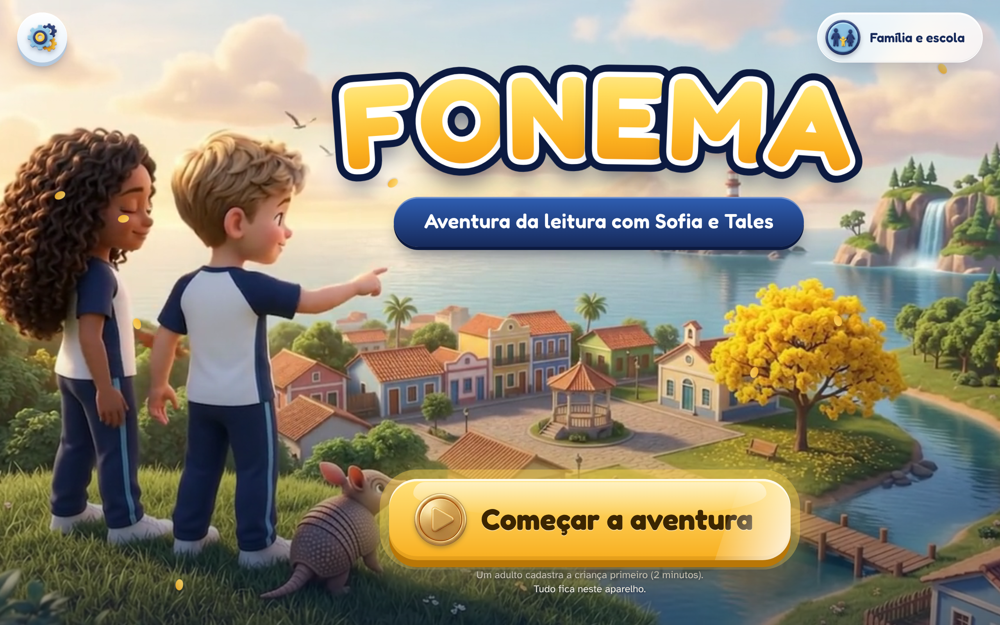
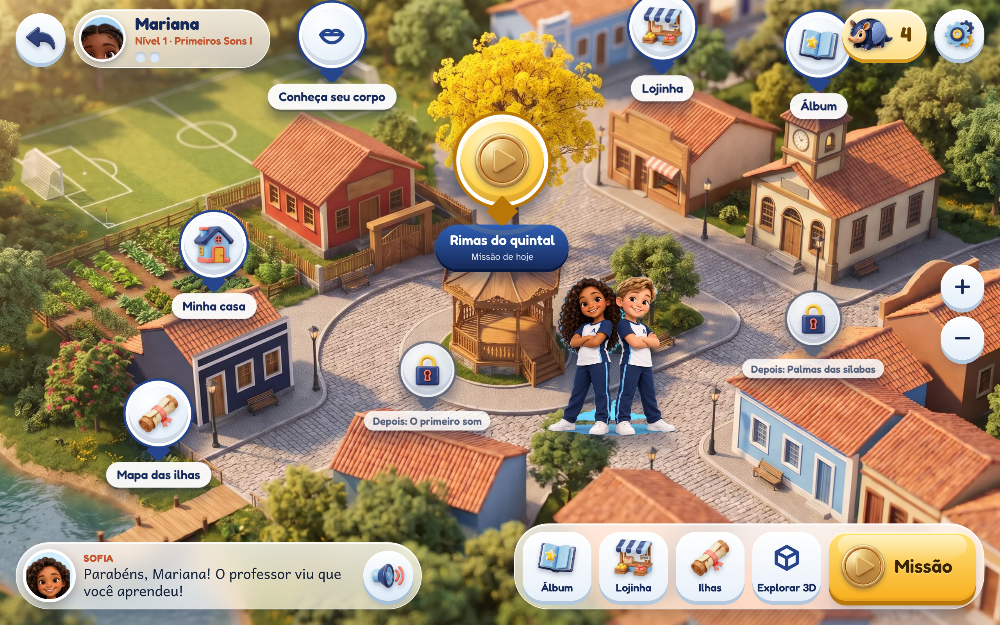
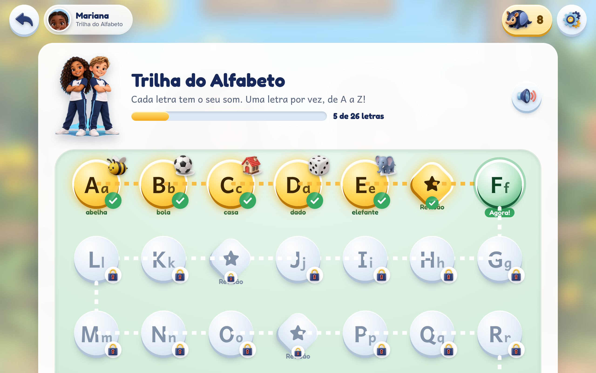
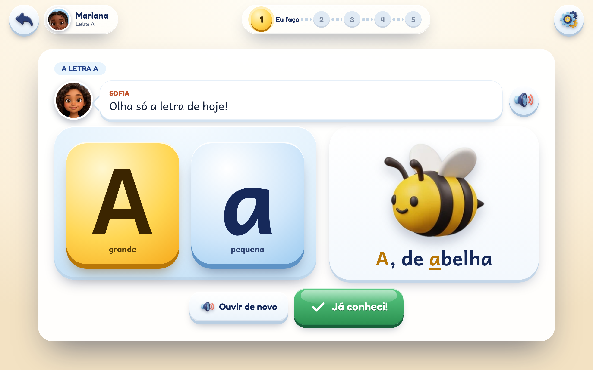

# FONEMA · app (MVP jogável R0–R2a)

Primeira implementação real da plataforma FONEMA (alfabetização pelo método fônico, pt-BR, com **Sofia e Tales**).
Escopo desta entrega: recomendação **P3** da revisão — regiões **R0 Quintal**, **R1 Ilha das Vogais** e **R2a Mata Atlântica (M-L-F)**, com o ciclo completo: cadastro pelo adulto → avatar → mapa → fase → sessão C0–C9 → conquista → lojinha → "Mostra pro professor" → painel da família.

Funciona **offline** (PWA instalável no tablet/celular), sem servidor: os dados ficam no aparelho (IndexedDB).





## D027: a jornada começa pela Trilha do Alfabeto

Decisão do dono (14/11/2026, [D027](../docs/decisoes/027-alfabeto-primeiro-personagens-vivos.md)): **primeiro o alfabeto** (cada letra e o som de cada letra, de A a Z), depois sílabas, palavras, o nome e as frases. O que mudou no app (o restante deste README descreve a versão anterior e continua valendo onde não é contradito aqui):

- **Ordem da jornada** (`packages/conteudo/src/regioes.ts`): **Alfabeto** (`AL`: 26 letras + revisão a cada 5 letras + Festa do Alfabeto) → **Sílabas** (`R1`: as duas vozes do E e do O e as 5 vogais misturadas; `R2a`: M, L, F) → **Palavras** (`R2a-F04`, chefe `R2a-F05`) → **Meu nome** (`R0-F01`) → Frases (em breve).
- **Uma missão por letra** (`fases/alfabeto.ts`, gerada dos dados de `alfabeto.ts`): a dupla apresenta a letra (maiúscula e minúscula) → o som no Espelho do Som → "ouça e toque na letra" → "qual figura começa com o som?" → traçar com o dedo → selo da letra. Missões curtas, sem pausa automática.
- **Dados fáceis de trocar** (`alfabeto.ts`): letra, som (IPA e chave do Espelho), palavra-chave, segunda palavra, dica de boca, gesto, o que vem depois e quem apresenta. Alinhado à tabela A–Z da pesquisa ([44a](../docs/pesquisa/44a-tabela-alfabeto.md)). Para trocar uma palavra: mude `palavra`, garanta a figura em `web/public/assets/figuras/` e rode o gerador de vozes.
- **Regras fônicas:** som principal de cada letra (C de casa, G de gato, R forte de rato, S de sapo, X de xícara); E e O apresentam as duas vozes (ê de elefante e é de pé; ô de ovo e ó de vovó); H não faz som sozinho; Q vem sempre com U; K, W e Y são letras de nomes (W e Y com crachá: Wesley, Yasmin). A dupla **nunca** diz o nome da letra como se fosse o som: fala "B, de bola". O **som puro das consoantes fica para a gravação da fonoaudióloga** (`somPuro.gravado` em `alfabeto.ts`; aviso em Configurações, só para o adulto).
- **Primeiras palavrinhas** (pesquisa 44 §4.3): assim que as letras vistas permitem, a missão ganha uma brincadeira de juntar as letras e ler (BABÁ depois do B, BEBÊ depois do E, CAFÉ depois do F, BALA e FILA depois do L…), sem CE, CI, GE, GI, QUE, GUE nem S ou R no meio. Liga e desliga em `config.ts` › `alfabeto.primeirasPalavrinhas` e em Configurações (padrão: ligado; o dono ainda vai confirmar).
- **Revisões** (`AL-R1`…`AL-R4`, `AL-FESTA`): aquecimento com uma brincadeira de escuta de R0 (palmas, rima, primeiro som, fala de tatu) → ache a letra → ligue a letra à figura → com qual letra começa? → palavrinhas. A Festa dá o troféu **Alfabeto Completo**, sobe o termômetro para 1 e abre o título seguinte.
- **"O som do meu nome"** vem **depois das primeiras palavras** (ordem pedida pelo dono: sílabas, palavras, o nome). Motivo: nessa hora a criança já conhece todas as letras (inclusive K, W, Y e o H mudo) e monta o próprio nome entendendo cada som; e a sequência fica igual para todas as crianças (sem pular fases, D021). Na missão da letra inicial do nome aparece o aviso "A letra do seu nome!".
- **Nível inicial (D026)** (`packages/motor/src/nivel-inicial.ts`): **Do zero** = letra A · **Já conhece as letras e os sons** = pula o Alfabeto (as 31 fases ficam abertas para revisar) e começa nas sílabas (`R2a-F01`) · **Já lê palavras** = começa no ponto de leitura mais avançado (`R2a-F04`).
- **Telas:** Trilha do Alfabeto (`#/c/:id/alfabeto`, `telas/crianca/Alfabeto.tsx`: 26 marcos, revisões e festa; as concluídas brilham), tela da letra (`mecanicas/Letra.tsx`), selos das letras no Álbum, botão "Alfabeto" na vila.
- **Vozes:** frases genéricas gravadas uma vez por voz (`FALAS_ALFABETO`) + dois clipes curtos por letra ("Letra B." e "B, de bola."); a Sofia e o Tales alternam entre as letras.
- **Capturas:** `npm run capturas` gera `docs/capturas/alfabeto-*.png` (1280×800 e 390×844). As capturas `v2-*` são anteriores à D027 (`node e2e/fluxo.e2e.mjs --capturas-v2`).





Pendências da Trilha do Alfabeto: som puro das consoantes (fonoaudióloga); figura do **jacaré** para o J (hoje "janela"; a geração de imagens estava sem cota); frase completa "o nome dela é… o som dela é…" (depende do som puro gravado); missões-duelo de letras parecidas (M×N, P×Q, B×D); medir retenção das letras depois de 1 e 4 semanas.

## Como rodar

Requisitos: Node 20+ (testado com 22) e npm. A partir desta pasta (`app/`):

```bash
npm install          # instala tudo (npm workspaces)
npm run dev          # abre em http://localhost:5173 (também na rede local, para testar no tablet)
npm run build        # build de produção em web/dist/ (site estático + PWA)
npm run preview      # serve o build em http://localhost:4173
npm test             # testes Vitest do motor e do conteúdo
npm run lint         # ESLint
npm run typecheck    # TypeScript (conteúdo, motor e web)
npm run e2e          # teste de ponta a ponta com Playwright (precisa do build antes)
npm run capturas     # o mesmo E2E salvando as capturas da Trilha do Alfabeto em docs/capturas/alfabeto-*.png
npm run assets       # (re)converte as artes de docs/ em WebP leves (Python 3 + Pillow)
npm run verificar    # lint + typecheck + testes + build
```

**Publicar:** `web/dist/` é um site estático com caminhos relativos (`base: './'`) e rotas por hash (`#/c/...`), então funciona em qualquer subcaminho (GitHub Pages, S3, Netlify, pendrive com servidor local). O service worker também usa caminhos relativos.

**Primeiro uso (D028):** a primeira página é "Quem vai entrar?" (Sou aluno(a) · Sou pai, mãe ou responsável · Sou professor(a) · Primeira vez aqui). "Primeira vez aqui" → conta do adulto (nome, tipo, PIN de 4 números; fica só neste aparelho, `web/src/servicos/conta.ts`) → cadastro da criança em 3 passos (quem vai aprender · de onde começa · tudo certo) → "Entregar para [nome]". Depois, a criança entra pelo cartão dela; a Área da Família (`#/familia`) e a Área do Professor (`#/professor`) pedem o PIN. Para testar todas as fases depressa, ligue **Configurações → Modo demonstração** (o domínio passa a valer com 1 sessão).

## O que está pronto

| Área | O que funciona |
|---|---|
| Visual (D025) | Sistema de design em `web/src/estilos.css` (tokens de cor, raio, sombra e movimento) e `web/src/componentes/ui.tsx` (Icone, Figura, Logo, Fundo, Botao3D, Cartao, BotaoSegurar, MapaNavegavel). Entrada com vídeo em loop e logotipo; mapa da vila e arquipélago pintados com pan/zoom e pinos 3D; figuras 3D nas atividades (`public/assets/figuras`, sem emoji); cenas 3D desfocadas atrás das missões (`public/assets/cenas`) |
| Nível inicial (D026) | No cadastro, "De onde [nome] começa?": Do zero (padrão) · Já conhece as letras e os sons · Já lê palavras. As fases anteriores ficam liberadas para revisar (sem contar como concluídas); o adulto muda o nível no Painel da família. Regra no motor: `packages/motor/src/nivel-inicial.ts` |
| Adulto | Portão sem cálculo (segurar 3 s); cadastro (primeiro nome, gênero 3 opções com prévia da concordância, ano, consentimentos LGPD em linguagem simples, "Não pedimos"); gravar o nome (MediaRecorder, fica no aparelho, apagado em 30 dias); 3 pronúncias na voz da Sofia e do Tales + ajuste ("Ka-u-Ã"); o que já sabe, apoios (Previsível, Foco curto, Leitura com reforço, Calmo) e rotina; vários perfis; exportar/apagar dados |
| Criança | Avatar por peças (17 bases, com óculos, aparelho e cadeira de rodas grátis; sem foto, sem joias); chegada "Oi, [NOME]!"; **mapa da vila** pintado em tela cheia (arrastar/pinça, pinos 3D, próximas fases com cadeado, HUD de jogo); **arquipélago** com as ilhas; trilha de fases por região (**sem pular fases**); entrada da fase com **Minhas Conquistas** (brilhante × apagado com cadeado e a habilidade) |
| Sessão C0–C9 | Acolhida → Jardim da Revisão (revisão espaçada) → cenas da fase → pausa ativa → ritual de fim. **Assiste e Faz** (vídeo curto da dupla com legenda → "Agora é a sua vez, [NOME]!") |
| Mecânicas | TOCAR/CAÇAR (figura pelo som inicial, rima, síntese, letra do som, ler e tocar a figura), ENSINAR o Bolota, **palmas** nas sílabas (lâmpadas, amarelinha, capoeira-esporte), **montar** com letras ou sílabas, **ditado** ("assim você escreveu / assim os adultos escrevem"), **ler/falar** com microfone opcional (o reconhecimento nunca é juiz: sempre "Eu falei!"), **traçar** a letra, **pausa ativa**. Escada de ajuda: dica → modelo → juntos; sem X vermelho, buzina, perda ou cronômetro |
| Espelho do Som | Na lição e em "Conheça seu corpo": **boca gigante de frente por visema** (boca aberta, U, O, M, F, I), com a letra surgindo no instante do som. O lado 3D entra com o novo embed (ponto de troca em `EspelhoDoSom.tsx`) |
| Recompensas | Moedinhas **fixas** em bloco no ritual (1 por atividade, 5 por domínio, 10 por região, teto 12/dia) voando ao **cofrinho-tatu**; selos 3D animados com nomes neutros (D022); surpresas de nível **depois** da conquista (P1-b); barra do **próximo objetivo de aprendizagem**; títulos com portões (Primeiros Sons → Caça às Sílabas → Exploração das Palavras) |
| Lojinha e Álbum | Itens que pode × ainda não pode ("faltam X"), meta do cofrinho, confirmação "esperar e juntar"; Álbum por região e mochila |
| Professor | "Mostra pro professor" (gravar 4 s ou "mostrei ao vivo"); fila com correção em **1 toque** (✓ Aprendeu · ↺ Treinar mais · 🎤 Me explicou certinho); a criança ouve o parabéns na vila; mapa de habilidades da turma **sem ranking** (P2-b) |
| Família | Painel com **termômetro 0–10** (cumulativo, nunca desce), nível × termômetro explicados, o que já faz, o que está aprendendo, semana, conquistas, missão de 5 min em casa e **mensagem estilo WhatsApp** de exemplo (sem envio) |
| Trilha Expressa | "Missão das Placas" (sondagem lúdica) → fases já dominadas viram prova-relâmpago; chefes e a primeira missão são sempre completos |
| Acessibilidade | Botões ≥ 64 px; áudio em todo texto (botão 🔊 em cada balão); reduzir movimento (e `prefers-reduced-motion`); alto contraste; fontes Andika (leitura), Fredoka e Atkinson |

## Arquitetura

```
app/
├── packages/conteudo   @fonema/conteudo — o CONTEÚDO como dados (TS/JSON)
│   └── src/
│       ├── fases/r0.ts, r1.ts, r2a.ts   fases e cenas (C0–C9) de cada região
│       ├── sons.ts                      fonemas: letra, dica de boca, palavras-figura
│       ├── palavras.ts                  figuras faladas e palavras decodificáveis (+ pseudopalavras)
│       ├── habilidades.ts               grafo de habilidades (ordem da jornada)
│       ├── regioes.ts                   regiões e posição no mapa
│       ├── conquistas.ts + dados/       subconjunto do catalogo.json + dica do cadeado
│       ├── lojinha.ts                   itens e surpresas de nível
│       ├── falas-gerais.ts              falas com [NOME] e {masc|fem|neutro}
│       └── config.ts                    PADRÕES DO MVP (P1-b, P2-b, P7-b, P8-b, moedinhas, domínio…)
├── packages/motor      @fonema/motor — lógica pura, testada com Vitest
│   └── src/  dominio (BKT + critério) · sequencia (sem pular) · trilha-expressa · revisao (1·2·4·8·16·32·60)
│             moedinhas · conquistas · nivel (curva e títulos) · termometro · primeiro-som (regras do nome)
│             resolver ($NOME…) · sessao (monta C0–C9) · jornada (aplica atividade e fecha a sessão) · painel
└── web                 Vite + React + TypeScript (PWA)
    ├── src/dados/repositorio.ts       INTERFACE do repositório (troca por API depois)
    ├── src/dados/repositorio-idb.ts   implementação IndexedDB (idb)
    ├── src/servicos/voz.ts            voz com ponto de troca: mp3 pré-gerado (ElevenLabs) → speechSynthesis
    ├── src/mecanicas/                 uma tela por mecânica
    ├── src/telas/{adulto,crianca}/    telas
    ├── scripts/gerar-assets.py        converte artes de docs/ para WebP (public/assets)
    ├── scripts/sincronizar-espelho.mjs copia as demos 3D de docs/ para public/ no dev/build
    └── e2e/fluxo.e2e.mjs              teste de ponta a ponta (Playwright)
```

Regra de ouro: **toda regra pedagógica está no motor** (testável, sem tela); a tela só mostra. O conteúdo é dado: nenhuma fase está "escrita no código da tela".

### Integrações com o trabalho de outros agentes
- **Espelho do Som** (`docs/.../espelho-do-som-3d`): o app mostra a boca DE FRENTE ("Boca gigante") com as bases ilustradas por visema (`web/public/assets/espelho/frente-*.webp`); o raio-X escuro antigo saiu. Ponto de troca: quando existir `espelho-do-som-3d/embed.html`, o build copia a pasta para `web/public/espelho/` e basta ligar `USAR_EMBED_NOVO` em `web/src/componentes/EspelhoDoSom.tsx` (iframe `embed.html?f=&vista=&quem=&compacto=1` + postMessage).
- **Mundo 3D v2** (`docs/.../mundo-3d-v2`): quando existir `index.html` nessa pasta, ele é copiado para `web/public/mundo3d/` e fica como modo SECUNDÁRIO "Passear 3D" (botão na doca do mapa pintado, que é o hub principal; rota `#/c/:id/mundo`, iframe com `?cena=vila&regiao=R0&fase=<fase atual>&feitas=<fases concluídas>`; o mundo avisa por `postMessage` `{tipo:'fonema:missao', detalhe:{id}}` e o app abre a fase, respeitando a regra de não pular fases). Sem `index.html` nessa pasta, a rota cai no mapa 2D da vila, que continua acessível pelo botão "Mapa 2D".
- **Vozes oficiais** (`voz/`): coloque os mp3 em `web/public/audio/falas/` e um `manifesto.json` (`{"sofia|Oi, Mariana!": "arquivo.mp3"}`); o serviço de voz usa o mp3 quando existe e cai no `speechSynthesis` quando não.

## Criar conteúdo ("criar coisas nela")

Tudo é dado em `packages/conteudo/src/`. Depois de editar, rode `npm test` (o linter de decodificabilidade e as checagens de referência avisam se algo ficou errado) e `npm run dev`.

**Adicionar palavras:** em `palavras.ts`, `FIGURAS` (palavras ouvidas, com emoji provisório no dado; a tela troca pela figura 3D de `web/public/assets/figuras/<palavra>.webp` — ver `Figura` em `componentes/ui.tsx`; para palavra nova, gere a figura com `scripts/recortar-arte.py`) ou `PALAVRAS_R2A` (palavras que a criança LÊ — só com letras já ensinadas). Pseudopalavras: `p('LUFO', 'LU-FO', '', true)`.

**Adicionar uma atividade numa fase:** em `fases/r0.ts` (ou r1, r2a), acrescente uma cena:

```ts
{
  id: 'R0-F02-C4b', tipo: 'C4', titulo: 'Rimas da praia', cenario: 'ilha', contaDominio: true,
  atividade: {
    tipo: 'escolher', estilo: 'tocar', habilidade: 'rima',
    enunciado: sofia('O que rima com BOLA, [NOME]?'),
    itens: [itemFig('o que rima com bola?', 'cola', 'lua')],
    comemora: sofia('Terminam igual!')
  }
}
```

Mecânicas disponíveis (`tipo`): `escolher` (com `estilo` tocar/cacar/ensinar/sintese/revisao), `palmas`, `montar` (`porSilaba` para tábua de sílabas), `ditado`, `falar`, `espelho`, `tracar`, `pausa`. Atalhos: `itemFig`, `itemLetra`, `itemLer`, `itemSimNao`, `itemSilaba` (em `construtores.ts`). Marcadores: `[NOME]`, `{pronto|pronta|Tudo pronto}`, `$NOME`, `$SOM_NOME` (som do nome da criança).

**Adicionar uma fase:** crie o objeto `Fase` no arquivo da região (id, objetivo, habilidades, cenas, `criterio` — `missao`, `dominio` ou `chefe` —, acolhida, gancho, emCasa, conquistas). A ordem do array é a ordem da jornada (sem pular). Para uma região nova, crie `fases/r2b.ts`, registre em `regioes.ts` (`FASES` e `REGIOES`, com a posição no mapa) e os grafemas dela em `GRAFEMAS_DA_REGIAO`.

**Adicionar um "vídeo" Assiste e Faz:** acrescente `assiste: { imagem: 'serie-palmas', roteiro: [sofia('…'), tales('Agora é a sua vez, [NOME]!')] }` a uma cena com atividade (D015: vídeo nunca sozinho). As imagens disponíveis estão em `web/public/assets/fundos/`.

**Adicionar uma música:** coloque o mp3 em `web/public/assets/audio/` (ex.: `musica-vogais.mp3`, já copiada da demo de `voz/musicas`) e use-o num roteiro `assiste` — a música deve sempre vir seguida de atividade (D024). (Um player de música dedicado está no "o que falta".)

**Conquistas:** o catálogo vem de `docs/.../conquistas/catalogo.json` (`node packages/conteudo/scripts/extrair-conquistas.mjs`). A dica do cadeado e o motivo do selo ficam em `conquistas.ts`; a regra de desbloqueio, em `packages/motor/src/conquistas.ts`.

**Itens da lojinha e surpresas:** `lojinha.ts` (imagens em `web/public/assets/itens/`).

**Padrões do MVP:** `config.ts` (e a tela Configurações, que grava por cima no aparelho).

## Roadmap técnico (rumo a `arquitetura-infra/README.md`)

1. **Backend NestJS + Postgres**: criar `RepositorioApi implements Repositorio` (mesmos métodos) e trocar em `criarRepositorio()` (`web/src/contexto.tsx`). O motor roda igual no cliente e no servidor (pacote puro); o servidor recalcula o fechamento de sessão para evitar fraude de moedinhas. Sincronização offline: fila de eventos no IndexedDB enviada quando houver rede.
2. **Contas e LGPD**: conta do adulto (e-mail/celular + senha), consentimentos versionados, exclusão a pedido, retenção de 30 dias do áudio do nome; turmas e escolas para o professor; painel da rede.
3. **Vozes**: script que gera as falas dos roteiros (já são dados) nas vozes "Sofia — FONEMA" e "Tales — FONEMA" com o nome encaixado, + sons isolados gravados por fonoaudióloga.
4. **App Expo/React Native**: reaproveita `@fonema/conteudo` e `@fonema/motor` sem mudança; as telas migram de React DOM para React Native (ou WebView do PWA na primeira versão). Next.js para o site/Academia e painéis web.
5. **Mundo 3D** (mundo-3d-v2) no padrão das artes-chave (hoje é modo secundário) e **Espelho do Som** validado por fonoaudiólogas (D020).

## O que falta para 100%

- Vozes oficiais pré-geradas (hoje: voz do navegador como simulação) e sons isolados gravados por fonoaudióloga.
- Conteúdo de R2b em diante (R2b–R10) e as cenas C7 (Hora da História, Papo com a Sofia, Criar) com histórias próprias; vídeos reais da série (hoje: animação com as artes + legenda).
- Mundo 3D explorável no padrão visual das artes-chave (hoje entra só como "Passear 3D").
- Backend, contas, sincronização entre aparelhos, turmas reais e envio real de WhatsApp.
- Teto diário/janela noturna aplicados (os dados da rotina já são coletados), modo Previsível/Calmo com variações de cena, Maternal.
- Validações externas (fonoaudióloga, linguista, advogado) listadas na revisão.
