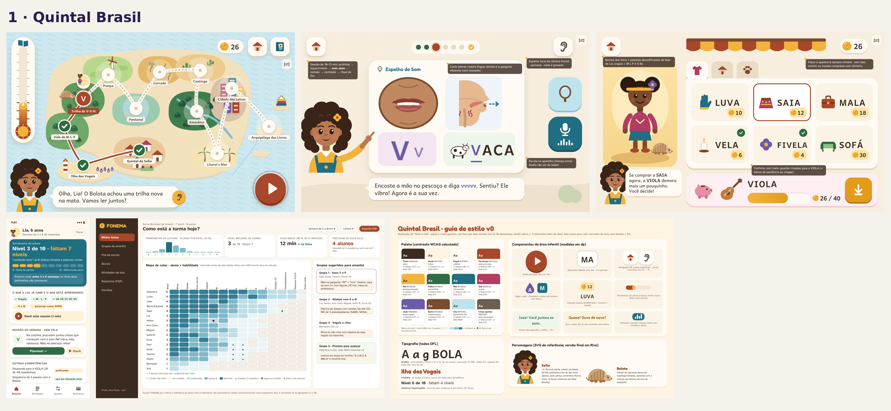
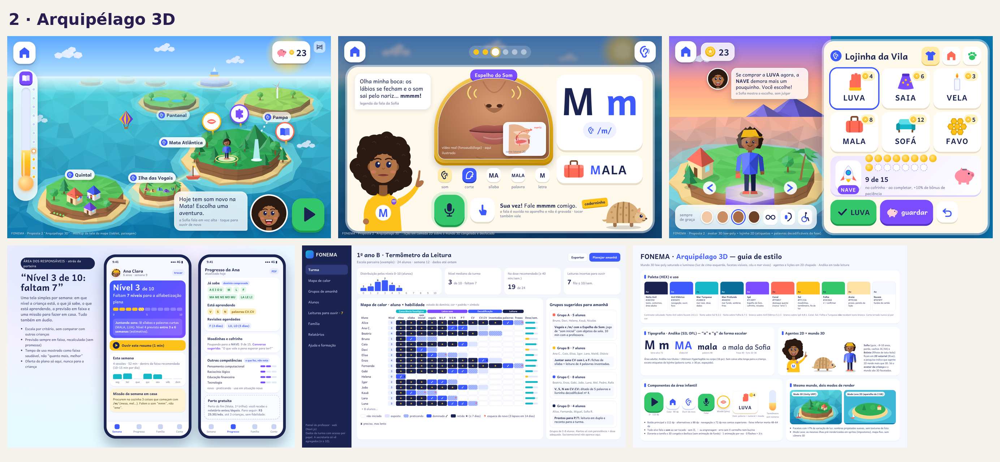
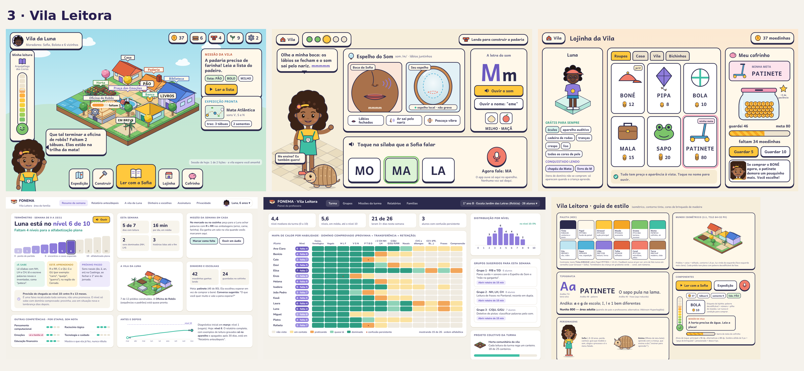
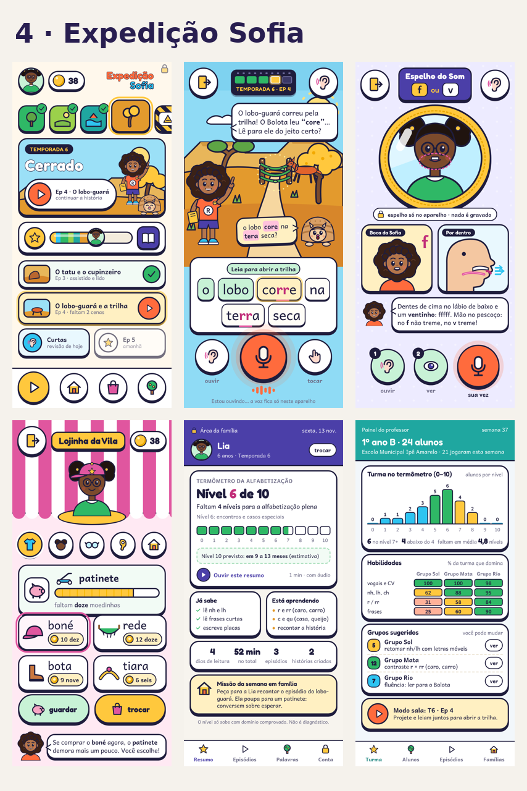
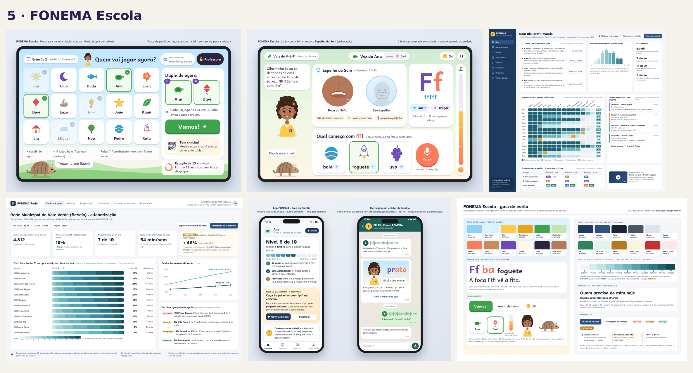

# FONEMA — 5 propostas para escolher

**Data:** 13/11/2026 · Base: 43 relatórios de pesquisa, bibliografia validada (16.847 trabalhos selecionados, 56 países), [documento mestre](../sintese/00-documento-mestre.md) e as [decisões 001–004](../decisoes/).

Todas as propostas cumprem o mesmo núcleo inegociável:
- método fônico sistemático com pseudopalavras e domínio comprovado;
- Sofia + Bolota, mais o **Espelho do Som** (nome provisório; "Boquinhas" é marca registrada);
- reconhecimento de fala **no aparelho**, que nunca pune;
- jornada de 2 anos com **11 regiões/biomas**;
- **termômetro 0–10** rumo à alfabetização plena;
- moedinhas sem dinheiro real e sem sorte, mais avatar, vila e educação financeira;
- 6 competências integradas;
- preço **sempre mensal**, com freemium por conquista e só adulto/instituição assinando;
- LGPD art. 14 e ECA Digital por padrão.

O que muda entre elas é **a forma do mundo, a tecnologia, o custo, o prazo e o público inicial**.

## Painéis visuais
| # | Proposta | Painel-resumo | Pasta completa |
|---|---|---|---|
| 1 | Quintal Brasil |  | [01-quintal-brasil](01-quintal-brasil/) |
| 2 | Arquipélago 3D |  | [02-arquipelago-3d](02-arquipelago-3d/) |
| 3 | Vila Leitora |  | [03-vila-leitora](03-vila-leitora/) |
| 4 | Expedição Sofia |  | [04-expedicao-sofia](04-expedicao-sofia/) |
| 5 | FONEMA Escola |  | [05-fonema-escola](05-fonema-escola/) |

Cada pasta tem:
- `README.md`: projeto, dia típico, jornada, MVP, cronograma, equipe, custos, preços, riscos, prós e contras;
- `arquitetura.md/.png`, `esqueleto.md`, `infra.md/.png` e `design.md`;
- `estilo.png` e as telas-modelo.

## Comparativo
*Valores são **estimativas das próprias propostas**, sem orçamento de fornecedor; servem para comparar ordens de grandeza.*

| | 1 · Quintal Brasil | 2 · Arquipélago 3D | 3 · Vila Leitora | 4 · Expedição Sofia | 5 · FONEMA Escola |
|---|---|---|---|---|---|
| **Ideia** | Mapa 2D ilustrado dos biomas, aconchegante | Mundo aberto 3D de ilhas para explorar | Jogo de construção: a vila cresce com a leitura | Série animada interativa em temporadas | Feita para sala de aula e rede pública |
| **"Uau" / engajamento** | Alto | **Máximo** | Muito alto (estratégia) | Alto (história) | Médio-alto |
| **Força pedagógica** | Muito alta | Alta (lições 2D por cima do 3D) | Muito alta (+ lógica e finanças) | Muito alta (+ oralidade e histórias) | Muito alta (+ professor no centro) |
| **Tecnologia** | Expo + Next.js (TypeScript), Supabase SP, Rive, PixiJS | Unity 6 + Next.js, Firebase/GCP SP | Flutter + Flame, AWS SP serverless | PWA Next.js + PixiJS + Capacitor, offline-first | Expo + Next.js + NestJS, PostgreSQL AWS SP, Keycloak |
| **Celular Android de 2 GB** | Bom | Só no "Modo Leve 2D" | Bom | **Ótimo** | Bom (tablets da escola) |
| **Prazo até o lançamento** | ~10 meses | ~12 meses (prova de viabilidade no 3º mês) | ~9 meses | **~6 meses** | ~7 meses até o piloto, com ensaio randomizado em 2028 |
| **Equipe no MVP** | ~11 pessoas | ~17 pessoas | ~11 pessoas | **6–7 pessoas** | ~14 pessoas |
| **Custo até o lançamento** | R$ 2,8–4,3 mi | R$ 5–7 mi | R$ 2,3–3,4 mi | **R$ 0,55–0,85 mi** | R$ 2,8–3,9 mi (+ R$ 5,5–7 mi de piloto/ensaio e conteúdo) |
| **Infra/mês, 100 mil alunos** | R$ 20–41 mil | ~R$ 66 mil | R$ 25–42 mil | **R$ 4,6–8,3 mil** | R$ 90–110 mil |
| **Preço mensal** | Família R$ 24,90–29,90 | Família R$ 29,90 | Família R$ 29,90 · Escola R$ 9,90/aluno | Família R$ 24,90 | Rede pública R$ 3,50/aluno · Escola R$ 8,90 · Família R$ 24,90 |
| **Público inicial** | Famílias + escolas-piloto | Famílias | Famílias + escolas privadas | Famílias com celular simples | Prefeituras e escolas |
| **Maior risco** | Concorrer com apps gratuitos | Custo, prazo e aparelhos fracos; a pesquisa favorece agente 2D | Meta-jogo de construção roubar foco da leitura (o piloto testa) | Menos "mundo aberto"; empacotar web nas lojas | Venda pública lenta; só fecha a conta com ~120–150 mil alunos |

## Análise final
1. **A pesquisa favorece o 2D.** Agente pedagógico 2D rende mais que 3D (rel. 23), e o público inclui muitos celulares de entrada (rels. 24 e 26). Por isso o **Arquipélago 3D** é o caminho de maior risco. Ele entrega o "efeito grandes jogos" que você descreveu, mas custa ~2× mais e atrasa ~6 meses.
2. **O que mais prende nem sempre ensina** (rel. 37). Construção e estratégia (Vila Leitora) e história (Expedição Sofia) dão profundidade e longa duração **sem** perder clareza pedagógica, desde que o domínio da leitura comande tudo.
3. **Escola e família juntas multiplicam o efeito** (rels. 01, 26 e 30: o app sozinho rende pouco). Os painéis do professor e da família precisam existir cedo em qualquer proposta.
4. **O custo de operação é viável** em todas, porque voz e fala rodam no aparelho (documento mestre §5). A única exceção de custo alto é a estrutura de rede pública da proposta 5.
5. **As propostas se combinam.** Elas compartilham o mesmo núcleo pedagógico e de dados, então dá para começar por uma e incorporar elementos das outras.

## Recomendação
**Caminho recomendado: Proposta 1 (Quintal Brasil) como base, com dois elementos das outras.**
- **A vila com construção e estratégia da Proposta 3** como meta-jogo de longa duração (já previsto nas decisões, aqui com mais profundidade);
- **as temporadas narrativas da Proposta 4** como forma de entregar conteúdo novo ao longo dos 2 anos.

O roteiro de escola da Proposta 5 entra na V1/V2, quando houver evidência do piloto para vender a prefeituras.

Por quê:
- tem a melhor relação entre evidência científica, encantamento e risco;
- é uma única linguagem (TypeScript) para app, web e painéis, o que facilita contratar e manter;
- roda bem em aparelhos simples;
- a infraestrutura é segura e com dados no Brasil.

**Se o orçamento inicial for apertado:** começar pela **Proposta 4** (≈ R$ 0,55–0,85 mi, 6 meses) para validar o aprendizado e a conversão com famílias reais e depois evoluir para o Quintal Brasil. As duas usam tecnologias web próximas.

**Se a prioridade for "uau" acima de tudo:** a Proposta 2 é possível, mas só com a prova de viabilidade em aparelho de 2 GB no 3º mês e orçamento maior.

## Decisões que ainda dependem de você
1. **Qual proposta (ou combinação) seguir.**
2. **Moedinhas:** confirmar "conta por atividade, entrega no fim da sessão, sem anunciar antes", com teste A/B no piloto.
3. **Nomes:** busca no INPI para "Sofia" e para o nome definitivo do Espelho do Som.
4. **Criar o branch `main`** no repositório para iniciar a fase de organização e infraestrutura (Decisão 004), com proteção de branch e pull requests.
