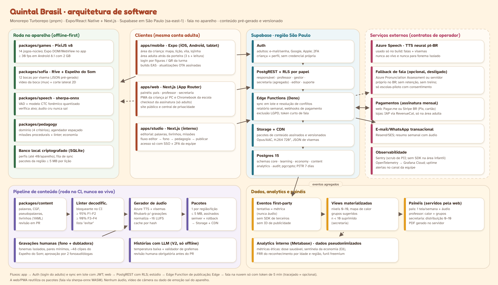

# Quintal Brasil — Arquitetura de software



Fonte do diagrama: `fontes/arq.spec.js` (gerado com `fontes/diag.js` e capturado com Playwright).

## 1. Visão geral

| Camada | Tecnologia | Responsabilidade |
|---|---|---|
| **Clientes** | `apps/mobile` (Expo SDK estável, React Native, Expo Router) · `apps/web` (Next.js App Router) · `apps/studio` (Next.js interno) | Área da criança, área adulta, painéis, editorial |
| **Pacotes compartilhados (rodam no aparelho)** | `packages/games` (PixiJS v8) · `packages/sofia` (Rive) · `packages/speech` (sherpa-onnx) · `packages/pedagogy` · `packages/content` · `packages/ui` | Jogos, personagens, fala, regras de ensino, conteúdo, design system |
| **Backend** | Supabase na região São Paulo (`sa-east-1`): Postgres 15, Auth, PostgREST com RLS, Storage, Edge Functions (Deno) | Contas, papéis, sincronização, relatórios, pagamentos, exclusão LGPD |
| **Conteúdo** | Pipeline no CI: YAML → linter → áudio (Azure TTS + gravações humanas) → pacotes assinados → Storage/CDN | Nada gerado ao vivo para a criança |
| **Dados** | Eventos first-party → views materializadas → painéis; Metabase interno pseudonimizado | Painéis de pais/professor/secretaria e métricas éticas |
| **Externos** | Azure Speech (só build; fallback opcional), Pagar.me/Stripe BR, RevenueCat, Resend/SES, Sentry, Grafana | Operadores com contrato (LGPD art. 39) |

**Regra de ouro:** a criança joga **offline**. Tudo o que a sessão precisa (jogos, áudio, vídeo do Espelho do Som, modelo de fala, motor pedagógico) já está no aparelho. A rede serve para baixar pacotes no Wi-Fi e sincronizar resultados em lote.

## 2. Clientes

### 2.1 App (`apps/mobile`)
- **Expo + React Native + TypeScript**, rotas com Expo Router: grupo `(crianca)` (mapa, lição, vila, lojinha, álbum) e grupo `(adulto)` atrás da porteira (segurar 3 s + tarefa de leitura sorteada).
- **Jogos PixiJS** rodam num componente DOM do Expo (WebView isolada) com ponte tipada de mensagens (`packages/games/bridge`): o app envia o item e recebe eventos (`tentativa`, `acerto`, `fim`). Áudio é tocado pelo lado nativo (expo-audio) para latência < 300 ms.
- **Sofia**: `rive-react-native`, máquina de estados com Data Binding (`viseme`, `estado`, `olhar`).
- **Fala**: módulo nativo Expo (`packages/speech/native`) que embute **sherpa-onnx** (VAD Silero + modelo CTC fonêmico quantizado int8, ~20–40 MB baixado depois da instalação, fora dos 40 MB iniciais).
- **Armazenamento local**: SQLite criptografado (expo-sqlite com SQLCipher) para perfis, progresso, fila de sincronização e índice de pacotes; arquivos de mídia no sistema de arquivos do app.
- **Atualizações**: EAS Build para binários; EAS Update (OTA, assinado) só para JavaScript e conteúdo leve; canais `dev`, `homolog`, `production`.
- **Modo compartilhado** (escola): até 40 perfis por tablet, entrada por QR da turma + senha de figuras.

### 2.2 Web (`apps/web`)
- **Next.js (App Router)**, React Server Components para os painéis; gráficos com ECharts (mapa de calor) e Recharts.
- Rotas: `(site)` público e central de privacidade; `(pais)`; `(escola)/professor`; `(rede)/secretaria`; `(crianca)` como **PWA** para PC/Chromebook de escola (reutiliza `games`, `sofia`, `pedagogy`; fala com sherpa-onnx em WebAssembly).
- Checkout da assinatura (só adulto) e área da conta.

### 2.3 Estúdio editorial (`apps/studio`)
- Next.js interno, SSO + 2FA da equipe. Fluxo: **editor → fonoaudióloga → pedagogia → publicar**. Cada publicação gera um PR no repositório de conteúdo; nada vai para produção sem passar no linter e no CI.

## 3. Lógica pedagógica compartilhada (`packages/pedagogy`)

Puro TypeScript, sem dependência de UI, 100% testável e igual no app e na web.

| Módulo | O que faz | Base |
|---|---|---|
| `dominio` | Regra de domínio com 4 critérios (precisão, pseudopalavra, transferência, retenção após dias). Itens com fala de baixa confiança não entram no cálculo | Documento mestre §4.5; rels. 20, 35 |
| `escala` | Calcula o nível 0–10 do Termômetro da Leitura; o nível **nunca desce visivelmente** | D004 |
| `agendador` | Revisão espaçada (Leitner + estabilidade no MVP; FSRS treinado depois) | rel. 07, F08/F70 |
| `sessao` | Monta a sessão: acolhida → aquecimento → 60–70% revisão + 1–2 itens novos → pausa → contraste → ritual | rel. 31 F-C |
| `gerador` | Missões procedurais com semente determinística, só grafemas ensinados, mistura 60/30/10, fallback curado | rel. 37 M10 |
| `economia` | Contabiliza moedas por resposta-alvo, aplica teto diário (12) e antifarming, **entrega em bloco no ritual** | documento mestre §4.9 |
| `adaptacao` | Dificuldade-alvo ~85% (janela 0,80–0,90), escada de ajuda 5/10/20 s | D001; rel. 24 |

## 4. Fala (`packages/speech`)

```
microfone → VAD (no aparelho) → recorte → modelo CTC fonêmico (no aparelho)
         → GOP + classificadores dos contrastes da lição → política de tolerância
         → {aceita | incerta | erro provável} + confiança  → motor pedagógico
         (o áudio é descartado da memória ao fim da tentativa)
```

- **Verificar, não transcrever**: cada tentativa tem alvo conhecido (palavra, sílaba, frase) e 2–4 distratores.
- **Tolerância assimétrica** e variantes regionais aceitas (róticos, /S/ de coda, palatalização etc.), matriz por idade (documento mestre §4.8).
- **Interface única** com 3 adaptadores: `native` (sherpa-onnx no app), `wasm` (sherpa-onnx na web) e `cloud` (fallback opcional, desligado por padrão: Azure Pronunciation Assessment em região Brazil South ou servidor próprio no Brasil; a Edge Function emite um **token de 5 minutos**; sem retenção, só escolas-piloto com consentimento).
- **Regressão no CI**: conjunto fixo de gravações consentidas; a release falha se a FRR por região/idade piorar.
- Se o aparelho não suportar o modelo (RAM, CPU), o app entra em **"só incentiva"** e oferece toque na palavra lida.

## 5. Conteúdo e mídia

- `packages/content` guarda palavras (grafia, transcrição, CGF, estrutura silábica, etapa mínima, campo semântico, região, marcação "evitar"), pseudopalavras, livrinhos, missões e falas da Sofia em YAML validado por **zod**.
- **Linter de decodificabilidade bloqueante** (≥ 95% nas fases 1–2; ≥ 90% nas fases 3–4).
- **Áudio**: falas e histórias geradas com **Azure TTS neural pt-BR no build**, com JSON de visemas para a boca da Sofia; fonemas isolados e pares mínimos **gravados por humano**. Tudo normalizado (−16 LUFS), em Opus/AAC mono, com cache por hash do texto e da voz (trocar de voz não quebra pacotes antigos).
- **Espelho do Som**: clipes H.264 720×720 (e 480×480 leve) com áudio embutido, legenda WebVTT, corte lateral 2D desenhado em Rive/Lottie.
- **Pacotes por região/lição** (≤ 5 MB cada), assinados (hash SHA-256 + assinatura Ed25519 verificada no app), versionados com semver e servidos por CDN.

## 6. Backend (Supabase, São Paulo)

### 6.1 Modelo de dados (esboço)

| Schema | Tabelas principais |
|---|---|
| `core` | `adultos` (= auth.users), `familias`, `criancas` (apelido, ano de nascimento, perfil sensorial; sem CPF, sem foto), `vinculos` (adulto↔criança, papel), `instituicoes`, `turmas`, `matriculas`, `consentimentos` (finalidade, versão do termo, data, revogação) |
| `learning` | `tentativas` (item, resultado, confiança da fala, tempo; **nunca áudio**), `dominios` (CGF × criança × estado), `niveis` (histórico do 0–10), `sessoes`, `revisoes_agendadas` |
| `economy` | `carteiras`, `movimentos` (append-only), `itens` (preço imutável após publicado), `compras` (desfazer em 24 h), `cofrinhos` |
| `content` | `pacotes`, `versoes`, `publicacoes` (metadados; os arquivos ficam no Storage) |
| `analytics` | `eventos` (first-party, pseudonimizados), views materializadas por turma/escola/rede |
| `audit` | `acessos` (quem leu/alterou dado de criança), `alteracoes` |

### 6.2 RLS por papel (exemplos)
- **Responsável** vê só as crianças com `vinculos.papel = 'responsavel'`.
- **Professor** vê só alunos das turmas em que está matriculado como docente, e só dados de leitura (nada do "Como estou hoje?", que nem é armazenado).
- **Gestor/secretaria** acessa **apenas views agregadas** com `n ≥ 10` (sem nome).
- **Editor** escreve só em `content`; **suporte** lê dados com mascaramento e cada acesso entra em `audit.acessos`.
- Cada política tem teste **pgTAP** no CI (um teste por papel × tabela).

### 6.3 Edge Functions
`sync` (recebe lotes do aparelho, idempotente, resolve conflitos por "último marco de domínio vence"), `relatorio-semanal`, `pagamentos-webhook` (Pagar.me/Stripe, RevenueCat), `exclusao-lgpd` (apaga em cascata e registra), `token-fala` (5 min), `publicar-pacote`, `exportar-dados` (portabilidade).

## 7. Fluxos principais

1. **Sessão offline → sincronização**: a criança joga; tentativas e moedas entram na fila local; no fim da sessão (ou quando houver rede) o app envia o lote para `sync`; o servidor recalcula agregados e devolve o estado consolidado.
2. **Download de região**: ao se aproximar do fim da região atual, o app baixa o próximo pacote no Wi-Fi e verifica a assinatura.
3. **Relatório semanal**: função agendada gera o resumo de cada criança (texto + áudio TTS pré-montado a partir de frases aprovadas), envia push/e-mail ao responsável.
4. **Assinatura**: adulto passa a porteira → escolhe plano mensal → checkout web (Pix/cartão) ou compra na loja (RevenueCat) → webhook atualiza `familias.plano` → as regiões além de R2a viram jogáveis.
5. **Publicação de conteúdo**: estúdio → PR → CI (linter, áudio, pacote) → homolog → aprovação → produção.

## 8. Decisões de arquitetura (ADRs propostos)

| ADR | Decisão | Alternativa descartada |
|---|---|---|
| 0001 | Monorepo Turborepo + pnpm + TypeScript estrito | Repositórios separados (duplicação de lógica pedagógica) |
| 0002 | Expo/React Native para o app | Flutter (perde o compartilhamento com Next.js); nativo puro (2 bases) |
| 0003 | PixiJS para jogos, em pacote compartilhado | Phaser (mais pesado), Unity (tamanho e licença) |
| 0004 | Rive para Sofia e Bolota | Spine/Live2D (custo, licença), vídeo pré-renderizado (sem reatividade) |
| 0005 | Supabase gerenciado em São Paulo | Backend próprio em Node + Postgres (mais equipe), Firebase (dados fora do BR, sem SQL/RLS) |
| 0006 | Fala no aparelho (sherpa-onnx + CTC fonêmico) | ASR em nuvem para tudo (custo e privacidade); Whisper como juiz (alucina acerto) |
| 0007 | TTS pré-gerado no build | TTS ao vivo (custo, latência, risco de conteúdo) |
| 0008 | Analytics first-party | SDKs de terceiros (vetados na área infantil pelas lojas) |
| 0009 | Pacotes de conteúdo assinados e versionados | Conteúdo em banco consultado ao vivo (não funciona offline) |
