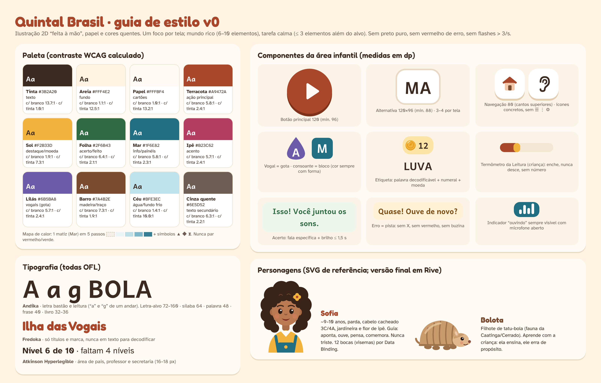
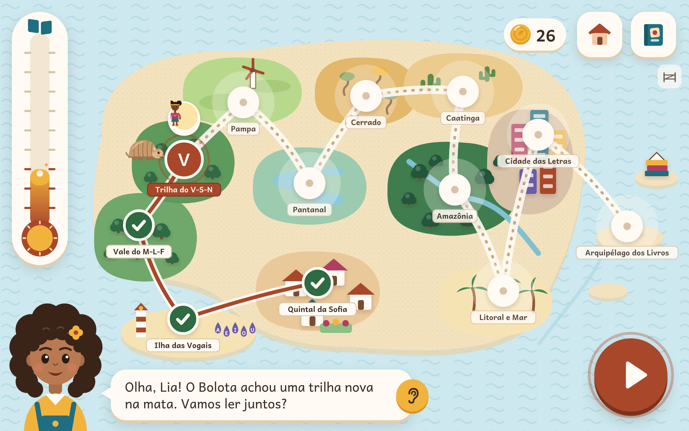
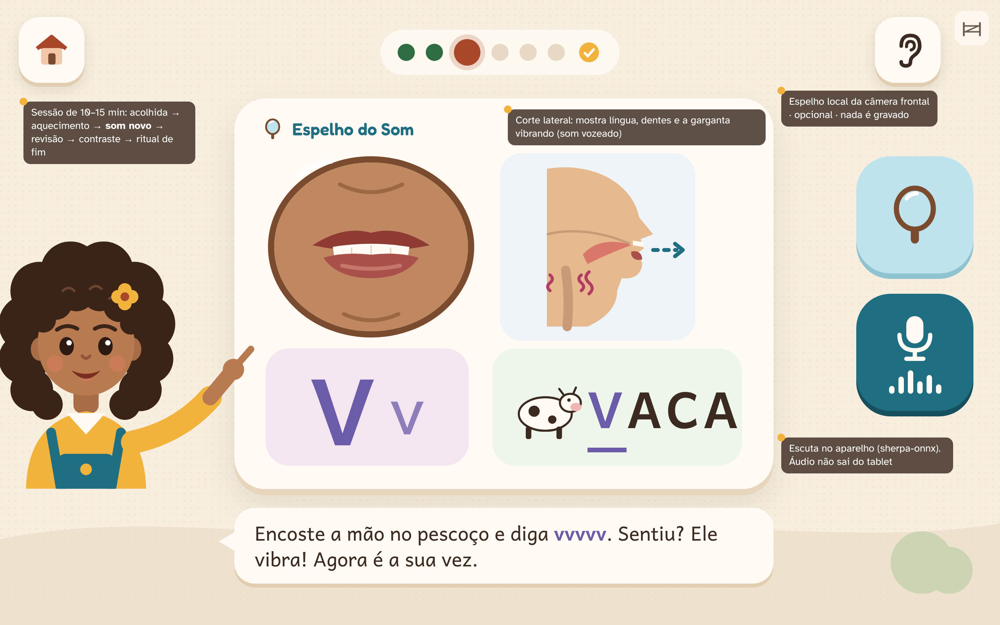
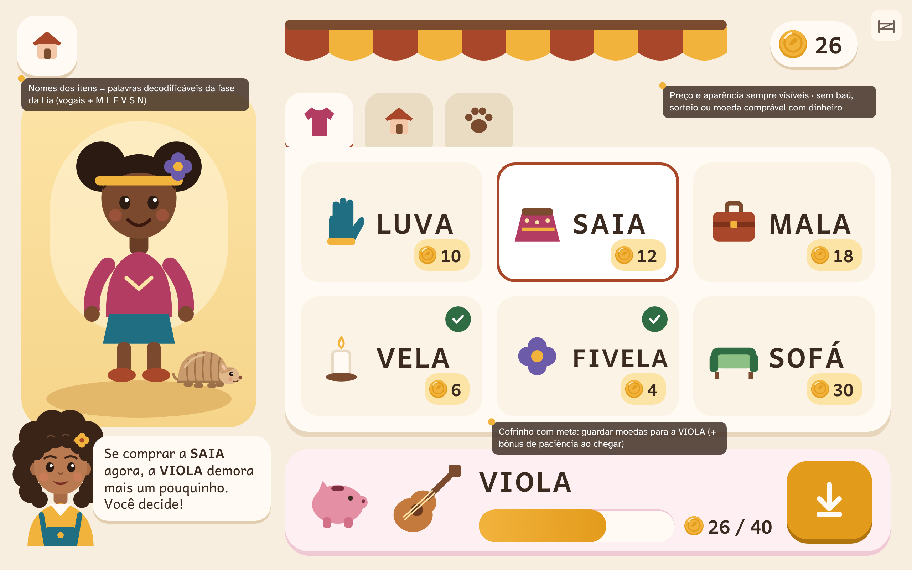
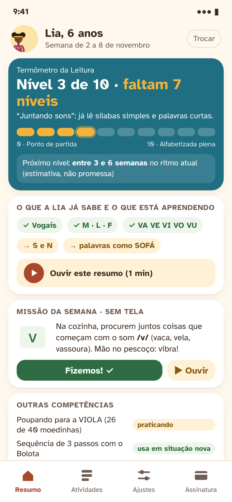
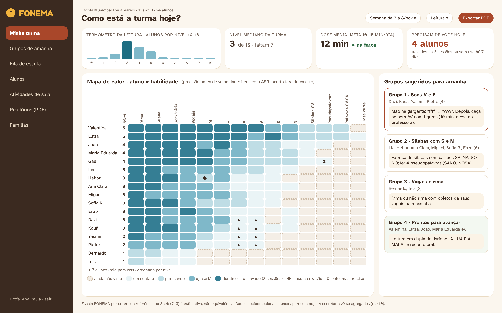

# Quintal Brasil — Design



As imagens são mockups desenhados nesta proposta em HTML/CSS/SVG próprios (fontes em `fontes/`), sem imagens externas nem marcas de terceiros. Personagens em SVG simples servem de referência; a versão final é ilustrada e animada em Rive.

## 1. Conceito visual

**"Livro ilustrado brasileiro que vira mundo."** 2D feito à mão, formas arredondadas, textura leve de papel, cores quentes da terra e do sol, sem preto puro. Calma como referência de ritmo (poucos estímulos, nada piscando, fim natural), mas linguagem **original e brasileira**: ipê, mandacaru, coqueiro, tuiuiú, chita, cordel.

**Dois níveis de densidade (rel. 28):**
- **Mundo** (mapa, vila): rico, 6–10 elementos, texturas e pequenos detalhes para explorar.
- **Tarefa** (lição, jogo): fundo dessaturado e calmo, **no máximo 3 elementos além do alvo**, um foco por tela.

**Regras globais:** nenhum flash acima de 3 por segundo; `prefers-reduced-motion` respeitado; cor sempre acompanhada de forma (vogal = gota, consoante = bloco); erro sem vermelho, sem X e sem buzina; nada se move enquanto a criança responde.

## 2. Paleta

Contrastes calculados pela fórmula WCAG 2.x (também mostrados em `estilo.png`).

| Token | HEX | Uso | Contraste |
|---|---|---|---|
| `tinta` | `#3B2A20` | texto principal (no lugar do preto) | 12,5:1 sobre Areia · 13,2:1 sobre Papel |
| `areia` | `#FFF4E2` | fundo do app | — |
| `papel` | `#FFFBF4` | cartões, balões | — |
| `terracota` | `#A9472A` | ação principal, região atual | 5,8:1 com branco · 5,3:1 sobre Areia |
| `sol` | `#F2B33D` | destaque, moedinha, termômetro | 7,3:1 com Tinta (texto escuro sobre Sol) |
| `folha` | `#2F6B43` | feito/domínio, botão "Fizemos!" | 6,4:1 com branco |
| `mar` | `#1F6E82` | painéis, informação, microfone | 5,8:1 com branco |
| `ipe` | `#B23C62` | acento, roupa do avatar | 5,7:1 com branco |
| `lilas` | `#6B5BA8` | vogais (gota), letra-alvo | 5,7:1 com branco |
| `barro` | `#7A4B2E` | madeira, traços | 7,3:1 com branco |
| `ceu` | `#BFE3EC` | água, fundos frios | 10,0:1 com Tinta |
| `cinza-quente` | `#6E5D52` | texto secundário (adulto) | 6,3:1 com branco · 5,8:1 sobre Areia |

**Pares proibidos:** texto Sol sobre Areia (1,7:1), Céu como texto, vermelho × verde para certo/errado.
**Mapa de calor do professor:** um único matiz (Mar) em 5 passos `#F4EEE6` (não visto, borda tracejada) → `#EAF4F6` → `#BFDDE5` → `#7FB8C9` → `#357E94`, com símbolos ▲ (travado), ◆ (lapso na revisão) e ⧗ (lento, mas preciso).

## 3. Tipografia (todas com licença OFL)

| Fonte | Onde | Tamanhos |
|---|---|---|
| **Andika** | todo texto que a criança lê (letra bastão; "a" e "g" de um andar) | letra-alvo 72–160 · sílaba 64 · palavra 48 · frase 40 · livro 32–36 (≤ 7 palavras/linha); modo reforço +15% e entrelinha 1,8 |
| **Fredoka** | títulos e marca, nunca em texto para decodificar | 22–38 |
| **Atkinson Hyperlegible** | área de pais, professor e secretaria | 16–18 corpo; 24–30 números-chave |

Letra bastão (caixa alta) primeiro; minúscula apresentada junto como par ("V v"). Lexend e OpenDyslexic ficam como opção no perfil sensorial, **sem promessa terapêutica**.

## 4. Componentes (área infantil)

| Componente | Especificação |
|---|---|
| Botão principal | círculo de 120 dp (mín. 96), Terracota com sombra sólida; só ícone; fala ao tocar |
| Alternativa de resposta | 120×96 dp (mín. 88), Papel com borda; 2–3 opções aos 4–5 anos, 3–4 aos 6–8 |
| Navegação | 80 dp, cantos superiores, ícones concretos (casa, álbum, ouvido); **sem ☰, ⋮ ou engrenagem** |
| Porteira | ícone discreto (cerca) de 44 dp no canto; segurar 3 s + tarefa de leitura |
| Balão da Sofia | Papel, texto Andika 24–25, botão "ouvir de novo"; instrução ≤ 6 s |
| Termômetro da Leitura | tubo vertical que **enche**, sol na base, livro no topo (Arquipélago); 10 marcas sem números; nunca desce |
| Etiqueta da lojinha | palavra decodificável da fase + numeral + moedinha |
| Cofrinho | porquinho + foto do item-meta + barra de progresso real |
| Feedback de acerto | fala específica + brilho ≤ 1,5 s |
| Feedback de erro | "Quase!" + pista, balanço leve da peça, som neutro ≤ 200 ms |
| Indicador "ouvindo" | barras animadas sempre visíveis com microfone aberto |
| Trilha da sessão | bolinhas (feito/agora/depois) no topo; termina num selo |

Alvos: nada infantil abaixo de 72 dp; espaço entre alvos 16–24 dp; faixa inferior "morta" de 48–64 dp; todo arrastar tem alternativa toque-toque.

## 5. Personagens

- **Sofia** — ~9–10 anos, parda, cabelo cacheado 3C/4A, jardineira azul-mar, blusa cor de sol, presilha de flor de ipê. Mentora: aponta, ouve, pensa, comemora (pequeno e grande), "vamos de novo"; **nunca triste**. Rive com 12 bocas ligadas a `viseme` por Data Binding; corpo, olhar e boca em camadas.
- **Bolota** — filhote de tatu-bola, casco com faixas, orelhinhas e focinho rosado. Aprendiz: a criança ensina, ele "erra de propósito" para ela corrigir.
- **Avatar da criança** — corpo, tom de pele, cabelo (cacheado, crespo, liso, tranças, puffs), óculos, aparelho auditivo, cadeira de rodas: **tudo grátis e permanente**.
- Antes de fechar: teste com crianças de 4–7 anos em 3 regiões e busca de marca no INPI (Sofia, Bolota, Espelho do Som).

## 6. Telas-modelo

### 6.1 Mapa do mundo — `tela-mapa.png` (tablet, 1280×800)

Vista aérea 2D com as 11 regiões e a trilha. Regiões feitas com check verde; região atual (Trilha do V-S-N) em Terracota com o avatar da Lia e o Bolota; regiões futuras **visíveis, sem cadeado**, com névoa leve. À esquerda, o **Termômetro da Leitura** (sem números). No topo, moedinhas, vila e álbum; a lojinha fica dentro da vila, fora da tela inicial. A Sofia convida com fala + legenda; botão "jogar" grande no canto inferior direito.

### 6.2 Lição com Sofia e Espelho do Som — `tela-licao.png` (tablet)

Som /v/: boca real (no produto, vídeo de fonoaudióloga), **corte lateral** com a garganta vibrando e o ar saindo, letra "V v" e palavra-âncora VACA com o V destacado. À direita, o espelho (câmera frontal local, opcional, sem gravação; V1) e o microfone com indicador "ouvindo". As notas escuras são anotações do mockup, não fazem parte da tela.

### 6.3 Lojinha, avatar e cofrinho — `tela-lojinha.png` (tablet)

Avatar da Lia (usando a FIVELA que comprou), prateleira com itens cujos nomes são **palavras decodificáveis da fase** (LUVA, SAIA, MALA, VELA, FIVELA, SOFÁ), preço sempre visível, cofrinho com meta (VIOLA, 26 de 40) e a Sofia mostrando o custo de oportunidade sem julgar. Sem baú, sorteio nem moeda comprável.

### 6.4 Painel dos pais — `tela-pais.png` (celular, 390×844)

"**Nível 3 de 10 · faltam 7 níveis**", descrição do nível, escala visual, previsão em faixa ("entre 3 e 6 semanas", sem promessa), o que já sabe e está aprendendo, áudio de 1 minuto, missão da semana sem tela com botão "Fizemos!", outras competências em estados ("novo / praticando / usa em situação nova") e rodapé "não é nota do Saeb".

### 6.5 Painel do professor — `tela-professor.png` (web, 1440×900)

Distribuição da turma pelos níveis 0–10, nível mediano, dose média na faixa, "precisam de você hoje"; **mapa de calor aluno × habilidade** em um matiz com símbolos; **grupos sugeridos com a atividade de amanhã**. Sem ranking, sem vermelho/verde, sem dado socioemocional.

## 7. Movimento e som

- Transições 200–400 ms ease-out; celebração ≤ 1,5 s (micro) e ≤ 2–3 s (fim de bloco); uma animação por vez.
- Prioridade sonora: voz da Sofia > fonema > efeito > música. Fala −16 LUFS; música 12–15 dB abaixo e **muda com microfone aberto**; limitador master (modo criança ≤ 75 dB(A)).
- Modos: padrão, **calmo**, alto contraste, reforço de leitura, foco curto, previsível, noturno (sem rótulo diagnóstico).

## 8. Como regenerar as imagens

```bash
cd docs/propostas/01-quintal-brasil/fontes
node shot.js tela-mapa.html 1280 800 ../tela-mapa.png        # idem para as outras telas
node diag.js arq.spec.js arquitetura.html && node shot.js arquitetura.html 1800 1030 ../arquitetura.png
```
(Playwright com Chromium, `deviceScaleFactor: 2`; fontes OFL em `fontes/fonts/`.)
