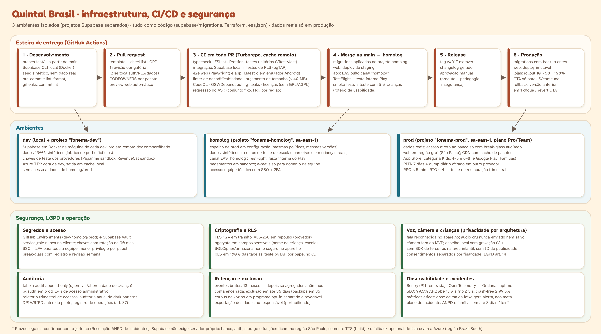

# Quintal Brasil — Infraestrutura, segurança e LGPD

Fonte do diagrama: `fontes/infra.spec.js`. Tudo aqui depende de **parecer jurídico ⚖️** antes do beta (documento mestre §4.15).

## 1. Ambientes

| | dev | homolog | prod |
|---|---|---|---|
| **Supabase** | Docker local (Supabase CLI) + projeto `fonema-dev` | projeto `fonema-homolog` (`sa-east-1`) | projeto `fonema-prod` (`sa-east-1`, plano Pro/Team, PITR) |
| **Web** | `localhost` + previews por PR | `homolog.fonema…` (staging) | domínio público, região `gru1` |
| **App** | Expo Dev Client | EAS canal `homolog`; TestFlight; faixa interna do Play | EAS canal `production`; App Store (Kids) e Google Play (Famílias) |
| **Dados** | 100% sintéticos (fábrica de perfis fictícios) | sintéticos + contas de teste de escolas parceiras; **nunca crianças reais** | reais |
| **Provedores** | sandbox (pagamentos, RevenueCat), cota de dev do Azure | sandbox; e-mails só para o domínio da equipe | produção |
| **Acesso** | todo o time | equipe técnica (SSO + 2FA) | sem acesso direto ao banco; **break-glass** auditado |

**Infraestrutura como código:** `supabase/migrations` e `config.toml` (banco, auth, storage), `infra/terraform` (Cloudflare DNS/CDN/R2, Vercel, alertas), `eas.json` e `app.config.ts` (app). Nada é configurado à mão em prod sem PR.

## 2. CI/CD

1. **Dev**: branch curta a partir da `main`; pre-commit com lint, format, gitleaks e commitlint.
2. **PR**: template com checklist LGPD/acessibilidade; preview web automático; revisão obrigatória (2 quando toca dados de criança).
3. **CI em todo PR**: typecheck, lint, unidade, integração com Supabase local, **pgTAP de RLS**, Playwright, Maestro (Android de entrada), linter de conteúdo, orçamento de tamanho/desempenho, CodeQL, OSV, gitleaks, licenças, regressão da fala.
4. **Merge na `main` → homolog** automático: migrations, deploy web de staging, build EAS `homolog`, smoke tests; teste de usabilidade com crianças quando a mudança é de tela infantil.
5. **Release**: tag `vX.Y.Z`, changelog, **aprovação manual** (produto + pedagogia + segurança).
6. **Produção**: backup lógico antes das migrations; deploy web imutável; lojas com **rollout gradual 10% → 50% → 100%**; OTA só para JavaScript/conteúdo.
7. **Rollback**: web volta à versão anterior em 1 clique; OTA revertido no canal; binário com nova versão de correção; migrations sempre **aditivas** (expandir → migrar → contrair) para permitir voltar o código sem voltar o banco.

## 3. Segurança

| Tema | Medida |
|---|---|
| **Autenticação** | Supabase Auth para adultos (e-mail/senha com política forte, Google, Apple); 2FA opcional para famílias e **obrigatório** para professores, gestores e equipe; sessão adulta expira após 2 min sem uso na área adulta do app |
| **Criança** | perfil sem credencial própria; entra por figuras/QR, sempre ligado a um adulto ou instituição |
| **Autorização** | **RLS em 100% das tabelas**, por papel (responsável, professor, gestor, secretaria, editor, suporte); views agregadas com `n ≥ 10` para a rede; testes pgTAP no CI |
| **Segredos** | GitHub Environments + Supabase Vault; `service_role` nunca no cliente; rotação a cada 90 dias; gitleaks no pre-commit e no CI |
| **Criptografia** | TLS 1.2+ em trânsito; AES-256 em repouso (provedor); `pgcrypto` em campos sensíveis (apelido da criança, escola); SQLCipher no aparelho; pacotes de conteúdo assinados (Ed25519) |
| **Dependências** | Dependabot/OSV, CodeQL, SBOM por release, bloqueio de GPL/AGPL, sem bibliotecas abandonadas |
| **Superfície** | sem SDK de terceiros na área infantil; CSP estrita na web; rate limit nas Edge Functions; WAF da CDN |
| **Pessoas** | menor privilégio, SSO + 2FA, revisão trimestral de acessos, offboarding com revogação no mesmo dia |

## 4. LGPD e ECA Digital (privacidade por arquitetura)

- **Conta do adulto, perfil da criança** com o mínimo de dados: apelido, ano de nascimento, perfil sensorial. Sem CPF, foto, endereço ou geolocalização.
- **Consentimentos separados por finalidade** (LGPD art. 14): uso do microfone, relatório à escola, sinalização de atenção, pesquisa/corpus de voz, câmera (só V1+). Cada um com versão do termo, data e revogação.
- **Voz no aparelho**: o áudio cru é processado na memória e descartado; só o resultado pedagógico (rótulo + confiança) vai ao servidor. Sem voiceprint. Corpus de voz só em programa **separado, opt-in e revogável**, com CEP/CONEP.
- **Câmera fora do MVP.** Espelho local sem gravação na V1; nenhuma inferência de emoção, nenhum reconhecimento facial.
- **Analytics first-party**, pseudonimizados; sem perfilamento publicitário (ECA Digital art. 22); sem anúncios.
- **Economia sem aleatoriedade** e sem dinheiro real (ECA Digital art. 20, por prudência além da letra da lei).
- **Oferta de assinatura só ao adulto**, atrás da porteira.
- **Auditoria**: `audit.acessos` append-only (quem leu ou alterou dado de criança), `pgaudit` em prod, relatório trimestral; **RIPD/DPIA** antes do beta; registro das operações (art. 37); encarregado (DPO) nomeado.
- **Retenção**: eventos brutos por 13 meses, depois só agregados anônimos; conta encerrada é apagada em até 30 dias (backups expiram em até 35); dados de turma arquivados ao fim do contrato com a escola conforme cláusula.
- **Direitos do titular**: painel de privacidade com exportação (portabilidade) e "apagar tudo" pelo responsável.
- **Incidentes**: runbook com comunicação à ANPD e às famílias no prazo regulamentar (a confirmar com o jurídico).
- **Transferência internacional**: banco, auth, storage e funções no Brasil; Azure usado no build (sem dado de criança) e no fallback opcional de fala em região Brazil South, sem retenção ⚖️; Sentry com remoção de PII e sem SDK na área infantil (avaliar instância hospedada no Brasil).

## 5. Observabilidade

| O quê | Como | Alerta |
|---|---|---|
| Erros e crashes | Sentry (área adulta e web; na área infantil só crash nativo sem PII, conforme política das lojas) | crash-free < 99,5% |
| Desempenho | OpenTelemetry → Grafana Cloud; métricas de abertura a frio e fps reportadas pelo app de forma agregada | abertura > 3 s no p75 do Android de referência |
| API e banco | métricas do Supabase, `pg_stat_statements`, latência das Edge Functions | p95 > 500 ms; erros 5xx > 1% |
| Disponibilidade | uptime externo (web, API, CDN) | SLO 99,5% |
| Fala | FRR/FAR por idade e região, taxa de "incerta" | FRR > 5% em qualquer região |
| **Métricas éticas** | dose por criança dentro da faixa (10–15 min/dia), sessões terminadas pelo ritual, sentinela da economia (E8) | dose acima da faixa = alerta de produto, **nunca meta** |
| Negócio | funil freemium, conversão no fim de R2a, cancelamento | painel semanal |

Logs sem dado pessoal (lista permitida de campos no `logger`).

## 6. Backups e recuperação

- **PITR de 7 dias** no Supabase prod (RPO ≤ 5 min).
- **Dump lógico diário** criptografado (age/GPG) enviado a um bucket em **outro provedor** (ex.: Cloudflare R2), retenção de 35 dias.
- **Pacotes de conteúdo** são imutáveis e versionados no Storage + cópia no bucket externo; o repositório recria qualquer pacote.
- **RTO ≤ 4 h**; teste de restauração **trimestral** em ambiente isolado, com relatório.
- Runbooks em `infra/runbooks/` (banco corrompido, chave vazada, provedor fora do ar, release com defeito).

## 7. Publicação nas lojas

**Apple — categoria Kids (faixas 5 e menos / 6–8)**
- Sem anúncios e **sem analytics/SDK de terceiros** na experiência infantil; nenhum link externo, compra ou pedido de avaliação sem **porteira de nível adulto** (aqui: segurar 3 s + tarefa de leitura sorteada; a porteira **não** substitui o consentimento parental).
- Assinatura mensal por **In-App Purchase** (via RevenueCat) quando comprada no app; explicação clara de renovação; restaurar compras.
- Rótulos de privacidade ("nutrition labels") coerentes com a arquitetura: microfone processado no aparelho, sem rastreamento.
- Texto da loja sem promessa de resultado e sem neuromitos.

**Google Play — programa Famílias**
- Cumprir a Política para Famílias; público-alvo declarado (crianças + adultos); só SDKs autocertificados para Famílias; **sem ID de publicidade**; formulário de **Segurança dos dados** coerente.
- Faixa de teste fechada no beta; rollout gradual em produção.
- Avaliar o selo "Aprovado por professores" após o lançamento.

**Checklist de release (bloqueante):** lista de SDKs revisada, porteira testada, nenhuma tela infantil com link externo, termos e política de privacidade atualizados, versão de consentimento incrementada se mudou finalidade, notas de versão, aprovação de pedagogia e segurança.
