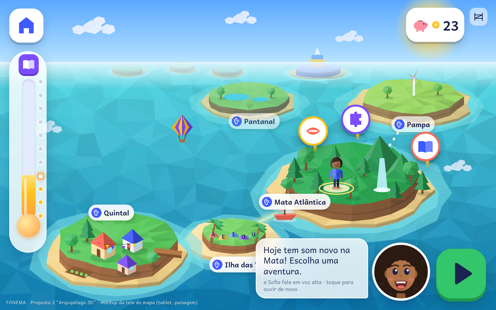

# Proposta 2 — "Arquipélago 3D"

> **Em uma frase:** o FONEMA como um jogo de mundo aberto de verdade. É um arquipélago 3D low-poly, colorido e explorável. Cada ilha é uma região/bioma da jornada de 2 anos, e a criança navega entre elas de barco ou de balão, com avatar 3D e vila 3D construível. As lições continuam em **camadas 2D limpas** por cima do mundo, para não perder a clareza pedagógica.

| | |
|---|---|
| **Aposta** | Máximo "uau" de mundo aberto ("parece jogo grande"), com o rigor pedagógico do Documento Mestre intacto |
| **Stack** | Unity 6 (iOS, Android, WebGL) para o mundo e os jogos · Next.js para o app-shell e os painéis web · Firebase/Google Cloud (Auth, Firestore, Cloud Functions, Storage + CDN) em `southamerica-east1` · TTS Azure **pré-gerado** · reconhecimento de fala **no aparelho** (Unity Sentis/ONNX) · **Modo Leve 2D** para aparelhos fracos |
| **Foco inicial** | B2C famílias (escolas privadas no 2º ano; rede pública depois, sobretudo no Modo Leve) |
| **Construção do MVP** | **12 meses**, equipe de ~17 pessoas, **R$ 5–7 milhões** (estimativa) |
| **Preço** | **R$ 29,90/mês** por família (até 3 crianças), sempre mensal, com freemium por conquista até o fim de R2a |
| **Maior risco** | Desempenho em Android de 2 GB e custo/prazo da produção 3D. A pesquisa também indica que **agente 2D rende mais que 3D** (g+ 0,38 × 0,11), e por isso **Sofia e Bolota continuam 2D** |

Arquivos desta proposta: [arquitetura.md](arquitetura.md) · [esqueleto.md](esqueleto.md) · [infra.md](infra.md) · [design.md](design.md) · imagens `tela-*.png`, `estilo.png`, `arquitetura.png`, `infra.png`.

---

## 1. Conceito

1. **O mundo é 3D e a leitura é 2D.** O arquipélago (ilhas, mar, céu, vila, avatar) é renderizado em 3D low-poly facetado, com luz quente e cores saturadas. Quando a criança entra numa atividade, **o 3D congela e desfoca** e a lição aparece numa camada 2D chapada, com a Sofia, o **Espelho do Som**, a letra e as palavras em Andika. Isso segue duas regras da pesquisa: nada de animação de fundo durante a tarefa (rels. 09, 23) e agente 2D > 3D (rel. 23: g+ 0,38 × 0,11).
2. **Ilhas = regiões do Documento Mestre (§4.2).** São 11 regiões (R0–R10), cada uma com um bloco de sons. O mapa é aberto: as ilhas futuras ficam **visíveis no horizonte, sem cadeado**. A trilha principal é **linear dentro do mundo aberto** para crianças de 4–6 anos, com no máximo 2 toques do mapa à atividade. A ilha seguinte "emerge" do mar quando a criança domina a anterior, e **domínio libera, tempo nunca**.
3. **Navegar é a recompensa.** A criança atravessa o mar de barco, que vira veleiro e depois balão conforme a jornada avança. As viagens duram no máximo 8–10 s, podem ser puladas e não têm joystick: basta tocar no destino. Revisitar ilhas antigas conta como revisão espaçada (Jardim da Revisão por ilha).
4. **A vila 3D do Bolota** cresce no Quintal (R0). A criança constrói por "plantas" lidas, decora a vila e cuida de bichinhos da fauna brasileira. Tudo vem das moedinhas ganhas aprendendo, sem dinheiro real, sem sorte e sem perda (D002).
5. **Ética como requisito de engenharia.** O app tem fim natural de sessão, não tem streak, não tem ranking, não tem loot box e não tem SDK de terceiros na área infantil. A oferta de assinatura só aparece para o adulto, atrás da porteira. A voz é processada no aparelho, e a câmera fica fora do MVP.

## 2. Um dia típico da criança

**Ana, 6 anos, terça-feira, 18h, tablet Android de entrada da família. Ela está na Mata Atlântica (R2b).**

| Tempo | O que acontece | Por trás |
|---|---|---|
| 0:00 | Ana toca no próprio avatar (login por figuras). A câmera "voa" do céu até a vila 3D no Quintal; a Sofia (2D, num balão de fala) diz: "Oi, Ana! A horta da vila cresceu." | Abertura ≤ 3 s no Modo 3D; ilha atual já em cache |
| 0:30 | **Aquecer (1–2 min):** três plantinhas "com sede" no Jardim da Revisão pedem sílabas já dominadas (MA, LU, FI). | Revisão espaçada escolhida pelo motor local |
| 2:00 | Ana toca na Mata. O barco navega por 6 s, com o fio de luz mostrando o caminho. | Cena ≤ 10 s, pulável |
| 2:10 | **Aprender (3–4 min):** a ilha congela e desfoca. A Sofia aponta para o **Espelho do Som**: vídeo real da boca no /v/, corte lateral 2D com "mão na garganta: vibra!" e a letra V aparecendo no instante do som. "Sua vez!": Ana fala /v/; a fala é verificada no aparelho e não é gravada. | Lição 2D (UI Toolkit) sobre o 3D; VAD + verificação de alvo via Sentis |
| 6:00 | **Missão escolhida entre 3 pinos (4–6 min):** Ana escolhe o quebra-cabeça. Ela programa o caminho do Bolota com cartas de comando, e cada carta tem uma palavra para ler (LUA, VELA, MALA). | Missão procedural (60% alvo / 30% revisão / 10% transferência); pensamento computacional por dentro da leitura |
| 11:00 | **Construir (1–2 min):** Ana coloca na vila a placa que leu, "VILA". O Bolota anota no caderninho o que ela ensinou. | Transferência para outro contexto |
| 12:30 | **Ritual de fim (≤ 1 min):** o sol se põe no arquipélago. As moedinhas da sessão entram **em bloco** no cofrinho, que agora tem 9 de 15 para a NAVE. A Sofia: "Você descobriu o som do V. Amanhã tem mais." O app volta à tela de descanso, sem autoplay. | Fim natural; moedas sem "pagar por acerto" (rels. 08, 37, 38) |
| Domingo | O responsável recebe: "Nível 3 de 10: faltam 7", previsão do nível 4 "entre 3 e 6 semanas" e a missão da semana em casa (com áudio). | Relatório semanal (Cloud Function) |

## 3. Jornada de 2 anos no arquipélago

O mapa é o do Documento Mestre (§4.2). Nomes e biomas finais dependem do dono e da consultoria de conteúdo.

| Ilha | Região / sons | Marco do mundo 3D | Transporte |
|---|---|---|---|
| Quintal da Sofia + Vila do Bolota | R0 — consciência fonológica | a vila nasce; primeira casa | a pé / píer |
| Ilha das Vogais | R1 — A E I O U | pedras-vogais que cantam; praia | barquinho a remo |
| Mata Atlântica (Vale do M-L-F) | R2a — M, L, F + CV | cachoeira, árvores que falam palavras | barquinho |
| **Fim da parte gratuita** | relatório antes/depois para o adulto | a criança vê uma **"ponte em obras"** até a Trilha do V-S-N, sem cadeado e sem oferta | — |
| Mata Atlântica (Trilha do V-S-N) | R2b — V, S, N + CV.CV | trilha no alto da serra | veleiro |
| Pampa | R3 — P, T → B, D | cata-ventos, dia e noite | veleiro |
| Pantanal | R4 — J, Z, X/CH, NH, LH + frases | a água sobe e desce (cheia/seca animadas) | veleiro |
| Cerrado | R5 — C/QU, G/GU, R/RR, S/SS, Ç | ipês, fogo e rebrota | balão |
| Caatinga/Sertão — **chefe do Ano 1** | R6 — nasalidade | cordel, xilogravura; festa junina sazonal | balão |
| Amazônia (abre o Ano 2) | R7 — CVC + ditongos | rios e povos da floresta | balão + canoa |
| Litoral e Mar | R8 — CCV | o Atlântico que liga África e Brasil | hidroavião de brinquedo |
| Cidade das Letras | R9 — S/Z/X, CH/X, J/G, H, -ão, -inho | oficina STEAM: a ponte da vila | hidroavião |
| Arquipélago dos Livros — **chefe final** | R10 — fluência e textos | "Livro da minha jornada"; pós-jogo | todos |

**Como fica "quase infinito" sem perder eficácia** (D001): missões paralelas procedurais por restrições, que nunca criam palavra livre; temporadas que voltam todo ano (carnaval, festa junina, Dia da Árvore); construção da vila; colecionáveis que ensinam (figurinhas que falam); desafio-chefe de fim de ilha (falhar não tira nada); modo infinito de revisão. **Toda sessão e toda missão têm fim.**

**Termômetro:** a criança vê o tubo que enche no canto do mapa, sem números. Os pais veem "Nível X de 10: faltam Y". O professor vê nível + mapa de calor. A secretaria vê só a distribuição agregada.

## 4. Diferenciais

1. **"Parece um jogo grande".** É o único produto pt-BR de fônica sistemática com um mundo 3D explorável, o que conversa com a expectativa das crianças (rel. 04) e com o pedido do dono ("como os grandes jogos").
2. **Separação clara entre jogo e lição.** O 3D emociona; a lição em 2D ensina. A camada pedagógica é idêntica à das propostas 2D e pode ser auditada igual.
3. **Vila e avatar 3D com identidade.** Representatividade grátis (tons de pele, cachos, crespo, tranças, óculos, aparelho auditivo, cadeira de rodas), com sensação de "meu mundo".
4. **Voz no aparelho desde o MVP** (Sentis/ONNX). Custo variável de fala ≈ R$ 0 e privacidade por arquitetura.
5. **Mesmo mundo em dois renders.** O Modo Leve 2D usa as mesmas ilhas pré-renderizadas, e por isso a criança com aparelho fraco não fica "fora do jogo".

## 5. MVP (12 meses)

**Entra:**
- Ilhas **R0, R1, R2a e R2b** em 3D + Modo Leve 2D, com barco e transição entre ilhas.
- Sessão estruturada com ritual de fim; Jardim da Revisão; 10 jogos-núcleo 2D (dos 14 do rel. 31).
- **Espelho do Som** para os fonemas de R0–R2 (vídeo real + corte lateral + letra; A/B antes da produção em lote).
- Sofia e Bolota 2D (Rive, se a PoC aprovar), TTS pré-gerado com visemas e fonemas gravados por humano.
- Fala no aparelho: VAD + modo "só incentiva" e verificação de alvo em beta (Documento Mestre §4.8).
- Avatar 3D com representatividade; vila 3D básica (5 construções); lojinha com etiquetas decodificáveis; cofrinho com meta.
- Termômetro (criança e pais); painel dos pais na web e no app (atrás da porteira); relatório antes/depois do freemium.
- Painel do professor **beta** (mapa de calor + grupos) para 3–5 turmas parceiras.
- Contas de adulto, perfis infantis, consentimento LGPD, porteira; assinatura mensal (IAP + web).

**Fica para depois:** R3–R10, temporadas, câmera (espelho local na V1), leitura oral completa com PCPM, painel da secretaria, B2G, multiplayer de qualquer tipo (sem chat, nunca).

## 6. Cronograma (meses a partir do início da construção, previsto para jan/2027)

| Fase | Meses | Entregas | Portão |
|---|---|---|---|
| **0. Pré-produção + PoCs** | M1–M3 | Bíblia de arte low-poly; orçamento técnico por ilha; **3 PoCs**: (a) ilha vertical em Android 2 GB, (b) fala no aparelho com Sentis, (c) Rive dentro do Unity + A/B do Espelho do Som | **Go/no-go:** ≥ 30 fps e ≤ 250 MB de RAM no Modo Leve em 2 GB; Modo 3D estável em 3 GB; latência de fala < 300 ms. Se falhar, a proposta recua para "3D só em aparelhos bons" ou migra para uma proposta 2D |
| **1. Produção do MVP** | M4–M9 | Ilhas R0–R2b, vila, avatar, lojinha, lições, web app-shell, painéis, pipeline de conteúdo e CI | Testes de usabilidade a cada 6 semanas (≥ 80% de sucesso sem ajuda) |
| **2. Beta fechado** | M10–M11 | 200–500 famílias + 3–5 turmas; telemetria por perfil de aparelho | Métricas éticas e de desempenho verdes |
| **3. Lançamento B2C** | M12 (≈ jan/2028) | Lojas Kids/Families + web; Plano Família | Checklist jurídico ⚖️ |
| **4. Ano 1 completo** | M13–M20 | R3–R6, temporadas, painel do professor completo, escolas privadas | — |
| **5. Ano 2** | M21–M30 | R7–R10, pós-jogo, Modo Leve para redes públicas | RCT (rel. 27) |

**Honestidade de prazo:** o rel. 27 previa beta no 1º semestre de 2027. Com 3D, o beta cai para o **fim de 2027**, cerca de 6 meses depois de uma proposta 2D.

## 7. Equipe (pico do MVP ≈ 17 pessoas)

| Papel | Qtde | Observação |
|---|---|---|
| Direção de produto | 1 | dono do backlog e da ética do produto |
| Coordenação pedagógica (alfabetização) + fonoaudióloga | 1 + 0,5 | aprova conteúdo, Espelho do Som e matriz de tolerância |
| Roteiro/conteúdo (palavras, textos decodificáveis, falas da Sofia) | 1 | com linter |
| Tech lead Unity | 1 | arquitetura, desempenho, revisão |
| Devs Unity (gameplay, UI Toolkit, integração) | 3 | C# |
| Tech artist / otimização mobile | 1 | **papel crítico**: orçamento de polígonos, LOD, impostores do Modo Leve |
| Artistas 3D low-poly | 2 | ilhas, vila, itens do avatar |
| Animador 2D (Rive) / ilustrador | 1 | Sofia, Bolota, corte lateral |
| UI/UX (infantil + adulto) | 1 | testes com crianças |
| Devs web/backend (Next.js, Firebase) | 2 | painéis, sync, assinaturas |
| Engenheiro de fala/ML | 1 | modelo ONNX no aparelho, corpus |
| QA + laboratório de aparelhos | 1 | Android 2/3 GB, iPad, Chromebook |
| DevOps/SRE | 0,5 | CI de builds Unity, Terraform |
| Som/música, voz, filmagem do Espelho | contratos | — |

## 8. Custos (estimativas; câmbio de referência US$ 1 = R$ 5,50, a conferir)

### 8.1 Construção
| Item | Faixa |
|---|---|
| Equipe do MVP (≈ 17 pessoas × 12 meses, custo carregado médio R$ 22–28 mil/mês) | R$ 4,5–5,7 mi |
| Terceiros: filmagem e aprovação do Espelho do Som (~48 clipes), voz, música, licenças (Unity Pro, Rive), aparelhos de teste, coleta do corpus de fala, jurídico | R$ 0,6–1,2 mi |
| **MVP (M1–M12)** | **R$ 5–7 mi** |
| Jornada completa (até R10, ~M30, equipe um pouco menor) | **R$ 11–15 mi acumulados** |

Para comparação: uma proposta 2D com a mesma pedagogia deve custar **cerca de 55–65%** disso. A diferença vem de arte 3D, tech art e QA de desempenho.

### 8.2 Custo mensal de operação (infraestrutura + ferramentas)
Premissas: 20 sessões/mês por aluno ativo, sync em lotes, ilhas baixadas uma vez (25–40 MB cada) mais atualizações ≈ 0,3–0,5 GB/aluno/mês de CDN em média, fala no aparelho e TTS pré-gerado (custo variável ≈ 0).

| Item (US$/mês) | 1 mil alunos | 10 mil | 100 mil |
|---|---|---|---|
| Firestore + Cloud Functions | 20 | 150 | 1.300 |
| Cloud Storage + CDN (bundles 3D, áudio, vídeo) | 70 | 600 | 5.500 |
| Hospedagem Next.js (Cloud Run / App Hosting) | 30 | 120 | 600 |
| Auth (só adultos; acima de 50 mil usuários ativos/mês é cobrado) | 0 | 0 | 50 |
| BigQuery + Logging + Monitoring | 30 | 150 | 900 |
| Backups (PITR + exports) | 10 | 40 | 300 |
| Azure (só regressão de TTS/qualidade, sem alunos) | 20 | 20 | 50 |
| **Variável** | **≈ 180** | **≈ 1.080** | **≈ 8.700** |
| Ferramentas fixas (≈ 10 licenças Unity Pro, runners macOS/Linux do CI, contas de loja, nuvem de testes em aparelhos) | ≈ 3.000 | ≈ 3.000 | ≈ 3.300 |
| **Total** | **≈ US$ 3,2 mil ≈ R$ 17,5 mil** | **≈ US$ 4,1 mil ≈ R$ 22,5 mil** | **≈ US$ 12 mil ≈ R$ 66 mil** |
| **Por aluno/mês** | **≈ R$ 17,50** | **≈ R$ 2,25** | **≈ R$ 0,66** |

Fora da tabela, e são o maior custo: **equipe de operação contínua** (conteúdo de temporadas, ilhas do Ano 2, suporte, QA), cerca de **R$ 250–400 mil/mês**, e as **taxas de loja/gateway** (15–30% na IAP; ~3–5% no web). O 3D pesa sobretudo no **CDN**, que é ~60% do custo variável. Por isso o pipeline de bundles e a compressão são prioridade.

## 9. Preço (sempre mensal)

| Plano | Preço | Nota |
|---|---|---|
| Gratuito por conquista | R$ 0 até concluir R0 + R1 + R2a, com relatório antes/depois completo | A criança vê "ponte em obras"; a oferta vai só ao adulto |
| **Família** | **R$ 29,90/mês**, até 3 crianças, sem fidelidade | Topo da faixa-hipótese (R$ 24,90–29,90), justificado pelo custo maior. **Mesmo preço para Modo 3D e Modo Leve**: o aparelho não pode virar desigualdade |
| Escola privada (a partir do Ano 2 da empresa) | R$ 8–10/aluno/mês | a recalcular (conversão sem âncora) |
| Rede pública (fase B2G) | R$ 3–4/aluno/mês, Modo Leve por padrão em tablets escolares | a recalcular; ⚖️ contratação "por aluno/mês" |

**Ponto de equilíbrio aproximado:** com receita líquida de ~R$ 22 por família (depois de loja e impostos) e operação de R$ 300–420 mil/mês, são necessárias **~14–19 mil famílias pagantes**.

## 10. Riscos e mitigação

| # | Risco | Prob. / impacto | Mitigação |
|---|---|---|---|
| 1 | **Android de 2 GB** (rel. 24: aparelho mínimo 2 GB, RAM ≤ 250 MB, instalação ≤ 40 MB): Unity 3D não cabe com folga | **Alta / alto** | Perfil de aparelho no 1º uso: **≥ 4 GB = 3D completo; 3 GB = 3D reduzido** (sem sombras em tempo real, LOD1, 30 fps); **≤ 2 GB, WebGL em celular ou "economia de bateria" = Modo Leve 2D**. Portão de PoC no M3. **Desvio assumido:** a instalação base fica em **~55–70 MB** (meta do rel. 24: 40 MB), com ilhas baixadas sob demanda (Play Asset Delivery / On-Demand Resources) |
| 2 | **Agente 3D rende menos** (rel. 23) e "o que engaja nem sempre ensina" (rel. 37, Lomas et al.) | Média / alto | Sofia, Bolota e lições **sempre 2D**; o 3D congela durante a tarefa. **A/B no beta:** mapa 3D × Modo Leve, medindo aprendizagem e não só tempo de tela. Se o 3D não ajudar a aprender, ele vira opcional |
| 3 | Custo e prazo da arte 3D; equipe Unity escassa em edtech | Alta / médio | Estilo low-poly sem texturas (rápido de produzir); kit modular de ilhas; orçamento fixo por ilha; tech art desde o M1 |
| 4 | **Unity WebGL no celular** é pesado e instável | Alta / médio | WebGL só em desktop/Chromebook; navegador de celular cai no Modo Leve (web) ou na sugestão do app |
| 5 | Dependência de fornecedor (licença, termos e preço da Unity; histórico do "Runtime Fee", cancelado em 2024) | Média / médio | Lógica pedagógica e currículo em dados (JSON) fora do motor; motor pedagógico em C# isolado e testável; contratos de dados compartilhados com a web |
| 6 | Rive no Unity menos maduro que na web | Média / médio | PoC no M1–M3; plano B: Spine (licença paga) ou sprites com visemas |
| 7 | Bateria e aquecimento em sessões de 15 min | Média / baixo | Limite de 30 fps fora de cenas, render on-demand no mapa, Modo Leve automático com bateria < 20% |
| 8 | Lojas Kids/Families: SDKs da Unity coletando dados | Média / alto | Unity Analytics, Ads e Cloud Diagnostics **desligados**; auditoria de rede no CI; nada de IDFA/AAID |
| 9 | Navegação 3D confunde crianças de 4 anos | Média / médio | Sem câmera livre nem joystick; só toque no destino; 3–5 destinos por tela; modo TEA com ordem fixa |
| 10 | ASR infantil pt-BR fraco | Alta / médio | ASR nunca é portão; tolerância assimétrica; caminho por toque equivalente; corpus próprio |
| 11 | Desigualdade de experiência entre 3D e Modo Leve | Média / médio | Mesmo conteúdo, mesmo preço, mesmo progresso; o Modo Leve é bonito por si (impostores do mesmo mundo) |

## 11. Prós e contras

**Prós**
- Maior encanto e diferenciação de mercado; material de marketing forte (trailers, lojas).
- Mundo aberto "de verdade" para a jornada de 2 anos: ilhas, viagens, vila 3D, temporadas.
- Unity dá ferramentas maduras para mundo, partículas, câmera, Addressables e builds multiplataforma.
- Voz no aparelho com Sentis/ONNX dentro do próprio motor.
- Firebase acelera auth, sync, regras por papel e funções, com região em São Paulo.

**Contras**
- **Mais caro e mais lento** (≈ +60–80% na construção e ~6 meses a mais até o beta).
- Instalação maior que a meta de 40 MB; risco real em aparelhos de 2 GB, que são justamente os da criança que mais precisa.
- Duas tecnologias de front (Unity + Next.js) e dois mundos de talento (C# e TypeScript).
- WebGL limitado no celular; web infantil fica menor que o app.
- O ganho de aprendizagem do 3D **não tem evidência**: ele é uma aposta de engajamento e precisa provar que não atrapalha.

## 12. Quando escolher esta proposta

Escolha o "Arquipélago 3D" se:
- o **diferencial "parece jogo grande"** for central para a marca e para a aquisição B2C;
- houver **orçamento de R$ 5–7 mi para o MVP** e tolerância a um beta no fim de 2027;
- o público inicial for de **famílias com aparelhos medianos ou bons** (o Modo Leve cobre o resto, mas não é a vitrine);
- o dono aceitar **portões de PoC no 3º mês**, com recuo se o desempenho em 2 GB falhar.

**Não escolha** se a prioridade for chegar rápido à rede pública com tablets e celulares fracos, se o orçamento for menor que ~R$ 4 mi ou se a equipe-núcleo vier de web/TypeScript. Nesses casos, uma proposta 2D é mais segura.
