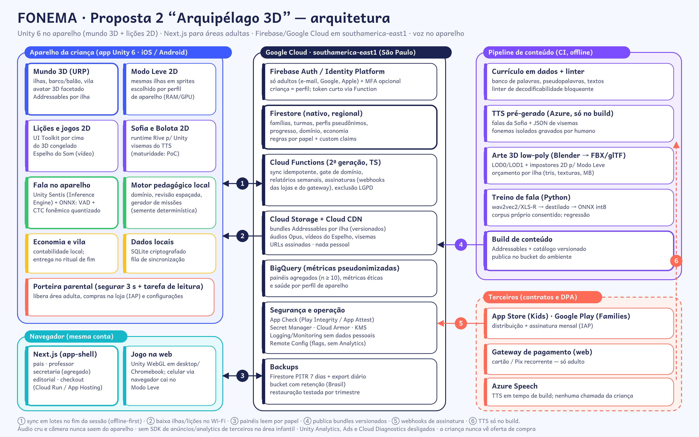

# Arquitetura — Proposta 2 "Arquipélago 3D"



## 1. Visão geral

| Camada | Tecnologia | Responsabilidade |
|---|---|---|
| App infantil (iOS/Android) | **Unity 6 LTS**, C#, URP, IL2CPP (arm64) | mundo 3D, Modo Leve 2D, lições e jogos 2D, Sofia/Bolota, fala no aparelho, motor pedagógico local, economia, vila, dados locais |
| Jogo na web | Unity 6 **WebGL**, embutido no app-shell Next.js | desktop e Chromebook; o celular cai no Modo Leve |
| App-shell e áreas adultas | **Next.js** (App Router, TypeScript) em Cloud Run / Firebase App Hosting | cadastro do adulto, consentimento, checkout, painel dos pais, painel do professor, painel da secretaria (agregado), editorial |
| Backend | **Firebase/Google Cloud, `southamerica-east1`**: Auth/Identity Platform, Firestore, Cloud Functions (2ª geração, TypeScript), Cloud Storage + Cloud CDN, BigQuery, Secret Manager, App Check | identidade, dados, regras por papel, sync, relatórios, assinaturas, distribuição de conteúdo |
| Pipeline de conteúdo | Python + Node + Unity em lote (CI) | currículo em dados, linter de decodificabilidade, TTS Azure pré-gerado + visemas, bundles Addressables, treino e export do modelo de fala (ONNX) |

**Princípio central:** *o 3D é casca; a pedagogia é dado.* Currículo, regras de domínio, gerador de missões, economia e termômetro ficam em **módulos C# puros** (sem `MonoBehaviour`) e em **JSON versionado**, compartilhados por contrato com a web. Assim, trocar o render (3D ↔ Modo Leve) ou até o motor no futuro não mexe na pedagogia.

## 2. App Unity — módulos

```
Fonema.Core        tipos, contratos gerados do JSON Schema, relógio, IDs, logs sem dados pessoais
Fonema.Pedagogia   motor de domínio (gate com 4 critérios), revisão espaçada, Elo por habilidade,
                   gerador de missões por restrições (semente determinística + fallback curado)
Fonema.Conteudo    leitura do "language pack" (etapas 0–10, grafemas, palavras, pseudopalavras, textos)
Fonema.Fala        VAD + verificação de alvo (Sentis/ONNX), política de tolerância assimétrica
Fonema.Sofia       roteiro de falas, fila de áudio, visemas → Rive (2D)
Fonema.Licoes      telas e jogos 2D (UI Toolkit), Espelho do Som (VideoPlayer + corte lateral + letra)
Fonema.Mundo       ilhas, navegação por toque, barco/balão, câmera guiada, fio de luz (URP)
Fonema.ModoLeve    mapa 2D com impostores pré-renderizados das mesmas ilhas
Fonema.Avatar      montagem do avatar 3D (peças modulares), representatividade grátis
Fonema.Vila        construção por "plantas" lidas, projetos coletivos
Fonema.Economia    livro-razão local de moedinhas, lojinha, cofrinho (10% de bônus de paciência), desfazer em 24 h
Fonema.Termometro  níveis 0–10 (critério), visão da criança (sem números)
Fonema.Dados       SQLite criptografado, fila de eventos, sync idempotente
Fonema.Porteira    segurar 3 s + tarefa de leitura; abre área adulta e compra (IAP)
```

### 2.1 Perfis de aparelho (decisão automática, ajustável pelo adulto)

| Perfil | Critério (no 1º uso + benchmark de 5 s) | Render | Orçamento |
|---|---|---|---|
| **A** | RAM ≥ 4 GB e GPU média/alta; iPad/iPhone recentes | 3D completo, sombras suaves, 60 fps | ≤ 450 MB RAM; ≤ 120k triângulos por cena |
| **B** | RAM 3 GB | 3D reduzido: LOD1, sem sombra em tempo real, 30 fps, resolução 0,8× | ≤ 320 MB; ≤ 60k triângulos |
| **C / Modo Leve** | RAM ≤ 2 GB, Android < 9, WebGL em celular, bateria < 20% ou escolha do adulto | **2D**: mapa com sprites pré-renderizados das mesmas ilhas, sem câmera 3D | **≤ 250 MB** (meta do rel. 24), ≥ 30 fps |

As lições 2D são **as mesmas** nos três perfis. A telemetria de desempenho por perfil (fps, RAM, abertura a frio, falhas) é anônima e alimenta o ajuste dos critérios.

### 2.2 Tamanho e download
- Base da instalação: runtime Unity IL2CPP + núcleo + Sofia + Quintal (R0) em Modo Leve. **Estimativa: 55–70 MB**, acima da meta de 40 MB do rel. 24 (desvio assumido; a medir na PoC).
- Cada ilha é um **grupo Addressables** (3D 20–35 MB + versão Leve 5–8 MB), baixado no Wi-Fi via Play Asset Delivery / On-Demand Resources ou pelo CDN próprio. Pacote de lição ≤ 5 MB (Espelho do Som em H.264 480×480 na versão leve).
- O catálogo de conteúdo é versionado. Atualizar conteúdo não exige nova versão de loja (só conteúdo, nunca código).

### 2.3 Fala no aparelho
- **Unity Sentis** (renomeado "Inference Engine" nas versões recentes do Unity 6; conferir nome e licença na adoção) executa modelos **ONNX**.
- Cadeia: microfone 16 kHz mono → **VAD** pequeno → **modelo acústico CTC fonêmico** destilado e quantizado (int8, meta ≤ 25 MB) → GOP/classificadores do contraste da lição → faixa {aceita / incerta / erro provável}.
- **Verificar, não transcrever**: o alvo e os 2–4 distratores são sempre conhecidos. O áudio fica em memória e é descartado; só o rótulo e as métricas vão para o sync.
- No Perfil C, se a inferência passar de 300 ms, o app usa só o VAD + modo "só incentiva" e o caminho por toque (o ASR nunca é portão).

### 2.4 Lição 2D por cima do 3D
- Ao abrir uma atividade, a câmera congela, um *render texture* do frame recebe blur e escurecimento, e as câmeras 3D são **desligadas** (economia de GPU/bateria). A lição roda em **UI Toolkit**.
- O Espelho do Som usa `VideoPlayer` (clipe por fonema, áudio embutido, sincronia −10/+30 ms), o corte lateral 2D em Rive/sprite e a letra animada no instante do som.

## 3. Dados (Firestore) e papéis

```
familias/{familiaId}                     responsáveis (uids), plano, consentimentos (versão + data)
familias/{familiaId}/criancas/{cId}      apelido, ano de nascimento (não a data), avatar, preferências, perfil de inclusão
progresso/{cId}                          nível 0–10 oficial, região atual, resumo semanal
progresso/{cId}/habilidades/{hId}        estado (5 estados), evidências T1–T6, próxima revisão
progresso/{cId}/eventos/{eventoId}       eventos de sessão append-only (id idempotente; TTL 180 dias)
economia/{cId}                           saldo, cofrinho (meta, valor), compras (com desfazer 24 h), vila
escolas/{eId}/turmas/{tId}               professor(es), lista de vínculos pseudônimos (cId)
agregados/{redeId}/...                   distribuição por nível, sem nomes, n ≥ 10
```

- **Papéis** por *custom claims*: `responsavel`, `professor`, `gestor_escola`, `secretaria`, `editorial`, `suporte`. As regras do Firestore negam por padrão; o professor lê só os alunos das suas turmas; a secretaria lê só `agregados`.
- **Criança não tem conta Firebase com e-mail.** O adulto autentica; a Cloud Function emite **token curto** para o perfil infantil no aparelho (com App Check).
- **O nível oficial é calculado no servidor** a partir dos eventos (fonte única para pais e professor). O motor local decide a próxima atividade offline, e o servidor confirma o domínio (provinha + transferência + retenção ≥ 7 dias).
- O conteúdo (palavras, áudio, vídeo, ilhas) **não fica no Firestore**: fica em bundles versionados no Storage/CDN.

## 4. Fluxos principais

1. **Sessão offline-first:** tudo roda local; ao fim da sessão, a fila de eventos é enviada em lote (`sync`). Conflitos entre aparelhos são resolvidos por eventos (CRDT simples de contadores + "maior estado de domínio").
2. **Relatório semanal:** uma Function agendada (domingo 8h, horário de Brasília) gera o resumo dos pais (texto + áudio TTS pré-montado por blocos) e os grupos sugeridos do professor.
3. **Assinatura:** IAP (App Store/Google Play) ou gateway web (cartão/Pix recorrente) → webhook → Function → `familias.plano`. O app só consulta o direito de acesso; **a criança nunca vê oferta**.
4. **Exclusão LGPD:** pedido do responsável → Function apaga perfil, progresso, eventos e economia em até 30 dias e registra a prova da exclusão.

## 5. Por que esta stack (e o que ela troca do rel. 03)

O rel. 03 recomendava Expo + Next.js + PixiJS + Supabase. Esta proposta troca deliberadamente:
- **PixiJS → Unity 6**, porque o pedido é mundo 3D explorável com builds nativos. Custo: binário maior e dois ecossistemas (C# + TS).
- **Supabase → Firebase**, por integração madura com Unity (SDK oficial), App Check, região em São Paulo e Functions. Custo: o Firestore não é SQL; relatórios analíticos vão para o BigQuery. As regras por papel substituem o RLS.
- **Mantido:** Next.js na web, TTS pré-gerado, fala no aparelho, Andika, ausência de SDK de terceiros, monorepo.
