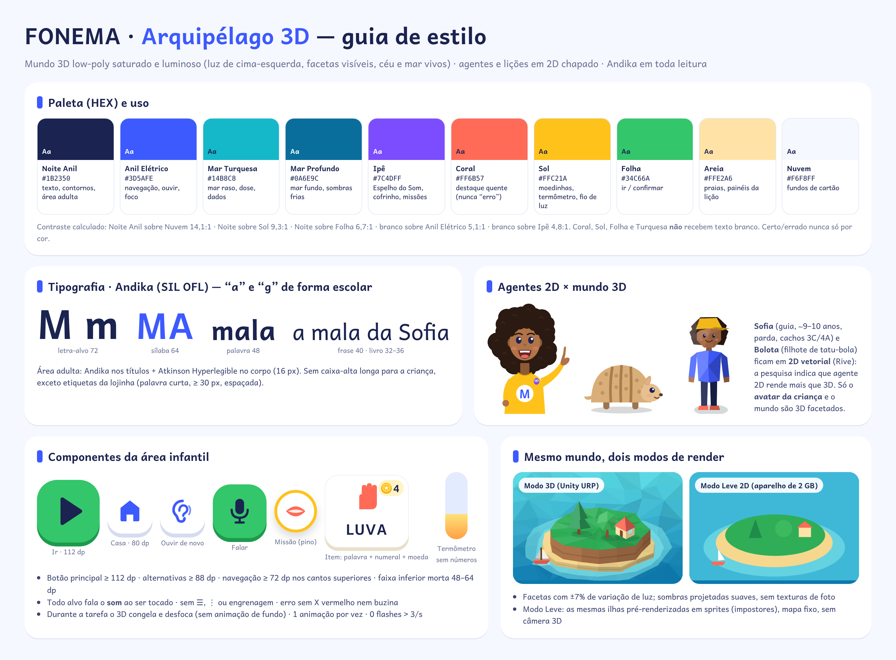
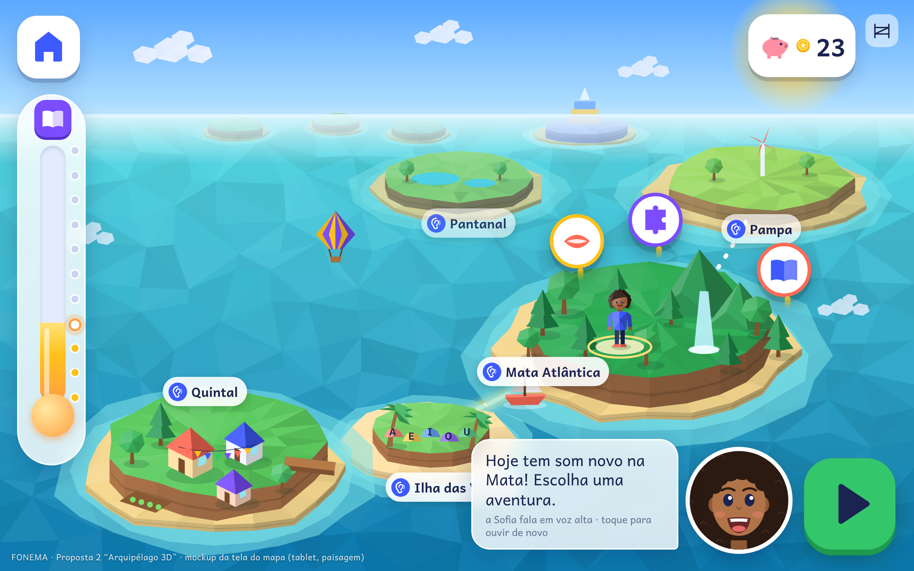
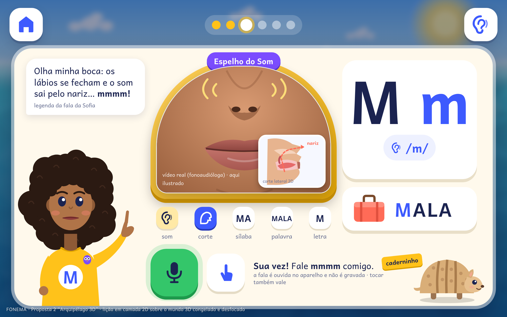
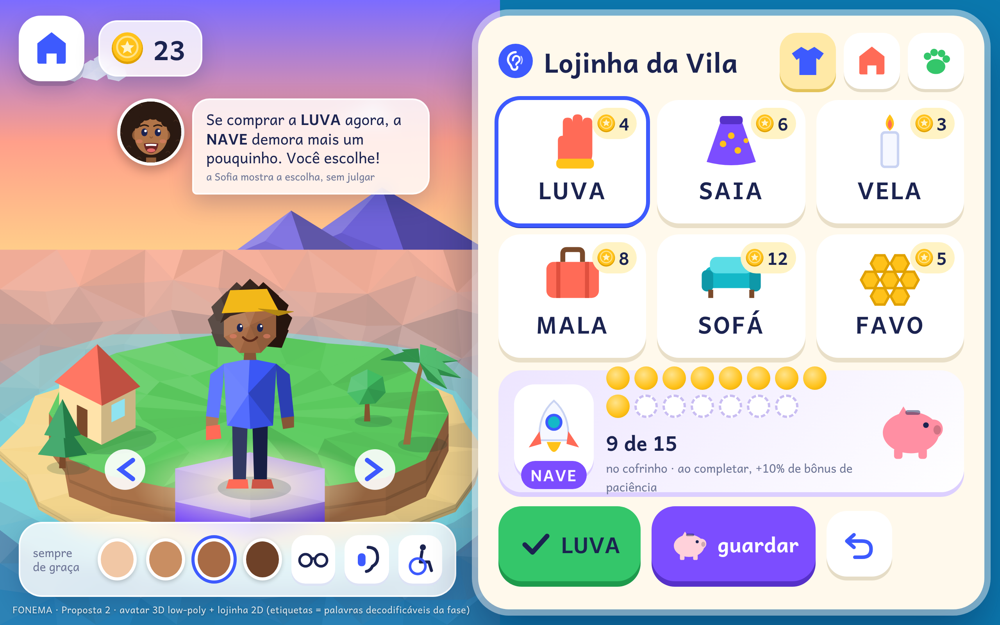
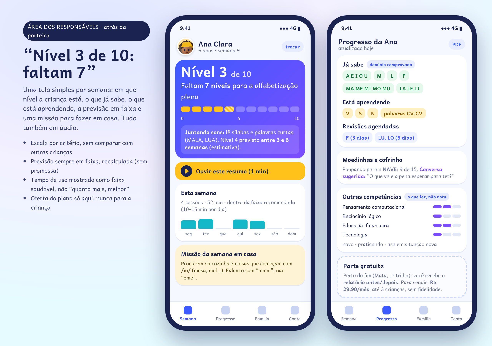
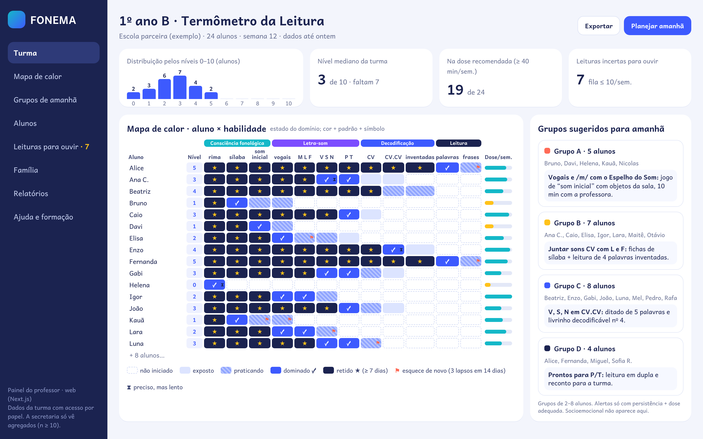

# Design — Proposta 2 "Arquipélago 3D"

## 1. Direção de arte

**"Brinquedo de mundo aberto, luminoso e facetado."** O mundo é 3D **low-poly**: polígonos visíveis, cores sólidas por faceta, luz quente vinda de cima-esquerda, céu e mar saturados e nenhuma textura de foto. A diferença para uma proposta 2D aconchegante (aquarela, papel, tons terrosos) é deliberada: aqui o mundo tem **profundidade, horizonte, câmera e viagem**.

Regras que mantêm a pedagogia limpa:
- **Agentes e lições em 2D chapado.** Sofia e Bolota são vetoriais (Rive). As telas de lição são 2D sobre o 3D congelado e desfocado (rel. 23: 2D > 3D; rel. 09: sem animação de fundo durante a tarefa).
- **Só o avatar da criança e o mundo são 3D.** O avatar é discreto nas lições.
- 1 animação por vez; celebração ≤ 1,5 s (micro) e ≤ 2–3 s (bloco); 0 flashes acima de 3/s; `reduzir movimento` desliga a câmera voando e as transições.

## 2. Paleta

| Nome | HEX | Uso |
|---|---|---|
| Noite Anil | `#1B2350` | texto, contornos, área adulta |
| Anil Elétrico | `#3D5AFE` | navegação, "ouvir", foco (texto branco 5,1:1) |
| Mar Turquesa | `#14B8C8` | mar raso, dados de dose |
| Mar Profundo | `#0A6E9C` | mar fundo, sombras frias |
| Ipê | `#7C4DFF` | Espelho do Som, cofrinho, missões de lógica (texto branco 4,8:1) |
| Coral | `#FF6B57` | destaque quente; **nunca** significa "erro" |
| Sol | `#FFC21A` | moedinhas, termômetro, fio de luz |
| Folha | `#34C66A` | ir / confirmar (ícone escuro, 6,7:1) |
| Areia | `#FFE2A6` | praias, painéis de lição |
| Nuvem | `#F6F8FF` | fundos de cartão |

Os contrastes foram calculados (WCAG): texto ≥ 4,5:1, ícones ≥ 3:1. Certo/errado nunca é comunicado só por cor.

## 3. Tipografia

- **Andika** (SIL OFL) em toda leitura infantil: letra-alvo 72, sílaba 64, palavra 48, frase 40, livro 32–36 (≤ 7 palavras por linha).
- Área adulta: Andika nos títulos + Atkinson Hyperlegible no corpo (16 px).

## 4. Componentes da área infantil

- Botão principal ≥ 112 dp (Ir, Falar); alternativas ≥ 88 dp; navegação ≥ 72 dp nos cantos superiores (Casa à esquerda; "ouvir de novo" à direita); faixa inferior morta de 48–64 dp.
- **Pinos de missão** flutuando sobre a ilha (2–3 por vez, com ícone concreto: boca = sons, quebra-cabeça = lógica, livro = história).
- **Termômetro da criança:** tubo vertical que enche, com marcos (bolinhas) e a meta (livro) no topo, **sem números**.
- **Etiqueta de item:** palavra decodificável + numeral + moeda; preço imutável depois de publicado.
- **Porteira:** ícone discreto no canto superior direito (segurar 3 s + tarefa de leitura).
- Sem ☰, ⋮ ou engrenagem; todo alvo fala o **som** ao ser tocado; erro sem X vermelho e sem buzina.

## 5. Regras do 3D

- **Câmera guiada**, sem câmera livre, pinça ou joystick: toque na ilha → viagem automática ≤ 8–10 s, pulável.
- Ilhas como "dioramas" com halo de água rasa; ilhas futuras **visíveis e sem cadeado** no horizonte (névoa suave).
- Orçamento: Perfil A ≤ 120k triângulos por cena; Perfil B ≤ 60k; 1 luz direcional; sombras *baked* + sombra de contato falsa.
- **Modo Leve:** as mesmas ilhas pré-renderizadas como sprites (impostores), com o mesmo enquadramento do mapa.

## 6. Telas-modelo

### 6.1 Mapa do arquipélago — `tela-mapa.png`

Quintal com a vila, Ilha das Vogais concluída, Mata Atlântica atual (avatar, cachoeira, 3 pinos de missão), Pampa e Pantanal visíveis sem cadeado, Arquipélago dos Livros no horizonte. **Fio de luz** dourado no caminho percorrido e pontilhado no próximo. À esquerda, o termômetro que enche (sem números); acima à direita, o cofrinho e a porteira discreta; embaixo, a Sofia 2D convidando e o botão "Ir". Rótulos das ilhas têm ícone de ouvido (tocar = ouvir o nome).

### 6.2 Lição com Sofia e Espelho do Som — `tela-licao.png`

O mundo 3D fica congelado e desfocado ao fundo. No painel 2D: a Sofia aponta para a moldura do **Espelho do Som** (vídeo real da boca da fonoaudióloga, aqui ilustrado, + **corte lateral 2D** mostrando o ar saindo pelo nariz no /m/); a letra **M m** com o som /m/; a palavra-âncora **MALA**; a sequência fixa som → corte → sílaba → palavra → letra; e "Sua vez!" com o microfone (verificação no aparelho, sem gravação) e a **alternativa por toque**. O Bolota acompanha com o caderninho. Sem câmera no MVP.

### 6.3 Avatar e lojinha com cofrinho — `tela-lojinha.png`

O avatar 3D facetado num pedestal da vila, girado por setas (toque simples). A barra "sempre de graça" traz tons de pele, óculos, aparelho auditivo e cadeira de rodas. A lojinha 2D tem etiquetas **decodificáveis na fase da criança** (LUVA, SAIA, VELA, MALA, SOFÁ, FAVO) com numeral + moeda. O **cofrinho com meta** (NAVE, 9 de 15, bônus de paciência de 10%) e a Sofia mostram o custo de oportunidade sem julgar. Comprar, guardar e desfazer ficam a 1 toque.

### 6.4 Painel dos pais — `tela-pais.png`

"**Nível 3 de 10: faltam 7**", barra 0–10, descritor por critério, previsão em faixa ("entre 3 e 6 semanas", estimativa), resumo em áudio, dose da semana como faixa saudável, missão em casa, o que já sabe / está aprendendo / revisões, cofrinho como conversa sobre dinheiro, competências transversais em estados ("o que fez, não nota") e a parte gratuita com o relatório antes/depois. A oferta do plano aparece só aqui.

### 6.5 Painel do professor — `tela-professor.png`

Distribuição da turma pelos níveis 0–10; **mapa de calor aluno × habilidade** com 5 estados codificados por cor **+ padrão + símbolo** (✓ dominado, ★ retido, ⚑ esquece de novo, ⧗ lento); dose semanal por aluno; **grupos sugeridos para amanhã** com uma atividade de sala por grupo. O socioemocional não aparece.

## 7. Acessibilidade e inclusão
WCAG 2.2 AA + ajustes infantis; legendas da Sofia; Libras em vídeo nas instruções-chave (V1); modo TEA com ordem fixa e sem viagens longas; "reduzir movimento"; volumes separados de voz e música; tempo sem limite; toda fala tem alternativa por toque; o Modo Leve também serve como modo de baixa estimulação.
