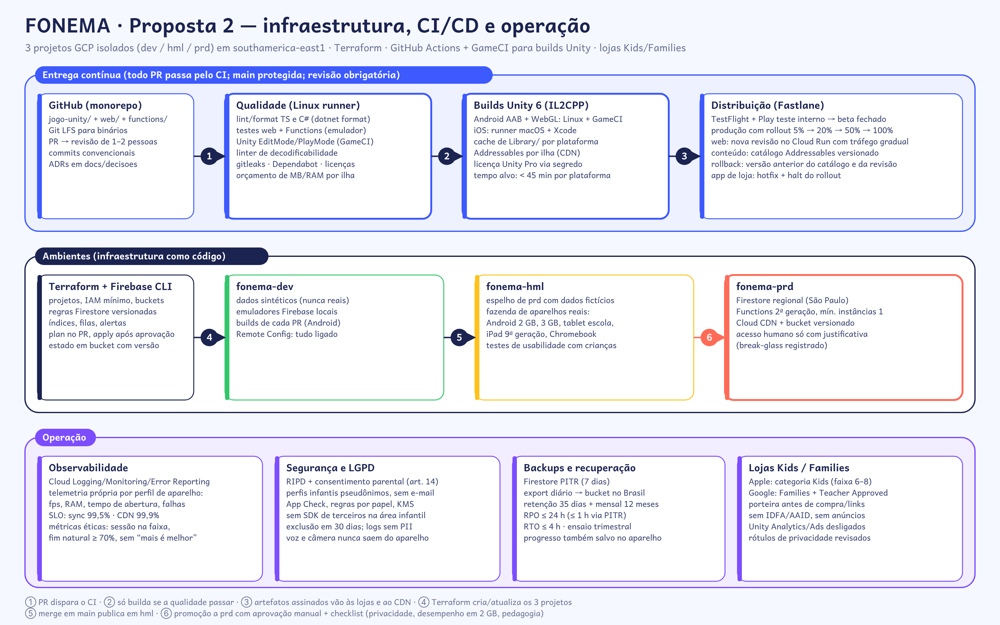

# Infraestrutura — Proposta 2 "Arquipélago 3D"

## 1. Ambientes

| Ambiente | Projeto GCP | Dados | Quem usa | Publicação |
|---|---|---|---|---|
| Desenvolvimento | `fonema-dev` | **sintéticos**; emuladores Firebase locais | equipe | cada PR (web: preview; Android: build interno) |
| Homologação | `fonema-hml` | fictícios, espelho da estrutura de prd | equipe, pedagogia, testes com crianças, laboratório de aparelhos | merge em `main` |
| Produção | `fonema-prd` | reais, em `southamerica-east1` | famílias e escolas | promoção manual com checklist |

- Tudo como código: **Terraform** (projetos, IAM mínimo, buckets, CDN, alertas, BigQuery) + **Firebase CLI** (regras, índices, Functions). `terraform plan` no PR e `apply` após aprovação; estado num bucket versionado.
- Os dados de produção nunca são copiados para dev/hml.

## 2. CI/CD

**GitHub Actions** em todo PR:
1. **Qualidade (runner Linux):** lint/format (TS, C#, Python); testes de Functions com emulador; testes web (unidade + Playwright para as áreas adultas); **Unity EditMode/PlayMode** via **GameCI** (`unity-test-runner`); linter de decodificabilidade; `gitleaks`; Dependabot/Renovate; verificação de licenças (bloqueia GPL/AGPL no código fechado); **orçamento de desempenho** (MB por bundle, triângulos, RAM no PlayMode).
2. **Builds Unity (IL2CPP):**
   - Android AAB + WebGL: GameCI `unity-builder` em Linux, com cache de `Library/` por plataforma.
   - iOS: projeto Xcode gerado em Linux e compilado/assinado em **runner macOS** (hospedado ou próprio).
   - Licença Unity Pro ativada por segredo do CI; tempo-alvo < 45 min por plataforma; builds noturnos completos e builds de PR só Android.
   - Addressables: build de conteúdo por ilha, enviado ao bucket do ambiente com catálogo versionado.
3. **Distribuição (Fastlane):** TestFlight e teste interno do Play → beta fechado → produção com **rollout escalonado 5% → 20% → 50% → 100%**, monitorando falhas e desempenho por perfil de aparelho. Web: nova revisão no Cloud Run com divisão gradual de tráfego.
4. **Rollback:** conteúdo = voltar o catálogo Addressables anterior (minutos); web = revisão anterior; app de loja = parar o rollout + hotfix (o servidor mantém compatibilidade com as 2 últimas versões do app).

## 3. Segurança e LGPD

- **Identidade:** só adultos têm conta (e-mail, Google, Apple; MFA para professores e secretaria). Os perfis infantis são pseudônimos (apelido + ano de nascimento), sem e-mail, foto ou geolocalização.
- **Acesso:** regras do Firestore negam por padrão; papéis por *custom claims*; secretaria só com agregados de n ≥ 10; acesso humano a prd por *break-glass* registrado.
- **App Check** (Play Integrity / App Attest / reCAPTCHA Enterprise na web) em Firestore, Functions e Storage. Segredos no **Secret Manager**; chaves de criptografia no KMS; TLS em tudo.
- **Privacidade por arquitetura:** áudio processado no aparelho e descartado; câmera fora do MVP; TTS só no build (nenhuma chamada da criança a terceiros); **sem SDK de terceiros** de analytics/anúncios na área infantil; logs sem dados pessoais (lint de log).
- **LGPD art. 14 / ECA Digital:** consentimento parental granular e versionado (produto / pesquisa / corpus); RIPD (relatório de impacto) antes do beta; encarregado (DPO) nomeado; portal do responsável para acesso, correção, portabilidade e exclusão (até 30 dias); contratos de operador (DPA) com Google, Azure, lojas e gateway. ⚖️ Validar com advogado.
- **Varreduras:** dependências (Dependabot), segredos (gitleaks), SAST (CodeQL para TS; analisadores Roslyn para C#) e auditoria de tráfego do app no CI (o build de teste não pode chamar domínios fora da lista).

## 4. Observabilidade

- Cloud Logging, Monitoring e Error Reporting para web e Functions. No app, **telemetria própria e mínima** (sem SDK de terceiros): falhas, fps, RAM, tempo de abertura e tempo de inferência de fala, **agregados por perfil de aparelho**, com ID de instalação aleatório e rotativo.
- **SLOs:** sync 99,5% de sucesso; CDN 99,9%; abertura a frio ≤ 3 s no Perfil C (p75); ≥ 30 fps (p90) no Perfil C.
- **Métricas éticas** no painel interno: duração da sessão na faixa-alvo; fim natural ≥ 70%; nenhuma meta de "mais tempo"; sentinela de superjustificação (E8 do rel. 38); FRR do ASR por região.
- Alertas para picos de erro, queda de sync, custo de CDN fora da curva e regressão de desempenho após um rollout.

## 5. Backups e recuperação

- Firestore com **PITR (7 dias)** + **export diário** para um bucket no Brasil com retenção de 35 dias e cópia mensal por 12 meses (bloqueio de retenção).
- **RPO ≤ 24 h** (≤ 1 h com PITR); **RTO ≤ 4 h**; ensaio de restauração a cada trimestre, em hml.
- O progresso também fica no aparelho (SQLite criptografado), o que permite reenviar eventos após incidente.
- Bundles e áudios são imutáveis e versionados no Storage (versão de objeto ativada).

## 6. Lojas Kids / Families

| Loja | Exigências | Como atendemos |
|---|---|---|
| **Apple — categoria Kids** (faixa 6–8; avaliar 5 e menos) | sem analytics/anúncios de terceiros; porteira de nível adulto para links, compras e "distrações"; política de privacidade | Unity Analytics/Ads desligados; porteira (segurar 3 s + tarefa de leitura); IAP só atrás dela; rótulos de privacidade revisados a cada versão |
| **Google Play — Families** (+ Teacher Approved como meta) | Política de Famílias, SDKs certificados, formulário de Segurança de Dados, público-alvo declarado | sem AAID; SDKs mínimos (Firebase revisado); formulário mantido com o RIPD; conteúdo revisado por pedagogia |
| Ambas | assinatura mensal clara, cancelamento fácil, sem oferta à criança | oferta só na área adulta; e-mail de renovação; cancelamento em 2 toques |

⚖️ A possibilidade de cobrar fora da loja (link para o checkout web) no Brasil depende de regras atuais da Apple/Google e de decisões regulatórias; a conferir na época do lançamento.
