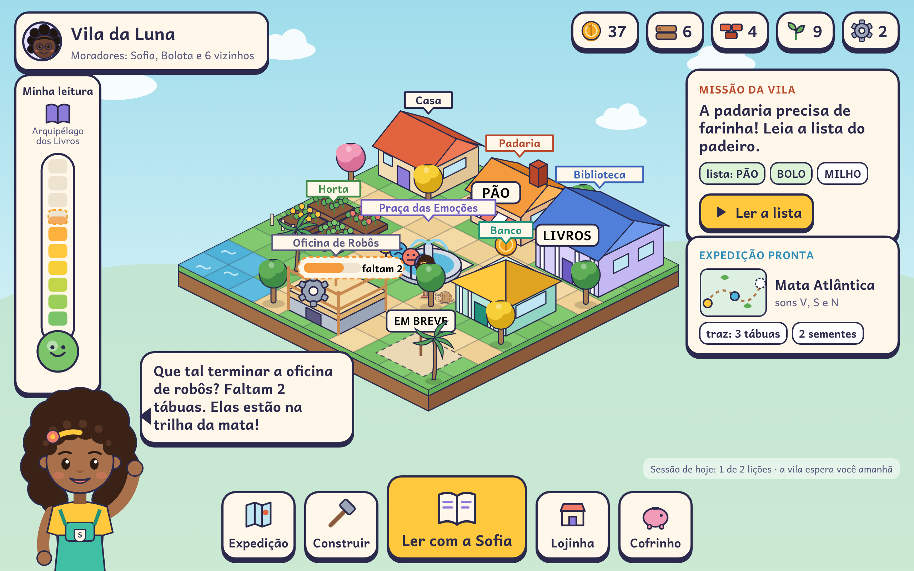

# Proposta 3 — VILA LEITORA (estratégia e construção)

> **📦 Proposta histórica.** Esta proposta foi uma das 5 opções de 13/11/2026. A [Decisão 005](../../decisoes/005-proposta-unificada.md) juntou o melhor das cinco na **[proposta 06 (FONEMA Unificada)](../06-fonema-unificada/README.md)**, que é a que vale. Decisões posteriores também mudaram pontos daqui: dupla Sofia e Tales em 3D (D007), sem adornos (D008), sem arco-íris (D009), Academia (D011), **sem festa junina, carnaval ou folclore como entidade (D012)** e linguagem de **plataforma**, não "jogo" (D014). Ver o [índice de decisões](../../decisoes/README.md).

> **Em uma frase:** a criança constrói e administra a própria vila **lendo**. Cada prédio nasce de um som dominado, cada expedição a um bioma brasileiro traz materiais, e a vila inteira vira o retrato visível da jornada de 2 anos até a alfabetização plena.

| Item | Escolha desta proposta |
|---|---|
| Coração do produto | City-builder isométrico fofo, em que **ler é a ferramenta de construir** |
| Ponto forte | Estratégia, planejamento, lógica, **educação financeira** e pensamento computacional, todos "por dentro" da leitura |
| Stack | **Flutter + Flame** (iOS, Android e Web numa base só) · painéis adultos em **Next.js** · **AWS sa-east-1** serverless (Cognito, API Gateway + AppSync, Lambda, Aurora PostgreSQL Serverless v2 + DynamoDB, S3/CloudFront) · **TTS Azure pré-gerado** · **fala no aparelho com sherpa-onnx** |
| Mercado inicial | **B2C (famílias) + escolas privadas**; rede pública fica para a fase 2 |
| Preço | Sempre mensal: Família **R$ 29,90/mês** · Escola privada **R$ 9,90/aluno/mês** · gratuito por conquista até o fim de R2a |

Imagens desta pasta: `tela-vila.png`, `tela-licao.png`, `tela-lojinha.png`, `tela-pais.png`, `tela-professor.png`, `estilo.png`, `arquitetura.png`, `infra.png`.
Documentos: [`arquitetura.md`](arquitetura.md) · [`esqueleto.md`](esqueleto.md) · [`infra.md`](infra.md) · [`design.md`](design.md).

---

## 1. Conceito

A Vila Leitora parte de uma ideia simples: **a criança quer construir coisas, e quem lê consegue construir**. O mundo é uma ilha isométrica, como um brinquedo de madeira visto de cima, que começa com a casa da Sofia e um terreno vazio. Ao longo de 24 meses, ela vira uma vila com padaria, biblioteca, horta, banco, praça, oficina de robôs, porto e teatro, ligada por expedições às 11 regiões do mapa (Quintal → Arquipélago dos Livros).

**Os três laços do jogo:**

| Laço | Duração | O que a criança faz | O que aprende |
|---|---|---|---|
| **Lição** (núcleo) | 6–10 min | Lição de 3 fases com a Sofia ("Eu faço, nós fazemos, você faz"), Espelho do Som, decodificação e leitura | O som da vez, revisão espaçada, compreensão |
| **Vila** (estratégia) | 3–5 min | Ler a "planta" de um prédio, escolher onde construir, decidir gastar ou guardar, cuidar da horta | Planejamento, necessidade × desejo, causa e efeito |
| **Expedição** (exploração) | 3–6 min, opcional | Ir a um bioma, resolver uma missão de leitura e trazer materiais (tábua, tijolo, semente, engrenagem) | Transferência para contexto novo, conhecimento de mundo |

**Regras que tornam a vila pedagógica, e não só um prêmio:**
1. **Prédio = domínio.** Um prédio só fica disponível quando a criança domina os sons da etapa (provinha + transferência + retenção, Decisão 004). Não existe "acelerar com moeda".
2. **A planta se lê.** Para construir, a criança lê a planta: lista de materiais e nome do prédio, sempre com palavras decodificáveis da fase dela (o linter garante).
3. **A vila pede leitura.** Placas, cartas de vizinhos, pedidos do padeiro e livros da biblioteca usam só grafemas já ensinados. A vila é o lugar da **transferência**.
4. **Cada prédio ensina uma competência transversal:** praça = emoções; banco = educação financeira; oficina de robôs = pensamento computacional; feira = comparar preços; prefeitura mirim = cidadania e tecnologia.
5. **Construir não ocupa a sessão.** No máximo 20–25% do tempo de tela vai para construção. A lição vem primeiro, e a vila "dorme" no fim da sessão (fim natural, rel. 42).
6. **Sem perda e sem pressão.** Nada se estraga se a criança ficar dias sem jogar. Não existe streak (existe o Álbum de Dias de Leitura), nem baú aleatório, nem oferta de compra para a criança (ECA Digital, Decisão 002).

---

## 2. Um dia típico

**Luna, 6 anos, nível 6 de 10, explorando o Cerrado (R5). Família assinante.**

| Hora | Quem | O que acontece |
|---|---|---|
| 7h40 | Mãe | Recebe no celular o lembrete gentil "a vila da Luna espera a leitura de hoje", só para o adulto e só se ela ativou. |
| 18h05 | Luna | Abre o tablet. A Sofia acena na praça: "A padaria precisa de farinha! Leia a lista do padeiro." Dois toques e ela está na lição. |
| 18h06–18h14 | Luna | **Lição do R/RR**: a Sofia modela o som no **Espelho do Som** (boca, corte lateral, letra); Luna separa CARO × CARRO, lê 6 palavras e uma frase decodificável. O microfone confirma a leitura **no próprio tablet**. Ela erra duas vezes e a Sofia elogia o esforço, não a nota. |
| 18h14 | Luna | **Ritual de fim**: as moedinhas chegam em bloco (sem contagem a cada acerto) e a padaria ganha a farinha. Uma figurinha falante de "CARRO" vai para o álbum. |
| 18h15–18h19 | Luna | **Vila**: lê a planta da Oficina de Robôs ("faltam 2 tábuas"). Vai à lojinha, olha o BONÉ (12) e o PATINETE (meta de 80). A Sofia comenta: "se comprar o boné agora, o patinete demora um pouquinho mais". Luna guarda 5 no cofrinho. |
| 18h20 | Luna | Bolota pergunta: "Me ensina o R?" Ela toca nas sílabas certas e explica o som para o amigo (efeito protégé). A Sofia fecha: "A vila vai dormir. Amanhã a gente busca as tábuas na mata!" |
| Domingo | Pai | Abre o **painel da família** (`tela-pais.png`): "nível 6 de 10, faltam 4", previsão em faixa, missão da semana em casa (achar R e RR nas embalagens), o que ela guardou e por quê. Ouve o resumo em áudio. |
| Segunda | Professora | (Se a escola for cliente) vê o **mapa de calor** da turma (`tela-professor.png`), aceita os 3 grupos sugeridos e projeta a "horta comunitária" da turma. |

Tempo de tela da criança: **15 minutos**, com fim natural.

---

## 3. Jornada de 2 anos — como a vila cresce em 24 meses

O mapa segue as 11 regiões do Documento Mestre (§4.2). A vila tem **bairros** que se abrem por ano; cada região traz 1–2 prédios, 20–30 itens de lojinha e 1 projeto coletivo.

| Mês (indicativo) | Região e sons | Prédio novo na vila | Competência que o prédio ensina | Nível típico |
|---|---|---|---|---|
| 0–1 | **R0 Quintal da Sofia** · consciência fonológica | Casa da Sofia, **Praça das Emoções** | Nomear emoções, respirar com a Sofia | 0 |
| 1–2 | **R1 Ilha das Vogais** · A E I O U | Poço e **Horta** (água antes do enfeite) | Necessidade × desejo, cuidar | 1 |
| 2–3 | **R2a Mata Atlântica, Vale do M-L-F** | **Padaria** (receitas = ordenar passos) | Sequência (PC), primeira lojinha | 2 |
| — | **Fim da parte gratuita** | "Ponte em obras" para a mata; nenhum cadeado ou oferta para a criança; relatório antes/depois para o adulto | — | — |
| 3–4 | **R2b Trilha do V-S-N** | **Biblioteca** (livros por domínio, nunca por moeda) | Gosto pela leitura | 3 |
| 4–6 | **R3 Pampa** · P T → B D | **Banco e Cofrinho** com meta, moinho | Poupar para um objetivo, bônus de paciência | 4 |
| 6–8 | **R4 Pantanal** · J Z CH NH LH + frases | **Porto e barco** (expedições pela água), **Oficina de Robôs 1** | Programar o robô entregador com cartas de comando lidas | 5 |
| 8–10 | **R5 Cerrado** · C/QU G/GU R/RR S/SS Ç | **Feira** com duas barraquinhas | Comparar preços, padrões (Oficina 2: repetições) | 6 |
| 10–12 | **R6 Caatinga** · nasais · **chefe do Ano 1** | **Cisterna** e **Casa do Cordel**; Festa da Vila | Planejar recursos escassos; meta de poupança do ano | 5–6 completo |
| 12–15 | **R7 Amazônia** · CVC + ditongos (abre o Ano 2) | **Barco-escola** e Centro do Rio | Depuração (Oficina 3: achar o "bug" no caminho) | 5–7 |
| 15–17 | **R8 Litoral e Mar** · PR BR TR, PL BL | **Estação e Museu do Mar** | Projeto coletivo da turma; África–Brasil | 7 |
| 17–20 | **R9 Cidade das Letras** · S/Z/X, H, -ão, -inho | **Prefeitura Mirim**, **Ponte da Vila** (STEAM), **Jornal da Vila** | Votar, escrever notícias, tecnologia e privacidade | 8 |
| 20–24 | **R10 Arquipélago dos Livros** · fluência e textos | **Teatro e Editora**: "Livro da minha jornada" | Contar a própria história; a vila vira "cidade leitora" | 9–10 |

**Crescimento visível:** mês 0 = 1 casa e 1 terreno · mês 3 = 5 prédios · mês 12 = cerca de 14 prédios em 2 bairros · mês 24 = cerca de 25 prédios, 4 bairros e a ilha do teatro.

**Para não acabar nunca** (Decisão 001): missões paralelas procedurais (o gerador só usa palavras validadas), modo infinito de revisão, decoração livre, temporadas que voltam todo ano (festa junina, carnaval, primavera) e expedições de revisão às regiões antigas, que contam como repetição espaçada.

---

## 4. Diferenciais

1. **A vila é o portfólio do aprendizado.** Pais e professores entendem o progresso olhando a vila. Cada prédio corresponde a um conjunto de sons dominados.
2. **Estratégia de verdade, sem violência e sem sorte.** Escolher o que construir primeiro, administrar materiais, guardar para uma meta e planejar uma expedição dão autonomia e sensação de competência, os dois motores do "vício positivo" (rel. 08).
3. **Educação financeira mais profunda que as outras propostas.** Banco, cofrinho com meta, feira com dois preços, projeto coletivo (horta comunitária) e conversa sugerida em casa.
4. **Pensamento computacional com propósito.** A Oficina de Robôs pede para programar o robô entregador da padaria com cartas de comando que **precisam ser lidas** ("ANDA", "VIRA", "PEGA").
5. **Projeto coletivo da turma** nas escolas: cada leitura da turma rega a horta comunitária. Coopera, não compete. Não existe ranking.
6. **Offline-first real:** Flame, motor de domínio, agendador e reconhecimento de fala rodam no aparelho. A vila funciona sem internet e sincroniza depois.
7. **Uma base de código** (Flutter) para iOS, Android e Web, com Flame dando 60 fps em aparelhos bons e 30 fps estáveis em Android de entrada (PoC obrigatória).
8. **Dados no Brasil** (sa-east-1) e **nenhuma voz ou imagem de criança na nuvem**.

---

## 5. MVP (9 meses)

**Entra no MVP:**
- App Flutter (Android, iOS, Web) com perfis infantis, porteira parental e até 40 perfis por aparelho.
- **R0, R1, R2a** (parte gratuita) + **R2b e R3** (primeiras regiões pagas), com cerca de 60 lições.
- Lição de 3 fases, **Espelho do Som** (≈ 20 clipes do recorte inicial), agendador de revisão, provinhas de passagem e termômetro 0–10.
- Vila com **7 prédios** (casa, praça, horta, padaria, biblioteca, banco, oficina 1 simplificada), construção por planta lida, materiais e 2 tipos de expedição.
- Lojinha com cerca de 80 itens, avatar com representatividade grátis e cofrinho com meta.
- Reconhecimento de fala no aparelho (sherpa-onnx, verificação de palavra-alvo) com alternativa sem fala sempre disponível.
- Painel da família (web e app, atrás da porteira) com relatório antes/depois e resumo semanal em áudio.
- Painel da professora v1: turma, mapa de calor, grupos sugeridos, convite de alunos por código.
- Assinatura: Família (lojas + web) e Escola privada (boleto ou Pix mensal, contrato simples).

**Fica para depois:** R4–R10, feira, porto, prefeitura mirim, painel de secretaria, B2G, câmera com dica articulatória (V2, só após PoC e parecer jurídico), variantes regionais do Espelho do Som, modo sala de aula com projetor.

---

## 6. Cronograma

| Período | Entregas |
|---|---|
| **Mês 1** · Descoberta e PoCs | Flame isométrico a 30 fps em Android 2 GB; sherpa-onnx (palavra-alvo) com 30 crianças; Sofia em Rive com 12 bocas; protótipo em papel da vila com 8 crianças; ADRs; contas AWS e esteira |
| **Meses 2–4** · Núcleo | Lição + motor de domínio + agendador; vila com 3 prédios; sincronização offline; Cognito e consentimento; fábrica de conteúdo (linter, TTS em lote) |
| **Meses 5–6** · Economia e adultos | Lojinha, cofrinho, expedições R0–R2a; painel da família; painel da professora v0; testes de usabilidade com 5–8 crianças por faixa |
| **Mês 7** · Beta fechado | 200–500 famílias e 3–5 turmas (Fase 0 do Documento Mestre); piloto com 3 braços: trilha sem vila × com vila × com vila e lojinha |
| **Meses 8–9** · Lançamento | Ajustes do piloto; R2b e R3; envio para Google Play Famílias e App Store Kids; lançamento público freemium + Família + Escola |
| **Meses 10–18** · Ano 1 completo | R4–R6, porto, feira, oficina 2, cisterna; painel da escola; 5–20 escolas privadas |
| **Meses 18–24** · Ano 2 | R7–R10, prefeitura mirim, jornal, teatro e "Livro da minha jornada"; preparação B2G (CPSI) |

---

## 7. Equipe

| Papel | MVP (FTE) | Observação |
|---|---|---|
| Produto (PO) com experiência em edtech infantil | 1 | Dono do backlog e das métricas éticas |
| Game designer / UX infantil | 1 | Economia da vila, balanceamento e testes com crianças |
| Desenvolvedores Flutter + Flame | 3 | Um sênior em Flame/isométrico, um em áudio e fala, um em app e sincronização |
| Backend / cloud (TypeScript + AWS CDK) | 1 | Também cuida de segurança e da esteira |
| Front-end Next.js (painéis) | 0,5 | Pode ser a mesma pessoa de backend no início |
| QA (manual + automação) | 1 | Inclui teste em aparelhos de entrada |
| Artista isométrico 2D + animador Rive | 1,5 | Prédios, itens e personagens |
| Conteúdo pedagógico (redação decodificável) | 1,5 | Sob a coordenação pedagógica |
| Consultoria: pedagogia, fonoaudiologia (2 CRFa), jurídico LGPD/ECA | sob demanda | O Espelho do Som exige 2 fonoaudiólogas independentes |
| **Total** | **≈ 11 FTE** | |

---

## 8. Custos

> Estimativas próprias para comparar propostas, **sem orçamento de fornecedor**. Câmbio usado: US$ 1 = R$ 5,70. Preços AWS de sa-east-1 (cerca de 30–50% acima de us-east-1).

### 8.1 Custo de construção
| Fase | Faixa |
|---|---|
| MVP (9 meses, ≈ 11 FTE a R$ 18–25 mil/mês carregado) | R$ 1,8–2,5 mi |
| Arte isométrica, Rive, áudio, gravação do Espelho do Som (faixa do rel. 28) | R$ 0,35–0,75 mi |
| Jurídico, testes com crianças, contas de lojas, PoCs | R$ 0,10–0,20 mi |
| **Total até o lançamento** | **R$ 2,3–3,4 mi** |
| Ano 1 completo + Ano 2 (meses 10–24, equipe de 9–11) | + R$ 3,0–4,2 mi |

### 8.2 Custo mensal de operação (nuvem + serviços variáveis)
| Alunos ativos/mês | AWS (prod + hml + dev) | Outros variáveis | **Total/mês** | **Por aluno/mês** |
|---|---|---|---|---|
| **1 mil** | US$ 450–650 | R$ 300 (e-mail, coletor de falhas, Azure TTS em lote) | **R$ 2,9–4,0 mil** | R$ 2,90–4,00 |
| **10 mil** | US$ 800–1.300 | R$ 600 | **R$ 5,2–8,0 mil** | R$ 0,52–0,80 |
| **100 mil** | US$ 4.000–7.000 | R$ 2.000 | **R$ 25–42 mil** | R$ 0,25–0,42 |

O que pesa: base fixa (Aurora com 0,5 ACU mínimo, WAF, GuardDuty, logs) no começo; CDN de pacotes de conteúdo e Aurora em escala. **TTS e fala custam ≈ zero por aluno** porque o TTS é pré-gerado uma vez e o reconhecimento roda no aparelho, o que atende à regra de *unit economics* do Documento Mestre (< R$ 10 por criança/ano). Detalhes em [`infra.md`](infra.md#6-custos).
Fora da nuvem: taxa das lojas (15% no programa de pequenas empresas), gateway de pagamento (≈ 3–5%), suporte e sustentação da equipe.

---

## 9. Preço (sempre mensal)

| Plano | Preço | O que inclui |
|---|---|---|
| **Gratuito por conquista** | R$ 0 | R0 + R1 + R2a (≈ 6–10 semanas), vila com 4 prédios, relatório antes/depois completo, painel da turma para escolas |
| **Família** | **R$ 29,90/mês** | Até 3 crianças, jornada completa, todas as regiões, painel da família, missões em casa |
| **Escola privada** | **R$ 9,90/aluno/mês** (mínimo 20 alunos) | Painel da professora, grupos sugeridos, projeto coletivo da turma, relatórios por turma, suporte de implantação |
| **Rede pública** (fase 2) | ≈ R$ 3,50/aluno/mês, via CPSI ou pregão | Painel de secretaria e formação, como item separado |

A oferta aparece **só para o adulto**, atrás da porteira parental. A criança vê a "ponte em obras" e nunca vê preço em reais. Os valores são hipótese a validar com pesquisa van Westendorp em base mensal (Documento Mestre §4.16).

---

## 10. Riscos e mitigação

| Risco | Prob. | Impacto | Mitigação |
|---|---|---|---|
| A construção **rouba tempo** da leitura ou vira o objetivo principal (superjustificação) | Média | Alto | Prédio só por domínio; teto de 20–25% do tempo em construção; moedas entregues em bloco no fim; piloto com 3 braços antes de escalar |
| **Desempenho** do Flame isométrico em Android de 2 GB | Média | Alto | PoC no mês 1; atlas de sprites, culling, no máximo ≈ 60 objetos animados; modo "vila leve" |
| Precisão do **sherpa-onnx** com voz infantil pt-BR | Alta | Médio | Usar só verificação de palavra-alvo (vocabulário fechado), nunca nota de pronúncia; 2 tentativas e depois toque; progresso nunca depende só da fala |
| **Inflação** da economia e criança "rica" sem motivo para ler | Média | Médio | Livro-razão no servidor, teto diário, razão gasto/ganho 0,6–0,9 monitorada, nova região absorve o saldo |
| Custo de **arte isométrica** (≈ 25 prédios × estados + 300 itens) | Média | Médio | Kit modular (paredes, telhados, portas recombináveis), paleta fechada, produção por região |
| Revisão das lojas **Kids/Families** e ECA Digital | Média | Alto | Sem SDK de terceiros com rastreamento, porteira parental, parecer jurídico antes do envio |
| Mercado de devs **Flutter + Flame** menor que o de React no Brasil | Média | Médio | Contratar 1 sênior de Flame cedo; documentação e ADRs; Flame é Dart puro, fácil de aprender para quem já faz Flutter |
| Flutter Web pesado para **painéis** | — | — | Já mitigado: painéis em Next.js; Flutter Web só para o jogo |
| Aurora com custo fixo para poucos alunos | Baixa | Baixo | 0,5 ACU mínimo em prod, pausa automática em dev/hml |

---

## 11. Prós e contras

**Prós**
- Motivação de longo prazo forte: a criança vê a própria vila crescer por 2 anos.
- Integra com naturalidade as 6 competências (especialmente finanças, lógica e pensamento computacional).
- Excelente para B2C: a vila é "mostrável" para os pais e gera boca a boca.
- Uma base de código para 3 plataformas; offline-first; dados no Brasil.
- Custo variável muito baixo por aluno.

**Contras**
- O jogo de construção é mais caro de produzir (arte, balanceamento, economia) que uma trilha linear.
- Exige disciplina de design para não virar "jogo com lição", e sim "lição que constrói".
- Crianças de 4–5 anos aproveitam menos a camada de estratégia; para elas, a vila precisa ser mais guiada.
- Flame isométrico em aparelhos fracos é um risco técnico real.
- Foco inicial em B2C e escolas privadas adia o grande volume do B2G.

---

## 12. Quando escolher esta proposta

Escolha a **Vila Leitora** se:
- a prioridade for **engajamento de longo prazo em casa** (B2C) e escolas privadas que querem algo diferenciado;
- o dono quiser que **estratégia, planejamento e educação financeira** sejam marcas do produto;
- houver orçamento para **arte isométrica de qualidade** e para um designer de economia de jogo;
- a equipe aceitar **Flutter + Flame** e AWS como base.

Prefira outra proposta se o foco for a rede pública em larga escala já no primeiro ano, aparelhos muito fracos (abaixo de 2 GB de RAM), ou se a meta for o menor custo de construção possível.
