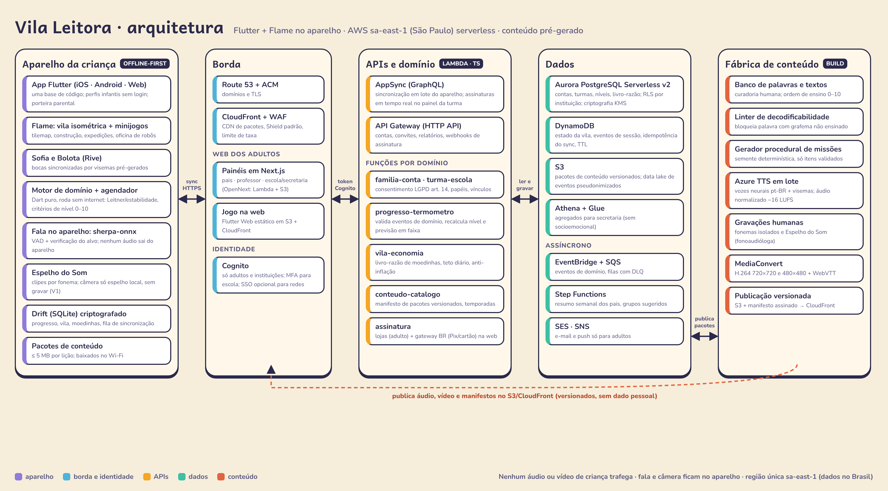

# Vila Leitora — Arquitetura



## 1. Princípios
1. **Offline-first.** Tudo o que a criança faz (lição, vila, fala, agendador, economia local) roda no aparelho. A nuvem guarda, valida, agrega e entrega conteúdo.
2. **Nada sensível sai do aparelho.** Áudio do microfone e imagem da câmera ficam no aparelho e não são gravados. Só sobem **eventos de aprendizagem** pseudonimizados (ex.: `item=R_RR_carro, resultado=fluente, latencia=1,8s`).
3. **Conteúdo é dado, não código.** Lições, plantas de prédios, itens de lojinha e missões chegam em **pacotes versionados** pelo CDN, então dá para corrigir conteúdo sem passar pela revisão das lojas.
4. **Servidor é a fonte da verdade para nível e moedinhas.** O aparelho calcula de forma otimista; o servidor revalida os eventos com as mesmas regras e projeta o estado oficial.
5. **Serverless e região única sa-east-1** (dados no Brasil), com custo próximo de zero quando ocioso.

## 2. Componentes

### 2.1 Aparelho (Flutter)
| Módulo | Tecnologia | Responsabilidade |
|---|---|---|
| Casca do app | Flutter 3, `go_router`, Riverpod | Navegação, perfis, porteira parental (pergunta de adulto + segurar 3 s), acessibilidade |
| Mundo da vila | **Flame** + `flame_tiled` (mapa isométrico 2:1) | Renderização em camadas, ordenação por profundidade, construção, câmera, expedições, minijogos |
| Personagens | Rive (`rive` runtime) | Sofia e Bolota com máquinas de estado; 12 bocas guiadas por visemas pré-gerados |
| Áudio | `just_audio` + `audio_session` | Falas pré-geradas, fonemas gravados, música baixa e muda com o microfone aberto |
| Fala | **sherpa-onnx** (plugin Dart/FFI) | VAD + **palavra-alvo** (keyword spotting com vocabulário fechado da lição). Modelo baixado depois da instalação (≈ 15–30 MB) |
| Espelho do Som | `video_player` + `camera` (opcional, V1) | Clipe por fonema (rosto real + corte lateral + letra); câmera só como espelho local, sem gravação nem análise |
| Domínio | pacote Dart puro `dominio` | Motor de domínio, agendador (Leitner + estabilidade), critérios da Escala 0–10, regras da economia |
| Persistência | **Drift** (SQLite) + SQLCipher | Progresso, estado da vila, livro-razão local, fila de eventos |
| Sincronização | `sync` (AppSync GraphQL em lote) | Envia eventos idempotentes, recebe projeções oficiais e manifestos de conteúdo |

### 2.2 Web
- **Jogo na web:** o mesmo app Flutter compilado para web (CanvasKit), hospedado em S3 + CloudFront. Uso secundário (computador da escola).
- **Painéis adultos em Next.js** (família, professora, escola/secretaria), implantados com OpenNext (Lambda + S3 + CloudFront). Motivo: páginas de tabela e gráfico, acessibilidade nativa do HTML, carregamento leve e SEO da página pública. Compartilham o esquema GraphQL com o app.

### 2.3 Nuvem (AWS sa-east-1)
| Serviço | Uso |
|---|---|
| **Cognito** | Contas de adultos (responsável, professora, gestor). MFA obrigatório para escola. Crianças **não têm login**: o aparelho recebe um token de dispositivo vinculado à família ou turma |
| **AppSync** | Sincronização em lote do app (mutations idempotentes) e assinaturas em tempo real para o painel da turma |
| **API Gateway (HTTP API)** | Endpoints REST: convites, relatórios em PDF, exportação LGPD, webhooks de assinatura das lojas e do gateway de pagamento |
| **Lambda** | Funções por domínio (seção 3). TypeScript, exceto `progresso` e `economia`, que rodam o **mesmo pacote Dart** do app (AOT em runtime `provided.al2023`) |
| **Aurora PostgreSQL Serverless v2** | Dados relacionais: famílias, crianças, turmas, vínculos, níveis, livro-razão de moedinhas, assinaturas. **RLS por instituição** |
| **DynamoDB** | Alto volume e chave-valor: estado da vila (documento por criança), eventos de sessão brutos (TTL de 13 meses), chaves de idempotência |
| **S3 + CloudFront** | Pacotes de conteúdo, vídeos do Espelho do Som, app web, painéis; data lake de eventos pseudonimizados (Parquet) |
| **Athena + Glue** | Agregados de turma, escola e secretaria (distribuição por nível, % no nível 10) |
| **EventBridge, SQS, Step Functions** | Eventos de domínio, filas com DLQ, resumo semanal das famílias, cálculo de grupos sugeridos |
| **SES / SNS** | E-mail e push **só para adultos** |
| **KMS, Secrets Manager, WAF** | Criptografia, segredos, proteção da borda |

### 2.4 Fábrica de conteúdo (fora do caminho do usuário)
1. Banco de palavras e textos (curadoria humana) → **linter de decodificabilidade** (bloqueia qualquer grafema ainda não ensinado na etapa).
2. **Gerador procedural** de missões e plantas: semente determinística, só itens validados, mistura ~60% alvo / 30% revisão / 10% transferência.
3. **Azure TTS em lote** (vozes neurais pt-BR) → falas + JSON de visemas → normalização −16 LUFS → Opus 32–48 kbps. Executado no CI, nunca em tempo de uso. As vozes são **versionadas** porque o fornecedor pode mudá-las sem aviso.
4. Fonemas isolados e clipes do **Espelho do Som** gravados por fonoaudióloga → MediaConvert (H.264 720×720 e 480×480 + WebVTT).
5. Publicação: pacote ≤ 5 MB por lição + **manifesto assinado** em S3 versionado, servido pelo CloudFront.

## 3. Domínios do backend
| Domínio | Dono dos dados | Principais operações |
|---|---|---|
| `familia-conta` | Aurora | Criar família, consentimento (versão do termo), perfis infantis, exclusão em 30 dias |
| `turma-escola` | Aurora | Escola, turma, professora, código de convite, papéis |
| `progresso-termometro` | Aurora + DynamoDB | Validar eventos, projetar domínio por item, recalcular nível 0–10 e previsão em faixa |
| `vila-economia` | Aurora (livro-razão) + DynamoDB (vila) | Creditar moedinhas por marco validado, teto diário, compras, cofrinho, construção |
| `conteudo-catalogo` | S3 | Manifestos por região e temporada, itens de lojinha, plantas de prédios |
| `relatorios` | Athena + Aurora | Resumo semanal da família, mapa de calor, grupos sugeridos, agregados |
| `assinatura` | Aurora | Notificações das lojas (App Store Server Notifications, Google RTDN), gateway BR na web; libera regiões pagas |

## 4. Modelo de dados (resumo)
```
familia(id, criada_em, termo_versao, consentido_em)          -- Aurora
adulto(id, cognito_sub, papel, familia_id|escola_id)
crianca(id, familia_id, apelido, ano_nascimento, avatar_json) -- sem nome completo, foto ou voz
escola(id, nome, plano) · turma(id, escola_id, ano, codigo_convite)
matricula(crianca_id, turma_id)                                -- RLS: escola só vê suas turmas
dominio_item(crianca_id, item_id, nivel_leitner, estabilidade, dificuldade, lapsos, dominado_em)
nivel_escala(crianca_id, nivel 0..10, desde, previsao_min_meses, previsao_max_meses)
razao_moedas(id, crianca_id, tipo [ganho|gasto|cofre], valor, origem_evento_id, criado_em)
vila#{crianca_id} (DynamoDB): { versao, predios[], decoracao[], materiais{}, cofrinho{meta,saldo} }
evento#{crianca_id}#{ts} (DynamoDB, TTL): { tipo, item, resultado, latencia_ms, sessao_id, idem_key }
```

## 5. Sincronização offline-first
1. Cada ação gera um **evento imutável** no Drift com `idem_key` (UUID v7).
2. Com internet, o app envia lotes de até 200 eventos por `syncEventos` (AppSync). O servidor grava a chave de idempotência no DynamoDB: reenviar não duplica.
3. As Lambdas `progresso` e `economia` reaplicam as **mesmas regras** do pacote Dart e devolvem a **projeção oficial** (nível, saldo, prédios liberados).
4. **Conflitos:** progresso é a união de eventos (não há conflito); a vila usa operações (construir, mover, decorar) com relógio lógico por criança, e o servidor aplica em ordem. Se dois aparelhos divergirem, vale a ordem do relógio e nada é perdido: um item "duplicado" volta para o inventário.
5. Moedinhas no aparelho são **otimistas**. Se o servidor discordar (ex.: relógio manipulado), a correção acontece em silêncio e nunca tira algo já comprado da criança; o ajuste fica no próximo ganho.

## 6. Fluxo de uma lição
```
Mapa/vila ─(2 toques)→ Lição
  1. Eu faço: Sofia + Espelho do Som (clipe local) + letra + palavra-âncora
  2. Nós fazemos: escolhas guiadas; sherpa-onnx verifica a palavra-alvo (opcional)
  3. Você faz: recuperação, intercalada com revisão do agendador
  → motor de domínio classifica (fluente / lenta / com pista / erro) e atualiza o item
  → ritual de fim: moedinhas em bloco + material para a vila
  → evento enfileirado → sync quando houver rede
```

## 7. Decisões de arquitetura (ADRs iniciais)
| ADR | Decisão | Alternativa descartada | Motivo |
|---|---|---|---|
| 001 | Flutter + Flame para app e jogo | React Native + PixiJS (rel. 03) | Uma base para 3 plataformas, renderização própria previsível em Android de entrada, Flame maduro para tilemaps isométricos |
| 002 | Painéis em Next.js | Flutter Web nos painéis | HTML acessível e leve para tabelas; Flutter Web fica só para o jogo |
| 003 | Aurora + DynamoDB | Só DynamoDB | Relatórios de escola e RLS por instituição pedem SQL; DynamoDB absorve o volume de eventos e o documento da vila |
| 004 | AppSync para sync, API Gateway para REST | Só REST | Assinaturas em tempo real no painel da turma e lote tipado; webhooks e PDFs ficam no REST |
| 005 | Regras de domínio em Dart compartilhado (app + Lambda) | Reescrever em TypeScript | Uma única fonte da verdade para nível e moedinhas; vetores de teste comuns |
| 006 | sherpa-onnx com palavra-alvo | ASR em nuvem (Azure) | Privacidade, custo ≈ zero por aluno, funciona offline; não avalia pronúncia |
| 007 | TTS Azure pré-gerado no CI | TTS em tempo real | Custo único, qualidade estável, offline, áudio versionado |
| 008 | Infraestrutura com AWS CDK (TypeScript) | Terraform | Mesmo idioma das Lambdas, constructs de alto nível, `cdk-nag` para segurança |

## 8. Requisitos não funcionais atendidos
| Requisito (Documento Mestre §6) | Como |
|---|---|
| Instalação ≤ 40 MB | App base ≈ 18–25 MB (Flutter + Flame + Rive); modelo de fala e pacotes baixados depois, no Wi-Fi |
| Pacote de lição ≤ 5 MB | Áudio Opus, sprites em atlas WebP, vídeo 480×480 na versão leve |
| ≥ 30 fps em Android 2 GB | Atlas únicos por bairro, culling fora da tela, animações de vila pausadas durante a lição |
| Feedback visual < 100 ms, áudio < 300 ms | Tudo local; pré-carregamento dos áudios da lição |
| Offline | Lições do mês no aparelho; fila de eventos; app funciona sem rede por semanas |
| WCAG 2.2 AA | Painéis em HTML semântico; no app, `Semantics` do Flutter, alvos ≥ 96 dp, sem gestos complexos |
