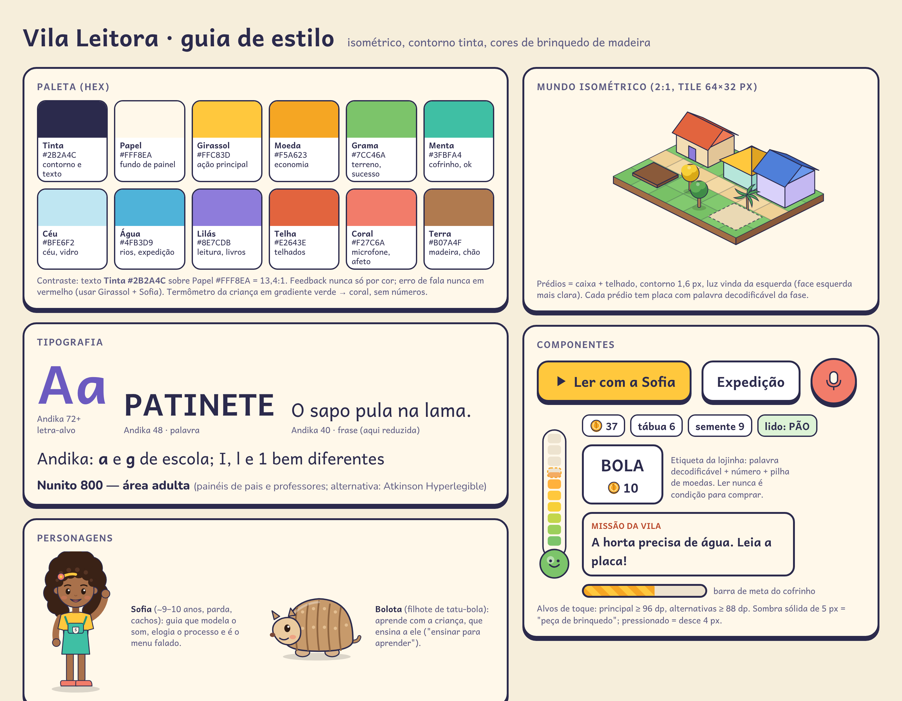
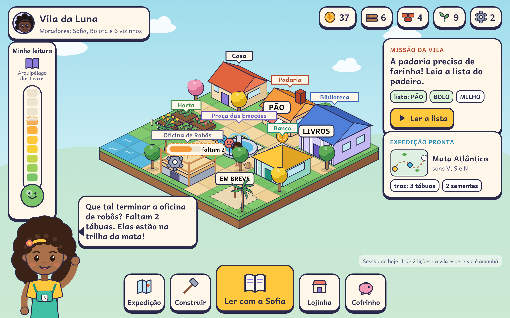
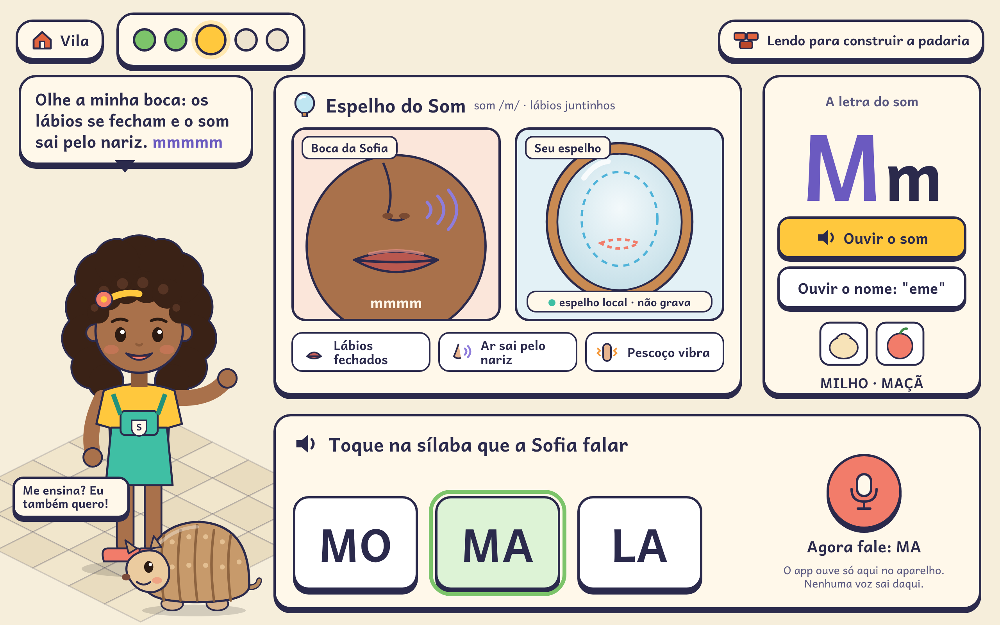
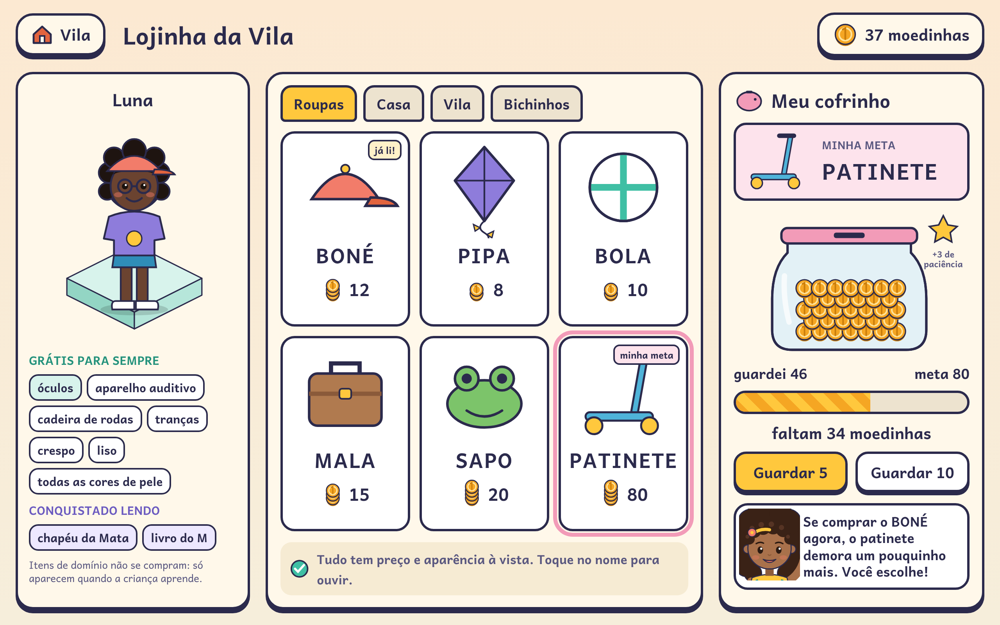
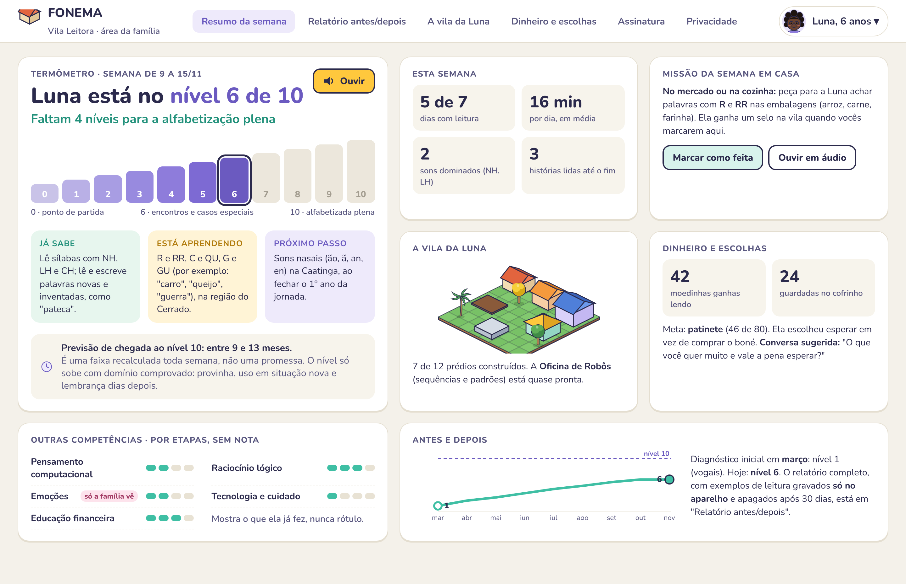
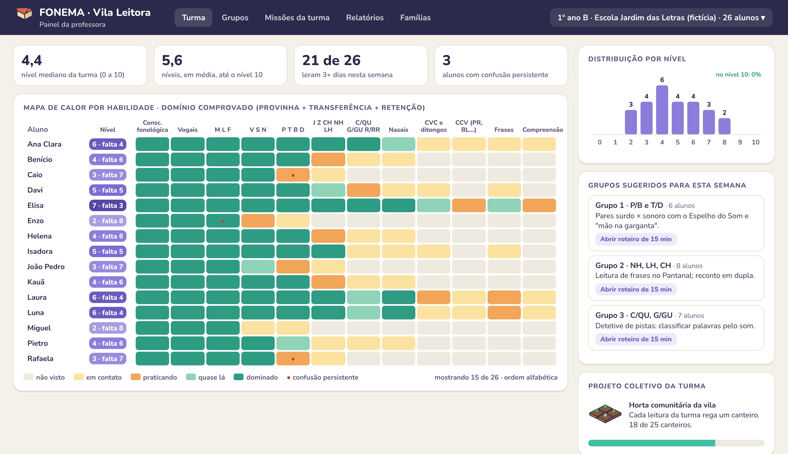

# Vila Leitora — Design

## 1. Ideia visual
**"Brinquedo de madeira visto de cima."** Um mundo **isométrico 2:1** em ilha flutuante, com contorno grosso na cor Tinta, cores quentes de brinquedo e sombras sólidas de 5 px nos botões, que parecem peças que se apertam. A diferença em relação às outras propostas é clara: aqui a tela principal é um **jogo de construção**, com HUD de recursos, termômetro, missões e barra de ações, não um mapa de trilha nem um mundo 3D.

Princípios:
1. **A lição manda, a vila responde.** O botão principal é sempre "Ler com a Sofia"; a vila reage ao que foi lido.
2. **Tudo que se lê é decodificável** na etapa da criança (placas, plantas, etiquetas, cartas).
3. **Sem números para a criança no termômetro**; números só nas moedinhas (que fazem parte da educação financeira).
4. **Calma visual:** fundo claro, poucas animações ao mesmo tempo, celebração de até 2–3 s e só no fim do bloco.
5. **Navegação sem texto:** a Sofia é o menu falado; ícones concretos; nenhum ☰, ⋮ ou engrenagem na área infantil.

## 2. Paleta
| Nome | HEX | Uso |
|---|---|---|
| Tinta | `#2B2A4C` | contorno, texto |
| Papel | `#FFF8EA` | fundo de painéis |
| Girassol | `#FFC83D` | ação principal |
| Moeda | `#F5A623` | economia |
| Grama | `#7CC46A` | terreno, sucesso |
| Menta | `#3FBFA4` | cofrinho, confirmação |
| Céu | `#BFE6F2` | céu, vidro, janelas |
| Água | `#4FB3D9` | rios, expedição |
| Lilás | `#8E7CDB` | leitura, livros, nível |
| Telha | `#E2643E` | telhados |
| Coral | `#F27C6A` | microfone, afeto |
| Terra | `#B07A4F` | madeira, chão |

Contraste Tinta sobre Papel = 13,4:1. Nunca usar só cor para informar; **erro de fala nunca em vermelho** (a Sofia ajuda e o Girassol destaca a nova tentativa).

## 3. Tipografia
- **Andika** (SIL, licença OFL) em toda a área infantil: letra-alvo 72+, palavra 48, frase 40, livro 32–36, no máximo 7 palavras por linha. Formas de "a" e "g" escolares; I, l e 1 bem diferentes.
- **Nunito** nos painéis adultos (alternativa: Atkinson Hyperlegible, recomendada pelo Documento Mestre). Corpo 15–16 px, títulos 800.

## 4. Mundo isométrico
- Tile 64×32 px (2:1); prédios ocupam 2×2 tiles; luz vinda da esquerda (face esquerda mais clara).
- **Kit modular** para baratear a arte: bases, paredes, janelas, portas e telhados (duas águas, pirâmide) recombináveis por região. Cada prédio tem 3 estados: terreno, em obra (andaime + barra de materiais) e pronto.
- **Placa decodificável** em todo prédio (PÃO, LIVROS, BANCO…), que muda conforme a etapa da criança.
- Biomas mudam o terreno e a vegetação das expedições (ipê, palmeira, buriti, mandacaru), sempre na mesma linguagem.

## 5. Componentes
| Componente | Regras |
|---|---|
| Botão principal | Girassol, ≥ 96 dp (recomendado 112–128), ícone + palavra curta, sombra sólida; pressionado desce 4 px |
| Botões da barra | ≥ 88 dp, ícone concreto + rótulo; nunca mais de 5 na barra |
| **Termômetro da criança** | Tubo vertical com 10 tracinhos coloridos (verde → coral) e bulbo sorridente; o próximo tracinho aparece tracejado e enchendo; destino visível no topo (Arquipélago dos Livros); **sem números** |
| Chip de recurso | moeda, tábua, tijolo, semente, engrenagem; número grande |
| Etiqueta da lojinha | palavra decodificável + número + pilha de moedas (de 5 em 5); "toque para ouvir"; ler nunca é condição para comprar |
| Card de missão | título curto em caixa alta pequena + frase decodificável + botão; no máximo 1 missão principal visível |
| Balão da Sofia | frase curta, sempre também falada; elogio de processo |
| Barra de meta do cofrinho | listras de moeda, sem porcentagem para a criança |

## 6. Telas

### 6.1 Vila (`tela-vila.png`)

Ilha isométrica com casa, padaria, biblioteca, horta, praça das emoções, banco e a oficina de robôs em obra ("faltam 2"). HUD: perfil e vila no topo esquerdo, recursos no topo direito, **termômetro** à esquerda, missão da vila e expedição pronta à direita, Sofia guiando no canto e barra de ações embaixo com o grande botão "Ler com a Sofia". A linha "sessão de hoje: 1 de 2 lições · a vila espera você amanhã" reforça o fim natural.

### 6.2 Lição com o Espelho do Som (`tela-licao.png`)

Passos da lição no topo (5 bolinhas), ligação com a vila ("lendo para construir a padaria"). O **Espelho do Som** mostra o modelo de boca (no produto: clipe de rosto real + corte lateral) ao lado do espelho local opcional, com as pistas "lábios fechados", "ar sai pelo nariz" e "pescoço vibra". À direita, a letra M m com botões separados para **som** e **nome da letra** e palavras-âncora. Embaixo, a atividade com 3 alternativas grandes e o microfone, que avisa que ouve só no aparelho. O Bolota pede para aprender (protégé).
> O nome "Boquinhas" é marca registrada e não é usado. O espelho por câmera é apenas local e sem gravação; a dica articulatória por câmera fica para V2, depois de PoC e parecer jurídico.

### 6.3 Lojinha, avatar e cofrinho (`tela-lojinha.png`)

Avatar em pedestal isométrico com representatividade **grátis para sempre** (óculos, aparelho auditivo, cadeira de rodas, cabelos e tons de pele) e itens "conquistados lendo", que não se compram. No centro, itens com etiqueta decodificável e preço visível, sem surpresa nem raridade. À direita, o **cofrinho com meta** (PATINETE), pote enchendo, "faltam 34 moedinhas", bônus de paciência e a Sofia mostrando o custo de oportunidade sem julgar.

### 6.4 Painel da família (`tela-pais.png`)

"Luna está no **nível 6 de 10** · faltam 4 níveis", escada de níveis, o que já sabe, o que está aprendendo e o próximo passo, previsão em **faixa** com a regra de honestidade, resumo em áudio, missão da semana em casa, mini-vila, dinheiro e escolhas com conversa sugerida, competências transversais em etapas (emoções visíveis só para a família) e gráfico antes/depois.

### 6.5 Painel da professora (`tela-professor.png`)

Indicadores da turma, **mapa de calor** por habilidade (não visto → em contato → praticando → quase lá → dominado, com marca de confusão persistente), nível e distância até 10 para cada aluno, distribuição por nível, **grupos sugeridos** com roteiro de 15 minutos e o **projeto coletivo** da turma (horta comunitária). Não existe ranking de alunos.

## 7. Movimento e som
- Animações curtas (≤ 400 ms) para responder ao toque; construção de prédio em 1,5 s, só no ritual de fim.
- `prefers-reduced-motion` / "movimento reduzido": tira balanço de árvores, nuvens e partículas.
- Zero flashes acima de 3 por segundo.
- Música 12–15 dB abaixo da fala e **muda quando o microfone abre**; nenhum som punitivo no erro.

## 8. Acessibilidade e inclusão
- Alvos de toque ≥ 96 dp (principal) e ≥ 88 dp (alternativas), 16–24 dp de espaço entre eles, faixa inferior "morta" de 48–64 dp.
- Sem toque duplo, pressionar e segurar (reservado à porteira), pinça ou arrastar obrigatório: toda ação de construir tem alternativa por toque simples.
- Toda fala tem alternativa sem fala; avaliação de fala desligada por padrão em perfis com TDL ou apraxia.
- Critério de pronto de cada tela: ≥ 80% de sucesso sem ajuda e < 15% de toques fora do alvo com 5–8 crianças por faixa etária.

## 9. Produção de arte
- Prédios e itens em vetor (SVG) exportados para atlas WebP por bairro; personagens em **Rive**.
- Paleta fechada de 12 cores + 3 tons por cor para faces isométricas.
- Cada região entrega: 1–2 prédios (3 estados), 20–30 itens de lojinha, 1 conjunto de terreno e vegetação, 1 projeto coletivo.
- Os mockups desta pasta foram feitos em HTML/CSS/SVG próprios, sem imagens externas, e capturados com Playwright.
