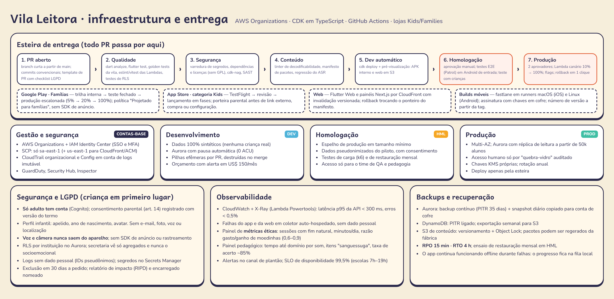

# Vila Leitora — Infraestrutura, entrega e operação

## 1. Ambientes e contas
Contas separadas no **AWS Organizations**, todas na região **sa-east-1** (CloudFront/ACM usam us-east-1 por exigência do serviço).

| Conta | Para quê | Regras |
|---|---|---|
| Gestão | Organizations, faturamento, IAM Identity Center | Ninguém implanta nada aqui |
| Segurança e logs | CloudTrail organizacional, Config, GuardDuty, Security Hub | Logs imutáveis (Object Lock), retenção de 2 anos |
| **dev** | Desenvolvimento e pilhas efêmeras por PR | Só dados sintéticos; Aurora com pausa automática; alerta de orçamento em US$ 150/mês |
| **hml** | Homologação, testes de carga e de restauração, piloto | Dados pseudonimizados do piloto com consentimento; acesso restrito a QA e pedagogia |
| **prod** | Produção | Multi-AZ; acesso humano só por "quebra-vidro" auditado; implantação só pela esteira |

**SCPs:** negam regiões fora de sa-east-1 (exceto serviços globais), desligamento do CloudTrail, buckets públicos e chaves de acesso de longa duração.

## 2. CI/CD
Ferramentas: **GitHub Actions** (com OIDC para a AWS, sem chave fixa), **AWS CDK** e **fastlane**.

| Etapa | O que roda | Bloqueia o merge? |
|---|---|---|
| Qualidade | `melos run analyze`, `flutter test` (inclui golden), `pnpm turbo lint test`, testes de RLS | Sim |
| Segurança | varredura de segredos, auditoria de dependências, licenças (sem GPL/AGPL no código fechado), SAST, `cdk-nag` | Sim |
| Conteúdo | linter de decodificabilidade, validação de schema, regressão do reconhecimento de fala com áudios de teste consentidos | Sim |
| Dev | `cdk deploy` automático + APK interno + web de pré-visualização | — |
| Homologação | aprovação manual; E2E com Patrol em aparelho de entrada; teste de carga; teste com crianças quando a mudança é de interface infantil | — |
| Produção | 2 aprovadores; Lambdas com **implantação canário** (10% por 10 min → 100%) e reversão automática por alarme; feature flags (AppConfig) | — |

**Apps móveis:** fastlane em runners macOS (iOS) e Linux (Android); chaves de assinatura no cofre do CI; build reprodutível a partir da tag.
- **Google Play — "Projetado para famílias":** trilha interna → teste fechado → produção escalonada 5% → 20% → 100%. Sem SDK de anúncio ou de rastreamento; declaração de público-alvo infantil; política de privacidade específica.
- **App Store — categoria Kids:** TestFlight → revisão → lançamento em fases. Porteira parental antes de qualquer link externo, compra ou configuração; sem analytics de terceiros.
- **Web:** CloudFront com arquivos versionados; reverter = trocar o ponteiro do manifesto.
- **Conteúdo:** publicado à parte, sem passar pela loja, com manifesto assinado e reversão para a versão anterior.

## 3. Segurança e LGPD
- **Minimização:** a criança tem só apelido, ano de nascimento e avatar. Sem e-mail, foto, nome completo, localização, voz ou imagem.
- **Consentimento** (LGPD art. 14): o adulto aceita um termo versionado; a escola assina contrato de operador de dados e informa as famílias.
- **Voz e câmera ficam no aparelho.** O espelho do Espelho do Som é local e não grava; a câmera está fora do MVP como análise (Documento Mestre §4.7).
- **Acesso:** Cognito com senha forte e MFA para escolas; papéis (responsável, professora, gestor, secretaria); **RLS por instituição** no Aurora; secretaria só vê agregados e **nunca** dados socioemocionais.
- **Criptografia:** TLS 1.2+ em trânsito; KMS em repouso (Aurora, DynamoDB, S3); SQLCipher no aparelho.
- **Segredos:** Secrets Manager e OIDC no CI; nada em código ou variável de ambiente em texto.
- **Logs:** apenas IDs pseudônimos; filtros que bloqueiam e-mail e telefone; retenção de 30 dias na aplicação.
- **Direitos do titular:** exportação e exclusão em até 30 dias, pelo painel da família.
- **Governança:** RIPD (relatório de impacto), encarregado (DPO) nomeado, checklist ECA Digital (sem loot box, sem oferta para criança, sem publicidade direcionada), parecer jurídico antes de cada envio às lojas.
- **Teste de invasão** anual e antes do lançamento; programa de divulgação responsável.

## 4. Observabilidade
| Camada | Ferramenta | Indicadores e alertas |
|---|---|---|
| APIs e Lambdas | CloudWatch + X-Ray (Powertools) | p95 < 300 ms, erros < 0,5%, filas DLQ vazias |
| App e web | coletor de falhas auto-hospedado, sem dado pessoal | sessões sem falha > 99,5%, abertura a frio ≤ 3 s, fps |
| Sincronização | métricas próprias | idade do evento mais antigo na fila, taxa de rejeição pelo servidor |
| **Métricas éticas** | painel próprio (Athena) | sessões com fim natural, minutos por dia (alerta acima de 30), razão gasto/ganho de moedinhas 0,6–0,9, saldo mediano |
| Pedagógicas | painel próprio | tempo até domínio por som, itens "sanguessuga", acerto médio ~85% |
| Disponibilidade | SLO | 99,5% mensal; plantão em horário escolar (7h–19h) e escalonamento fora dele |

## 5. Backups e recuperação
| Recurso | Proteção | Teste |
|---|---|---|
| Aurora | backup contínuo (PITR 35 dias) + snapshot diário copiado para a conta de segurança | restauração mensal em hml |
| DynamoDB | PITR ligado + exportação semanal para S3 | restauração trimestral |
| S3 de conteúdo | versionamento + Object Lock; pacotes podem ser regerados pela fábrica | — |
| Código e infraestrutura | Git + CDK: ambiente recriado do zero em < 1 dia | ensaio semestral |

**RPO 15 min · RTO 4 h.** Durante uma falha da nuvem, o app continua funcionando offline e o progresso fica na fila local.

## 6. Custos {#custos}
Estimativa mensal, sa-east-1, câmbio US$ 1 = R$ 5,70, incluindo prod + hml + dev.

| Item | 1 mil alunos | 10 mil | 100 mil |
|---|---|---|---|
| Aurora Serverless v2 (0,5–8 ACU + armazenamento) | US$ 90 | US$ 200 | US$ 1.200–2.000 |
| DynamoDB (sob demanda) | US$ 5 | US$ 40 | US$ 350–600 |
| Lambda + AppSync + API Gateway | US$ 10 | US$ 70 | US$ 600–1.000 |
| CloudFront + S3 (pacotes, vídeos, web) | US$ 30 | US$ 150 | US$ 1.000–2.000 |
| WAF, GuardDuty, Config, CloudTrail, KMS, Secrets | US$ 120 | US$ 160 | US$ 350 |
| CloudWatch, X-Ray, Athena, Glue | US$ 60 | US$ 120 | US$ 400–700 |
| hml + dev | US$ 150–330 | US$ 150–400 | US$ 250–500 |
| **Total AWS** | **US$ 450–650** | **US$ 800–1.300** | **US$ 4.000–7.000** |
| Em reais, com outros variáveis | **R$ 2,9–4,0 mil** | **R$ 5,2–8,0 mil** | **R$ 25–42 mil** |

Notas: TTS é custo único de produção (≈ US$ 15 por milhão de caracteres; toda a jornada fica abaixo de US$ 200 por geração completa). Reconhecimento de fala no aparelho = US$ 0. Os números são estimativas para comparar propostas e devem ser refeitos com a calculadora da AWS antes do orçamento final.
