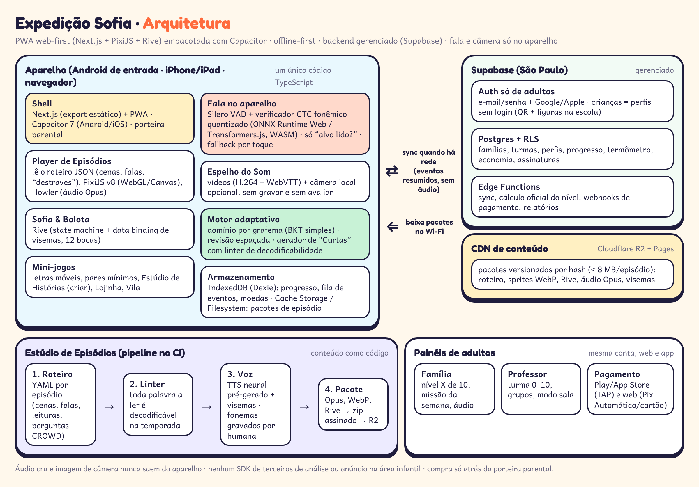

# Arquitetura — Expedição Sofia



## 1. Princípios

1. **Web-first, um código só.** A experiência inteira é uma aplicação web em TypeScript. O Capacitor a empacota para Android e iOS, adicionando só o que é nativo (arquivos, microfone, compras, notificações para adultos).
2. **Offline-first.** A criança joga sem internet. O servidor é a fonte oficial de contas, assinaturas e do nível do termômetro, mas o aparelho funciona dias sem rede.
3. **Nada sensível sai do aparelho.** Áudio cru e imagem de câmera são processados localmente e descartados. Só sobem resultados pedagógicos resumidos (Doc. Mestre §4.8 e §4.15).
4. **Conteúdo como dados.** Episódios são pacotes de dados (roteiro + mídia), nunca código. Isso permite publicar sem nova versão da loja e respeita as regras de lojas sobre código baixado.
5. **Serviços gerenciados e baratos.** Nenhum servidor próprio para manter no MVP, além de uma VPS pequena de observabilidade.

## 2. Componentes no aparelho

| Componente | Tecnologia | Responsabilidade |
|---|---|---|
| **Shell** | Next.js 15 (App Router, `output: 'export'`), React 19, PWA (Workbox), Capacitor 7 | rotas da criança e do adulto, porteira parental, troca de perfil, atualização |
| **Player de Episódios** | PixiJS v8 (WebGL, fallback Canvas), `@pixi/sound` ou Howler.js | interpreta o roteiro (cenas, camadas, falas, legendas, escolhas, "destraves"), sincroniza áudio e visemas, aplica `prefers-reduced-motion` |
| **Personagens** | Rive (runtime WASM `@rive-app/canvas`), state machines com data binding | Sofia e Bolota: idle, ouvir, pensar, apontar, comemorar, "vamos de novo" (nunca triste); 12 bocas ligadas à propriedade `viseme` |
| **Mini-jogos** | componentes Pixi reutilizáveis | letras móveis, pares mínimos, sequências (pensamento computacional), Estúdio de Histórias, Lojinha |
| **Espelho do Som** | `<video>` H.264 + WebVTT; `getUserMedia` só como espelho | clipes por fonema (estrutura fixa do §4.7); câmera opcional, liberada pelo adulto, **sem gravar e sem avaliar** |
| **Fala** | Silero VAD (ONNX, ~2 MB) + verificador CTC fonêmico quantizado int8 (wav2vec2/XLS-R pequeno, destilado) via ONNX Runtime Web/Transformers.js em Web Worker (WASM SIMD) | responde só "a criança leu o alvo?" entre alvo + distratores, com 3 faixas (aceita / incerta / provável erro). Modelo baixado no Wi-Fi e ativado só se o aparelho passar no teste de capacidade; senão, toque |
| **Motor adaptativo** | pacote TS puro (`packages/adaptive`) | domínio por grafema (Bayesian Knowledge Tracing simplificado), revisão espaçada (1–3–7–21 dias), seleção de Curtas, sinais de sobrecarga, termômetro local |
| **Gerador de Curtas** | pacote TS + banco de palavras validadas | gera missões a partir de modelos e só com grafemas já ensinados; semente determinística; linter embutido; *fallback* curado |
| **Armazenamento local** | IndexedDB (Dexie), Cache Storage (web), Capacitor Filesystem (app) | perfis, progresso, fila de eventos, carteira de moedas, pacotes de episódio; dados locais cifrados com chave do aparelho (Web Crypto / Keystore) |

### Orçamento de desempenho (Android 8.1+, 2 GB, tela de 5")
- Instalação inicial ≤ 40 MB (shell + T1); pacote de episódio ≤ 8 MB (áudio Opus mono 32–48 kbps, sprites WebP, `.riv`).
- Abertura a frio ≤ 3 s; ≥ 30 fps; RAM em uso ≤ 250 MB; feedback visual < 100 ms e áudio < 300 ms.
- O modelo de fala (≤ 25 MB) é opcional e baixado sob demanda.

## 3. Formato do episódio (DSL de roteiro)

Cada episódio é um YAML no repositório, validado por esquema (Zod) e compilado para JSON no pacote.

```yaml
id: t6-e04
temporada: cerrado
titulo: O lobo-guará e a trilha
alvo: { grafemas: [rr], contraste: [r, rr] }
vocabulario: [vereda]
cenas:
  - id: abertura
    tipo: revisao        # "Anteriormente…": itens vêm do motor de revisão
    itens: 4
  - id: historia
    cenario: cerrado/trilha
    falas:
      - sofia: "O lobo-guará anda de noite. Por quê?"   # pausa CROWD
        espera: escolha
        opcoes: [frio, sol, sono]
  - id: som
    tipo: licao
    espelho: rr
    bolota_erra: { palavra: corre, leitura_errada: core }
  - id: destrave
    tipo: leitura
    texto: "o lobo corre na terra seca"
    modo: [voz, toque]     # toque é sempre equivalente
    pseudopalavra: "turra"
    abre: porteira-cipo
    pergunta: { texto: "Onde o lobo corre?", resposta: "na terra seca" }
  - id: criar
    tipo: e_depois
    opcoes: ["o lobo bebe na vereda", "o lobo come a fruta", "o lobo nada"]
  - id: fim
    tipo: ritual
    gancho: t6-e05
```

O **linter de decodificabilidade** confere, para cada `texto`, `opcoes` e rótulo da Lojinha, se todos os grafemas pertencem ao conjunto ensinado até aquela temporada (palavras de alta frequência são liberadas por lista explícita). Um episódio que falha não é publicado.

## 4. Backend (Supabase, região São Paulo)

| Serviço | Uso |
|---|---|
| **Auth** | só adultos (e-mail + senha, Google, Apple); MFA para professor/gestor. Crianças são perfis sem credencial própria; na escola, QR da turma + senha de 3 figuras gera um token curto vinculado à turma |
| **Postgres + RLS** | políticas por papel: `responsavel` vê só seus perfis; `professor` vê só suas turmas; `gestor` vê só agregados |
| **Edge Functions (Deno)** | `sync` (recebe lotes de eventos, idempotente por `event_id`), `nivel` (recalcula o termômetro oficial: domínio + transferência + retenção), `pagamentos` (webhooks Play/App Store/gateway), `relatorios` (semana da família, painel da turma) |
| **Storage** | só itens de adulto (ex.: exportação de dados). Mídia de episódios fica no R2 |
| **Cron (pg_cron)** | resumos semanais, rotação de eventos brutos (13 meses), avisos de assinatura ao adulto |

### Modelo de dados (núcleo)

| Tabela | Campos principais |
|---|---|
| `contas` | id, tipo (familia/escola/rede), plano, status_assinatura |
| `adultos` | id (auth), conta_id, papel, consentimentos (versão, data, escopos separados: produto / pesquisa / corpus) |
| `criancas` | id, conta_id, apelido, faixa_etaria, avatar (JSON), região de sotaque, preferências de acessibilidade — **sem nome completo, sem data exata, sem foto** |
| `turmas`, `matriculas` | turma ↔ criança ↔ professor |
| `progresso_grafema` | crianca_id, grafema, p_dominio, ultima_revisao, proxima_revisao |
| `episodios_vistos` | crianca_id, episodio_id, versão, partes concluídas, criado_em |
| `eventos` | id (uuid do aparelho), crianca_id, tipo, payload resumido (item, acerto, modalidade voz/toque, faixa de confiança, tempo) |
| `termometro` | crianca_id, nivel (0–10), evidências, previsão (faixa), atualizado_em |
| `carteira`, `itens`, `compras_virtuais` | moedas ganhas por domínio, itens com preço fixo e visível, cofrinho (meta) |
| `producoes` | quadrinhos/legendas criados pela criança (texto, sem voz) — compartilhamento só por ação do adulto |

## 5. Fluxos-chave

**Sincronização offline.** Cada ação gera um evento local com UUID e relógio do aparelho. Quando há rede, a fila é enviada em lotes (≤ 200 eventos) para `sync`. O servidor deduplica, aplica as regras e devolve o estado consolidado (nível, moedas, revisões agendadas). Em conflito, vale a regra "moedas e domínio só crescem" (o nível nunca desce visivelmente).

**Download de pacotes.** O manifesto da temporada lista episódios com hash. O app baixa sempre **os 2 próximos episódios + Curtas da semana** no Wi-Fi (ou com permissão do adulto nos dados móveis) e apaga os antigos assistidos há mais de 30 dias (os roteiros ficam para reprises).

**Leitura por voz.** Microfone abre só na tela de leitura, com indicador visível → VAD detecta fala → o verificador compara posteriores fonêmicos com o alvo **e com o conjunto de variantes aceitas** (§4.8) → resultado em 3 faixas → o áudio é descartado. Depois de 2 tentativas incertas, a Sofia oferece o toque. Nenhum resultado de voz bloqueia a progressão.

**Compra.** A criança nunca vê preço em dinheiro. No fim da T3a a próxima temporada aparece "em obras". O adulto, atrás da porteira (segurar 3 s + tarefa de leitura), vê a oferta: no Android/iOS por IAP (RevenueCat ou plugin nativo), na web por gateway com Pix Automático e cartão. Um webhook atualiza `contas.status_assinatura` e libera os pacotes.

## 6. Decisões e alternativas

| Decisão | Alternativa considerada | Por quê |
|---|---|---|
| Capacitor | React Native/Expo (rel. 03), Flutter | Pixi e Rive rodam nativamente na web; um código só; equipe web; custo menor |
| Supabase gerenciado | PocketBase gerenciado (PocketHost) | Postgres + RLS + região São Paulo + PITR ajudam a LGPD e o painel da escola. PocketBase fica como plano B mais barato para o protótipo (SQLite, um binário) |
| Cloudflare R2 | Supabase Storage / S3 | sem tarifa de saída: pacotes de episódio são o maior volume de tráfego |
| Verificador no aparelho | Azure Pronunciation Assessment | custo de US$ 1,3–1,5/aluno/mês é incompatível com o preço; privacidade |
| TTS pré-gerado (Azure Neural pt-BR + visemas, versionado) | TTS em tempo real | custo ≈ 0 por aluno, funciona offline, voz estável |
| Rive para personagens | Spine, Live2D, vídeo | data binding de visemas, arquivos pequenos, runtime aberto |
