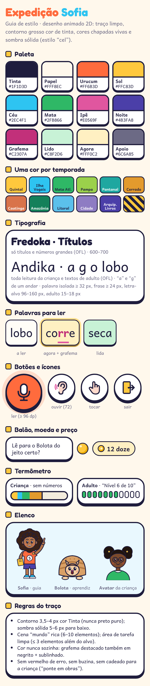

# Design — Expedição Sofia

O visual é de **série de desenho animado 2D**, não de livro ilustrado: **traço limpo de contorno grosso** cor de tinta, **cores chapadas e vivas**, sombra sólida deslocada (estilo "cel"), formas arredondadas, balões de fala de quadrinho e elementos de TV (vinheta, "Temporada 6 · Ep 4", fita de cenas). Todos os mockups foram feitos com HTML/CSS/SVG próprios, sem imagens externas.

## 1. Princípios

1. **A história reage à criança.** Nada de vídeo passivo: no máximo 45 s de animação sem uma ação da criança.
2. **Dois níveis de densidade** (rel. 28): a cena "mundo" é rica (6–10 elementos); a **área de tarefa** é limpa, com fundo branco e ≤ 3 elementos além do alvo. Nada se move enquanto a criança responde.
3. **Navegação sem texto:** ícones concretos (porta = sair, ouvido = ouvir de novo, microfone = ler, mão = tocar, casa = vila, sacola = lojinha, árvore = palavras). Sem ☰, ⋮ ou engrenagem na área infantil. A Sofia é o menu falado.
4. **Erro sem castigo:** sem X vermelho, sem buzina, sem vidas, sem cronômetro, sem ranking. Erro repetido → a resposta certa pulsa e a Sofia diz "vamos juntos?".
5. **Sem cadeado para a criança:** o que ainda não está disponível aparece como **"em obras"** (faixa zebrada amarela com placa), inclusive no fim da parte gratuita.
6. **Cor nunca sozinha:** o grafema-alvo é destacado com cor **e** negrito **e** sublinhado; certo/incerto também usam forma e som.

## 2. Paleta

| Token | HEX | Uso |
|---|---|---|
| Tinta | `#1F1D3D` | contornos, texto (nunca preto puro) |
| Papel | `#FFF8EC` | fundo padrão |
| Urucum | `#FF6B3D` | ação principal (ler, continuar), camiseta da Sofia |
| Sol | `#FFC83D` | destaque, moedas, item atual, "em obras" |
| Céu | `#2EC4F1` | ouvir, água, informação |
| Mata | `#2FB866` | concluído, domínio, termômetro do adulto |
| Ipê | `#E0569F` | Lojinha, grafema (sublinhado) |
| Noite | `#4B3FA8` | áreas de adulto, Espelho do Som |
| Grafema | `#C2307A` | letras do som do episódio (contraste 5,3:1 no branco) |
| Lido / Agora | `#C8F2D6` / `#FFF0C2` | palavra já lida / palavra da vez |
| Apoio | `#6C6A85` | textos secundários |

**Uma cor por temporada:** Quintal `#FFC83D` · Ilha das Vogais `#2EC4F1` · Mata Atlântica `#2FB866` · Pampa `#9BD14B` · Pantanal `#1FA7A0` · Cerrado `#E39A2D` · Caatinga `#D9734A` · Amazônia `#14805A` · Litoral `#5BC0EB` · Cidade `#8E7CC3` · Arquipélago dos Livros `#4B3FA8`.

Contraste: texto ≥ 4,5:1 e ícones ≥ 3:1 (WCAG 2.2 AA); textos claros sobre cor só em títulos grandes com contorno.

## 3. Tipografia

- **Andika** (SIL, OFL): toda leitura da criança e os textos de adulto. "a" e "g" de um andar. Palavra isolada ≥ 32 px (usamos 33–34 px no episódio), frase ≥ 24 px, letra-alvo 96–160 px; adulto 15–18 px.
- **Fredoka** (OFL): só títulos, números grandes e a marca ("Expedição Sofia", "Cerrado", "Nível 6 de 10").
- Cursiva escolar (Playwrite BR + Guides) entra só nas atividades de escrita a partir da T8; OpenDyslexic como opção de acessibilidade.

## 4. Componentes

| Componente | Especificação |
|---|---|
| **Botão "ler" (microfone)** | círculo Urucum de 96–116 dp, contorno 4 px, sombra sólida 6 px e halo pulsando enquanto ouve; ondas sonoras abaixo |
| **Botões de ícone** | círculo branco de 72–84 dp, contorno 3,5 px, sombra 5 px; espaço ≥ 24 dp entre alvos; nunca na faixa inferior de 48 dp sem margem |
| **Chip de palavra** | Andika 33 px, cartão arredondado com contorno 2,5 px; estados: a ler (branco), **agora** (amarelo + halo), lida (verde-claro); toque = a palavra é falada |
| **Balão de fala** | branco com contorno e "rabicho"; a fala da Sofia é sempre também legenda; balão do Bolota em amarelo, com o erro marcado em rosa (nunca riscado com X) |
| **Card de episódio** | miniatura da cena + título + estado (✓ visto, ▶ atual, estrela = amanhã); o atual tem halo amarelo |
| **Tíquete de temporada** | quadrado de 66–96 dp na cor da região, com selo ✓ quando concluída; futura = faixa zebrada "em obras" |
| **Termômetro da criança** | tubo horizontal que enche com as cores das temporadas, avatar da criança no ponto atual, estrela no início e livro (Arquipélago) no fim; **sem números** |
| **Termômetro do adulto** | 11 segmentos (0–10) com o atual parcialmente preenchido + "Nível 6 de 10 · faltam 4" + previsão em faixa |
| **Moedinha e etiqueta** | moeda amarela com brilho; preço = número **e** palavra decodificável ("12 doze") |
| **Cofrinho** | porquinho + item-meta + barra de progresso + "faltam doze moedinhas" (falado) |
| **Fita de cenas** | barra escura de filme com furinhos e 5 quadros (verde = feito, amarelo = agora) e "TEMPORADA 6 · EP 4" |

## 5. Personagens

- **Sofia**: ~9–10 anos, parda, cabelo cacheado volumoso (3C/4A), camiseta Urucum com a letra do som da semana, caderno amarelo e broche de corujinha. Em Rive: 12 bocas por visema, olhar para a criança ao perguntar e para a tarefa ao explicar, gesto de **apontar** como recurso central. Nunca triste, nunca decepcionada.
- **Bolota**: filhote de tatu-bola (*Tolypeutes tricinctus*), carapaça com 3 faixas, rosto claro, orelhinhas. Erra de propósito só o que a criança já domina; a criança o corrige e ele anota no caderninho.
- **Avatar da criança**: tons de pele, cabelos (cacheado, crespo, liso, tranças, puffs), óculos, aparelho auditivo e cadeira de rodas gratuitos desde o início.
- Revisão de representatividade por pessoas negras e pardas, educadores de várias regiões e pessoas com deficiência antes da produção em lote.

## 6. Movimento e som

- Transições de 200–400 ms com *ease-out*; comemoração ≤ 1,5 s; nenhum flash > 3/s; `prefers-reduced-motion` troca animações por cortes.
- Vinheta de abertura ≤ 8 s, pulável depois da primeira vez.
- Fala −16 LUFS; música 12–15 dB abaixo, **muda com o microfone aberto**; som de "incerto" neutro e curto (≤ 200 ms); limitador de volume para ouvidos infantis.

## 7. Telas

| Tela | Arquivo | O que mostra |
|---|---|---|
| Temporadas | `tela-temporadas.png` | avatar e moedas; tíquetes das temporadas (concluídas, atual e "em obras"); destaque da Temporada 6 Cerrado com "continuar a história"; termômetro infantil sem números; lista de episódios; Curtas de revisão; navegação por 4 ícones. O cadeado discreto no canto superior direito é a porteira dos adultos (segurar 3 s) |
| Episódio | `tela-episodio.png` | cena do Cerrado com a porteira de cipó fechando a trilha; Sofia aponta e pede para a criança corrigir o Bolota ("core" × "corre"); cartão de leitura "o lobo corre na terra seca" com o **rr** destacado; botões ouvir / **ler** / tocar (alternativa por toque); aviso de que a voz fica no aparelho |
| Espelho do Som | `tela-espelho.png` | par f × v; espelho local (ilustrado aqui) com guia da boca; "Boca da Sofia" e corte lateral "Por dentro" com o ventinho; dica "mão no pescoço"; passos ouvir → ver → sua vez; selo "nada é gravado" |
| Lojinha | `tela-lojinha.png` | avatar provando o boné; abas roupa, cabelo, óculos, aparelho auditivo, casa; cofrinho para o patinete; itens com nome e preço decodificáveis; Sofia mostra o custo de oportunidade sem julgar; tudo com preço visível, sem sorte |
| Família | `tela-pais.png` | "Nível 6 de 10 — faltam 4", régua 0–10, previsão em faixa, áudio de 1 min, já sabe / está aprendendo, semana (sem "mais é melhor"), missão em família e aviso de que não é diagnóstico |
| Professor | `tela-professor.png` | turma distribuída nos níveis 0–10, mapa de calor por habilidade e grupo, grupos sugeridos editáveis e **modo sala** do episódio da semana |

## 8. Acessibilidade

Meta WCAG 2.2 AA + ajustes infantis do rel. 24: alvos ≥ 72 dp (principais ≥ 96 dp), 2–4 alternativas por tela conforme a idade, sem limite de tempo por padrão, legendas sempre ligadas, Libras em vídeo nas instruções-chave, volumes separados de voz e música, modo "menos movimento", alto contraste e compatibilidade com leitor de tela nas áreas de adulto.
