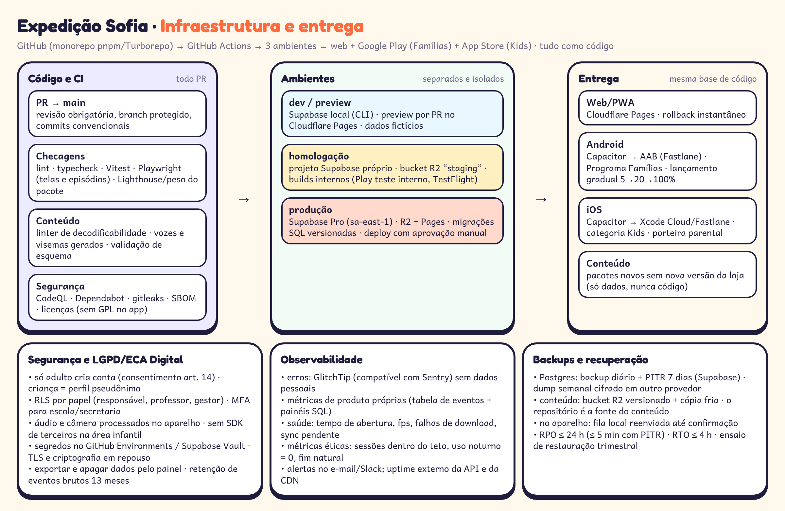

# Infraestrutura — Expedição Sofia

## 1. Ambientes

| Ambiente | Web | Backend | Mídia | Dados | Quem acessa |
|---|---|---|---|---|---|
| **dev** | `next dev` local + preview por PR (Cloudflare Pages) | Supabase local (CLI, Docker) | bucket R2 `dev` | fictícios (`supabase/seed`) | equipe |
| **homologação** | `hml.` no Pages | projeto Supabase próprio (sa-east-1) | bucket `staging` | fictícios + contas de teste | equipe, pedagogia, testadores; builds de teste interno (Play) e TestFlight |
| **produção** | domínio principal no Pages | Supabase Pro (sa-east-1), PITR ligado | bucket `prod` versionado | reais | só via pipeline; acesso humano com MFA, registrado e temporário |

Toda configuração (projetos, buckets, DNS, regras de cache) fica em **Terraform** (providers Cloudflare e Supabase) em `infra/`, com o estado remoto cifrado. Variáveis e segredos ficam em **GitHub Environments** (com aprovação manual em produção) e no Supabase Vault; nunca no código.

## 2. CI/CD (GitHub Actions)

| Workflow | Gatilho | Etapas |
|---|---|---|
| `ci.yml` | todo PR | instalar (cache pnpm/Turbo) → lint → typecheck → Vitest → testes de RLS (pgTAP) → build → Playwright (fluxos da criança e do adulto, capturas de tela) → orçamento de tamanho (shell ≤ 40 MB, pacote ≤ 8 MB) → CodeQL, gitleaks, licenças |
| `conteudo.yml` | PR que toca `conteudo/` | validar esquema → **linter de decodificabilidade** → gerar vozes TTS + visemas (só falas alteradas, com cache por hash) → empacotar → publicar em `staging` → link de pré-visualização do episódio no PR |
| `release-web.yml` | tag `web-v*` | build → deploy no Pages → smoke test → rollback automático se falhar |
| `release-android.yml` | tag `app-v*` | `cap sync` → Gradle (AAB assinado; chave no Play App Signing) → Fastlane → faixa interna → produção em lançamento gradual (5% → 20% → 100%) |
| `release-ios.yml` | tag `app-v*` | `cap sync` → Xcode Cloud ou Fastlane → TestFlight → revisão da App Store |
| `migracoes.yml` | merge em `main` com SQL novo | `supabase db push` em homologação → aprovação → produção (migrações só aditivas; nada destrutivo sem plano) |
| `conteudo-prod.yml` | aprovação pedagógica | promove o pacote de `staging` para `prod` e atualiza o manifesto da temporada (sem nova versão do app) |

Teste de desempenho: um job semanal roda o app num **Android de 2 GB real** (laboratório de aparelhos ou aparelho próprio ligado a um runner) e falha se a abertura passar de 3 s, se ficar abaixo de 30 fps ou se a RAM passar de 250 MB.

## 3. Segurança e LGPD / ECA Digital

- **Cadastro só por adulto** ou instituição; consentimento parental (LGPD art. 14) com escopos separados (produto / pesquisa / corpus); textos revisados por advogado.
- **Minimização:** a criança é um perfil pseudônimo (apelido, faixa etária, avatar). Sem foto, sem data exata de nascimento, sem localização.
- **Voz e câmera no aparelho.** O microfone abre só na tela de leitura, com indicador; o áudio é descartado após a decisão. A câmera do Espelho do Som é opcional, liberada pelo adulto, sem gravar e sem análise no MVP.
- **Controle de acesso:** RLS em todas as tabelas, testada no CI; papéis `responsavel`, `professor`, `gestor`, `admin`; MFA obrigatório para escola e equipe.
- **Criptografia:** TLS 1.2+; Postgres e R2 cifrados em repouso; dados locais cifrados (Web Crypto + Keystore/Keychain via Capacitor).
- **Sem terceiros na área infantil:** nenhum SDK de analytics, anúncio ou rede social; fontes e mídias servidas pelo próprio domínio. Crash reports sem dados pessoais (GlitchTip próprio).
- **Direitos do titular:** exportar e apagar dados pela área da família; apagar conta remove eventos em até 30 dias e dos backups no ciclo de retenção.
- **Retenção:** eventos brutos por 13 meses, depois só agregados; logs de servidor por 30 dias sem IP completo.
- **Compra e oferta só para adultos**, atrás da porteira; sem loot box, sem compra de moedas (ECA Digital, arts. 20 e 22).
- **Fornecedores:** DPA com Supabase, Cloudflare e o gateway de pagamento; dados hospedados no Brasil sempre que possível.

## 4. Observabilidade

| O quê | Como |
|---|---|
| Erros (web e app) | GlitchTip (compatível com Sentry) numa VPS pequena; `beforeSend` remove qualquer texto livre e identificador |
| Saúde técnica | eventos próprios: tempo de abertura, fps médio, falhas de download, tamanho da fila de sync, uso de memória (amostral) |
| Produto e aprendizagem | tabela `eventos` + visões SQL/Metabase: domínio por grafema, conversão do gratuito, retenção semanal |
| **Métricas éticas** | % de sessões dentro do teto diário, uso na janela noturna (meta 0), sessões que terminam pelo ritual, taxa de toque × voz por região (equidade do verificador) |
| Disponibilidade | monitor externo da API e da CDN; alertas por e-mail/Slack; página de status simples |

## 5. Backups e recuperação

- **Postgres:** backups diários automáticos + PITR de 7 dias (Supabase Pro); `pg_dump` semanal cifrado em outro provedor (bucket com retenção de 90 dias).
- **Conteúdo:** o repositório é a fonte; os pacotes no R2 têm versionamento e cópia fria; qualquer pacote pode ser regerado pelo pipeline.
- **Aparelho:** a fila local só é apagada após confirmação do servidor.
- **Metas:** RPO ≤ 5 min (PITR) / 24 h (pior caso); RTO ≤ 4 h. Ensaio de restauração em homologação a cada trimestre, com registro.

## 6. Lojas: Google Play Famílias e App Store Kids (via Capacitor)

| Requisito | Como atendemos |
|---|---|
| Público infantil declarado; política de privacidade | política em linguagem simples + versão para crianças em áudio |
| Sem anúncios e sem SDKs de terceiros não aprovados | nenhum SDK de analytics/anúncio; o manifesto Android remove `AD_ID`; bundle auditado no CI |
| Porteira parental para links, compras e configurações (Apple Kids) | segurar 3 s + tarefa de leitura sorteada; aviso falado da Sofia |
| Compras digitais pela loja | assinatura mensal via Google Play Billing e App Store (RevenueCat ou plugin nativo); na web, gateway próprio |
| Funcionalidade nativa real (Apple 4.2) | offline com arquivos locais, microfone, compras nativas, ícones adaptativos, splash; nada de "site embrulhado" |
| Código baixado | pacotes de episódio são **só dados** (JSON, áudio, imagem, `.riv`); o código JS vem sempre na versão aprovada |
| Permissões mínimas | microfone (pedido em contexto) e câmera (só se o adulto ligar o espelho); sem localização, contatos ou fotos |
| Classificação etária | Livre / 4+; questionários IARC e Apple preenchidos com o jurídico |
