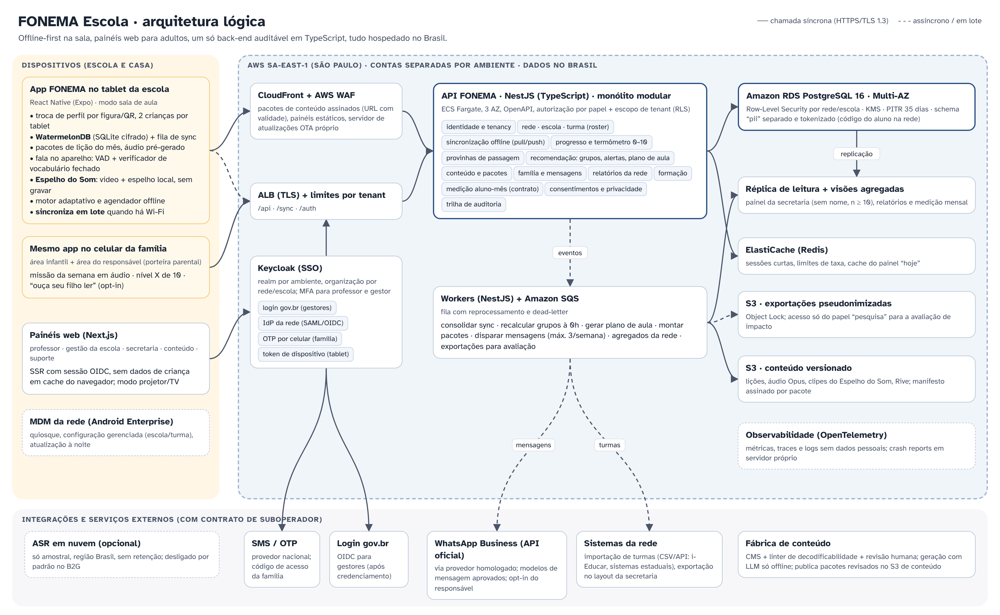

# Arquitetura — FONEMA Escola



## 1. Princípios

1. **Offline-first na sala:** o tablet é a fonte da verdade durante a aula; o servidor consolida depois. Nenhuma interação da criança espera a rede.
2. **Um back-end, muitos clientes:** app (criança, família, modo professor) e painéis web falam com a mesma API, com a mesma autorização.
3. **Monólito modular** em NestJS, não microsserviços: equipe pequena, fronteiras de módulo explícitas, possível extração futura.
4. **Privacidade por arquitetura:** voz e câmera no aparelho; a secretaria nunca recebe dado nominal; logs sem dados pessoais.
5. **Auditável:** tudo em código (Terraform, migrações, políticas RLS), trilha de auditoria imutável, dados só no Brasil.

## 2. Componentes

| Camada | Tecnologia | Responsabilidade |
|---|---|---|
| App | **React Native + Expo** (Android primeiro; iPadOS depois) | modo sala (troca de perfil, duplas, estações), área infantil, área do responsável, modo professor (atrás de porteira) |
| Jogos e animação | PixiJS via Expo DOM / `react-native-skia`; **Rive** para Sofia e Bolota | atividades 2D, lip-sync por visemas |
| Banco local | **WatermelonDB** (SQLite com SQLCipher) | perfis, tentativas, progresso, fila de eventos |
| Fala | VAD + verificador de vocabulário fechado no aparelho (sherpa-onnx/Vosk com gramática restrita; PoC decide) | "leu o alvo?"; nunca avalia articulação; toque como alternativa equivalente |
| Painéis | **Next.js** (App Router, SSR) | professor, gestão escolar, secretaria, conteúdo, suporte |
| API | **NestJS** (TypeScript), OpenAPI | regras de negócio, sync, termômetro, recomendações |
| Assíncrono | Workers NestJS + **Amazon SQS** (com DLQ) | grupos noturnos, plano de aula, pacotes, mensagens, agregados |
| Identidade | **Keycloak** | SSO de professores e gestores (MFA), federação com IdP da rede, **login gov.br** para gestores, OTP da família, token de dispositivo |
| Dados | **Amazon RDS PostgreSQL** Multi-AZ + réplica; ElastiCache Redis; S3 | dados transacionais com RLS; agregados; conteúdo versionado |
| Borda | CloudFront + WAF + ALB | conteúdo assinado, OTA próprio, proteção |

## 3. Modelo de dados (resumo)

```
rede ─┬─ escola ─┬─ turma ─┬─ matricula ── aluno (perfil infantil, sem CPF)
      │          │         └─ professor_turma ── usuario (adulto, Keycloak)
      │          └─ dispositivo (tablet, token próprio)
      └─ contrato (medição aluno-mês)
aluno ── tentativa (evento) ── habilidade (grafema-fonema, BNCC)
aluno ── dominio_habilidade (estado, estabilidade, última revisão)
aluno ── nivel_fonema (0–10, histórico, provinha de passagem)
aluno ── responsavel_vinculo ── usuario (família, OTP)
consentimento (por finalidade) · auditoria (append-only) · pacote_conteudo (versão, hash)
```

- **Tenancy:** toda tabela de domínio tem `rede_id` (e `escola_id` quando cabe). Políticas **RLS** no PostgreSQL usam variáveis de sessão (`app.rede_id`, `app.papel`, `app.escola_ids`) definidas pela API a partir do token; um bug na API não vaza dados entre redes.
- **Dados pessoais mínimos do aluno:** primeiro nome + inicial, figura, turma, mês/ano de nascimento. O código do aluno na rede (para integração) fica em schema `pii` separado, cifrado no nível da coluna e acessível só ao módulo de integração.
- **Agregados da secretaria:** visões materializadas na réplica, por turma/escola, com **supressão de células n < 10**; nenhum dado socioemocional entra nelas.

## 4. Sincronização offline

**Escolha: WatermelonDB + protocolo próprio de pull/push no NestJS.** PowerSync (replicação lógica do Postgres) foi avaliado como alternativa; fica como plano B se o protocolo próprio custar demais. Motivos da escolha: sem fornecedor adicional processando dados de crianças, protocolo simples de auditar e regras de conflito do domínio.

- **Push:** o tablet envia lotes de **eventos imutáveis** (tentativa, sessão, provinha, troca de perfil) com UUID v7, relógio do aparelho e `device_id`. A API grava de forma idempotente (chave = UUID). Eventos nunca conflitam: só se acumulam.
- **Pull:** o tablet recebe mudanças desde o último `cursor` (turmas, perfis, grupos do dia, estado de domínio recalculado, pacotes disponíveis).
- **Estado derivado** (domínio, nível, grupos) é recalculado no servidor a partir dos eventos; o tablet mantém uma cópia local calculada pelo mesmo pacote `@fonema/dominio` (mesmo código TypeScript dos dois lados), então a criança vê progresso imediato e o servidor confirma depois.
- **Conflitos raros** (ex.: professora renomeia perfil em dois aparelhos): última escrita vence por campo, com auditoria.
- **Capacidade:** até 40 perfis por tablet; até 30 dias offline; lote de sync comprimido (< 200 KB por turma/dia típico).
- **Rede local (V1):** modo ao vivo da professora lê o tablet pela rede da sala quando não há internet.

## 5. Identidade e acesso

| Quem | Como entra | Papel |
|---|---|---|
| Professor(a) | e-mail institucional + senha + MFA, ou SSO da rede (SAML/OIDC) | vê só suas turmas, com nomes |
| Coordenação/direção | idem | vê a escola |
| Secretaria | SSO da rede ou **login gov.br** (OIDC, após credenciamento) + MFA | vê agregados, sem nomes |
| Família | celular + código (OTP por SMS/WhatsApp), sem e-mail | vê só os próprios filhos |
| Tablet | **token de dispositivo** emitido no cadastro pelo MDM/professora, vinculado à escola | cria eventos dos alunos daquela escola |
| Criança | **sem credencial**: escolhe a figura ou mostra o crachá QR (token opaco e rotativo, sem dado pessoal) | perfil infantil |
| Equipe FONEMA | IAM Identity Center + Keycloak admin, acesso JIT com aprovação | suporte com dados pseudonimizados |

## 6. Conteúdo

- Fonte em YAML/JSON versionado no repositório (`conteudo/`), validado pelo **linter de decodificabilidade** (bloqueante) e por revisão humana.
- O pipeline gera **pacotes por região** (≤ 5 MB por lição; áudio Opus; clipes do Espelho do Som H.264 720×720 e versão leve 480×480; Rive) com manifesto assinado (Ed25519); o app verifica a assinatura antes de usar.
- Histórias geradas com LLM **só offline**, com validador de grafemas e revisão humana obrigatória; nada é gerado em tempo real para a criança.

## 7. Recomendações para o professor

Job noturno por turma (≈ 0h):
1. **Alertas:** travado ≥ 3 sessões na mesma habilidade; sem uso ≥ 7 dias; padrão de chute (latência muito baixa + erro); pronto para provinha; criança "invisível" (estável e sem interação com a professora há 3 semanas).
2. **Grupos de 3–5:** agrupamento pela próxima habilidade-alvo (vetor de domínio), com restrições (tamanho, equilíbrio, ajuste manual da professora persistido).
3. **Plano de aula:** rotação 3 × 15 min, combinando grupos × estações, com a ficha do guia e do kit impresso de cada grupo.

Regras simples e explicáveis primeiro (auditáveis pela rede); modelos estatísticos só depois do RCT.

## 8. Mensagens às famílias

- Módulo `familia` agenda no máximo **3 mensagens/semana** por família, no horário escolhido, nunca durante o "modo juntos".
- Envio por **provedor oficial da API do WhatsApp Business** (modelos aprovados de utilidade), SMS ou notificação do app; A/B por família registrado para a avaliação.
- Opt-in explícito e revogável; nenhuma foto de criança; respostas em áudio só com consentimento específico.

## 9. Decisões de arquitetura (ADRs iniciais)

| ADR | Decisão |
|---|---|
| 0001 | Monorepo TypeScript (pnpm + Turborepo) |
| 0002 | NestJS monólito modular; extrações só com métrica que justifique |
| 0003 | PostgreSQL com RLS por rede/escola como segunda barreira de autorização |
| 0004 | WatermelonDB + protocolo próprio de sync orientado a eventos |
| 0005 | Keycloak como IdP central; gov.br e IdPs das redes por federação |
| 0006 | AWS sa-east-1 exclusivamente; SCP bloqueando outras regiões |
| 0007 | Fala no aparelho; nuvem só amostral, opcional e sem retenção |
| 0008 | Sem SDK de terceiros na área infantil; telemetria first-party via OpenTelemetry |
| 0009 | OTA próprio (protocolo expo-updates) em vez de serviço externo |
