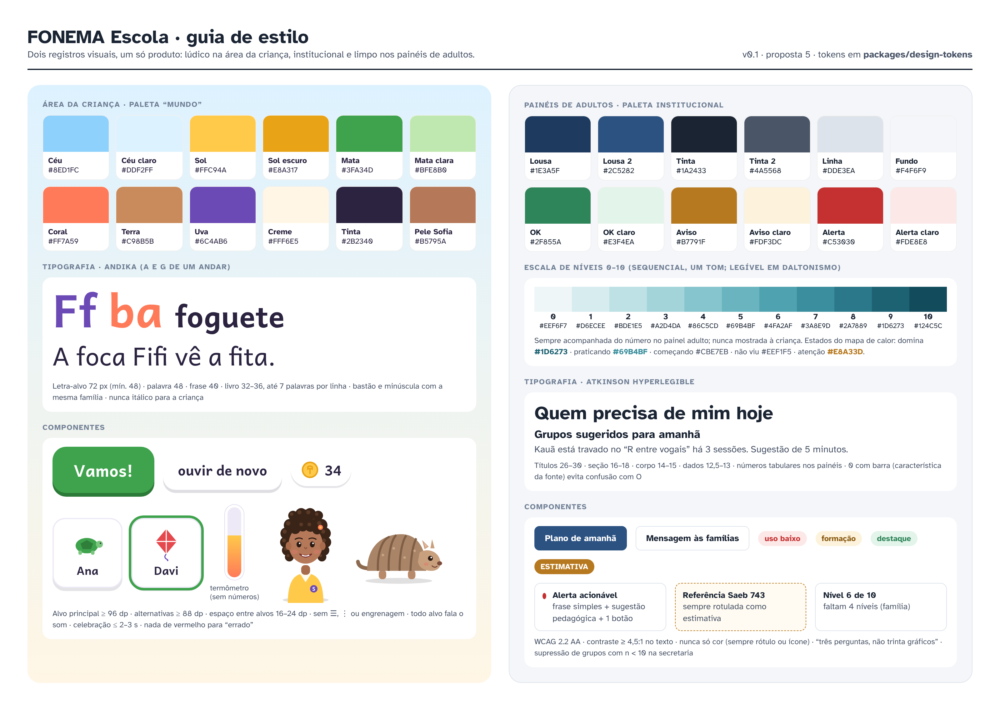
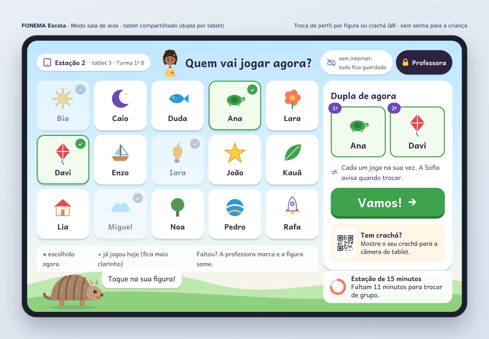
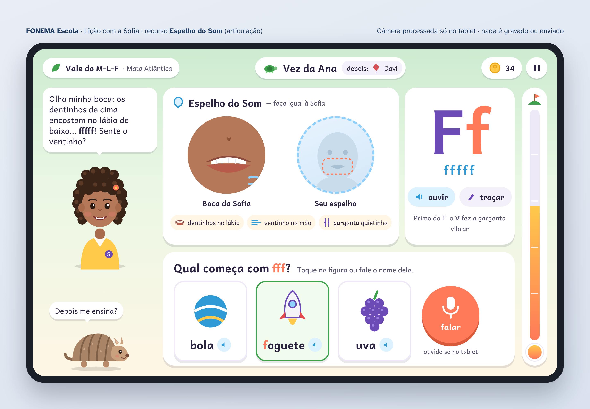
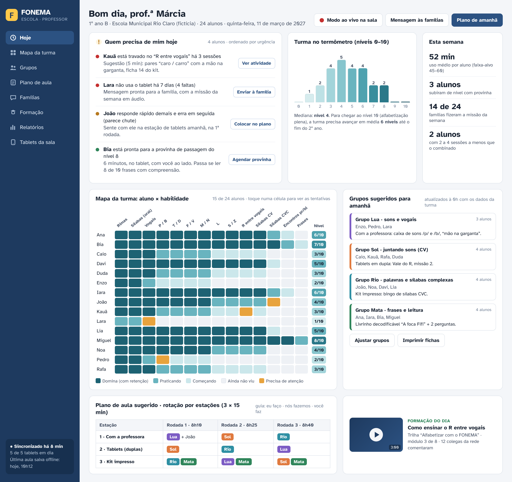
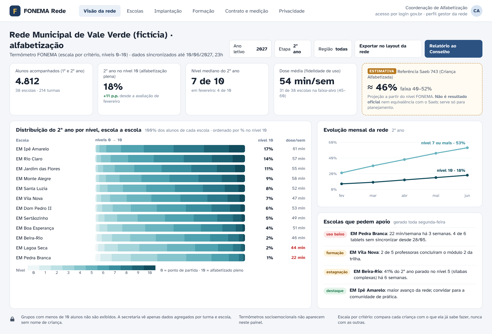
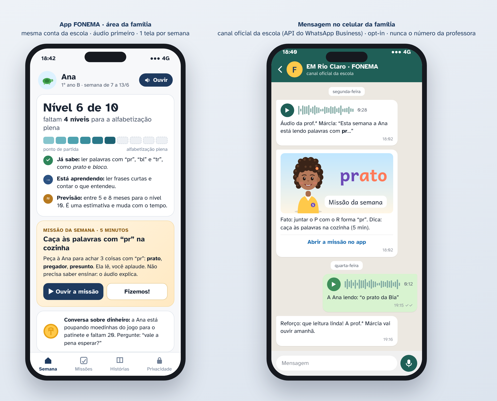

# Design — FONEMA Escola

Dois registros visuais num só produto:
- **Área da criança — lúdica:** céu, mata, sol; cartões grandes com sombra "de brinquedo"; Sofia e Bolota sempre presentes; tipografia **Andika**.
- **Painéis de adultos — institucional limpo:** fundo cinza-claro, cartões brancos, azul "lousa"; tipografia **Atkinson Hyperlegible**; dado sempre com frase e sugestão de ação.

Todas as imagens foram feitas com HTML/CSS/SVG próprios (sem imagens externas nem marcas de terceiros) e capturadas com Playwright (escala 2×). As fontes vêm do pacote Fontsource (licença SIL OFL).

## Guia de estilo

| Token | Criança (HEX) | Painéis (HEX) |
|---|---|---|
| Primária | Mata `#3FA34D` (ação “Vamos!”) | Lousa 2 `#2C5282` (ação principal) |
| Fundo | Céu claro `#DDF2FF` → Creme `#FFF6E5` | Fundo `#F4F6F9`, cartão `#FFFFFF`, linha `#DDE3EA` |
| Texto | Tinta `#2B2340` | Tinta `#1A2433`, secundário `#4A5568` |
| Acentos | Sol `#FFC94A`, Coral `#FF7A59`, Uva `#6C4AB6`, Terra `#C98B5B`, Céu `#8ED1FC` | OK `#2F855A`, Aviso `#B7791F`, Alerta `#C53030` (sempre com rótulo) |
| Escala 0–10 | não aparece (termômetro sem números, gradiente sol→coral) | sequencial de um tom: `#EEF6F7` … `#124C5C` |

Regras: WCAG 2.2 AA; nunca só cor; alvos infantis ≥ 96 dp; sem ☰/⋮/engrenagem na área infantil; nenhum vermelho para “errado” na fala; celebração ≤ 2–3 s; sem rolagem nas telas da criança.

## Telas

### 1. Troca de perfil da turma (tablet compartilhado)

Figuras grandes (sem senha), dupla de agora com ordem de vez, crachá QR como alternativa, cronômetro da estação, indicador “sem internet: tudo fica guardado” e acesso da professora atrás de cadeado.

### 2. Lição com a Sofia e o Espelho do Som

Sofia modela o som; o **Espelho do Som** mostra a boca da Sofia e o espelho local (processado só no tablet, nada gravado), com pistas lúdicas (“dentinhos no lábio”, “ventinho na mão”, “garganta quietinha”). Letra grande em Andika, atividade de escolha com toque ou fala, vez da dupla no topo e termômetro sem números à direita.

### 3. Painel do professor

“Quem precisa de mim hoje” com ação em 1 toque, turma no termômetro 0–10, mapa de calor aluno × habilidade (5 estados com rótulo), grupos sugeridos para amanhã, plano de aula em rotação por estações e formação do dia.

### 4. Painel da secretaria

Distribuição 0–10 por escola (barras 100%), % no nível 10, dose de uso, evolução mensal, escolas que pedem apoio e a **referência Saeb 743 em caixa tracejada com selo “ESTIMATIVA”**. Sem nomes, n < 10 suprimido, sem socioemocional.

### 5. Família

“Nível 6 de 10 · faltam 4 níveis” com o que já sabe, o que está aprendendo e previsão em faixa; missão da semana de 5 minutos com áudio; conversa sobre dinheiro (moedinhas do jogo). Ao lado, a mensagem no canal oficial da escola (fato/dica/reforço, áudio da professora e resposta com a leitura da criança).

## Fontes do HTML

Os arquivos-fonte das telas (HTML/CSS/SVG) ficam no rascunho da sessão; no repositório definitivo devem ir para `packages/design-tokens` (tokens) e `docs/design/mockups/` (protótipos).
