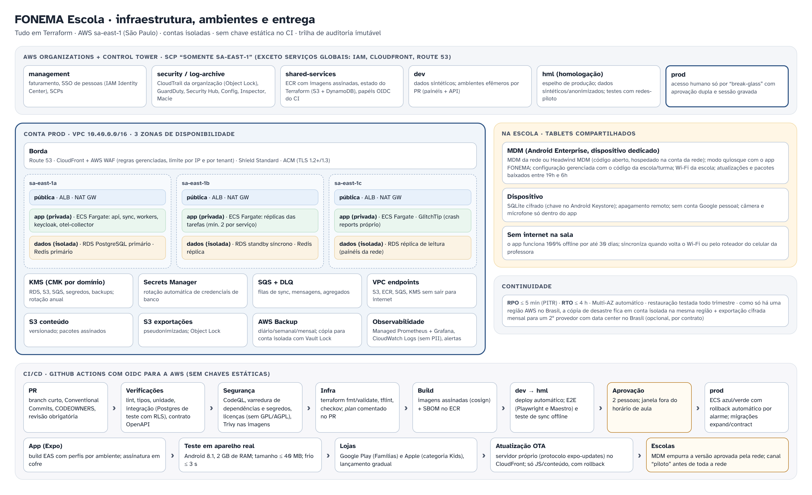

# Infraestrutura — FONEMA Escola

## 1. Ambientes e contas

| Conta AWS | Uso | Dados |
|---|---|---|
| management | faturamento, IAM Identity Center, SCPs | — |
| security / log-archive | CloudTrail da organização (Object Lock), GuardDuty, Security Hub, AWS Config, Inspector, Macie | logs |
| shared-services | ECR (imagens assinadas), estado do Terraform (S3 + DynamoDB), papéis OIDC do CI | — |
| **dev** | desenvolvimento; ambientes efêmeros por PR | sintéticos |
| **hml** | homologação, espelho de produção; testes com redes-piloto | sintéticos/anonimizados |
| **prod** | produção | reais |

- **Região única: sa-east-1 (São Paulo)**, imposta por SCP (exceto serviços globais IAM, CloudFront, Route 53).
- Tudo em **Terraform** (módulos próprios versionados); nenhuma mudança manual em prod (AWS Config alerta desvio).
- Acesso humano a prod só por *break-glass*: aprovação de 2 pessoas, sessão gravada, duração máxima de 1 h.

## 2. Produção

- VPC em 3 AZs: sub-redes públicas (ALB, NAT), privadas de aplicação (ECS Fargate) e isoladas de dados (RDS, Redis).
- **ECS Fargate**: `api`, `sync`, `workers`, `keycloak`, `ota`, `otel-collector`, `glitchtip`; mínimo de 2 tarefas por serviço, autoescala por CPU e fila.
- **RDS PostgreSQL 16 Multi-AZ** (aplicação) + réplica de leitura (painéis da rede); **RDS separado para o Keycloak**.
- ElastiCache Redis (sessões curtas, limites de taxa).
- S3: conteúdo versionado; exportações pseudonimizadas com Object Lock; backups.
- CloudFront + WAF (regras gerenciadas, limite por IP e por tenant), ACM, Shield Standard.
- KMS com chave por domínio; Secrets Manager com rotação; VPC endpoints para S3, ECR, SQS e KMS.

## 3. CI/CD

GitHub Actions com **OIDC para a AWS** (sem chaves estáticas):

1. **PR:** lint, tipos, testes de unidade e integração (Postgres real com RLS), contrato OpenAPI, CodeQL, varredura de dependências e segredos, licenças (sem GPL/AGPL no código fechado), Trivy nas imagens.
2. **Infra:** `terraform fmt/validate`, tflint, checkov; `plan` comentado no PR; `apply` só após merge e aprovação.
3. **Build:** imagens assinadas com cosign + SBOM no ECR.
4. **dev → hml:** deploy automático; E2E (Playwright, Maestro) e teste de sync offline.
5. **prod:** aprovação de 2 pessoas, janela **fora do horário de aula** (ex.: 19h–6h), ECS azul/verde com rollback automático por alarme; migrações expand/contract.

App: build EAS com perfis por ambiente → teste em aparelho real (Android 8.1, 2 GB) → lojas com lançamento gradual → **OTA próprio** (protocolo expo-updates, só JS e conteúdo, com rollback) → MDM da rede empurra a versão aprovada, canal "piloto" antes de toda a rede.

## 4. Segurança e LGPD

**Papéis jurídicos** ⚖️
- No B2G/B2B, a **secretaria (ou escola) é a controladora**; o FONEMA é **operador**. No B2C, o FONEMA é controlador.
- **Contrato de tratamento de dados com cada secretaria** (anexo ao contrato/ARP): finalidade (alfabetização e gestão pedagógica), instruções do controlador, lista de **suboperadores** (AWS Brasil, provedor de WhatsApp Business, provedor de SMS), **dados armazenados no Brasil**, medidas de segurança, comunicação de incidentes ao controlador em até 24 h (para que ele cumpra o prazo da ANPD), auditoria, apoio a pedidos de titulares, **eliminação ou devolução em até 30 dias** após o fim do contrato, proibição de uso para publicidade ou perfilamento.
- **RIPD/DPIA** conjunto com cada rede antes do piloto (dados de crianças, voz, sinalização de risco, mensagens), revisado a cada versão relevante.
- Base legal: execução de políticas públicas de educação pela secretaria, com o melhor interesse da criança (LGPD art. 14; Enunciado ANPD 1/2023); **consentimento específico e separado** para finalidades opcionais (mensagens por WhatsApp, "ouça seu filho ler", pesquisa/corpus de voz, câmera se um dia existir).
- **ECA Digital:** proteção máxima por padrão, sem loot box nem aleatoriedade paga, sem perfilamento publicitário, sem autoplay ou rolagem infinita.

**Controles técnicos**
- MFA obrigatório para professores, gestores e equipe; sessões curtas; tokens de dispositivo revogáveis.
- RLS no Postgres + autorização na API (duas barreiras); testes automatizados de isolamento entre redes.
- Criptografia em trânsito (TLS 1.2+) e em repouso (KMS; SQLCipher nos aparelhos; coluna cifrada para o código do aluno).
- Voz processada no aparelho; áudio não sai sem consentimento; nada de voiceprint.
- Logs sem dados pessoais; trilha de auditoria append-only de todo acesso a dado nominal.
- Pentest externo antes do piloto e anual; programa de divulgação responsável.

## 5. Observabilidade

- OpenTelemetry na API, workers e painéis → Amazon Managed Prometheus + Grafana; logs no CloudWatch (sem PII, retenção 90 dias).
- Crash reports do app em **GlitchTip hospedado na própria conta** (sem SDK de terceiros na área infantil).
- SLOs: API p95 < 300 ms; sync com sucesso > 99,5% dos lotes; disponibilidade dos painéis 99,5% em horário escolar.
- **Métricas de saúde pedagógica e ética**: dose por turma, escolas com sync parado > 7 dias, sessões infantis acima do teto, mensagens além de 3/semana (deve ser zero).
- Alertas para plantão em horário escolar (7h–18h) com escalonamento.

## 6. Backups e continuidade

- RDS: PITR de 35 dias (RPO ≤ 5 min) + snapshots diários/semanais/mensais pelo **AWS Backup**, cópia para conta isolada com **Vault Lock**.
- RTO ≤ 4 h; restauração testada a cada trimestre (runbook em `docs/runbooks`).
- Como a AWS tem uma só região no Brasil, a recuperação de desastre usa Multi-AZ + conta isolada na mesma região + **exportação mensal cifrada para um 2º provedor com data center no Brasil** (opcional, conforme contrato com a rede).
- Os tablets são resilientes por natureza: até 30 dias de dados ficam neles se o servidor cair.

## 7. MDM para tablets escolares

- **Android Enterprise, dispositivo dedicado (modo quiosque)**: o tablet abre direto no FONEMA; sem conta Google pessoal; navegador e lojas bloqueados.
- MDM da própria rede, quando existir; senão **Headwind MDM** (código aberto) hospedado na conta da rede ou operado pelo FONEMA como serviço.
- **Configuração gerenciada** (managed config) leva o código da escola e da turma; o app pede o token de dispositivo no primeiro uso.
- Atualizações de app e pacotes de conteúdo agendadas entre 19h e 6h; política de bateria e Wi-Fi da escola; apagamento remoto em perda/roubo.
- iPad (V2): Apple School Manager + MDM compatível.

## 8. Lojas (Kids / Families)

- **Google Play — programa Famílias**: público-alvo infantil declarado, sem ID de publicidade, sem anúncios, só SDKs autorizados (nenhum de terceiros na área infantil), política de privacidade específica.
- **Apple — categoria Kids** (quando houver iOS): sem analytics/anúncios de terceiros, **porteira parental** antes de qualquer link externo, compra ou área adulta.
- A área do responsável e o modo professor ficam atrás da porteira; **nenhuma oferta de compra aparece para a criança**; no B2G nem existe compra no app.
- Distribuição escolar também por MDM (APK gerenciado via Google Play gerenciado), com a mesma versão das lojas.
