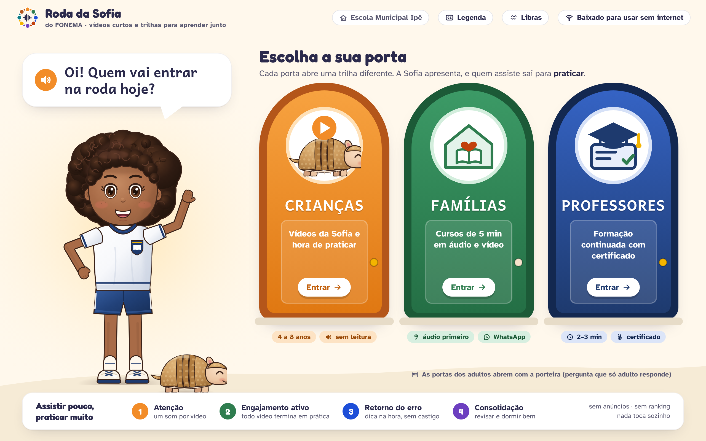

# Academia FONEMA: vídeos e trilhas para crianças, famílias e professores

> **Atualizado pela [Decisão 011](../../../decisoes/011-academia-pintura-vozes.md):** o nome oficial é **Academia** (Academia FONEMA). "Roda da Sofia", recomendado na primeira versão deste documento (§1), deixou de ser o nome principal e pode ficar só como nome da **seção de conversas mediadas** (rodas on-line, rodas na escola). As telas PNG desta pasta ainda mostram o logotipo "Roda da Sofia" e precisam ser regeradas (ver `docs/QUALIDADE.md`).

> **Origem:** [Decisão 006](../../../decisoes/006-academia-uniforme-elenco-voz.md), item 1: uma academia lúdica, com nome mais brincalhão que "academy", para **crianças, famílias e professores**. Ela parte das 3 amostras de vídeo que o dono aprovou ([`../videos/`](../videos/README.md)).
> **Em uma frase:** a Academia é o lugar dos vídeos curtos e das trilhas do FONEMA. Ela tem **3 portas**: a das crianças (assistir pouco e praticar muito), a das famílias (5 minutos, de preferência em áudio, também pelo WhatsApp) e a dos professores (formação continuada com microvídeos, planos de aula, comunidade de prática e **certificado com carga horária**).
> **Bases:** pesquisas [26](../../../pesquisa/26-familia-professores-escolas.md) (família, professores, implementação), [15](../../../pesquisa/15-neuroeducacao-mitos.md) (neuroeducação e neuromitos), [41](../../../pesquisa/41-linguagem-oral-vocabulario.md) (linguagem oral) e [43](../../../pesquisa/43-avaliacao-competencias-transversais.md) (avaliação sem virar prova).



## Arquivos desta pasta

| Arquivo (2560×1600) | O que mostra |
|---|---|
| `academia-inicio.png` | Escolha de perfil com 3 portas (Crianças, Famílias, Professores). A Sofia, de uniforme, pergunta em voz alta "Quem vai entrar na roda hoje?". As portas dos adultos abrem pela porteira. No rodapé, os 4 pilares da aprendizagem |
| `academia-criancas.png` | Academia · Crianças: o som novo do dia (/v/), a videoteca "Sofia apresenta o som" com selos **assisti + pratiquei**, "Como funciona" (E se eu errar?), regrinha R/RR e um teto diário de "1 vídeo + 1 prática" |
| `academia-familias.png` | Academia · Famílias: missão da semana ligada ao som da criança, 6 microcursos de 5 min (áudio, vídeo e WhatsApp), um celular com a sequência fato, missão e reforço no WhatsApp, a versão simples por ícones e voz, e uma nota de ciência sem exagero |
| `academia-professores.png` | Academia · Professores: a trilha de 40 h em 9 módulos com progresso (13 h de 40 h), requisitos do certificado, plano de aula do dia e comunidade de prática da rede |
| `academia-aula.png` | Aula do professor: player do microvídeo "Como modelar o /v/ sem vogal extra" (corte lateral, legenda, capítulos, Libras) com a atividade ao lado (checagem sem nota, "leve para a sala", registro da prática) e o quadro "mito ou fato?" |
| `academia-certificado.png` | Certificado de formação continuada (modelo marcado "MODELO"), com carga horária detalhada, módulos, código e QR de verificação, e espaços para a IES parceira e a Secretaria |
| `fonte/` | HTML/CSS/SVG próprios. `node fonte/capturar.js` gera as 6 telas com Playwright (`chromium.launch()`, viewport 1280×800, `deviceScaleFactor: 2`) |

**A Sofia nesta pasta já segue a Decisão 006.** Ela usa **uniforme escolar**: camiseta branca com gola e punhos azul-marinho, brasão bordado da escola e bermuda azul-marinho. Não usa **brincos, fivela de flor, pulseira de miçangas nem mochila de exploradora**. O desenho base vem de `personagens/fonte/`, copiado para `academia/fonte/` (`sofia.js`, `core.js`) com o figurino trocado. O Bolota não mudou. O elenco animal e as profissões novas da Decisão 006 ficam com a frente de personagens.

---

## 1. Nome: 8 opções avaliadas (histórico; o nome escolhido pelo dono é "Academia", D011)

Critérios: palavras curtas, fáceis de ler e, de preferência, **decodificáveis** por quem está aprendendo (sílabas CV); som lúdico; sentido que funcione para os 3 públicos; nenhuma marca conflitante óbvia. **Nenhuma busca no INPI foi feita nesta sessão.** Todas as opções precisam de busca em [busca.inpi.gov.br](https://busca.inpi.gov.br) nas classes NCL **9** (software/app), **16** (material impresso), **41** (educação e formação) e **42** (plataforma). Também é preciso checar domínio .com.br e os perfis de rede social.

| # | Nome | Por que funciona | Alerta para a busca (INPI e mercado) |
|---|---|---|---|
| 1 | **Roda da Sofia** ★ | "Roda" é prática diária da escola brasileira (roda de conversa, roda de leitura, brincar de roda) e serve aos 3 públicos: a criança entra na roda, a família faz roda em casa, a professora faz roda de formação. RO-DA, DA, SO-FI-A são sílabas simples | "Sofia" é nome comum e existe a marca infantil da Disney *Sofia the First* ("Princesinha Sofia") nas classes 9, 16 e 41. Esse risco já vale para a personagem, não só para a academia. Conferir também "Roda" em educação (Roda Viva é TV, outra classe) |
| 2 | Toca do Bolota | A toca do tatu é lugar seguro para errar e tentar de novo. "Toca" também lembra "o vídeo toca" | **Toca Boca** é marca conhecida de apps infantis (classes 9 e 41). Risco de confusão alto. Evitar |
| 3 | Quintal do Som | Quintal é brincadeira, casa e família | QU é dígrafo, mais difícil para quem começa a ler. Conferir "Quintal" em educação infantil (há muitas escolas com esse nome) |
| 4 | Praça das Letras | Conversa com a praça da vila (ambiente da frente de personagens): lugar público onde todos se encontram | PR e Ç são difíceis para leitor iniciante. "Praça" é termo genérico, logo a marca é fraca |
| 5 | Coreto da Sofia | O coreto da praça é palco: os vídeos são "apresentações" | Palavra pouco conhecida por crianças pequenas e em algumas regiões |
| 6 | Ciranda do Som | Brincadeira de roda brasileira, musical | **Ciranda Cultural** é editora infantil (classes 16 e 41). Há também muitos projetos "Ciranda". Risco médio |
| 7 | Recreio Sabido | Recreio é a parte preferida da escola | **Recreio** é revista infantil tradicional. Risco médio. "Recreio" também sugere pausa, não estudo |
| 8 | Ninho das Letras | Acolhimento: aprender protegido | Muitas escolas usam "Ninho". Marca fraca, e o nome soa mais como educação infantil que como formação de professores |

**Recomendação original (superada pela D011): Roda da Sofia.** As sub-marcas eram **Roda das Crianças**, **Roda das Famílias** e **Roda dos Professores**. O encontro da comunidade de prática se chama "roda" (roda on-line, roda na escola). A busca no INPI, feita por advogado de PI, decide. Se "Sofia" for impeditivo, o plano B é **"Roda do Som"**, que mantém o conceito e o logotipo (crianças de mãos dadas em roda em volta de uma onda sonora).

---

## 2. Estrutura em 3 trilhas

Os princípios comuns às 3 portas valem antes do conteúdo:

1. **Assistir pouco, praticar muito.** Todo vídeo termina numa ação: a criança faz o som, a família faz a missão, a professora aplica na turma. Não existe reprodução automática (rel. 15, R2.1; README de vídeos §2).
2. **Um conceito por vídeo**, com legenda sempre e Libras nos tipos indicados, além de áudio de qualidade (vídeos §2).
3. **Sem ranking, sem anúncio, sem prêmio por tempo de tela.** O progresso mede o que foi **feito**, não os minutos assistidos (rel. 15, R1.5; rel. 43 §3.5).
4. **Neurociência sem neuromito.** Os 4 pilares de Dehaene (atenção, engajamento ativo, retorno de erro, consolidação) organizam o desenho e aparecem nos conteúdos em linguagem de cada público (§3).
5. **Cada etapa liga a próxima** (Decisão 006, item 5): o vídeo da criança alimenta a missão da família, que alimenta o painel e o microvídeo do professor (§6).

### 2.1 Academia · Crianças (4–8 anos), ver `academia-criancas.png`

| Elemento | Como funciona |
|---|---|
| **Sofia apresenta o som** (vídeos tipo a, 30–45 s) | Sequência fixa ouvir → boca → letra → palavras → **"agora é sua vez"**. O vídeo do som novo aparece em destaque no dia em que a trilha de leitura o introduz, e não antes |
| **Regrinhas** (tipo b, 45–60 s) | Para 6–8 anos. Terminam com 6 palavras para ler |
| **Como funciona** (tipo d) | "Como o app me ouve", "E se eu errar?" e outros. O Bolota erra e tenta de novo, para normalizar o erro (pilar 3) |
| **Histórias / episódios** (tipo c) | Trailers de região e "Hora da História" com pausas e perguntas (rel. 41: ouvir acima do nível de leitura) |
| **Selos "assisti e pratiquei"** | Um selo por som, que só vale com **2 marcas**: o ouvido (vídeo assistido até o convite) e o microfone (prática feita com a Sofia: espelho local, fala ou toque). Assistir de novo não dá selo novo. O selo é carimbo de álbum, não moeda. Não há contagem de minutos, sequência de dias ("streak") nem comparação entre crianças |
| **Teto do dia** | "Hoje: 1 vídeo + 1 prática". O tempo de vídeo conta no teto diário do app (vídeos §5). Ao atingir o teto, a Sofia propõe brincar longe da tela |
| **Sem leitura obrigatória** | Todo rótulo tem botão de ouvir. A navegação usa ícones grandes. A porteira dos adultos separa a área infantil |

### 2.2 Academia · Famílias, ver `academia-familias.png`

- **Microcursos de 5 minutos.** Cada curso tem de 3 a 5 partes de 1 minuto, em **áudio** (formato principal), **vídeo** (≤ 60 s, 16:9 e 9:16) e **WhatsApp** (áudio + 1 imagem + link). Os 6 cursos: *Como ajudar em casa*, *Ler junto (leitura dialógica)*, *Rotina e sono*, *Telas saudáveis*, *Dinheiro e escolhas (educação financeira com a criança)*, *Como ler o termômetro*. Há ainda cursos complementares no catálogo (§5).
- **Missão da semana**, ligada ao som que a criança está aprendendo. Segue o formato READY4K: **fato** (segunda), **missão** (quarta), **reforço** (sexta), com no máximo **3 mensagens por semana** em horário escolhido pela família (rel. 26 §2.2 e §3.1). O reforço usa o que a criança fez ("ele já lê 3 palavras com V") e nunca rótulo ("ele é inteligente") (rel. 43 §1.10).
- **"Ouça seu filho ler"**: a família ouve e manda um coração ou um áudio. A criança é gravada **só com consentimento** (rel. 26 §3.1.3; roteiro da amostra da família, observação jurídica).
- **Versão para pais com baixa escolaridade** (rel. 26 §2.4; Inaf 2024: ~29% de analfabetismo funcional): chave "Versão simples" que troca a tela por **4 ícones grandes falados** (missão, ler junto, sono, como meu filho está). Todo texto tem botão de ouvir, as frases têm até 12 palavras e não há gráfico. O lema é "Você não precisa ser professor". O áudio da missão pode vir na **voz da professora da turma**, o que aumenta o vínculo (rel. 26 §3.1.5).
- **Dados leves**: "baixar tudo no Wi-Fi" (≈ 4 MB por curso); vídeo em 480p; áudio Opus/AAC de 32–48 kbps.

### 2.3 Academia · Professores, ver `academia-professores.png` e `academia-aula.png`

**Trilha 1: "Alfabetizar pelo som: da ciência à sala de aula"** tem 40 h, 9 módulos, 62 microvídeos de 2–3 min e 27 planos de aula.

| Módulo | Horas | Conteúdo | Pilar / base |
|---|---|---|---|
| M1 Ciência da leitura e o cérebro que lê | 5 | Visão simples da leitura, reciclagem neuronal (a área da forma visual das palavras), por que o fônico sistemático tem evidência, e "mito ou fato?" com os 16 neuromitos da rel. 15 §4 | Rel. 15 §2.1–2.4 |
| M2 Consciência fonológica | 5 | Rima → sílaba → fonema; modelar cada som **sem vogal extra** (33 microvídeos "como modelar o som X", tipo f); mão na garganta; pares surdo/sonoro | Rel. 10, 28; vídeos tipo f |
| M3 Ensino explícito | 5 | Eu faço / nós fazemos / você faz; revisão no início da aula; prática espaçada e intercalada; ditado | Pilares 2 e 4 |
| M4 Linguagem oral e vocabulário | 4 | Leitura dialógica (PEER/CROWD), reconto, palavras da semana com definição amigável | Rel. 41 §3 |
| M5 Avaliação formativa | 5 | Termômetro 0–10, fluência (palavras por minuto), tipos de erro; descrever o que a criança fez, sem rotular; competências transversais sem prova | Rel. 43 §3; pilar 3 |
| M6 Painel da turma em 3 perguntas | 3 | Onde está a turma? Qual som trava? Quem precisa de mim hoje? "O painel sugere; quem decide é você" | Rel. 26 §3.3; amostra f |
| M7 Modo sala e estações | 3 | Projetor e um aparelho; rotação por estações; fichas sem tela; 2 crianças por tablet | Rel. 26 §3.4 |
| M8 Inclusão: TEA, TDAH, dislexia | 6 | Adaptar sem rotular; previsibilidade e apoio visual (TEA); blocos curtos e pausas ativas (TDAH); intervenção fônica intensiva e quando encaminhar (dislexia: o app **não diagnostica**); Libras e surdez; deficiência visual | Rel. 15 §4 (mito 16); consultoria de especialistas |
| M9 Projeto de prática em sala | 4 | 4 semanas aplicando os roteiros com a própria turma e registrando 4 aulas, **sem dados identificáveis de alunos** | Rel. 26 §2.7 (formação ligada à prática) |
| **Total** | **40** | | |

Cada aula tem: microvídeo de 2–3 min; checagem de compreensão **sem nota punitiva** (pode refazer); "leve para a sala" (roteiro de 15 min + fichas PDF + vídeo da Sofia no modo sala); "por que funciona" (o pilar da aprendizagem, em 2 linhas); transcrição e referências; e o quadro "mito ou fato?".

**Comunidade de prática** (rel. 26 §3.5.4): grupo da rede municipal, relatos curtos de aula ("funcionou / ajustei"), "achei útil" em vez de curtidas e rankings, e rodas on-line mensais com formadora. Coordenadoras e formadoras usam o mesmo painel para **coaching com dados** (rel. 26 §3.5.3: Ceará, coaching remoto). A moderação segue a LGPD: nada de foto de criança e nenhum nome completo de aluno.

**Trilhas seguintes** (para chegar a 180 h com IES; ver §4): Trilha 2, "Aprofundamento: intervenção para quem não avança" (60 h); Trilha 3, "Coordenação e formação na rede: coaching com dados" (40 h); Trilha 4, "Linguagem, escrita e competências transversais" (40 h).

---

## 3. O papel da neurociência da aprendizagem (sem neuromitos)

A neurociência entra como **explicação de fundo**, e a prova vem da pesquisa educacional (rel. 15 §3.2.2). Em cada público:

| Público | Como aparece | Exemplo de fala permitida | Nunca dizer (rel. 15 §4) |
|---|---|---|---|
| Criança | Implícita no desenho: um som por vídeo (atenção), prática no fim (engajamento), dica na hora (erro), revisão e selo só com prática (consolidação). Vídeo "E se eu errar?" | "Errar faz parte de aprender. Vamos tentar de novo?" | "Seu cérebro ficou mais forte!", "Você é muito inteligente!" |
| Família | Curso *Rotina e sono*, "a ciência por trás, sem exagero" em cada tela, e as fontes a 1 toque | "Repetir em dias diferentes e dormir bem ajudam a guardar o que a criança aprendeu acordada" | "Aprende dormindo", "estilo de aprendizagem do seu filho", "treina o cérebro", "dopamina" |
| Professor | M1 inteiro; "por que funciona" em cada aula; quadro "mito ou fato?"; checklist de neuromitos no M5 (avaliação) | "Aprender a ler muda a forma como o cérebro processa a escrita"; "o ensino fônico sistemático tem forte evidência" | "Cérebro direito/esquerdo", Brain Gym, "inteligências múltiplas" como base de ensino, "comprovado pela neurociência" sem estudo do produto |

Regras de produção:
1. **Não usar imagem de cérebro colorido** como argumento (fascínio sedutor, rel. 15 §4, mito 13). O M1 usa só um diagrama esquemático e didático da via da leitura.
2. Todo conteúdo de ciência tem referência pública, ligada à página "A ciência do FONEMA".
3. **Revisão por conselho científico externo** antes de publicar o M1, o M8 e o curso *Rotina e sono*. Os parceiros possíveis estão na rel. 15 §3.3 (Rede CpE, Instituto do Cérebro/UFRN, InsCer/PUCRS).

---

## 4. Certificado de formação continuada: como funciona no Brasil e o que depende de parceria

Situação verificada por busca nesta sessão. Os itens marcados **[conferir]** precisam de checagem em fonte primária (DOU, regulamento da IES ou estatuto da rede) antes de qualquer comunicação pública.

| Tema | O que se sabe | Consequência para a Academia |
|---|---|---|
| Dever de formar | A LDB (Lei 9.394/1996) atribui à União, aos estados e aos municípios a formação continuada dos profissionais do magistério (art. 62) e prevê aperfeiçoamento continuado e tempo de estudo na carga de trabalho (art. 67) **[conferir redação vigente]** | A Academia deve se apresentar como **ferramenta da rede**, não como concorrente da formação oficial (rel. 26 §3.5.5) |
| Diretriz nacional | A **BNC-Formação Continuada** (Res. CNE/CP 1/2020) foi **revogada** pela Res. CNE/CP 4/2024, e analistas apontam que a formação continuada ficou sem orientação nacional específica [fonte: nota técnica da ANDES-SN; artigos de 2024–2025] **[conferir no DOU]** | Não há currículo nacional obrigatório a seguir. Alinhar à BNCC, ao Compromisso Nacional Criança Alfabetizada e aos referenciais estaduais (por exemplo, o PAIC) |
| Curso livre | Uma empresa pode emitir certificado de curso livre, sem autorização do MEC. O certificado comprova participação e carga horária | **O FONEMA pode certificar sozinho**, mas isso **não garante** que as horas contem para progressão na carreira |
| Progressão na carreira | Cada rede define no seu **plano de carreira/estatuto** quais cursos contam. É comum exigir instituição credenciada ou curso homologado pela Secretaria, além de carga mínima e período **[conferir rede a rede]** | **Precisa de parceria/validação:** termo de cooperação com a Secretaria (homologação da trilha) e/ou certificação por IES |
| Extensão universitária | IES credenciadas emitem certificados de cursos de extensão (diretrizes da extensão: Res. CNE/CES 7/2018 **[conferir]**). O MEC oferta, por exemplo, o curso "Alfabetização Baseada na Ciência" como extensão EAD de 180 h [fonte: divulgação do curso] **[conferir oferta atual]** | **Rota recomendada:** a trilha de 40 h vira curso de extensão de uma IES parceira (pró-reitoria de extensão), com a IES como certificadora e o FONEMA como plataforma e conteúdo |
| Aperfeiçoamento e especialização | Aperfeiçoamento costuma ter ≥ 180 h (prática das IES **[conferir]**). Especialização lato sensu (≥ 360 h) só por IES credenciada ou escola de governo (Res. CNE/CES 1/2018 **[conferir]**) | Trilhas 1 a 4 somam 180 h, o que permite um **aperfeiçoamento** com a IES. Especialização fica fora do escopo inicial |
| Plataforma pública | O **AVAMEC** (MEC) hospeda cursos com certificado digital, que mostra carga horária, conteúdo programático e período, emitido após nota mínima [fonte: edital e páginas de redes] **[conferir regras de oferta por parceiro]** | Opção de distribuição via AVAMEC, com a Secretaria ou o MEC como ofertante. O FONEMA fornece o conteúdo |
| Assinatura e verificação | A Lei 14.063/2020 rege as assinaturas eletrônicas. Certificados digitais costumam ter **código de verificação público** e QR | O certificado tem código, QR, *hash* do PDF e página de verificação. A assinatura da IES é avançada ou qualificada (ICP-Brasil), conforme o regulamento dela |
| Carga horária honesta | A carga deve refletir o **tempo estimado de estudo + prática comprovada**, não o tempo de tela. O modelo vem detalhado no certificado: 24 h de estudo, 12 h de prática registrada, 4 h de comunidade | Requisitos: microvídeos e leituras, checagens ≥ 70% (podem ser refeitas), 4 registros de prática e 2 rodas |
| LGPD | Os dados do professor ficam no certificado e na verificação. Registros de prática **sem dados de alunos identificáveis** | O termo de uso da formação é separado do termo da plataforma infantil |

**Precisa de parceria ou validação:** (1) IES certificadora, com termo de cooperação, conteúdo aprovado pelo colegiado de extensão e docente responsável; (2) Secretaria municipal ou estadual, que homologa as horas para a carreira; (3) conselho científico, que revisa M1, M8 e o curso *Rotina e sono*; (4) fonoaudióloga (CRFa), que revisa M2 e todos os "como modelar o som"; (5) consultoria de pessoa surda e intérprete para Libras; (6) especialistas em TEA, TDAH e dislexia para o M8; (7) advogado, para o termo de uso e o modelo de certificado. **Até lá, o certificado sai como curso livre do FONEMA, com o aviso "o reconhecimento para a carreira depende da sua rede".** É o que mostra `academia-certificado.png`, marcado como MODELO.

---

## 5. Catálogo de conteúdos (80 itens)

Legenda de formato: **V16** = vídeo 16:9 · **V9** = vídeo 9:16 (WhatsApp) · **A** = áudio · **WA** = envio pelo WhatsApp · **P** = prática no app · **PDF** = ficha/plano · **L** = versão com Libras · **CC** = legenda. A coluna "Tipo" usa as letras da biblioteca de vídeos (a–f).

### 5.1 Academia · Crianças (26 itens)

| # | Título | Público | Duração | Objetivo | Formato | Tipo |
|---|---|---|---|---|---|---|
| C01 | Sofia apresenta o som /a/ | 4–6 | 35 s | Reconhecer e produzir a vogal /a/ e ligar ao A | V16 + 1:1 · CC · L · P | a |
| C02 | Sofia apresenta o som /m/ (amostra aprovada) | 4–6 | 34 s | Lábios fechados, ar pelo nariz; M em MALA, MAPA, MOLA | V16 · CC · L · P | a |
| C03 | Sofia apresenta o som /l/ | 4–6 | 38 s | Língua no céu da boca; L inicial | V16 · CC · L · P | a |
| C04 | Sofia apresenta o som /f/ | 4–6 | 37 s | Dentes no lábio, sem vibrar | V16 · CC · L · P | a |
| C05 | Sofia apresenta o som /v/ | 4–6 | 38 s | Dentes no lábio, garganta vibra | V16 · CC · L · P | a |
| C06 | Sofia apresenta o som /s/ | 4–6 | 36 s | Som de cobrinha, dentes juntos | V16 · CC · L · P | a |
| C07 | Sofia apresenta o som /p/ | 5–7 | 34 s | Som explosivo sem vogal ("p", não "pê") | V16 · CC · L · P | a |
| C08 | Sofia apresenta o som /ɲ/ (NH) | 6–8 | 42 s | Dígrafo NH: um som com duas letras | V16 · CC · L · P | a |
| C09 | Pares que se parecem: /f/ × /v/ | 5–7 | 45 s | Discriminar surdo/sonoro com a mão na garganta | V16 · CC · P | a (par) |
| C10 | Pares que se parecem: /p/ × /b/ | 5–7 | 45 s | Idem para p/b | V16 · CC · P | a (par) |
| C11 | Boca de ã: sons nasais | 5–7 | 42 s | Vogal oral × nasal (lá × lã) | V16 · CC · P | a (par) |
| C12 | Regrinha: R ou RR? | 6–8 | 55 s | Usar RR entre vogais para o som forte | V16 · CC · P (6 palavras) | b |
| C13 | Regrinha: C ou QU? | 6–8 | 55 s | Escolher C/QU antes de e/i | V16 · CC · P | b |
| C14 | Regrinha: M antes de P e B | 6–8 | 50 s | Grafar "campo", "bomba" | V16 · CC · P | b |
| C15 | Regrinha: -ÃO ou -AM? | 7–8 | 58 s | Tonicidade e terminação | V16 · CC · P | b |
| C16 | Regrinha: S com som de Z | 7–8 | 52 s | Casa, mesa: S entre vogais | V16 · CC · P | b |
| C17 | Como funciona: como o app me ouve | 4–8 | 50 s | Entender o microfone e o espelho local (nada é gravado) | V16 · CC · L | d |
| C18 | Como funciona: o Espelho do Som | 4–8 | 55 s | Usar o espelho para imitar a boca | V16 · CC · L | d |
| C19 | Como funciona: e se eu errar? | 4–8 | 52 s | Normalizar o erro; dica → nova tentativa | V16 · CC · L · P | d |
| C20 | Como funciona: meus selos | 4–8 | 45 s | Entender que o selo vem de assistir **e** praticar | V16 · CC · L | d |
| C21 | Como funciona: respirar com a Sofia | 4–8 | 60 s | Pausa ativa e autorregulação (sem medir emoção) | V16 · CC · L | d |
| C22 | Trailer: chegada ao Cerrado | 4–8 | 75 s | Apresentar a região e o vocabulário (vereda, buriti) | V16 · CC | c |
| C23 | Hora da História: o lobo-guará e a vereda | 5–8 | 3 min | Linguagem oral: perguntas CROWD com pausa | V16 / Rive · CC · P (reconto) | c |
| C24 | Hora da História: o tatu que tentou de novo | 4–7 | 3 min | Narrativa sobre persistência; vocabulário "teimoso", "insistir" | V16 / Rive · CC · P | c |
| C25 | Baú de Palavras: 3 palavras da semana | 5–8 | 60 s | Definição amigável + produção oral | V16 · CC · P | c |
| C26 | Brincar fora da tela: caça aos sons | 4–7 | 40 s | Convite para procurar objetos com o som da semana (com adulto) | V16 · CC · P (missão) | d |

### 5.2 Academia · Famílias (24 itens)

| # | Título | Público | Duração | Objetivo | Formato |
|---|---|---|---|---|---|
| F01 | O que é o FONEMA (amostra aprovada) | Responsáveis | 42 s | Entender o método e o termômetro em 40 s | V16 · V9 · CC · L · WA |
| F02 | Como ajudar em casa 1: você não precisa ser professor | Responsáveis | 1 min | Autoeficácia e convite (Hoover-Dempsey) | A · V9 · WA |
| F03 | Como ajudar em casa 2: o som, não o nome da letra | Responsáveis | 1 min | Dizer "mmm", não "emê" | A · V9 · WA |
| F04 | Como ajudar em casa 3: 5 minutos, todo dia | Responsáveis | 1 min | Dose curta e regular vale mais que maratona | A · V9 · WA |
| F05 | Como ajudar em casa 4: elogie o esforço | Responsáveis | 1 min | Elogio ao processo, não à inteligência (rel. 43) | A · V9 · WA |
| F06 | Como ajudar em casa 5: ouça seu filho ler | Responsáveis | 1 min | Escutar e responder com carinho (efeito moderado, rel. 26) | A · V9 · WA · P |
| F07 | Ler junto 1: pergunte e espere | Responsáveis | 1 min | Leitura dialógica: perguntar e esperar 5 s | A · V16 · V9 · WA · L |
| F08 | Ler junto 2: repita e aumente a resposta | Responsáveis | 1 min | Expandir ("Isso! O cachorro está *bravo*") | A · V9 · WA |
| F09 | Ler junto 3: e depois, o que acontece? | Responsáveis | 1 min | Perguntas de previsão e de ligação com a vida | A · V9 · WA |
| F10 | Ler junto 4: reconte com a criança | Responsáveis | 1 min | Reconto com começo, meio e fim | A · V9 · WA |
| F11 | Ler junto 5: livro sem texto também vale | Pais com baixa escolaridade | 1 min | Contar a história pelas figuras, sem precisar ler | A · V9 · WA (só voz e imagem) |
| F12 | Rotina e sono 1: dormir ajuda a guardar | Responsáveis | 1 min | Sono consolida o que foi aprendido acordado, sem promessas | A · V9 · WA |
| F13 | Rotina e sono 2: a melhor hora para praticar | Responsáveis | 1 min | Prática no fim da tarde; sem tela logo antes de dormir | A · V9 · WA |
| F14 | Rotina e sono 3: a rotina de 10 minutos | Responsáveis | 1 min | Montar o "cantinho da leitura" e o horário fixo | A · V9 · WA · PDF |
| F15 | Telas saudáveis 1: tela junto vale mais | Responsáveis | 1 min | Uso conjunto e conversa (JME) | A · V9 · WA |
| F16 | Telas saudáveis 2: o celular dos pais também conta | Responsáveis | 1 min | Tecnoferência: guardar o celular na hora juntos | A · V9 · WA |
| F17 | Telas saudáveis 3: o teto diário do FONEMA | Responsáveis | 1 min | Entender o teto e a porteira | A · V16 · WA |
| F18 | Dinheiro e escolhas 1: esperar para escolher | Responsáveis | 1 min | Brincar de escolher e esperar (função executiva, CFPB) | A · V9 · WA |
| F19 | Dinheiro e escolhas 2: conversar sobre os gastos da casa | Responsáveis | 1 min | Conversas simples sobre dinheiro (Fletcher & Wright, 2024) | A · V9 · WA |
| F20 | Dinheiro e escolhas 3: o cofrinho com objetivo | Responsáveis | 1 min | Poupar para algo e mudar de estratégia quando preciso | A · V9 · WA · P |
| F21 | Como ler o termômetro (nível de 0 a 10) | Responsáveis | 60 s | Ler o nível como caminho, não como nota | V16 · V9 · A · L · WA |
| F22 | Privacidade: a voz do seu filho fica no aparelho | Responsáveis | 45 s | Consentimento e LGPD em linguagem simples | V16 · V9 · A · L · WA |
| F23 | Missões da semana (≈ 40, uma por som/regra) | Responsáveis | 1 min cada | Atividade de 5 min ligada ao som atual, formato fato/missão/reforço | A · V9 · WA (gerada + revisada) |
| F24 | Quando procurar ajuda (fala e leitura) | Responsáveis | 1 min | Sinais para conversar com a escola ou o pediatra, sem diagnóstico do app | A · V16 · L |

### 5.3 Academia · Professores (30 itens)

| # | Título | Público | Duração | Objetivo | Formato |
|---|---|---|---|---|---|
| P01 | O painel da turma em 3 perguntas (amostra aprovada) | Professores | 32 s | Ler o painel e agir | V16 · CC · L |
| P02 | M1: Como o cérebro aprende a ler | Professores | 3 min | Reciclagem neuronal e a via fonológica, sem jargão | V16 · CC · PDF |
| P03 | M1: A visão simples da leitura | Professores | 2 min | Decodificação × compreensão da linguagem | V16 · CC |
| P04 | M1: Mito ou fato? Estilos de aprendizagem | Professores | 2 min | Desfazer o neuromito mais comum | V16 · CC · quiz |
| P05 | M1: Mito ou fato? Cérebro direito, Brain Gym e "treino cerebral" | Professores | 3 min | Reconhecer neuromitos em materiais | V16 · CC · quiz |
| P06 | M1: Os 4 pilares da aprendizagem na sua aula | Professores | 3 min | Atenção, engajamento ativo, retorno de erro e consolidação na prática | V16 · CC · PDF |
| P07 | M2: Rima, sílaba, fonema: a escada | Professores | 2 min | Sequência da consciência fonológica | V16 · CC |
| P08 | M2: Como modelar o som /m/ sem vogal extra | Professores | 2 min | Modelagem correta do fonema | V16 · CC · L |
| P09 | M2: Como modelar o som /v/ sem vogal extra | Professores | 2:40 | Ver `academia-aula.png` | V16 · CC · L · quiz · PDF |
| P10 | M2: Como modelar o som do R (e do RR) | Professores | 2:30 | Variantes regionais e erro "caro × carro" | V16 · CC |
| P11 | M2: 33 vídeos "como modelar o som X" | Professores | 2 min cada | Biblioteca completa de modelagem (tipo f) | V16 · CC (fono revisa) |
| P12 | M3: Eu faço, nós fazemos, você faz | Professores | 3 min | Liberação gradual da responsabilidade | V16 · CC · PDF |
| P13 | M3: Revisão de 3 minutos no começo da aula | Professores | 2 min | Prática de recuperação e espaçamento | V16 · CC · PDF |
| P14 | M3: Ditado sem medo | Professores | 3 min | Ditado como diagnóstico, com retorno imediato | V16 · CC · PDF |
| P15 | M3: Leitura em coro e em eco | Professores | 2 min | Fluência com apoio do grupo | V16 · CC |
| P16 | M4: Leitura dialógica na roda (PEER/CROWD) | Professores | 3 min | Perguntar, esperar e expandir | V16 · CC · PDF |
| P17 | M4: Palavras da semana: ensinar vocabulário de verdade | Professores | 3 min | Definição amigável, 3 contextos, produção oral | V16 · CC · PDF |
| P18 | M5: O termômetro 0–10 e o critério de domínio | Professores | 2 min | Ler o nível e usar o critério | V16 · CC |
| P19 | M5: Fluência: medir palavras por minuto em 1 minuto | Professores | 3 min | Aplicar e registrar a fluência | V16 · CC · PDF |
| P20 | M5: Descrever, não rotular: devolutiva para famílias | Professores | 2 min | Comportamento observado + próximo passo + atividade em casa (rel. 43) | V16 · CC · PDF |
| P21 | M6: Grupos sugeridos: quem precisa de mim hoje? | Professores | 2 min | Formar grupos de 10 min a partir do painel | V16 · CC |
| P22 | M6: Comunicar com as famílias em 1 clique | Professores | 2 min | Mensagens prontas do tipo "o que pode melhorar" | V16 · CC |
| P23 | M7: Modo sala: uma tela para a turma toda | Professores | 2 min | Projetar o vídeo da Sofia e transformar a pausa em coro | V16 · CC · L |
| P24 | M7: Estações com poucos tablets | Professores | 3 min | Rotação de 15 min; fichas sem tela | V16 · CC · PDF |
| P25 | M8: TEA: previsibilidade e apoio visual | Professores | 3 min | Rotina visual, antecipação e menos estímulo | V16 · CC · L · PDF |
| P26 | M8: TDAH: blocos curtos e pausas ativas | Professores | 3 min | Organização da tarefa e retorno imediato | V16 · CC · L · PDF |
| P27 | M8: Dislexia: o que o app faz e o que não faz | Professores | 3 min | Intervenção fônica intensiva; quando encaminhar; o app não diagnostica | V16 · CC · L · PDF |
| P28 | M8: Alunos surdos e a Libras na alfabetização | Professores | 3 min | Datilologia, janela de Libras e bilinguismo | V16 · CC · L |
| P29 | M9: Como registrar sua prática (sem dados de alunos) | Professores | 2 min | Registro em 3 linhas que vale para o certificado | V16 · CC |
| P30 | Roda on-line mensal da comunidade de prática | Professores e coordenação | 60 min | Trocar práticas, com formadora; vale horas de comunidade | Ao vivo + gravação · CC · L |

**Total:** 26 + 24 + 30 = **80 itens no catálogo** (P11 e F23 são séries: 33 e ≈ 40 peças). Os itens que já estão na biblioteca de vídeos (tipos a–f) **não são produzidos de novo**: a Academia é a vitrine e a trilha. Os itens **novos** são os microcursos de família em partes (F02–F20, F24), os vídeos de ciência e de inclusão (P02–P06, P25–P28), as checagens, os planos de aula em PDF e a comunidade.

---

## 6. Integração com a plataforma

| Peça | Integração |
|---|---|
| **Biblioteca de vídeos** (`../videos/`) | Mesma esteira (roteiro YAML → linter → TTS/ElevenLabs para falas e fonemas gravados por fonoaudióloga → render determinístico → CC/Libras → R2/CDN). A Academia é a **camada de catálogo e trilha** sobre os mesmos arquivos: um vídeo, vários lugares. Cada vídeo ganha metadados `publico`, `trilha`, `modulo`, `pilar`, `pratica_id` e `carga_estimada_min` |
| **Voz** (Decisão 006) | O ElevenLabs entra nas falas dos microcursos de família (voz calorosa e pausada) e nas narrações dos módulos do professor (voz de formadora). **Fonemas isolados continuam gravados por fonoaudióloga** |
| **Trilha da criança** | O som novo abre o vídeo (a) no passo "ouvir → ver". O selo da Academia é **o mesmo evento** da prática concluída na lição: não há sistema paralelo de pontos |
| **WhatsApp** (frente `../whatsapp/`) | Os microcursos da família são enviados em partes de 1 min (áudio + 1 imagem + link). Máximo de 3 mensagens por semana, horário escolhido, opt-in e SAIR. Os microvídeos de professor vão em trechos 9:16 para o WhatsApp da rede, com consentimento da Secretaria |
| **Painel da família** | O cartão "missão da semana" e o curso "Como ler o termômetro" ficam ao lado do "Nível X de 10" |
| **Painel do professor** (`../paineis/`) | Microvídeo contextual em cada gráfico ("como modelar o /r/" ao lado da linha R/RR); "plano de aula de hoje" ligado à lição da turma; progresso da trilha e do certificado no perfil |
| **Painel da escola e da secretaria** | Adesão à formação (professores ativos, horas concluídas, rodas realizadas) **agregada**, sem ranking de professores. Exportação para a Secretaria homologar horas |
| **Modo sala** | "Abrir modo sala" em todo plano de aula projeta o vídeo da Sofia em 16:9, e a pausa final vira leitura em coro |
| **Offline** | Os vídeos da etapa atual e da próxima, os áudios da família e os PDFs da semana são baixados no Wi-Fi |
| **Certificado** | Emissão em PDF/A com código, QR e *hash*; página pública de verificação; integração com a IES (assinatura) e com a Secretaria (lista de concluintes) |
| **Privacidade** | Contas de professor separadas das de criança. Registros de prática não aceitam nome de aluno (validação de texto + aviso). A comunidade é moderada |

---

## 7. Métricas (sem medir tempo de tela como sucesso)

| Público | Métrica principal | Métricas de apoio | Meta inicial (piloto) |
|---|---|---|---|
| Criança | **% de vídeos seguidos de prática concluída** ("assisti e pratiquei") | Erro no item depois do vídeo × antes; uso do "ver a boca de novo"; abandono por segundo | ≥ 70% dos vídeos (a) com prática |
| Família | **% de famílias que fizeram a missão** (autorrelato de 1 toque ou áudio "ouça seu filho ler") | Abertura no WhatsApp (áudio × vídeo × texto, A/B); conclusão de microcursos; uso da versão simples; pedidos de SAIR | ≥ 40% de missões feitas por semana; SAIR ≤ 5% |
| Professor | **Aplicação em sala** (registros de prática e uso do plano de aula do dia) | Conclusão de módulos; checagens; presença nas rodas; uso do microvídeo contextual no painel | ≥ 60% de concluintes da Trilha 1 em 4 meses |
| Sistema | **Ganho das crianças** no termômetro e na fluência em turmas com professora em formação × sem | Fidelidade de implementação (dose, cobertura) | Avaliação com parceiro acadêmico (rel. 15 §3.2.4) |
| Qualidade | Satisfação por item (útil / não útil), erros de conteúdo reportados, auditoria de neuromitos | — | 0 neuromitos publicados |

---

## 8. Custos estimados (ordem de grandeza; R$ de nov./2026; sem fonte de mercado)

Os valores são **incrementais** à biblioteca de vídeos (`../videos/README.md` §6), que já orça os tipos a–f. O que já está lá não entra de novo.

| Bloco | Unidade | Custo unitário | Qtde. | Total |
|---|---|---|---|---|
| Marca: busca INPI (advogado), registro em 2–4 classes, logotipo final | pacote | — | 1 | R$ 8–20 mil |
| UI da Academia (6 telas + estados, design system, acessibilidade) | pacote | — | 1 | R$ 40–70 mil |
| Desenvolvimento: catálogo/trilhas, selos, progresso, checagens, registros de prática, comunidade, emissão e verificação de certificado | pacote | — | 1 | R$ 180–320 mil |
| Microcursos de família **novos** (≈ 20 partes de 1 min: roteiro, revisão, áudio ElevenLabs, V9) | parte | R$ 800–1,5 mil | 20 | R$ 16–30 mil |
| Vídeos de professor **novos** (ciência, inclusão etc., ≈ 17 além dos 45 da biblioteca) | vídeo | R$ 3–5 mil | 17 | R$ 51–85 mil |
| Planos de aula e fichas PDF | plano | R$ 600–1,2 mil | 27 | R$ 16–32 mil |
| Checagens de compreensão e "mito ou fato?" | módulo | R$ 1–2 mil | 9 | R$ 9–18 mil |
| Especialistas (conselho científico, TEA/TDAH/dislexia, fonoaudióloga, Libras extra) | pacote | — | 1 | R$ 40–80 mil |
| Parceria IES (taxas de extensão, docente responsável, emissão) | ano | — | 1 | R$ 20–60 mil/ano (ou por concluinte, R$ 15–40) **[negociar]** |
| Formadora para rodas on-line e moderação da comunidade | mês | R$ 4–8 mil | 12 | R$ 48–96 mil/ano |
| WhatsApp Business (conversas iniciadas pela empresa) | família/mês | R$ 0,30–1,20 | 10 mil famílias × 12 | R$ 36–144 mil/ano (custo do canal; ver frente WhatsApp) |
| ElevenLabs (plano Creator do dono para pilotos; plano maior em escala) | mês | US$ 22–99 | 24 | R$ 3–13 mil |
| Distribuição (R2/CDN, PDFs, certificados) | mês | — | 24 | centavos por usuário |
| **Total de implantação (sem os custos anuais de canal e formadora)** | | | | **≈ R$ 380–760 mil** |
| **Custo anual de operação (10 mil famílias, 400 professores)** | | | | **≈ R$ 110–310 mil/ano** |

A fatia do MVP (M0–M6) inclui: telas e catálogo, selos, F01–F10 e F21–F22, Trilha 1 com M1–M3 e M6, plano de aula do dia e certificado como curso livre. Custa **≈ R$ 160–300 mil**.

---

## 9. Cronograma

| Mês | Entrega | Validação |
|---|---|---|
| M0 | Busca INPI dos nomes 1, 3 e plano B; telas v1 (esta pasta); conversa com 1–2 IES e 1 Secretaria | Teste de nome com 10 famílias, 10 professoras e 8 crianças (o nome é lido e lembrado?) |
| M1–M2 | Catálogo e selos no app; microcursos de família 1–2 (áudio e WhatsApp); M1–M2 | Alfa com 30 famílias (A/B áudio × vídeo) e 10 professoras |
| M3–M4 | M3, M6 e M7; plano de aula do dia; certificado como curso livre; comunidade piloto | Beta com 3–5 turmas; checagem de neuromitos pelo conselho |
| M5–M6 | M4, M5, M8 e M9; termo com a IES (extensão) e com a Secretaria (homologação) | Primeira turma de concluintes; avaliação de aplicação em sala |
| M7–M12 | Trilhas 2–4 (180 h), oferta via AVAMEC (se viável), todos os microcursos de família | Estudo com parceiro acadêmico (rel. 15) |

---

## 10. Riscos e cuidados

1. **Virar "Netflix infantil".** Mitigação: teto diário, sem reprodução automática, selo só com prática, nada de *streak*.
2. **Certificado sem reconhecimento**, que frustra o professor. Mitigação: dizer com clareza que é curso livre até haver parceria, e priorizar a IES e a Secretaria.
3. **Conteúdo de ciência com neuromito ou promessa.** Mitigação: checklist da rel. 15 §4 no linter de roteiro, além de revisão pelo conselho científico.
4. **Sobrecarga da família por WhatsApp.** Mitigação: 3 mensagens por semana, horário escolhido, SAIR sempre visível.
5. **Dados de alunos em registros e comunidade.** Mitigação: validação de texto, moderação e termo de uso.
6. **Marca.** Mitigação: nome oficial "Academia" (D011); risco "Sofia" (Disney) continua valendo para a personagem (§1).

---

## 11. Como regerar as telas

```bash
cd docs/propostas/06-fonema-unificada/academia/fonte
node capturar.js                       # gera as 6 telas
node capturar.js academia-aula         # só uma
```

`ui.js` tem a página base, o logotipo, os ícones e a Sofia de uniforme. `telas.js` traz início e crianças. `telas2.js` traz famílias, professores, aula e certificado. `sofia.js`, `core.js`, `mouth.js`, `bolota.js` e `corte.js` são cópias de `personagens/fonte/` com o figurino da Decisão 006. As fontes (Andika, Fredoka, Atkinson Hyperlegible, todas OFL) estão em `fonte/fonts/`. Nomes de pessoas e da escola nas telas são **fictícios**, e o QR do certificado é ilustrativo.

### Fontes consultadas nesta sessão (certificação)
- Nota técnica da ANDES-SN sobre a Res. CNE/CP 4/2024 (revogação da Res. CNE/CP 1/2020): https://apur.org.br/wp-content/uploads/2024/11/Circ501-2024-Envia-nota-tecnica-da-Diretoria-do-ANDES-SN-sobre-a-resolucao-CNE-CP-no-04-2024-1.pdf
- Divulgação do curso "Alfabetização Baseada na Ciência" (MEC, extensão EAD 180 h): https://www.pebsp.com/inscreva-se-no-curso-ead-de-alfabetizacao-do-mec-com-180-horas/
- Exemplo de certificado AVAMEC em rede municipal (Curitiba, 2025): https://mid-educacao.curitiba.pr.gov.br/2025/11/pdf/00522496.pdf
- Edital de formador municipal do CNCA no AVAMEC (SC, 2024): https://conteudo.portalfaurgs.com.br/arq_upload/20240220112240_Edital%20n%C2%BA%2011.24_Formador%20Municipal-SC.docx.pdf
