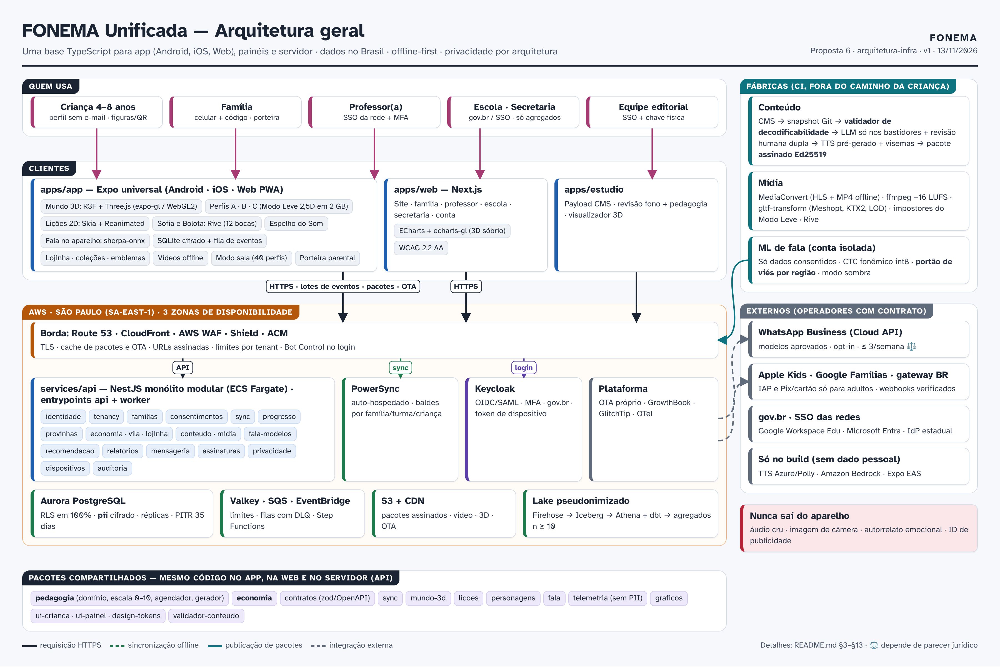
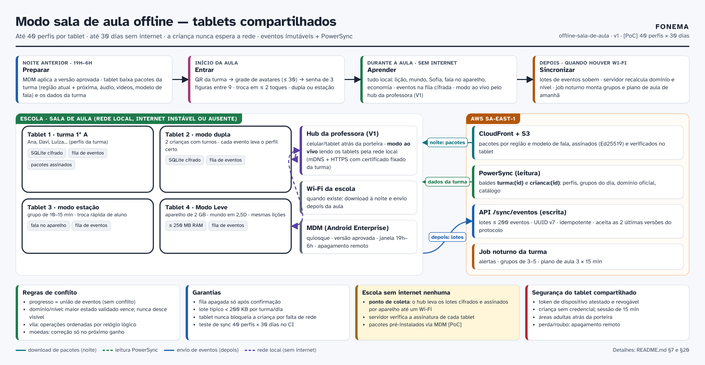
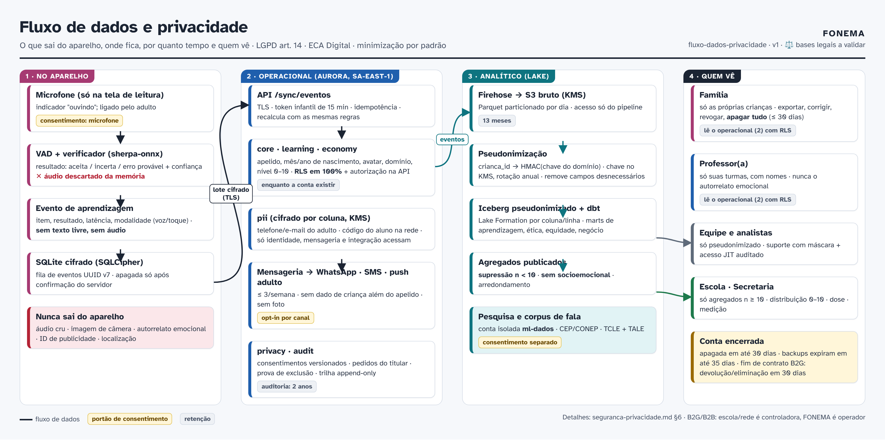
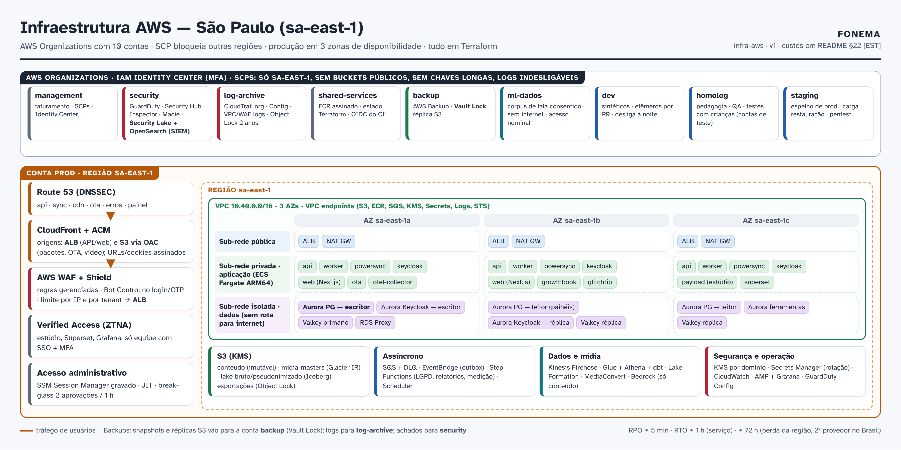
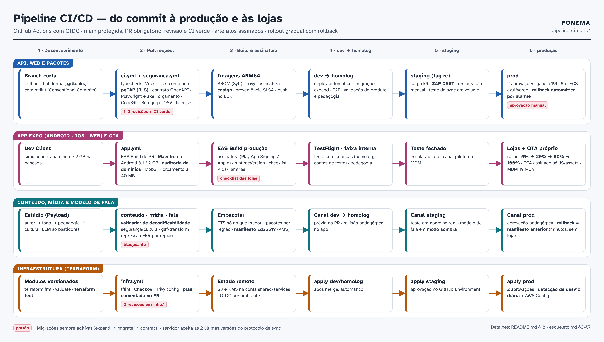
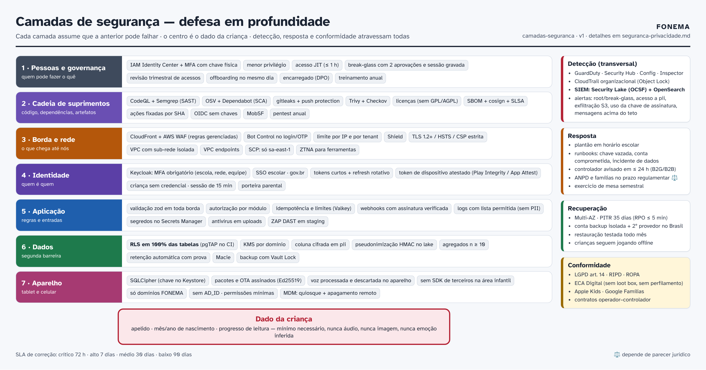

# FONEMA Unificada — Arquitetura e Infraestrutura (referência para construir)

> **Status:** proposta de referência v1 · **Data:** 13/11/2026 · **Base:** Decisões [001](../../../decisoes/001-jornada-e-modelo-de-precos.md)–[005](../../../decisoes/005-proposta-unificada.md), [Documento Mestre](../../../sintese/00-documento-mestre.md) e as arquiteturas das propostas [1](../../01-quintal-brasil/arquitetura.md), [2](../../02-arquipelago-3d/arquitetura.md), [3](../../03-vila-leitora/arquitetura.md), [4](../../04-expedicao-sofia/arquitetura.md) e [5](../../05-fonema-escola/arquitetura.md).
>
> **Documentos desta frente**
> - `README.md` (este): arquitetura completa, ADRs resumidos, custos, riscos.
> - [`esqueleto.md`](esqueleto.md): árvore completa do monorepo, convenções, branches, commits, versões, testes e definição de pronto.
> - [`seguranca-privacidade.md`](seguranca-privacidade.md): modelo de ameaças, controles e checklists LGPD / ECA Digital / lojas Kids e Famílias.
> - Diagramas: `arquitetura-geral.png`, `infra-aws.png`, `fluxo-dados-privacidade.png`, `pipeline-ci-cd.png`, `camadas-seguranca.png`, `offline-sala-de-aula.png` (fontes HTML/SVG em `fontes/`, capturados com Playwright: `node fontes/capturar.js`).
>
> **Legenda:** **[EST]** = estimativa a refazer com calculadora e cotação · **[PoC]** = depende de prova de conceito com critério de aprovação · **⚖️** = depende de parecer jurídico · **[conferir]** = verificar na fonte oficial ou na documentação atual do fornecedor antes de adotar.

---

## 1. Resumo executivo

O FONEMA Unificado junta o **mundo 3D navegável** (Proposta 2), o **estilo ilustrado** (Proposta 1), a **vila com construção** (Proposta 3), os **vídeos curtos** (Proposta 4) e a **estrutura institucional** (painéis, modo sala, WhatsApp, B2G) da Proposta 5. A infraestrutura precisa servir ao mesmo tempo uma família com um celular Android de 2 GB e uma secretaria com 300 mil alunos, **com dados no Brasil e privacidade por arquitetura**.

| Tema | Decisão | Principal alternativa descartada |
|---|---|---|
| Repositório | **Monorepo pnpm + Turborepo**, TypeScript estrito em todo o produto (Python só em `ml/`) | Repositórios separados; Nx |
| App da criança (iOS, Android, Web) | **Expo (React Native, nova arquitetura) universal**: uma base para celular, tablet e navegador (react-native-web) | Unity 6; Flutter; Capacitor |
| Mundo 3D | **Three.js via react-three-fiber**, cena escrita uma vez em `packages/mundo-3d`; no app roda sobre **expo-gl**, na web sobre WebGL2. **Perfis A/B/C**: 3D completo, 3D reduzido e **Modo Leve 2,5D** (impostores pré-renderizados em Skia) automático em aparelhos de 2 GB | Unity (tamanho 55–70 MB, 2ª linguagem); Babylon React Native; WebView com Three.js |
| Lições, jogos 2D e Espelho do Som | **react-native-skia + Reanimated**; vídeo com `expo-video`; lições sempre em 2D (salvaguarda da D005) | PixiJS em WebView (Propostas 1, 4) |
| Personagens | **Rive** (Sofia e Bolota, 12 bocas por visemas, ~40 estados) | Spine, Live2D, vídeo |
| Painéis adultos e site | **Next.js (App Router)** com **Apache ECharts + echarts-gl** para gráficos 3D sóbrios; tabelas acessíveis sempre ao lado | Painéis no app Expo; Highcharts (licença paga) |
| Backend | **NestJS monólito modular** (TypeScript) em **ECS Fargate**; **Aurora PostgreSQL** Multi-AZ com **RLS**; **ElastiCache (Valkey/Redis)**; **SQS + EventBridge + Step Functions** | Supabase; Firebase; microsserviços desde o início |
| Nuvem | **AWS, região São Paulo (`sa-east-1`)**, AWS Organizations com 10 contas, SCP que bloqueia outras regiões | Supabase gerenciado (bom para MVP, fraco para B2G); GCP |
| Identidade | **Keycloak** auto-hospedado: adultos (celular + código, e-mail, Google, Apple), **SSO escolar** (SAML/OIDC: Google Workspace for Education, Microsoft Entra ID), **gov.br** para gestores, MFA obrigatório para escola/rede/equipe. **Criança sem e-mail nem senha**: perfil escolhido por figuras em aparelho autorizado | Amazon Cognito |
| Offline | **SQLite cifrado no aparelho** + **PowerSync auto-hospedado** (leitura: Postgres → aparelho por regras de sincronização) + **envio de eventos imutáveis** pela API (`/sync/eventos`, idempotente) | WatermelonDB + protocolo próprio (plano B) |
| WhatsApp | **WhatsApp Business Platform (Cloud API)** via módulo `mensageria`, só modelos aprovados, opt-in por finalidade, ≤ 3 mensagens/semana | Número pessoal da professora (proibido); BSP como plano B |
| Conteúdo | **Payload CMS** (estúdio editorial) → snapshot em Git → **validador de decodificabilidade** bloqueante → pacotes assinados (Ed25519) → CDN. **LLM só nos bastidores** (Amazon Bedrock), com revisão humana dupla | Conteúdo gerado ao vivo; CMS SaaS com dados fora do Brasil |
| Mídia | **MediaConvert** (HLS/CMAF + MP4 offline), **ffmpeg** (−16 LUFS, Opus/AAC), **gltf-transform** (Meshopt + KTX2/Basis + LOD), **CloudFront** com URLs assinadas | Vídeo hospedado em plataforma de terceiros |
| Fala | **sherpa-onnx** no aparelho (nativo e WASM), modelo **CTC fonêmico** quantizado int8; treino só com **dados consentidos** numa conta isolada; **portão de viés regional** no CI; modelo distribuído como pacote assinado com **modo sombra** | ASR em nuvem; Whisper como juiz |
| TTS | **Pré-gerado no build** (Azure Neural pt-BR com visemas; Amazon Polly como reserva) + **voz humana** para fonemas e pares mínimos | TTS ao vivo |
| Dados e painéis | Eventos first-party pseudonimizados → **Kinesis Firehose → S3 (Apache Iceberg) → Athena + dbt** → agregados (n ≥ 10) publicados no Postgres para os painéis; BI interno em **Apache Superset** | SDK de analytics de terceiros (proibido na área infantil) |
| Experimentos | **GrowthBook auto-hospedado** (flags + A/B com estatística sobre o lake), com **comitê de ética de experimentos** | LaunchDarkly/Statsig (dados fora); AppConfig sem estatística |
| Observabilidade | **OpenTelemetry** → coletor com filtro de PII → **Amazon Managed Prometheus/Grafana**, CloudWatch Logs, **GlitchTip** próprio; SLOs com orçamento de erro | Sentry SaaS na área infantil |
| Segurança | WAF + Shield, KMS por domínio, Secrets Manager, GuardDuty, Security Hub, Inspector, Macie, **Security Lake + OpenSearch (SIEM)**; CodeQL, Semgrep, OSV, gitleaks, Trivy, Checkov, ZAP, MobSF; pentest anual | — |
| IaC e CI/CD | **Terraform** (módulos próprios) + **GitHub Actions com OIDC**; **EAS Build/Submit** para lojas; **OTA próprio** (protocolo expo-updates) em produção | AWS CDK; Pulumi |
| Ambientes | **dev, homolog, staging, prod** (+ efêmeros por PR) em contas separadas | 3 ambientes |
| MDM | **Android Enterprise, dispositivo dedicado (quiosque)**; MDM da rede ou **Headwind MDM** operado pelo FONEMA; iPad via Apple School Manager | Tablets sem gestão |
| Custo [EST] | ~R$ 26 mil/mês (1 mil alunos, estrutura completa) → ~R$ 100 mil (100 mil) → ~R$ 370 mil (1 milhão), **sem WhatsApp**; perfil "enxuto" para a fase 0 ≈ R$ 10–15 mil | — |

---

## 2. Princípios de arquitetura

1. **A criança joga offline.** Tudo o que uma sessão precisa (lição, mundo, Sofia, áudio, vídeo, modelo de fala, motor pedagógico, economia) está no aparelho. A rede serve para baixar pacotes e sincronizar em lote.
2. **O 3D é casca; a pedagogia é dado.** Currículo, domínio, escala 0–10, gerador de missões e economia ficam em **pacotes TypeScript puros** (`packages/pedagogia`, `packages/economia`), iguais no app, na web e no servidor. Trocar o renderizador 3D não mexe na pedagogia (lição da Proposta 2).
3. **Uma fonte da verdade por dado.** O aparelho calcula de forma otimista; o **servidor recalcula** nível, domínio e saldo a partir dos eventos, com o mesmo código. O nível **nunca desce visivelmente** (D004).
4. **Privacidade por arquitetura, não por promessa.** Voz e câmera processadas no aparelho, áudio descartado, nenhum SDK de terceiros na área infantil, o app infantil só fala com **domínios próprios** (auditado no CI), secretaria só vê agregados com n ≥ 10.
5. **Duas barreiras de autorização.** Regra na API **e** RLS no PostgreSQL. Um bug na API não vaza dados entre redes, escolas ou famílias.
6. **Monólito modular primeiro.** Fronteiras de módulo explícitas, contratos tipados e eventos de domínio. Um módulo só vira serviço separado com métrica que justifique (carga, isolamento de dados ou equipe).
7. **Conteúdo é dado versionado e assinado.** Nada é gerado ao vivo para a criança. Corrigir conteúdo não exige nova versão de loja, e nunca se baixa código fora da loja além do OTA de JavaScript permitido.
8. **Brasil por padrão.** Dados pessoais em `sa-east-1`. Serviços fora do Brasil só sem dado pessoal (ex.: geração de TTS com texto curricular) ou com contrato e parecer ⚖️.
9. **Tudo como código e auditável.** Infraestrutura (Terraform), banco (migrações + políticas RLS), conteúdo (Git), políticas de MDM, painéis, alertas e SLOs.
10. **Desempenho é requisito, não ajuste final.** Orçamentos de tamanho, memória, fps e latência são verificados no CI e em aparelho real de 2 GB.
11. **Ética mensurável.** Métricas éticas (dose, fim natural, sentinela da economia, FRR por região) têm alerta igual às técnicas. Nenhum experimento otimiza tempo de tela.

---

## 3. Visão geral por camadas

| Camada | Componentes | Responsabilidade |
|---|---|---|
| **Clientes** | `apps/app` (Expo universal: Android, iOS, Web PWA) · `apps/web` (Next.js: site, família, professor, escola, secretaria, conta) · `apps/estudio` (Payload CMS + revisão) · `apps/suporte` (back-office interno) | Experiência infantil, áreas adultas, editorial e operação |
| **Pacotes compartilhados** | `pedagogia`, `economia`, `mundo-3d`, `licoes`, `personagens`, `fala`, `espelho-do-som`, `sync`, `contratos`, `ui-crianca`, `ui-painel`, `graficos`, `design-tokens`, `telemetria`, `porteira`, `i18n` | Regras, renderização, contratos e componentes iguais em todos os clientes |
| **Borda** | Route 53, CloudFront, AWS WAF, Shield, ACM | TLS, cache, proteção, URLs assinadas, OTA e pacotes |
| **Aplicação** | `services/api` (NestJS; entrypoints `api` e `worker`), `services/powersync`, `services/ota`, Keycloak, GrowthBook, GlitchTip, Payload | Regras de negócio, sync, identidade, flags, erros, CMS |
| **Dados operacionais** | Aurora PostgreSQL (app), Aurora PostgreSQL (Keycloak, isolado), ElastiCache Valkey, S3 | Transações, RLS, sessões curtas, limites de taxa, arquivos |
| **Assíncrono** | SQS (com DLQ), EventBridge, Step Functions, EventBridge Scheduler | Relatórios semanais, grupos da turma, exclusão LGPD, mensagens, agregados |
| **Dados analíticos** | Kinesis Firehose, S3 + Iceberg, Glue Catalog, Athena, dbt, Lake Formation, Superset | Painéis institucionais, métricas éticas, experimentos, pesquisa pseudonimizada |
| **Fábricas** | `pipelines/conteudo`, `pipelines/midia`, `ml/fala` | Conteúdo validado, mídia otimizada, modelos de fala avaliados |
| **Externos (operadores com contrato)** | Apple, Google, Meta (WhatsApp), gateway de pagamento BR, Azure/AWS TTS (só build), Expo EAS (só build) | Lojas, mensagens, cobrança, voz sintética |

---

## 4. Clientes

### 4.1 App universal (`apps/app`, Expo)

- **Expo SDK estável + React Native (nova arquitetura, Hermes) + Expo Router + TypeScript estrito.** Uma base gera Android (AAB), iOS (IPA) e Web (export estático servido como PWA para PC/Chromebook da escola).
- Grupos de rotas: `(crianca)` (mundo, vila, lição, lojinha, coleções, emblemas, álbum, vídeos), `(sala)` (QR da turma, grade de avatares, senha de 3 figuras, duplas, estações), `(adulto)` atrás da **porteira** (família, modo professor no tablet, privacidade, assinatura).
- **Estado e dados:** SQLite cifrado (op-sqlite + SQLCipher [conferir suporte no momento da adoção]; na web, SQLite WASM com OPFS e chave derivada no aparelho), cliente PowerSync, fila de eventos, índice de pacotes. Mídia no sistema de arquivos do app.
- **Áudio:** `expo-audio` com sessões separadas para fala, efeitos e música; música abaixa 12–15 dB sob a fala e **silencia com o microfone aberto**; limitador master (≤ 75 dB(A) no modo criança).
- **Tamanho:** meta de instalação **≤ 40 MB** (AAB com divisão por ABI). Modelo de fala, regiões 3D e vídeos baixados depois, no Wi-Fi. **[PoC]** medir o binário com Skia + Rive + sherpa-onnx + expo-gl; se passar de 40 MB, Skia e o motor 3D viram módulos de entrega sob demanda.
- **Sem SDK de terceiros na área infantil.** Os únicos destinos de rede do binário infantil são domínios FONEMA (`api.`, `sync.`, `cdn.`, `ota.`, `erros.`). O CI roda o app instrumentado e **falha** se houver chamada fora da lista.

### 4.2 Motor 3D e perfis de aparelho (`packages/mundo-3d`)

**Decisão:** react-three-fiber (R3F) + Three.js, com a cena descrita **uma vez** e renderizada pelo `Canvas` nativo (`@react-three/fiber/native` sobre **expo-gl**) no app e pelo `Canvas` web (WebGL2) no navegador.

Estrutura do pacote:
- `cena/` — descrição declarativa do arquipélago e das vilas (ilhas, construções, pontos de interesse, câmeras guiadas), **sem lógica pedagógica**.
- `camera/` — câmera orbital limitada (ângulos pré-aprovados, zoom com degraus, sem pinça para crianças pequenas: zoom por botões grandes ≥ 96 dp), transições suaves com `prefers-reduced-motion`.
- `render/` — interface `Renderizador` com 3 implementações: `r3f-native` (expo-gl), `r3f-web` (WebGL2) e `leve-2d` (Skia com impostores). Uma 4ª implementação `filament` (react-native-filament) fica como **plano B** do nativo.
- `ativos/` — carregamento de glTF com Meshopt e texturas **KTX2/Basis** (transcodificadas para ASTC/ETC2), LOD por distância, descarte agressivo de memória ao entrar na lição.

**Perfis (decididos no 1º uso por RAM, GPU e benchmark de 5 s; o adulto pode mudar):**

| Perfil | Critério | Renderização | Orçamento |
|---|---|---|---|
| **A — completo** | RAM ≥ 4 GB, GPU média/alta, iPad/iPhone recentes, desktop | 3D, sombras suaves assadas + 1 luz dinâmica, 60 fps | ≤ 400 MB RAM; ≤ 120 mil triângulos/cena; texturas ≤ 96 MB |
| **B — reduzido** | RAM 3 GB ou GPU fraca | 3D com LOD1, sem sombra em tempo real, resolução 0,75×, 30 fps | ≤ 300 MB; ≤ 50 mil triângulos; texturas ≤ 48 MB |
| **C — Modo Leve** | **RAM ≤ 2 GB**, Android < 9, bateria < 20 %, falha de benchmark, navegador de celular | **2,5D**: mapa e vila com **impostores pré-renderizados** das mesmas ilhas (gerados no pipeline a partir dos mesmos glTF), paralaxe leve em Skia, sem contexto WebGL | **≤ 250 MB**, ≥ 30 fps, abertura a frio ≤ 3 s |

- **Ao abrir uma lição**, o contexto 3D é **pausado e liberado** (texturas descarregadas, `gl` em repouso) e a lição roda em 2D. Ao voltar, a cena é restaurada a partir do cache.
- **Telemetria de desempenho** (fps p50/p90, RAM, abertura a frio, falhas de contexto GL) é agregada por perfil e modelo de aparelho, sem identificador pessoal, e ajusta os critérios de perfil por feature flag.
- **Critério de aprovação da PoC [PoC]** em aparelho de referência (Android 8.1+, 2 GB e 3 GB, GPU Mali/Adreno de entrada): Perfil B ≥ 30 fps p90 com a ilha mais densa; Perfil C ≤ 250 MB e ≥ 30 fps; troca 3D → lição ≤ 500 ms. **Se o Perfil B falhar no expo-gl**, troca-se a implementação nativa para `filament` mantendo a cena, os glTF e a lógica; a web continua em Three.js.

**Por que não Unity (Proposta 2):** binário base de 55–70 MB (acima da meta de 40 MB), segunda linguagem (C#) e segundo ecossistema de build, WebGL pesado em celular, custo de licença por faturamento e integração mais difícil com o resto da pilha TypeScript (pedagogia compartilhada, painéis, sync). O Unity seria superior em ferramentas de cena; compensamos com Blender como editor e um **visualizador de cenas** (`apps/estudio/mundo`) baseado no próprio `packages/mundo-3d`.

### 4.3 Lições, jogos 2D, Espelho do Som e personagens

- **Lições e minijogos** (`packages/licoes`): react-native-skia + Reanimated, alvos ≥ 96 dp, sem gestos proibidos (toque duplo, pinça, multitoque). Na web, Skia via CanvasKit carregado sob demanda. O motor de sessão vem de `packages/pedagogia`.
- **Espelho do Som** (`packages/espelho-do-som`): clipe por fonema em `expo-video` (H.264 720×720; 480×480 no Perfil C), legenda WebVTT, corte lateral 2D em Rive, letra que aparece no instante do som (sincronia −10/+30 ms). Espelho de câmera **fora do MVP**; se vier (V1), local, sem gravação, sem análise.
- **Personagens** (`packages/personagens`): Rive (`rive-react-native` no app, `@rive-app/canvas` na web), máquina de estados com Data Binding (`viseme`, `estado`, `olhar`, `gesto`). Visemas do TTS (JSON gerado no build) ou do Rhubarb (gravações humanas). A Sofia é sempre **2D por cima do mundo 3D** (salvaguarda da D005).
- **Lojinha, coleções e emblemas** (`packages/economia` + telas): preços e aparências visíveis antes da compra, **nenhuma aleatoriedade**, etiquetas como palavras decodificáveis da fase da criança, cofrinho com meta, desfazer em 24 h. O livro-razão é append-only e o servidor é a fonte oficial.
- **Biblioteca de vídeos curtos** (`packages/videos`): episódios e explicações para criança (offline, MP4 em pacote), família e professor (streaming HLS no painel). **Sem autoplay em sequência e sem rolagem infinita** (ECA Digital).

### 4.4 Web adulta (`apps/web`, Next.js)

- **Next.js App Router**, React Server Components para painéis, renderização no servidor dentro da AWS (ECS) para manter dados no Brasil [alternativa: OpenNext em Lambda].
- Rotas: `(site)` (público, preços, central de privacidade, "A ciência do FONEMA"), `(familia)`, `(escola)/professor`, `(escola)/gestao`, `(rede)/secretaria`, `conta` (login, assinatura, privacidade), `(parceiros)` (integração de redes).
- **Gráficos** (`packages/graficos`): **Apache ECharts + echarts-gl** para 3D elegante (ex.: distribuição por nível 0–10 por escola em barras 3D com rotação limitada) **sempre acompanhado do número exato e de uma tabela acessível**; 2D é o padrão para leitura precisa (D005: sem distorção de perspectiva). Cenas 3D de destaque (ex.: "ilha da turma") reutilizam `packages/mundo-3d` em modo somente leitura.
- Acessibilidade **WCAG 2.2 AA**, Atkinson Hyperlegible/Lexend, botão "ouvir" em todo texto da área da família.

### 4.5 Estúdio editorial (`apps/estudio`)

- **Payload CMS** (TypeScript, MIT, roda dentro de Next.js, banco PostgreSQL próprio) para palavras, pseudopalavras, frases, livrinhos, missões, falas da Sofia, itens da lojinha, emblemas, coleções, roteiros de vídeo e metadados de cenas 3D.
- Fluxo: **autor → validação automática → fonoaudióloga → pedagogia → (cultura/ERER quando aplicável) → publicar**. "Publicar" gera um **snapshot JSON** e abre um PR no repositório (`content/`) pelo bot do estúdio; o CI valida e empacota. Assim o Git continua sendo a trilha de auditoria.
- Acesso só para a equipe via Keycloak (SSO + MFA), dentro de VPN/ZTNA (AWS Verified Access).

### 4.6 Porteira parental

`packages/porteira`: pressionar e segurar 3 s + tarefa de leitura sorteada, com aviso falado. Protege relatórios, configurações, links, consentimentos, assinatura, mensagens e modo professor. Logout da área adulta após 2 min sem uso. **Não substitui o consentimento parental** (que é feito na criação da conta, com autenticação do adulto).

---

## 5. Backend (`services/api`, NestJS monólito modular)

### 5.1 Módulos

| Módulo | Responsabilidade | Dono dos dados |
|---|---|---|
| `identidade` | Integração com Keycloak, tokens de dispositivo, sessão infantil derivada | Keycloak + `core` |
| `tenancy` | Redes, escolas, turmas, papéis, convites, importação de matrículas | `tenancy` |
| `familias` | Contas B2C, vínculos adulto↔criança, perfis infantis | `core` |
| `consentimentos` | Termos versionados, finalidades separadas, revogação, prova | `privacy` |
| `sync` | Recepção idempotente de eventos, credenciais do PowerSync, regras de conflito | `learning`, `economy` |
| `progresso` | Projeção oficial de domínio, escala 0–10, previsão em faixa | `learning` |
| `provinhas` | Desafios-chefe, transferência, retenção | `learning` |
| `economia` | Livro-razão de moedinhas, teto diário, antifarming, cofrinho | `economy` |
| `vila` | Construções, projetos coletivos, inventário | `economy` |
| `lojinha` | Catálogo de itens, coleções, emblemas, presentes | `content` (catálogo) + `economy` |
| `conteudo` | Catálogo de pacotes, manifestos, publicação, canais | `content` |
| `midia` | URLs assinadas, catálogo de vídeos, legendas | `content` |
| `fala-modelos` | Catálogo e liberação de modelos de fala por perfil de aparelho | `content` |
| `recomendacao` | Alertas, grupos de 3–5 alunos, plano de aula (job noturno) | `learning` |
| `relatorios` | Relatório semanal da família, painel da turma, PDFs, exportações | `learning` + `analytics` |
| `mensageria` | WhatsApp, SMS, e-mail, push; modelos, opt-in, limites, webhooks | `messaging` + `pii` |
| `assinaturas` | B2C (lojas e web), B2B/B2G (contratos, medição aluno-mês, faturas), direitos de acesso | `billing` |
| `privacidade` | Direitos do titular (acesso, correção, portabilidade, exclusão), retenção | `privacy` |
| `dispositivos` | Registro de tablets, MDM, revogação, modo compartilhado | `tenancy` |
| `experimentos` | Avaliação de flags no servidor, registro de exposição | GrowthBook |
| `auditoria` | Trilha append-only de leitura/alteração de dado de criança | `audit` |
| `suporte` | Atendimento com dados mascarados e acesso JIT | — |

- Estilo de API: **REST + OpenAPI 3.1** gerado do código, versionado por cabeçalho; clientes TypeScript gerados em `packages/contratos`. Validação com zod nas bordas. Webhooks externos em rotas separadas, com verificação de assinatura.
- **Workers** (`services/api/src/main-worker.ts`): a mesma base de código com outro entrypoint consome SQS. Workflows longos (exclusão LGPD em cascata, relatório semanal, fechamento mensal de medição B2G) em **Step Functions**; agendamentos em **EventBridge Scheduler** (fuso `America/Sao_Paulo`).
- **Comunicação entre módulos:** chamadas diretas por interfaces públicas do módulo + **eventos de domínio** (`DominioConquistado`, `NivelSubiu`, `CompraFeita`, `ConsentimentoRevogado`) publicados via outbox transacional no Postgres → EventBridge. Testes de arquitetura (dependency-cruiser) impedem importação entre módulos fora da interface pública.

### 5.2 Dados

| Schema | Conteúdo principal | Observações |
|---|---|---|
| `tenancy` | `redes`, `escolas`, `turmas`, `matriculas`, `papeis`, `dispositivos` | toda tabela com `rede_id`/`escola_id` |
| `core` | `adultos` (sub do Keycloak), `familias`, `criancas` (apelido, mês/ano de nascimento, avatar, perfil sensorial, região de sotaque), `vinculos` | **sem CPF, foto, endereço, geolocalização** |
| `pii` | telefone e e-mail de adultos, código do aluno na rede, nome completo quando a escola exige | **cifrado por coluna (KMS + envelope)**, acessível só a `mensageria`, `identidade` e integração |
| `learning` | `eventos_recentes` (particionado por mês, 90 dias), `dominios`, `niveis`, `provinhas`, `revisoes_agendadas`, `sessoes` | **nunca áudio**; eventos antigos vão para o lake |
| `economy` | `carteiras`, `movimentos` (append-only), `compras`, `cofrinhos`, `vilas`, `inventarios` | correções nunca tiram item da criança |
| `content` | `pacotes`, `versoes`, `canais`, `catalogo_itens`, `emblemas`, `colecoes`, `videos`, `modelos_fala` | arquivos no S3 |
| `messaging` | `optins`, `envios`, `modelos`, `respostas` | conteúdo da mensagem sem dado de criança |
| `billing` | `planos`, `assinaturas`, `direitos`, `contratos`, `medicoes`, `faturas` | |
| `privacy` | `consentimentos`, `pedidos_titular`, `retencao`, `exclusoes` (prova) | |
| `audit` | `acessos`, `alteracoes` | append-only, replicado para log imutável |
| `agregados` | distribuição por nível, dose, cobertura por turma/escola/rede | **n ≥ 10**, sem socioemocional |

- **RLS em 100 % das tabelas** com variáveis de sessão (`app.papel`, `app.rede_id`, `app.escola_ids`, `app.familia_id`, `app.crianca_ids`) definidas pela API a partir do token; papel de banco da API **sem** `BYPASSRLS`. Testes pgTAP por papel × tabela no CI.
- **Migrações expand → migrate → contract**: nunca quebrar a versão anterior do app que pode estar offline por 30 dias; o servidor aceita as **2 últimas versões do protocolo de sync**.
- **Leitura pesada** (painéis) na réplica de leitura do Aurora; **escrita** só no primário.

---

## 6. Identidade e acesso

| Quem | Como entra | Proteções |
|---|---|---|
| Responsável (B2C ou convidado) | **Celular + código** (OTP por WhatsApp ou SMS) como padrão; e-mail/magic link, Google, Apple como alternativa | Passkey opcional; sessão adulta curta no app; aviso de novo login |
| Professor(a) | **SSO da rede** (SAML/OIDC: Google Workspace for Education, Microsoft Entra ID, IdP estadual) ou e-mail institucional + senha + **MFA** | MFA obrigatório; vê só suas turmas |
| Coordenação/direção | idem | escopo da escola |
| Secretaria/gestor público | **Login gov.br** (OIDC, nível prata/ouro exigido) [conferir credenciamento e níveis] ou SSO da rede + MFA | só agregados |
| Equipe FONEMA | Keycloak com MFA por chave física (WebAuthn) + IAM Identity Center na AWS; acesso a produção **JIT** com aprovação | sessão gravada no break-glass |
| Tablet escolar | **Token de dispositivo** emitido no cadastro via MDM/professora, vinculado à escola, chave privada no Keystore/Secure Enclave (atestado por Play Integrity / App Attest) | revogável em 1 clique |
| Criança | **Sem credencial**: em casa, o adulto autentica e escolhe o perfil; na escola, QR da turma → grade de avatares (≤ 30) → senha de 3 figuras entre 9. QR individual impresso é um token opaco e rotativo | **sessão infantil derivada** (JWT de 15 min, escopo = 1 criança + aparelho, sem e-mail) |

- **Keycloak** em ECS com banco Aurora próprio (isolado), realms por ambiente, **Organizations** para multi-tenant de redes, temas próprios, autenticadores customizados (OTP por WhatsApp, token de dispositivo). Imagem fixada por digest, atualizações mensais.
- Tokens: access token curto (5–15 min), refresh rotativo, **DPoP** ou mTLS para tokens de dispositivo [PoC], `aud` restrito por serviço.
- **Por que não Cognito:** federação SAML por rede, fluxos infantis e de dispositivo e personalização exigem Lambdas e contornos; Keycloak entrega SAML/OIDC por organização, gov.br, políticas finas e portabilidade. Custo: operar o Keycloak (patches, HA), mitigado com módulo Terraform, testes de atualização em staging e runbook.

---

## 7. Sincronização offline e modo sala de aula

### 7.1 Modelo

- **Escrita = eventos imutáveis.** Cada ação gera um evento com **UUID v7**, `device_id`, relógio do aparelho, relógio lógico por criança e versão do protocolo. A fila local envia lotes (≤ 200 eventos, gzip) para `POST /sync/eventos`; a API grava com **idempotência** (chave = UUID), aplica as regras de `packages/pedagogia`/`economia` e atualiza as projeções.
- **Leitura = PowerSync.** O serviço PowerSync (auto-hospedado no ECS, lendo a replicação lógica do Aurora) entrega ao SQLite do aparelho os "baldes" que ele pode ver: `familia:{id}`, `turma:{id}` (só no tablet da turma), `crianca:{id}` (projeções oficiais), `catalogo:{canal}`. As regras de sincronização espelham as políticas RLS e têm teste automático de equivalência.
- **Conflitos:** progresso é união de eventos (não há conflito); domínio e nível usam "o maior estado validado vence" (nunca desce visível); vila usa operações ordenadas por relógio lógico (item duplicado volta ao inventário); moedas são otimistas e a correção acontece **no próximo ganho**, nunca tirando algo já comprado; dados cadastrais usam "última escrita por campo vence" com auditoria.
- **Capacidade de projeto:** 40 perfis por tablet, **30 dias offline**, lote típico < 200 KB por turma/dia. A fila local só é apagada após confirmação do servidor.
- **Plano B [PoC]:** se PowerSync não cumprir (licença, custo ou desempenho com 100 mil conexões), troca-se a leitura por **protocolo próprio pull por cursor** (Proposta 5) com WatermelonDB/SQLite; o envio de eventos não muda. [conferir licença da edição auto-hospedada do PowerSync no momento da adoção]

### 7.2 Modo sala de aula (tablets compartilhados)

1. **Antes da aula (19h–6h):** o MDM aplica a versão aprovada do app; o tablet baixa no Wi-Fi da escola os pacotes da turma (regiões atuais + próxima, áudio, vídeos curtos da semana, modelo de fala) e os baldes de sync da turma.
2. **Entrada:** QR da turma → grade de avatares → senha de 3 figuras. Troca de perfil em ≤ 2 toques; modo dupla (2 crianças por tablet com turnos) e modo estação (10–15 min por grupo).
3. **Durante a aula, sem internet:** tudo roda local; eventos ficam na fila cifrada; o tablet nunca bloqueia a criança por falta de rede.
4. **Modo professor (V1):** o tablet/celular da professora vira **hub local** (mDNS + HTTPS com certificado fixado por turma) e mostra o "modo ao vivo" lendo os tablets da sala pela rede local, sem internet.
5. **Depois da aula:** quando há Wi-Fi, os tablets enviam os lotes; o job noturno recalcula grupos e o plano de aula do dia seguinte.
6. **Escola sem internet nenhuma:** sincronização por **"ponto de coleta"** — a professora leva o celular/tablet hub a um lugar com Wi-Fi; o hub carrega os lotes cifrados de toda a turma (assinados por aparelho), e o servidor verifica a assinatura de cada aparelho. Pacotes de conteúdo podem ser pré-instalados por MDM ou cartão SD em casos extremos [PoC].

---

## 8. Mensageria: WhatsApp, SMS, e-mail e push

- **Canal oficial:** WhatsApp Business Platform (**Cloud API da Meta**) com número verificado do FONEMA (ou da rede, em contrato B2G). Nunca o número pessoal da professora. Plano B: provedor oficial (BSP) brasileiro com contrato de operador.
- **Só modelos aprovados** (categoria utilidade/autenticação): missão da semana (áudio da Sofia + 1 imagem + link profundo), resumo semanal, aviso da escola, código de acesso. Marketing não é usado para famílias de alunos da rede pública.
- **Opt-in explícito por finalidade**, registrado em `messaging.optins` com versão do termo; "SAIR" em qualquer mensagem revoga na hora. **Máximo 3 mensagens/semana** por família, no horário escolhido, nunca durante o "modo juntos"; o limitador fica no módulo e tem métrica ética (deve ser zero acima do teto).
- **Sem dado de criança na mensagem** além do apelido escolhido pelo adulto; nenhuma foto de criança; respostas em áudio só com consentimento específico ⚖️. Mídia servida por URL assinada de curta duração.
- **Webhooks** da Meta verificados por assinatura (`X-Hub-Signature-256`), processados de forma idempotente via SQS. Números de telefone ficam em `pii`, cifrados.
- **Escolha de canal por custo:** push no app (grátis) quando a família usa o app; WhatsApp quando não usa; SMS como último recurso. A/B entre SMS, WhatsApp texto e WhatsApp áudio registrado para a avaliação (Documento Mestre §4.14).
- ⚖️ **Transferência internacional:** a Cloud API processa dados fora do Brasil. Avaliar a opção de **armazenamento local de dados em repouso** da Cloud API [conferir se o Brasil está entre as regiões oferecidas], cláusulas contratuais e base legal; no B2G, a secretaria (controladora) aprova o suboperador.
- Outros canais: **SES** (e-mail, região sa-east-1), **AWS End User Messaging** (SMS), **push** via FCM/APNs **só para adultos** (o app infantil não recebe notificação).

---

## 9. Assinaturas, cobrança e direitos de acesso

- **B2C:** compra **só pelo adulto atrás da porteira**. No app, In-App Purchase (StoreKit 2 / Google Play Billing) com validação no servidor (App Store Server API e Notifications v2; Google RTDN via Pub/Sub → webhook). Na web, gateway brasileiro (cartão e **Pix Automático**) [comparar Pagar.me, Stripe Brasil, Mercado Pago, Asaas]. Sempre **mensal** (D001).
- **B2B (escola privada):** contrato por aluno/mês; faturamento mensal por medição; boleto/Pix; NFS-e.
- **B2G (rede pública):** contrato/ARP/CPSI ⚖️, **medição aluno-mês auditável** (aluno com ≥ 1 sessão no mês), relatório de medição assinado, sem compra no app.
- O app só consulta **direitos** (`billing.direitos`: regiões liberadas, recursos); a criança vê a próxima região como **"ponte em obras"**, sem oferta. RevenueCat fica como alternativa para acelerar o B2C, desde que só na área adulta [conferir política Apple Kids para SDKs de compra].

---

## 10. Pipeline de conteúdo

1. **Fontes:** banco de palavras (grafia, transcrição, CGF, estrutura silábica, etapa mínima, campo semântico, região, marcação "evitar"), pseudopalavras, frases, livrinhos, missões, falas da Sofia, itens/emblemas/coleções, roteiros de vídeo e metadados de cenas. Autoria no **Payload CMS**; snapshot em `content/` (YAML/JSON validado por zod).
2. **Validadores bloqueantes no CI** (`packages/validador-conteudo`):
   - **decodificabilidade**: ≥ 95 % nas fases 1–2 e ≥ 90 % nas fases 3–4; só grafemas ensinados até a etapa; palavras de alta frequência só por lista explícita; ≥ 4 repetições da CGF-foco;
   - **etiquetas da lojinha** e placas da vila também passam pelo validador (comprar também é ler);
   - **segurança e cultura**: lista de termos proibidos, neuromitos (16 frases), falas proibidas da Sofia, estereótipos (revisão ERER);
   - **acessibilidade**: toda fala com legenda, todo vídeo com WebVTT, todo arrastar com alternativa por toque.
3. **Geração com LLM só nos bastidores:** o módulo `pipelines/conteudo/gerador-llm` usa **Amazon Bedrock** [conferir modelos disponíveis em `sa-east-1` e se a inferência cruza regiões] com prompt restrito (conjunto de grafemas, vocabulário permitido, tema, tamanho), temperatura baixa e N candidatos. Nenhum dado de criança entra no prompt. Cada candidato passa pelo validador e por **revisão humana dupla** (pedagogia + fonoaudiologia; cultura quando aplicável) no estúdio. Registro de origem ("gerado por LLM, revisado por X e Y") em cada item.
4. **Áudio:** TTS neural pt-BR **no build** com JSON de visemas, cache por hash (texto + voz + versão), vozes versionadas; fonemas isolados, pares mínimos e 150–300 falas-chave **gravados por dubladora humana** (contrato de voz ⚖️).
5. **Empacotamento:** pacotes por região/lição (≤ 5 MB por lição; regiões 3D separadas), **manifesto assinado com Ed25519** (chave em KMS/HSM, assinatura no job de release), hash SHA-256 por arquivo, semver, canais `dev` → `homolog` → `staging` → `prod`. O app verifica assinatura e hash antes de usar.
6. **Publicação:** promoção de canal com aprovação pedagógica; **reversão** = apontar o canal para o manifesto anterior (minutos), sem nova versão de loja.
7. **Missões procedurais** são geradas **no aparelho** por `packages/pedagogia/gerador` (semente determinística, só itens do pacote validado, mistura 60/30/10, fallback curado), então não dependem de rede nem de LLM.

---

## 11. Pipeline de mídia

| Tipo | Origem | Processamento (`pipelines/midia`) | Entrega |
|---|---|---|---|
| **Espelho do Som** (≈ 48 clipes) | Gravação com fonoaudióloga + 3 crianças (cessão de imagem com prazo ⚖️) | Edição → aprovação por 2 fonoaudiólogas → MediaConvert: MP4 H.264 720×720 e 480×480, áudio AAC embutido, WebVTT, verificação de sincronia A/V | Pacote offline por região |
| **Vídeos curtos** (criança, família, professor) | Animação 2D/3D, Rive, gravação | MediaConvert: **HLS/CMAF** multi-bitrate (240p–720p) para painéis; MP4 480p/720p para pacotes offline da criança; legendas e audiodescrição; miniaturas | CloudFront com **cookies/URLs assinados** |
| **Áudio** | TTS no build + dubladora | ffmpeg: −16 LUFS / −1 dBTP, Opus 32–48 kbps (Android/web) e AAC (iOS), fonemas sem compressão que achate o ataque | Pacote |
| **Rive** (`.riv`) | Ilustração e animação | Teste de contrato da máquina de estados (entradas obrigatórias: `viseme`, `estado`), orçamento de tamanho, nenhuma fonte externa | Pacote |
| **Modelos 3D** | Blender (fonte em Git LFS) | Export glTF 2.0 → **gltf-transform**: dedupe, weld, simplificação (meshoptimizer) para LOD0/1/2, compressão **Meshopt**, texturas **KTX2/Basis** (UASTC para normais, ETC1S para cor), orçamento (triângulos, MB, memória de textura) → **impostores** renderizados em headless (Three.js + Playwright) para o Modo Leve | Pacote de região 3D (≤ 25 MB) + pacote leve (≤ 6 MB) |
| **Imagens/ícones** | Ilustração | WebP/AVIF, atlas por região, SVG otimizado | Pacote |

- Originais (masters) no S3 com versionamento e classe **Glacier Instant Retrieval**; derivados imutáveis endereçados por hash (`cdn.fonema…/p/{sha256}`), cache longo.
- **Orçamentos verificados no CI** (`tools/orcamento`): instalação ≤ 40 MB, lição ≤ 5 MB, região 3D ≤ 25 MB, região leve ≤ 6 MB, vídeo offline ≤ 2 MB/min.

---

## 12. ML de fala

- **Tarefa:** verificar se a criança **leu o alvo** (alvo + 2–4 distratores), nunca transcrever nem julgar articulação; três faixas (aceita / incerta / erro provável); baixa confiança nunca conta como erro.
- **Modelo:** VAD (Silero) + **CTC fonêmico** (wav2vec2/XLS-R/WavLM ajustado para pt-BR, destilado) + GOP e classificadores dos contrastes da lição; exportado em **ONNX int8** (meta ≤ 25 MB); executado por **sherpa-onnx** (módulo nativo Expo em Kotlin/Swift; WASM SIMD em Web Worker na web). Se a inferência passar de 300 ms ou o aparelho não suportar, modo **"só incentiva"** + toque.
- **Dados de treino só consentidos:** corpus próprio (300–500 crianças, 5 regiões, 30–50 h anotadas), com CEP/CONEP, TCLE + TALE e consentimento LGPD art. 14 separado (produto / pesquisa / corpus). Guardado numa **conta AWS isolada `ml-dados`** (sem internet, Lake Formation, chave KMS própria, acesso nominal de pesquisadores, sessões gravadas). Nenhum áudio de uso normal do produto entra no treino.
- **Treino:** SageMaker ou EC2 GPU na própria região [conferir disponibilidade de instâncias GPU em `sa-east-1`; se faltar, dados **não** saem do Brasil: usa-se capacidade reservada local ou servidor GPU próprio no Brasil]. Experimentos rastreados em **MLflow** (auto-hospedado); dados versionados com **DVC** apontando para S3; código em `ml/`.
- **Avaliação de viés (portão de liberação):** FRR e FAR por **região (N, NE, CO, SE, S)**, idade (4–5, 6–7, 8), sexo, rede pública/privada, perfil (TSF, TDL, Down) e condições de ruído. Liberação exige **FRR ≤ 5 % em todos os grupos com n suficiente** e diferença máxima entre grupos ≤ 2 p.p. [hipótese a calibrar]; ≥ 90 % de acordo com juízes humanos nos itens que entram no domínio. Relatório de equidade publicado internamente a cada versão (cartão do modelo).
- **Distribuição ao aparelho:** o modelo é um **pacote assinado** no catálogo `fala-modelos`, com variantes por perfil de aparelho. Liberação em **modo sombra** (o novo modelo calcula, o antigo decide; o app envia só métricas agregadas de concordância), depois **rollout gradual por feature flag** (5 % → 25 % → 100 %) com reversão automática se a taxa de "incerta" ou a FRR estimada subir.
- **Regressão no CI:** conjunto fixo de gravações consentidas e anotadas; o PR que mexe em `packages/fala` ou em `ml/` falha se qualquer grupo piorar além da tolerância.

---

## 13. Analytics, data warehouse e painéis

1. **Coleta first-party** (`packages/telemetria`): eventos tipados com esquema versionado (`tentativa`, `sessao_fim`, `dominio`, `compra_virtual`, `desempenho`), **sem texto livre, sem áudio, sem IP completo**. Identificador = `crianca_id` interno; o SDK infantil não coleta ID de publicidade nem identificador do aparelho.
2. **Ingestão:** API → **Kinesis Data Firehose** → S3 `bruto` (Parquet, particionado por dia), cifrado com KMS. Retenção do bruto: **13 meses**.
3. **Pseudonimização:** job de transformação troca `crianca_id` por `HMAC(chave_do_dominio, id)` com chave em KMS rotacionada por ano; remove `rede_id` abaixo do nível necessário; zona `pseudonimizado` em **Apache Iceberg** (Glue Catalog). Só a zona pseudonimizada fica visível para analistas, via **Lake Formation** (permissões por coluna e linha).
4. **Modelagem:** **dbt** (dbt-athena) gera marts: aprendizagem (domínio por grafema, tempo até domínio, itens "sanguessuga"), engajamento saudável (dose, fim natural), economia (razão gasto/ganho, sentinela E8), equidade (FRR por região), negócio (funil freemium, medição B2G).
5. **Publicação para painéis:** agregados com **supressão de células n < 10** e **sem socioemocional** são gravados em `agregados` no Aurora (réplica de leitura) para os painéis de escola e secretaria (baixa latência). Painéis de família e professor leem as projeções operacionais (com RLS).
6. **BI interno:** **Apache Superset** auto-hospedado (Apache 2.0) sobre Athena, acesso só a pseudonimizados, com SSO.
7. **Pesquisa (RCT, avaliação de impacto):** exportações pseudonimizadas sob protocolo aprovado, com Object Lock e trilha de auditoria; reidentificação só pelo controlador (escola/rede) quando o protocolo exigir.

---

## 14. Experimentos A/B e feature flags

- **GrowthBook auto-hospedado** (núcleo MIT) no ECS, SDK avaliando flags **localmente** (sem chamada a terceiros), estatística direto no lake (Athena). Flags também controlam rollout de modelos de fala, perfis de aparelho, OTA e módulos.
- **Regras éticas** (registro em `docs/experimentos/`):
  1. todo experimento tem hipótese, métrica primária de **aprendizagem ou bem-estar**, métricas de guarda (dose, fim natural, FRR) e data de fim;
  2. **proibido** otimizar tempo de tela, sessões por dia ou toques por minuto; proibido testar padrões manipulativos;
  3. experimentos pedagógicos (ex.: alvo de acerto 75/85/95 %, Espelho do Som A/B, braços da economia) passam pelo **conselho pedagógico** e, quando forem pesquisa, por CEP;
  4. aleatorização por **turma** no B2G (evita contaminação e desigualdade dentro da sala);
  5. a família pode recusar participação em pesquisa sem perder funcionalidade.
- Tipos de flag: `release` (temporária, remover em ≤ 60 dias), `ops` (kill switch), `experimento`, `permissao` (plano/direito). Flags velhas geram alerta no CI.

---

## 15. Observabilidade e SLOs

- **OpenTelemetry** em API, workers, web e Keycloak (traces, métricas, logs) → **ADOT Collector** com processador de **lista permitida de atributos** (descarta qualquer campo fora da lista; mascara e-mail/telefone por regex como segunda barreira) → **Amazon Managed Service for Prometheus** + **Amazon Managed Grafana**; traces em X-Ray (ou Tempo); logs no **CloudWatch Logs** (90 dias, depois S3 com retenção de 1 ano para segurança).
- **App:** telemetria própria e mínima (abertura a frio, fps, RAM, falhas de download, fila de sync, latência de inferência de fala) agregada por perfil de aparelho; crashes no **GlitchTip** auto-hospedado (compatível com o SDK Sentry, apontado para `erros.fonema…`), com `beforeSend` que remove texto livre e identificadores.
- **SLOs (janela de 28 dias):**

| Serviço | SLI | Objetivo |
|---|---|---|
| API (área adulta) | requisições sem 5xx e p95 < 300 ms | 99,9 % |
| Sync de eventos | lotes aceitos em ≤ 5 min após conexão | 99,5 % |
| PowerSync | aparelho atualizado em ≤ 2 min após conexão | 99,5 % |
| CDN de pacotes | downloads bem-sucedidos | 99,9 % |
| Login (Keycloak) | logins sem erro de servidor | 99,9 % (99,95 % em horário escolar) |
| Painéis | carregamento p75 < 2,5 s (LCP) | 99,5 % |
| App | sessões sem falha | ≥ 99,5 %; abertura a frio ≤ 3 s p75 no Perfil C |
| Fala | FRR por região | ≤ 5 % (alerta de produto) |
| **Éticos** | dose acima da faixa, sessões sem fim natural, mensagens > 3/semana, compras acima do teto | alerta de produto; **nunca meta** |

- **Orçamento de erro**: estourou → congelamento de releases de funcionalidade até recuperar. Plantão em horário escolar (7h–19h) com escalonamento fora dele; runbooks em `docs/runbooks/`.

---

## 16. Infraestrutura AWS

### 16.1 Contas (AWS Organizations)

| Conta | Para quê |
|---|---|
| `management` | Organizations, faturamento, IAM Identity Center, SCPs. Nada é implantado aqui |
| `security` | GuardDuty/Security Hub/Inspector/Macie (administrador delegado), **Security Lake + OpenSearch (SIEM)** |
| `log-archive` | CloudTrail organizacional, Config, logs de fluxo VPC, logs de WAF — **S3 Object Lock** (2 anos) |
| `shared-services` | ECR (imagens assinadas com cosign), estado do Terraform, papéis OIDC do CI, artefatos |
| `backup` | Cofre do AWS Backup com **Vault Lock** (cópia isolada) |
| `ml-dados` | Corpus de fala consentido e treino; sem internet; acesso nominal |
| `dev` | Desenvolvimento e ambientes efêmeros por PR; **só dados sintéticos** |
| `homolog` | QA, pedagogia, testes com crianças (contas de teste), aprovação de conteúdo; dados sintéticos |
| `staging` | Espelho de produção: carga, restauração, pentest, release candidate; dados sintéticos em volume de produção |
| `prod` | Produção |

**SCPs:** negar regiões fora de `sa-east-1` (exceto serviços globais: IAM, CloudFront, Route 53, ACM em `us-east-1` para CloudFront, WAF global), negar desligar CloudTrail/GuardDuty/Config, negar buckets públicos, negar usuários IAM com chave de longa duração, exigir cifragem.

### 16.2 Produção (`sa-east-1`, 3 AZs)

- **VPC** com sub-redes públicas (ALB, NAT), privadas de aplicação (ECS Fargate) e **isoladas de dados** (Aurora, Valkey, OpenSearch). **VPC endpoints** para S3, ECR, SQS, KMS, Secrets Manager, CloudWatch, STS (menos NAT, menos exposição).
- **ECS Fargate (Graviton/ARM64)**: `api`, `workers`, `powersync`, `keycloak`, `web` (Next.js), `ota`, `growthbook`, `glitchtip`, `payload` (estúdio, só VPN), `superset` (só VPN), `otel-collector`. Mínimo 2 tarefas por serviço crítico em AZs diferentes; autoescala por CPU, latência e profundidade de fila.
- **Aurora PostgreSQL 16** (I/O-Optimized quando compensar): cluster da aplicação com escritor + 1–2 leitores em AZs distintas; cluster separado para Keycloak; outro para Payload/GrowthBook/GlitchTip (ferramentas). PITR 35 dias. Proxy RDS para conexões.
- **ElastiCache for Valkey** (compatível com Redis) Multi-AZ: limites de taxa, cache de catálogo, idempotência curta, fila de sessão do PowerSync.
- **S3**: `conteudo` (versionado, imutável), `midia-masters`, `lake-bruto`, `lake-pseudonimizado`, `exportacoes` (Object Lock), `backups-logicos`.
- **Borda:** CloudFront (origens: ALB para API/web, S3 para pacotes/OTA), **AWS WAF** (regras gerenciadas, Bot Control nas rotas de login, limite por IP e por tenant, bloqueio geográfico opcional por contrato B2G), **Shield Standard** (Shield Advanced quando o B2G exigir SLA de DDoS), ACM, Route 53 com DNSSEC.
- **Acesso administrativo:** sem bastion público; **SSM Session Manager** com gravação; acesso humano a dados só por break-glass (2 aprovações, 1 h, gravado).

### 16.3 Ambientes

| | dev | homolog | staging | prod |
|---|---|---|---|---|
| Objetivo | construir, PR efêmero | validar com pedagogia, QA, crianças | ensaio geral de produção | uso real |
| Dados | sintéticos (fábrica) | sintéticos + contas de teste | sintéticos em volume de produção | reais |
| Escala | mínima, desliga à noite | pequena | igual à prod (sob demanda) | autoescala |
| Deploy | a cada push no PR | a cada merge na `main` | release candidate (tag `rc`) | tag de release + 2 aprovações |
| App | Dev Client, build interno | EAS canal `homolog`, TestFlight interno, faixa interna Play | canal `staging`, teste fechado | lojas + OTA `production` |
| Acesso | equipe | equipe + pedagogia | equipe técnica | só pipeline; break-glass |

**Dados de produção nunca são copiados para outros ambientes.**

---

## 17. Infraestrutura como código

- **Terraform** (≥ 1.x, compatível com OpenTofu) com **módulos próprios versionados** em `infra/terraform/modulos/` (vpc, ecs-servico, aurora, valkey, cdn, waf, keycloak, powersync, lake, backup, observabilidade, conta-base, guardrails) e **composições por conta/ambiente** em `infra/terraform/ambientes/`.
- Estado remoto em S3 (conta `shared-services`) com bloqueio nativo e cifragem KMS; uma pilha por domínio para limitar o raio de impacto.
- No PR: `terraform fmt`, `validate`, **tflint**, **Checkov** e **Trivy config**, `plan` comentado no PR; `apply` só após merge, com aprovação no GitHub Environment. **Detecção de desvio** diária (plan sem mudanças esperado) + AWS Config.
- Também como código: políticas RLS e migrações (`services/api/db`), regras do PowerSync, realms do Keycloak (exportação versionada + `keycloak-config-cli`), painéis e alertas do Grafana, SLOs, políticas do MDM, regras do WAF, flags padrão.

---

## 18. CI/CD

| Workflow | Gatilho | Etapas |
|---|---|---|
| `ci.yml` | todo PR | pnpm + cache Turbo remoto → lint/format → typecheck → unidade (Vitest) → integração (Testcontainers: Postgres com RLS, Valkey, Keycloak) → pgTAP → contrato OpenAPI → build afetado → E2E web (Playwright) → acessibilidade (axe) → orçamento de tamanho/desempenho |
| `seguranca.yml` | todo PR + diário | CodeQL, Semgrep, OSV-Scanner, gitleaks, licenças (bloqueia GPL/AGPL no código fechado), Trivy (imagens e IaC), SBOM (Syft) |
| `app.yml` | PR que toca o app | EAS Build de PR (Android) → **Maestro** em aparelho de entrada (laboratório) → auditoria de domínios de rede → MobSF (análise estática do binário) |
| `conteudo.yml` | PR em `content/` | esquema → **validador de decodificabilidade** → TTS só do que mudou (cache) → empacotar → publicar em `dev` → link de prévia no PR |
| `midia.yml` | PR em `assets/` | gltf-transform + orçamento 3D, impostores, Rive (contrato), MediaConvert em `dev` |
| `fala.yml` | PR em `packages/fala` ou `ml/` | regressão de FRR/FAR por grupo, tamanho e latência do modelo |
| `infra.yml` | PR em `infra/` | fmt/validate/tflint/Checkov/Trivy → `plan` no PR → `apply` após merge (por ambiente) |
| `deploy.yml` | merge na `main` / tag | imagens multi-arch assinadas (cosign) + **proveniência SLSA** → dev → homolog (automático) → staging (tag `rc`: carga com k6, ZAP DAST, teste de restauração mensal) → prod (2 aprovações, **fora do horário de aula 19h–6h**, ECS azul/verde com **rollback automático por alarme**) |
| `release-app.yml` | tag `app-v*` | EAS Build produção → EAS Submit → TestFlight / faixa interna → teste fechado → **lançamento gradual 5 % → 20 % → 50 % → 100 %**; MDM recebe a mesma versão (canal piloto antes da rede inteira) |
| `ota.yml` | tag `ota-v*` | bundle JS assinado (code signing do expo-updates) → servidor OTA próprio → canal por ambiente; só JS e assets, nunca nativo; rollback por canal |
| `privacidade.yml` | PR | verifica se migração nova tem RLS; teste de log sem PII; checklist de privacidade preenchido quando toca dados de criança |

- **Lojas:** Apple **categoria Kids** (faixas 5 e menos / 6–8) e Google Play **Projetado para Famílias**; checklist bloqueante (SDKs, porteira, links externos, rótulos de privacidade, formulário de Segurança dos dados) — ver [`seguranca-privacidade.md`](seguranca-privacidade.md#8-checklist-das-lojas).
- **Rollback:** web/API = versão anterior (azul/verde) em minutos; conteúdo = canal aponta para manifesto anterior; OTA = republicar a anterior; binário = parar rollout + hotfix; banco = migrações aditivas (sem rollback de esquema).

---

## 19. Backups e recuperação

| Recurso | Proteção | RPO | Teste |
|---|---|---|---|
| Aurora (app, Keycloak, ferramentas) | Multi-AZ + **PITR 35 dias** + snapshots diários/semanais/mensais (AWS Backup) com cópia para a conta `backup` (**Vault Lock**) | ≤ 5 min | restauração **mensal** em staging, com relatório |
| Dump lógico cifrado | semanal, cifrado com `age`, enviado a **2º provedor com data center no Brasil** (ex.: Azure Brazil South, OCI São Paulo, Magalu Cloud) [escolher por contrato] | 7 dias | trimestral |
| S3 (conteúdo, masters, lake) | versionamento + replicação para a conta `backup`; Object Lock nas exportações | ≤ 15 min | trimestral |
| Valkey | dado efêmero; recriável | — | — |
| Keycloak | banco (acima) + exportação de realm versionada | ≤ 5 min | semestral |
| Código, IaC, conteúdo | Git (GitHub) + espelho diário em repositório de backup | ≤ 24 h | semestral (recriar ambiente do zero em < 1 dia) |
| Aparelhos | fila local mantida até confirmação do servidor; até 30 dias | — | teste de sync no CI |

- **RTO:** falha de AZ → automático (minutos); perda de serviço/banco → **≤ 1 h** (restauração PITR); comprometimento de conta → **≤ 4 h** (restaurar na conta `backup`/nova conta via Terraform); **perda da região `sa-east-1`** (única região AWS no Brasil) → **≤ 72 h** reconstruindo no 2º provedor brasileiro a partir dos dumps, ou em outra região AWS **somente com decisão jurídica e dos controladores** ⚖️. Durante qualquer indisponibilidade, **as crianças continuam jogando offline**.
- Runbooks: banco corrompido, chave vazada, conta comprometida, CDN fora, release com defeito, modelo de fala com viés, incidente de dados pessoais.

---

## 20. MDM de tablets escolares

- **Android Enterprise, dispositivo dedicado (modo quiosque/lock task)**: o tablet abre direto no FONEMA; sem conta Google pessoal; navegador, câmera (fora do app), lojas e configurações bloqueados; **Google Play gerenciado** para instalar a versão aprovada.
- **MDM da rede quando existir** (ex.: Intune, Google endpoint management, ManageEngine) ou **Headwind MDM** operado pelo FONEMA, hospedado na conta da rede ou numa conta dedicada [conferir licença da edição escolhida].
- **Configuração gerenciada** (managed configurations) leva `escola_id`, `turma_id`, canal e URL de registro; o app gera a chave do aparelho e obtém o **token de dispositivo** no primeiro uso.
- Janela de atualização 19h–6h, Wi-Fi da escola, política de bateria, **apagamento remoto** em perda/roubo, inventário (modelo, versão, último sync) no painel da escola.
- **iPad (V2):** Apple School Manager + MDM compatível (Jamf School ou o da rede), modo de app único.
- Políticas versionadas em `infra/mdm/` (JSON), com revisão de segurança.

---

## 21. Segurança e privacidade (resumo)

Detalhes, modelo de ameaças e checklists em [`seguranca-privacidade.md`](seguranca-privacidade.md). Resumo das camadas: **pessoas e processos** (MFA, menor privilégio, JIT, revisão trimestral, treinamento) → **borda** (WAF, Shield, TLS 1.2+, HSTS, CSP estrita) → **identidade** (Keycloak, MFA, tokens curtos, token de dispositivo atestado) → **aplicação** (validação zod, autorização por módulo, limites de taxa, outbox) → **dados** (RLS, KMS por domínio, coluna cifrada em `pii`, pseudonimização, n ≥ 10) → **aparelho** (SQLCipher, pacotes assinados, porteira, sem SDK de terceiros) → **detecção e resposta** (GuardDuty, Security Lake + OpenSearch, alertas, runbooks, comunicação à ANPD e aos controladores ⚖️) → **cadeia de suprimentos** (SAST, SCA, segredos, SBOM, assinatura, SLSA, pentest).

---

## 22. Custos mensais estimados [EST]

Premissas: **US$ 1 = R$ 5,50 [EST]**; preços públicos de `sa-east-1` aproximados (São Paulo costuma custar 30–60 % mais que `us-east-1`); prod + homolog + staging + dev; tráfego de CDN médio de **150 MB por aluno/mês** (B2G com tablets compartilhados puxa a média para baixo; B2C com 3D completo puxa para cima); eventos ≈ 1.300 por aluno/mês; preços **sob demanda, sem descontos**. Com Savings Plans/instâncias reservadas e preço privado de CDN, reduzir **25–35 %**. **Refazer com a AWS Pricing Calculator e cotações antes de qualquer orçamento.**

| Bloco (US$/mês) | 1 mil alunos | 10 mil | 100 mil | 1 milhão |
|---|---|---|---|---|
| Computação ECS (API, workers, PowerSync, Keycloak, web, OTA, ferramentas) | 450 | 700 | 2.500 | 12.000 |
| Bancos Aurora (app + leitores, Keycloak, ferramentas) + RDS Proxy | 450 | 900 | 2.800 | 9.000 |
| Valkey, SQS, EventBridge, Step Functions, Firehose | 80 | 150 | 600 | 3.000 |
| Rede (ALB, NAT, VPC endpoints, transferência) | 300 | 350 | 800 | 3.500 |
| CDN + S3 (pacotes, vídeos, 3D, OTA) | 60 | 250 | 1.800 | 9.000 |
| Lake e BI (S3, Glue, Athena, dbt, Superset) | 150 | 250 | 900 | 4.500 |
| Observabilidade (AMP, Grafana, CloudWatch, GlitchTip) | 250 | 350 | 1.200 | 5.000 |
| Segurança (WAF, GuardDuty, Security Hub, Config, Inspector, Macie, KMS, Secrets, Security Lake + OpenSearch) | 600 | 750 | 2.000 | 7.500 |
| Backup e DR (AWS Backup, cópia isolada, 2º provedor) | 80 | 150 | 600 | 2.500 |
| Ambientes não-produtivos (dev, homolog, staging, efêmeros) | 900 | 1.000 | 1.800 | 4.000 |
| ML de fala (treino e avaliação, amortizado) | 300 | 500 | 1.500 | 4.000 |
| **Subtotal AWS** | **3.620** | **5.350** | **16.500** | **64.000** |
| Ferramentas (GitHub Enterprise + segurança avançada, EAS, plantão, lojas, domínios, pentest amortizado) | 1.200 | 1.300 | 1.800 | 3.000 |
| **Total sem WhatsApp (US$)** | **≈ 4,8 mil** | **≈ 6,7 mil** | **≈ 18,3 mil** | **≈ 67 mil** |
| **Total sem WhatsApp (R$)** | **≈ 26 mil** | **≈ 37 mil** | **≈ 100 mil** | **≈ 370 mil** |
| Por aluno/mês (R$) | ≈ 26,00 | ≈ 3,70 | ≈ 1,00 | ≈ 0,37 |
| **WhatsApp (R$)** — 60 % das famílias com opt-in, 13 mensagens/mês, modelo de utilidade a ~US$ 0,008 [conferir tabela vigente da Meta para o Brasil], 30–50 % das mensagens gratuitas em janela de atendimento | 0,2–0,3 mil | 1,7–3,4 mil | 17–34 mil | 170–340 mil |

Leitura dos números:
- **O custo fixo domina até ~10 mil alunos** (estrutura completa de segurança, 4 ambientes, Multi-AZ). Para a **fase 0 (beta)**, o perfil **"enxuto"** (mesmo Terraform com variáveis menores: 1 NAT, Aurora Serverless v2 com mínimo baixo, SIEM só com Security Hub + CloudTrail Lake, staging ligado só em ensaios) fica em **≈ R$ 10–15 mil/mês [EST]** sem mudar a arquitetura.
- Em 100 mil alunos, o custo de infra (~R$ 1,00/aluno) é **24–48 % da receita B2G** estimada (R$ 2,10–4,20/aluno/mês, Documento Mestre §4.16). Com descontos de compromisso e otimização, a meta é **≤ R$ 0,60/aluno** em 100 mil e **≤ R$ 0,30** em 1 milhão.
- **WhatsApp é o maior custo variável.** Mitigação: push no app quando possível, mensagens dentro da janela de atendimento, consolidar a missão da semana em 1 mensagem rica, e no B2G cobrar o canal como item do contrato (repasse) ⚖️.
- Voz e fala **não têm custo por aluno** (TTS pré-gerado: custo único de produção; ASR no aparelho).

---

## 23. ADRs resumidos

Cada ADR completo vai para `docs/adr/NNNN-titulo.md` no monorepo (formato MADR). Status inicial: **proposto**; vira **aceito** após PoC/revisão indicada.

| ADR | Decisão | Alternativas consideradas | Por quê | Consequências / gatilho de revisão |
|---|---|---|---|---|
| **0001** Monorepo | pnpm + Turborepo, TS estrito, Python só em `ml/` | Repos separados; Nx; Bazel | Pedagogia, contratos e UI compartilhados entre app, web e servidor; cache remoto; padrão das Propostas 1 e 5 | Precisa de CODEOWNERS e limites de dependência |
| **0002** App universal | Expo (RN nova arquitetura) para Android, iOS e Web | Unity 6; Flutter + Flame; Capacitor + PixiJS | Uma base TS para 3 plataformas; ecossistema EAS; compartilha pacotes com Next.js e NestJS | Web infantil via react-native-web tem limites; PWA testada em Chromebook |
| **0003** Motor 3D | **R3F + Three.js** (expo-gl no app, WebGL2 na web), interface `Renderizador`, perfis A/B/C com Modo Leve 2,5D | Unity; Babylon React Native; WebView + Three.js; react-native-filament; Godot | Uma cena para app e web; tamanho pequeno; mesma linguagem; Modo Leve cumpre 2 GB | **[PoC]** Perfil B ≥ 30 fps p90; senão `filament` no nativo |
| **0004** 2D e personagens | Skia + Reanimated para lições; Rive para Sofia/Bolota; lições sempre 2D | PixiJS em WebView; Lottie; Spine | Desempenho nativo; Rive com Data Binding de visemas; salvaguarda "agente 2D" | Skia na web pesa (~CanvasKit): carregar sob demanda |
| **0005** Backend | NestJS monólito modular + workers | Supabase (Edge Functions); microsserviços; Firebase | Regras complexas (B2G, medição, sync, mensageria), testes, OpenAPI, equipe TS única | Extração só com métrica; testes de arquitetura |
| **0006** Nuvem | AWS `sa-east-1`, Organizations com 10 contas, SCP de região | Supabase SP; GCP `southamerica-east1`; Azure Brazil South | Maturidade em segurança/compliance para B2G, Multi-AZ, KMS, Security Lake, MediaConvert, Bedrock; dados no Brasil | Custo fixo maior; perfil "enxuto" na fase 0 |
| **0007** Banco | Aurora PostgreSQL com RLS + réplicas; schema `pii` cifrado | RDS PostgreSQL Multi-AZ; DynamoDB; Firestore | SQL para relatórios, RLS como 2ª barreira, failover rápido, PITR 35 d | Lock-in leve no Aurora (compatível com Postgres) |
| **0008** Identidade | Keycloak (SSO escolar, gov.br, OTP, dispositivo), criança sem credencial | Cognito; Auth0; Supabase Auth | Federação por rede, fluxos infantis/dispositivo, portabilidade, dados no Brasil | Operar HA e patches; runbook e testes de upgrade |
| **0009** Offline | SQLite cifrado + **PowerSync auto-hospedado** (leitura) + eventos imutáveis via API (escrita) | WatermelonDB + protocolo próprio; Replicache; CRDT geral | Mesma base SQLite no app e na web; regras declarativas por balde; escrita auditável | **[PoC]** 40 perfis, 30 dias, 100 mil conexões; licença; plano B pronto |
| **0010** Mensageria | WhatsApp Cloud API + SMS + SES + push adulto, opt-in por finalidade, ≤ 3/semana | BSP; número pessoal; só SMS | Canal que as famílias usam; evidência READY4K; custo controlado | ⚖️ transferência internacional; custo variável alto |
| **0011** Conteúdo | Payload CMS → snapshot Git → validadores → pacotes assinados Ed25519 → CDN; LLM só nos bastidores (Bedrock) com revisão dupla | CMS SaaS (Sanity/Contentful); conteúdo em banco ao vivo; LLM ao vivo | Auditoria em Git, offline, segurança infantil | Duas fontes (CMS e Git) exigem sincronização pelo bot |
| **0012** Mídia | MediaConvert + ffmpeg + gltf-transform (Meshopt/KTX2/LOD) + CloudFront assinado | Plataforma de vídeo de terceiros; Draco; texturas PNG | Orçamentos de tamanho e memória; controle de dados | Pipeline mais complexo; testes de orçamento no CI |
| **0013** Fala | sherpa-onnx no aparelho, CTC fonêmico int8, treino só com consentimento, portão de viés, modo sombra | ASR em nuvem (Azure); Whisper juiz; Unity Sentis | Privacidade, custo zero por aluno, offline, equidade regional | Precisa de corpus próprio; **[PoC]** FRR ≤ 5 % |
| **0014** TTS | Pré-gerado no build (Azure Neural + visemas; Polly reserva) + voz humana | TTS ao vivo; só voz humana | Custo único, offline, versionado | Fornecedor muda vozes: cache por hash e versão |
| **0015** Analytics | First-party → Firehose → Iceberg/Athena/dbt → agregados n ≥ 10 → painéis; Superset | SDK de terceiros; Redshift; ClickHouse | Lojas Kids, LGPD, custo por consulta, escala até 1 M | Latência analítica de horas (painéis operacionais usam o Postgres) |
| **0016** Experimentos | GrowthBook auto-hospedado + comitê de ética | LaunchDarkly; Statsig; AppConfig | Dados no Brasil, estatística sobre o lake, avaliação local | Operar mais um serviço |
| **0017** Observabilidade | OpenTelemetry + AMP/Grafana + CloudWatch + GlitchTip próprio; logs com lista permitida | Datadog; Sentry SaaS; New Relic | Sem PII em terceiros; padrão aberto | Mais operação; dashboards como código |
| **0018** IaC | Terraform com módulos próprios | AWS CDK; Pulumi; CloudFormation | Padrão de mercado, multi-provedor (Cloudflare, GitHub, 2º provedor), Checkov/tflint | HCL é outra linguagem; módulos testados com `terraform test` |
| **0019** Entrega móvel | EAS Build/Submit; **OTA próprio** (protocolo expo-updates) em produção | EAS Update em prod; Fastlane puro | App infantil só fala com domínios próprios; rollback por canal | Operar servidor OTA; EAS Update fica em dev/homolog |
| **0020** Ambientes | dev, homolog, staging, prod + efêmeros, contas separadas | 3 ambientes | Staging permite carga, restauração e pentest sem tocar homolog (pedagogia) | Custo de staging: ligar sob demanda |
| **0021** MDM | Android Enterprise dedicado; MDM da rede ou Headwind | Sem MDM; MDM comercial obrigatório | Quiosque, atualização controlada, apagamento remoto | Suporte de campo; treinamento de escolas |
| **0022** Gráficos | ECharts + echarts-gl (3D só onde ajuda) com número exato e tabela | Highcharts; D3 puro; Three.js puro | Licença Apache 2.0, 3D maduro, acessibilidade via tabela | Testes visuais de regressão |

---

## 24. Riscos técnicos e mitigação

| # | Risco | Prob./impacto | Mitigação |
|---|---|---|---|
| T1 | **3D no expo-gl abaixo de 30 fps** em aparelho de 3 GB, ou perda de contexto GL | Média / alto | PoC na semana 1–4; Modo Leve automático; plano B `filament`; orçamento de triângulos/texturas no CI |
| T2 | **Instalação acima de 40 MB** (Skia + Rive + sherpa-onnx + expo-gl) | Média / médio | AAB por ABI; módulos sob demanda; modelo de fala e regiões fora do binário; orçamento no CI |
| T3 | **Sincronização** com 40 perfis × 30 dias offline gera conflito ou perda | Média / alto | Eventos imutáveis + idempotência; teste de sync obrigatório no CI; fila só apagada após confirmação; plano B do PowerSync |
| T4 | **ASR com viés regional** (FRR alta no N/NE) | Alta / alto | Corpus de 5 regiões; portão de viés; modo sombra; toque sempre equivalente; ASR nunca é portão |
| T5 | **Complexidade operacional** (Keycloak, PowerSync, GrowthBook, GlitchTip, Superset, Payload auto-hospedados) para equipe pequena | Alta / médio | Módulos Terraform padronizados; atualização mensal com testes em staging; SRE dedicado a partir da fase 2; alternativa gerenciada documentada por componente |
| T6 | **Custo fixo alto no início** | Certa / médio | Perfil "enxuto" na fase 0; staging sob demanda; Savings Plans após 6 meses de uso estável |
| T7 | **Custo do WhatsApp** em escala B2G | Alta / alto | Push primeiro; janela de atendimento; repasse em contrato; limite de 3/semana |
| T8 | **Transferência internacional** (WhatsApp, TTS, EAS, Bedrock) | Média / alto | Nenhum dado de criança em TTS/EAS/Bedrock; WhatsApp com contrato e parecer ⚖️; suboperadores listados no contrato B2G |
| T9 | **Indisponibilidade da região `sa-east-1`** | Baixa / alto | Offline-first; dumps no 2º provedor brasileiro; RTO 72 h documentado e acordado em contrato |
| T10 | **Mudança de política das lojas** (Kids/Famílias, cobrança fora da loja) | Média / alto | Checklist por release; revisão jurídica trimestral; arquitetura de direitos independente do canal de pagamento |
| T11 | **Vazamento entre tenants** | Baixa / muito alto | API + RLS; testes de isolamento entre redes no CI; pentest focado em multi-tenant |
| T12 | **Conteúdo gerado por LLM inadequado** | Média / alto | Nunca ao vivo; validador + revisão humana dupla; registro de origem; lista de termos proibidos |
| T13 | **Dependência de bibliotecas comunitárias** (expo-gl, R3F native, op-sqlite, sherpa-onnx) | Média / médio | Fixar versões; testes de atualização; fork interno possível (licenças permissivas); interface de adaptação por pacote |
| T14 | **Suporte de campo** nas escolas (MDM, Wi-Fi, tablets) | Alta / médio | Painel de saúde dos aparelhos; runbook de escola; parceiros locais; kit impresso como contingência |

---

## 25. Roadmap de infraestrutura por fase (alinhado ao Documento Mestre §4.16)

| Fase | Período | Infraestrutura |
|---|---|---|
| **Fundação** | antes do beta | Criar `main` protegido; monorepo; Terraform das contas e guardrails; CI completo; Keycloak; API mínima; PowerSync PoC; **PoCs obrigatórias**: 3D em 2/3 GB, Rive com 12 bocas, fala on-device, sync 40 perfis × 30 dias, tamanho ≤ 40 MB |
| **0 — Beta** | 1º sem. 2027 | Perfil "enxuto"; 200–500 famílias, 3–5 turmas; RIPD aprovado; pentest pré-lançamento; lojas em teste fechado |
| **1 — B2C + escolas privadas** | 2º sem. 2027 | Estrutura completa em prod; WhatsApp; GrowthBook; lake + dbt; SLOs com plantão |
| **2 — Municípios (CPSI)** | 2027–2028 | gov.br, SSO de redes, MDM, contratos operador, medição aluno-mês, painéis da secretaria, Shield Advanced se exigido |
| **3 — RCT** | 2028 | Exportações de pesquisa, aleatorização por turma, auditoria externa |
| **4 — Escala B2G** | 2029+ | Otimização de custo (compromissos, CDN privado), extração de módulos com métrica (ex.: `sync`, `mensageria`), réplicas adicionais |

---

## 26. Pendências e PoCs obrigatórias

| Prior. | Item | Critério de aceite |
|---|---|---|
| P0 | PoC 3D (R3F/expo-gl) em Android 2 GB e 3 GB | Perfil B ≥ 30 fps p90; Perfil C ≤ 250 MB; troca para lição ≤ 500 ms |
| P0 | PoC de tamanho do binário | ≤ 40 MB de download no Android de referência |
| P0 | PoC de fala on-device | FRR ≤ 5 % em todas as regiões testadas; latência ≤ 300 ms |
| P0 | PoC de sync (PowerSync + eventos) | 40 perfis, 30 dias offline, reconexão sem perda; licença aprovada |
| P0 | Parecer jurídico ⚖️ | WhatsApp (transferência), voz, economia, contratos operador, retenção, incidentes |
| P1 | gov.br | credenciamento e níveis de conta [conferir] |
| P1 | Bedrock em `sa-east-1` | modelos disponíveis e residência da inferência [conferir] |
| P1 | GPU em `sa-east-1` para treino | disponibilidade e custo [conferir] |
| P1 | Licenças | PowerSync (auto-hospedado), Headwind MDM, Payload, GrowthBook, Rive runtime, sherpa-onnx, modelos pré-treinados (XLS-R/WavLM) |
| P1 | Custos | refazer a tabela da seção 22 com a calculadora e cotações (AWS, Meta, gateway) |
