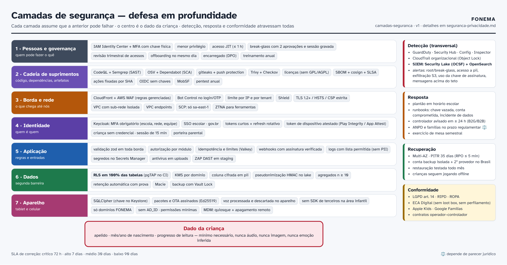
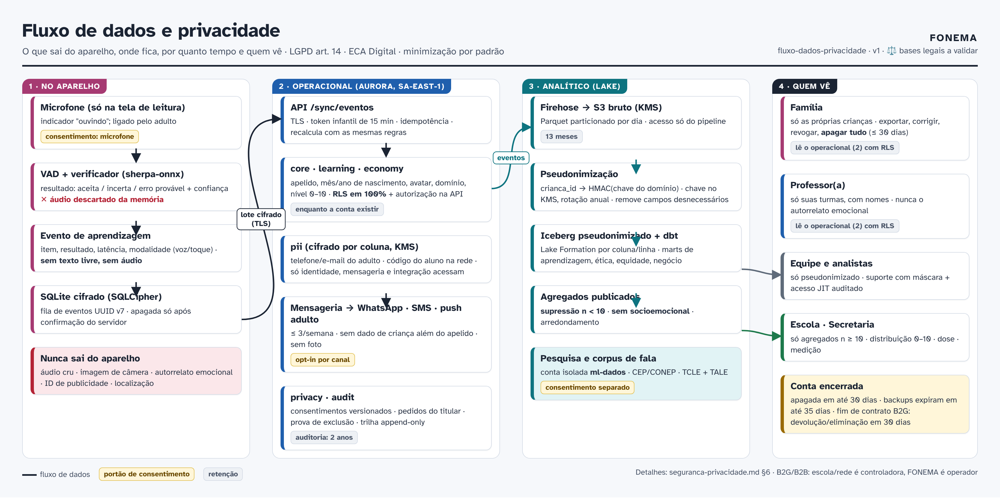

# FONEMA Unificada — Segurança e privacidade

> Complementa o [README](README.md) (arquitetura) e o [esqueleto](esqueleto.md). **Tudo que é jurídico aqui depende de parecer ⚖️**: nenhum texto de lei foi conferido no Planalto nesta fase (Documento Mestre §4.15 e §9.2). Os artigos citados vêm do Documento Mestre e precisam ser conferidos na fonte oficial.

---

## 1. O que protegemos

| Ativo | Classificação | Onde vive | Observação |
|---|---|---|---|
| Perfil infantil (apelido, mês/ano de nascimento, avatar, perfil sensorial, região de sotaque) | **Pessoal de criança** | `core` (Aurora), SQLite cifrado no aparelho | sem CPF, foto, endereço, geolocalização |
| Progresso (tentativas, domínio, nível 0–10, provinhas) | **Pessoal de criança** (educacional) | `learning`, lake (pseudonimizado) | **nunca áudio** |
| Perfil de inclusão (TEA, TDAH, dislexia, TDL, Down) | **Sensível** (saúde) ⚖️ | `core` com cifragem por coluna | só se o responsável informar; nunca na secretaria |
| Autorrelato emocional ("Como estou hoje?") | Efêmero | só na memória do aparelho | **não é armazenado** |
| Voz da criança | **Potencialmente biométrico** ⚖️ | memória do aparelho, descartada | só sai com consentimento específico (fila de escuta, "ouça seu filho ler", corpus) |
| Corpus de fala para pesquisa | **Sensível + pesquisa** | conta `ml-dados` isolada | CEP/CONEP, TCLE + TALE, opt-in separado |
| Dados de adultos (telefone, e-mail, nome) | Pessoal | `pii` cifrado, Keycloak | necessário para login e mensagens |
| Código do aluno na rede, nome completo exigido pela escola | Pessoal | `pii` cifrado | acessível só ao módulo de integração |
| Mensagens WhatsApp | Pessoal | `messaging` + Meta (suboperador) | sem dado de criança além do apelido |
| Pagamentos | Pessoal/financeiro | gateway/lojas (operadores); só tokens no FONEMA | sem dados de cartão no FONEMA (fora do escopo PCI) |
| Conteúdo e chaves de assinatura | Integridade crítica | Git, S3, KMS | assinatura Ed25519 de pacotes e OTA |
| Segredos e chaves | Crítico | Secrets Manager, KMS, GitHub Environments | rotação, nunca no código |
| Agregados da rede | Pessoal agregado | `agregados` | n ≥ 10, sem socioemocional |

## 2. Atores e fronteiras de confiança

- **Fronteira 1 — aparelho ↔ internet:** app infantil e adulto, tablets compartilhados (atacante com acesso físico, outra criança, adulto curioso, app malicioso no mesmo aparelho).
- **Fronteira 2 — borda ↔ aplicação:** CloudFront/WAF → ALB → ECS.
- **Fronteira 3 — aplicação ↔ dados:** API → Aurora (RLS), S3, Valkey.
- **Fronteira 4 — FONEMA ↔ terceiros:** Meta, lojas, gateway, TTS (build), EAS (build), Bedrock (sem dado pessoal).
- **Fronteira 5 — produção ↔ pessoas da equipe:** acesso administrativo, suporte, pesquisa.
- **Fronteira 6 — cadeia de suprimentos:** dependências, imagens, ações do GitHub, modelos pré-treinados.

Atores de ameaça: criminoso oportunista (credenciais, ransomware), atacante direcionado a dados de crianças, insider (equipe, suporte, terceirizado), funcionário de escola com acesso indevido a outra turma/escola, responsável tentando ver dados de criança de outra família (ex.: guarda disputada), criança tentando "burlar" a economia, concorrente (scraping de conteúdo), dependência comprometida.

## 3. Modelo de ameaças (STRIDE + LINDDUN)

| # | Componente | Ameaça (categoria) | Cenário | Controles | Risco residual |
|---|---|---|---|---|---|
| A1 | Login de adulto | **S**poofing | Credential stuffing, SIM swap para OTP | MFA obrigatório para escola/rede/equipe; OTP por WhatsApp preferido a SMS; limite de taxa e Bot Control no WAF; detecção de login anômalo; passkeys | Médio |
| A2 | Token de dispositivo (tablet) | Spoofing | Token copiado para outro aparelho | Chave privada no Keystore/Secure Enclave; atestação (Play Integrity/App Attest); DPoP; revogação em 1 clique; vínculo à escola | Baixo |
| A3 | Sessão infantil | Elevação de privilégio | Criança acessa área adulta | Porteira (3 s + leitura); escopo do token infantil = 1 criança, sem rotas adultas; logout adulto em 2 min | Baixo |
| A4 | Senha de figuras (sala) | Spoofing | Colega escolhe o avatar de outro | Senha de 3 figuras entre 9; impacto limitado (só progresso de leitura); professora pode corrigir atribuição | Aceito |
| A5 | API multi-tenant | **I**nformation disclosure | IDOR entre turmas/escolas/redes | Autorização por módulo + **RLS** (2ª barreira); testes pgTAP por papel × tabela; testes de isolamento entre redes; pentest multi-tenant | Baixo |
| A6 | Painel da secretaria | Information disclosure / **L**inkability | Reidentificação por célula pequena | Supressão n < 10; sem socioemocional; arredondamento; sem cruzamento livre; revisão de novas visões | Baixo |
| A7 | Lake/BI | **I**dentifiability | Analista reidentifica criança | Pseudonimização HMAC com chave em KMS; Lake Formation (coluna/linha); sem acesso à chave; auditoria de consultas | Baixo |
| A8 | Eventos de sync | **T**ampering | Relógio manipulado para ganhar moedas; replay | Servidor recalcula com as mesmas regras; idempotência; teto diário; antifarming; correção silenciosa no próximo ganho | Baixo |
| A9 | Pacotes de conteúdo e OTA | Tampering | Pacote malicioso via CDN ou rede da escola | Assinatura Ed25519 (chave em KMS) + SHA-256; code signing do expo-updates; TLS; app recusa sem assinatura | Baixo |
| A10 | Aparelho perdido/roubado | Information disclosure | Leitura do SQLite | SQLCipher com chave no Keystore; apagamento remoto via MDM; dados mínimos no aparelho | Baixo |
| A11 | Microfone | **D**isclosure / **U**nawareness | Áudio captado sem saber | Microfone só na tela de leitura com indicador "ouvindo"; áudio em memória e descartado; sem upload sem consentimento específico | Baixo |
| A12 | WhatsApp | Disclosure / **N**on-compliance | Mensagem para número errado; dado de criança em servidor fora do Brasil | Opt-in com confirmação; sem dado de criança além do apelido; sem foto; contrato com Meta; parecer ⚖️ | Médio |
| A13 | Webhooks (Meta, lojas, gateway) | Spoofing / Tampering | Webhook forjado libera plano | Verificação de assinatura; reconsulta à API do provedor; idempotência | Baixo |
| A14 | Estúdio/LLM | Tampering / conteúdo nocivo | Prompt injection ou texto inadequado | LLM só nos bastidores; sem dado de criança; validador + revisão humana dupla; nada vai ao ar sem PR aprovado | Baixo |
| A15 | Suporte/insider | Disclosure / **R**epudiation | Funcionário consulta criança sem motivo | Dados mascarados; acesso JIT com ticket; `audit.acessos` append-only; revisão trimestral; sessões gravadas | Médio |
| A16 | Contas AWS | Elevação | Credencial de CI vazada | OIDC sem chave estática; papéis mínimos por workflow; SCPs; GuardDuty; alertas de uso de root | Baixo |
| A17 | Cadeia de suprimentos | Tampering | Dependência npm comprometida | Lockfile; OSV/Dependabot; Socket/Semgrep supply chain [avaliar]; ações do GitHub fixadas por SHA; SBOM; imagens assinadas; proveniência SLSA | Médio |
| A18 | Disponibilidade | **D**enial of service | DDoS em horário escolar | CloudFront + WAF + Shield; limites por tenant; autoescala; **offline-first** (aula continua) | Baixo |
| A19 | Ransomware/exclusão | Tampering/DoS | Atacante apaga bancos e backups | Backups em conta separada com **Vault Lock**; Object Lock; MFA delete; 2º provedor | Baixo |
| A20 | Modelo de fala | Viés (equidade) | Crianças de uma região reprovadas mais | Portão de viés por região/idade; modo sombra; ASR nunca é portão; caminho por toque | Médio |
| A21 | Economia | Manipulação/dark pattern | Desenho que pressione a criança | Sem aleatoriedade, sem dinheiro real, sem perda, preço visível; métricas éticas; revisão ECA Digital por release | Baixo |
| A22 | Guarda disputada | Disclosure | Responsável sem guarda acessa dados | Vínculos com papel; processo de suporte para revogação com documentação; registro de acesso | Médio |

## 4. Controles por camada

### 4.1 Pessoas e processos
- **IAM Identity Center** com MFA por chave física para a equipe; **menor privilégio**; nenhum acesso permanente a produção; **JIT** com aprovação e duração máxima de 1 h; **break-glass** com 2 aprovadores e sessão gravada.
- **Revisão trimestral de acessos**; offboarding com revogação no mesmo dia; termo de confidencialidade; treinamento anual de privacidade de crianças e segurança.
- **Encarregado (DPO)** nomeado; comitê de privacidade e segurança mensal; comitê de ética de experimentos.

### 4.2 Borda e rede
- CloudFront + **AWS WAF** (conjuntos gerenciados: núcleo, entradas ruins conhecidas, SQLi, Linux, IP reputation; **Bot Control** em login/OTP; limites por IP, por tenant e por rota); **Shield Standard** (Advanced quando exigido em B2G).
- TLS 1.2+ (preferir 1.3), HSTS com preload, **CSP estrita** com nonce, `X-Content-Type-Options`, `Referrer-Policy: no-referrer`, `Permissions-Policy` restritiva (microfone só no app).
- VPC com sub-redes isoladas para dados, **VPC endpoints**, security groups mínimos, sem IP público em ECS/Aurora, logs de fluxo no `log-archive`.

### 4.3 Identidade
- Keycloak: senhas fortes (NIST 800-63B: comprimento, lista de senhas vazadas), MFA, passkeys, bloqueio progressivo, sessões curtas, refresh rotativo, `aud` por serviço, chaves de assinatura rotacionadas.
- Criança **sem credencial própria**; sessão infantil derivada e curta; token de dispositivo atestado e revogável.
- gov.br e SSO de redes por federação; mapeamento de papéis controlado pela rede (controladora).

### 4.4 Aplicação
- Validação zod em todas as bordas; autorização por módulo; **RLS** como 2ª barreira; papel de banco sem `BYPASSRLS`; consultas parametrizadas.
- Limites de taxa (Valkey) por usuário, aparelho e tenant; idempotência em sync e webhooks; outbox transacional.
- **Uploads** (exportações, imagens do estúdio): verificação de tipo, antivírus (ClamAV em worker isolado), buckets privados, URLs assinadas curtas.
- Segredos lidos do Secrets Manager em tempo de execução; nada em variáveis de ambiente em texto no repositório.

### 4.5 Dados
- **Cifragem em repouso** com **KMS por domínio** (chaves separadas para `app`, `pii`, `lake`, `backup`, `ml-dados`, `assinatura-conteudo`); rotação anual automática.
- **Cifragem por coluna** (envelope) em `pii` e perfil de inclusão.
- **Pseudonimização** no lake (HMAC com chave por domínio); **agregação com n ≥ 10** para rede.
- **Minimização** (ver §6.4) e **retenção** automatizada (jobs com prova).
- Macie varrendo buckets para detectar PII fora do lugar.

### 4.6 Aparelho
- SQLite com **SQLCipher** (chave no Keystore/Keychain); na web, SQLite WASM em OPFS com chave não exportável (Web Crypto) [PoC].
- Pacotes e OTA **assinados**; **sem SDK de terceiros** na área infantil; auditoria de domínios no CI; `allowBackup=false` no Android; bloqueio de captura de tela na área adulta sensível (opcional).
- Permissões mínimas: **microfone** (pedido em contexto, pelo adulto); câmera **fora do MVP**; sem localização, contatos, fotos ou ID de publicidade (`AD_ID` removido do manifesto).
- Porteira parental; logout adulto em 2 min.

### 4.7 Detecção e resposta
- **GuardDuty** (inclui proteção de S3, RDS, ECS runtime), **Security Hub** (padrões AWS FSBP e CIS), **Config** (regras de conformidade), **Inspector** (imagens ECR), **Macie**, **CloudTrail** organizacional.
- **SIEM:** **Amazon Security Lake** (formato OCSF) + **OpenSearch Security Analytics** na conta `security`. Casos de uso iniciais: login de root/break-glass; acesso a `pii` fora do padrão; pico de 403/401 por tenant; consulta em massa no lake; desativação de logs; mudança de SCP/IAM; exfiltração de S3; uso de chave KMS de assinatura fora do pipeline; mensagens WhatsApp acima do teto.
- Alertas → plantão; **runbooks** de incidente; exercícios de mesa semestrais.

### 4.8 Cadeia de suprimentos e desenvolvimento seguro

| Prática | Ferramenta | Quando | Bloqueia |
|---|---|---|---|
| SAST | **CodeQL** + **Semgrep** (regras próprias: log de PII, consulta sem RLS, chamada de rede na área infantil) | todo PR + diário | alto/crítico |
| SCA (dependências) | **OSV-Scanner** + Dependabot/Renovate | todo PR + diário | crítico explorável |
| Segredos | **gitleaks** (pre-commit e CI) + secret scanning com push protection do GitHub | sempre | sim |
| Licenças | verificador de licenças (lista permitida; **sem GPL/AGPL no código fechado**, isolar como serviço) | todo PR | sim |
| Contêineres e IaC | **Trivy** (imagens, IaC), **Checkov**, tflint | todo PR | alto/crítico |
| DAST | **OWASP ZAP** (varredura autenticada) | staging, a cada release candidate | alto |
| Binário móvel | **MobSF** + auditoria de domínios + revisão de SDKs | todo build de release | sim |
| SBOM e assinatura | **Syft** (SBOM CycloneDX), **cosign**, proveniência **SLSA** nível 3 [meta] | toda imagem/release | — |
| Ações do GitHub | fixadas por SHA; permissões mínimas por job (`permissions:`); OIDC | sempre | — |
| Pentest | empresa externa: **antes do beta**, **antes do 1º contrato B2G**, **anual** e após mudança grande (escopo: app, API multi-tenant, Keycloak, MDM, AWS) | calendário | correção antes de ir ao ar |
| Divulgação responsável | `SECURITY.md` + e-mail dedicado; programa de recompensa na fase 2+ | contínuo | — |

**Prazos de correção (SLA):** crítico 72 h · alto 7 dias · médio 30 dias · baixo 90 dias. Exceções só com aceite de risco registrado e data de revisão.

## 5. Gestão de segredos e chaves

- **Secrets Manager** com rotação automática (banco 30 dias; chaves de API de terceiros 90 dias quando o provedor permitir).
- **KMS** para cifragem e para a **chave de assinatura de pacotes (Ed25519)** [conferir suporte a Ed25519 no KMS; alternativa: CloudHSM ou chave em HSM com assinatura só no job de release].
- Chaves de assinatura de app: Play App Signing + chave de upload no cofre do CI; certificados Apple no EAS com acesso restrito.
- **GitHub Environments** com segredos por ambiente e revisores; OIDC para AWS (sem chave estática).
- Inventário de segredos com dono e data de rotação; alerta de segredo próximo do vencimento.

---

## 6. LGPD — privacidade por arquitetura

### 6.1 Papéis

| Modalidade | Controlador | Operador | Observações |
|---|---|---|---|
| **B2C** (família) | **FONEMA** | AWS, Meta, gateway, lojas (operadores/suboperadores) | consentimento parental específico e em destaque (art. 14 §1º) ⚖️ |
| **B2B** (escola privada) | **Escola** | **FONEMA** (operador) + suboperadores | contrato de tratamento de dados (DPA) |
| **B2G** (rede pública) | **Secretaria/município** | **FONEMA** (operador) + suboperadores | base em políticas públicas de educação ⚖️; contrato anexo à ARP/CPSI |
| Pesquisa (corpus, RCT) | FONEMA e/ou instituição de pesquisa | — | CEP/CONEP; consentimento separado |

### 6.2 Bases legais por finalidade ⚖️

| Finalidade | Base proposta (a validar) | Opcional? |
|---|---|---|
| Prestar o serviço de alfabetização (B2C) | Consentimento parental específico (art. 14 §1º) | não (sem ele não há conta) |
| Prestar o serviço (B2G/B2B) | Execução de políticas públicas / contrato da escola, com melhor interesse da criança (art. 14 caput; Enunciado CD/ANPD 1/2023) | não |
| Microfone (verificação no aparelho) | Consentimento do responsável; sem armazenamento | **sim** (toque é equivalente) |
| Relatório à escola (B2C convidado) | Consentimento | sim |
| Mensagens WhatsApp/SMS | Consentimento por canal | sim |
| "Ouça seu filho ler" / fila de escuta | Consentimento específico ⚖️ | sim |
| Sinalização de risco (atenção) | ⚖️ (dado de saúde inferido) | sim, desligado por padrão |
| Corpus de fala / pesquisa | Consentimento separado + CEP/CONEP (TCLE + TALE) | sim |
| Experimentos de produto | Legítimo interesse **não** se aplica a criança sem análise ⚖️; pesquisa = consentimento | — |
| Cobrança (adulto) | Execução de contrato | — |
| Segurança e prevenção a fraude | Legítimo interesse / obrigação legal (logs de acesso, Marco Civil) ⚖️ | — |

### 6.3 Documentos de governança (em `docs/privacidade/`)
- **RIPD/DPIA** (relatório de impacto) do produto **antes do beta**; **RIPD conjunto com cada rede** antes do piloto B2G; revisão a cada mudança relevante (nova finalidade, novo suboperador, novo dado).
- **ROPA** (registro das operações de tratamento, art. 37).
- **Mapa de dados** (cada campo: finalidade, base, retenção, onde vive, quem acessa) — gerado em parte a partir dos schemas.
- **Política de privacidade** em linguagem simples + **versão para crianças em áudio**; termos versionados.
- **Contrato-modelo de tratamento de dados com secretarias e escolas** (ver §6.6).
- **Lista pública de suboperadores** com aviso prévio de mudança.
- **Plano de resposta a incidentes** (ver §6.7).

### 6.4 Minimização e retenção

| Dado | Coletado? | Retenção |
|---|---|---|
| Nome completo da criança | Não (B2C). B2G/B2B só se a escola exigir, em `pii` | fim do contrato + até 30 dias |
| Data exata de nascimento | **Não** (só mês/ano) | — |
| CPF, foto, endereço, geolocalização, ID de publicidade | **Não** | — |
| Áudio cru | **Não** (descartado em memória) | — |
| Áudio com consentimento (fila de escuta / "ouça seu filho ler") | Sim, opcional | **30 dias** ou até a escuta, o que vier primeiro [hipótese] ⚖️ |
| Eventos brutos de aprendizagem | Sim | **13 meses**, depois só agregados anônimos |
| Projeções (domínio, nível, vila, saldo) | Sim | enquanto a conta existir |
| Conta encerrada | — | apagada em **até 30 dias**; backups expiram em **até 35 dias** |
| Logs de aplicação | Sim, sem PII | 90 dias (CloudWatch) |
| Logs de segurança/auditoria | Sim | **2 anos** (Object Lock); registros de acesso exigidos por lei conforme parecer ⚖️ |
| Dados de turma após fim de contrato B2G/B2B | — | **devolução ou eliminação em até 30 dias** conforme instrução do controlador |
| Corpus de pesquisa | Sim, opt-in | conforme protocolo CEP; revogação remove gravações futuras e, se possível, as existentes do conjunto de treino seguinte |

### 6.5 Direitos do titular (exercidos pelo responsável)

- **Painel de privacidade** na área da família (web e app, atrás da porteira): ver dados, **exportar** (JSON + PDF legível; portabilidade), **corrigir**, **revogar consentimentos** por finalidade, **apagar tudo**.
- Fluxo de exclusão = **Step Functions**: confirma identidade do adulto → marca conta → apaga em cascata (Aurora, PowerSync, S3, lake bruto; pseudonimizado sai na próxima compactação) → revoga tokens e aparelhos → registra **prova de exclusão** → avisa o adulto.
- **B2G/B2B:** pedidos chegam ao FONEMA e são **encaminhados ao controlador** (escola/rede) em até 2 dias úteis, com apoio técnico para atender.
- Prazo-alvo de resposta: **15 dias** [conferir prazo legal aplicável] ⚖️.

### 6.6 Contrato operador–controlador com secretarias e escolas (cláusulas mínimas)

1. Objeto, finalidade (alfabetização e gestão pedagógica) e **proibição de outros usos** (publicidade, perfilamento comercial, venda de dados, treino de modelos sem consentimento específico).
2. **Instruções documentadas** do controlador; o FONEMA não decide finalidades no B2G/B2B.
3. Categorias de dados e de titulares; lista de **suboperadores** (AWS Brasil, Meta/WhatsApp, provedor de SMS, e-mail) com direito de objeção a novos.
4. **Localização dos dados no Brasil**; transferência internacional só com cláusulas e aprovação do controlador ⚖️.
5. Medidas de segurança (anexo técnico com os controles deste documento), certificações e relatórios de pentest (sumário).
6. **Comunicação de incidente ao controlador em até 24 h** da ciência, com informações para que ele comunique à ANPD e aos titulares no prazo regulamentar [conferir Resolução CD/ANPD sobre incidentes] ⚖️.
7. Apoio a pedidos de titulares e ao RIPD do controlador.
8. **Auditoria** pelo controlador (documental anual; presencial com aviso).
9. Sigilo da equipe; treinamento; acesso mínimo.
10. **Fim do contrato:** devolução em formato aberto e/ou eliminação em até 30 dias, com certificado.
11. Agregados com n ≥ 10 e **sem dado socioemocional** para a gestão da rede.
12. Responsabilidades e limites (art. 42 e seguintes) ⚖️.

### 6.7 Resposta a incidentes de dados pessoais
1. **Detectar** (SIEM, alerta, relato) → abrir incidente privado, acionar encarregado e segurança.
2. **Conter** (revogar credenciais, isolar recurso, bloquear no WAF).
3. **Avaliar** risco aos titulares (crianças = risco elevado por padrão).
4. **Comunicar:** B2C → ANPD e responsáveis no prazo regulamentar [conferir] ⚖️; B2G/B2B → controlador em até 24 h.
5. **Erradicar e recuperar**; **lições aprendidas** em até 10 dias úteis; registro de todos os incidentes (mesmo sem comunicação obrigatória).

### 6.8 Transferência internacional e terceiros

| Terceiro | Dado pessoal? | Situação |
|---|---|---|
| AWS (`sa-east-1`) | Sim | no Brasil; DPA da AWS |
| Meta (WhatsApp Cloud API) | Sim (telefone, conteúdo da mensagem) | **fora do Brasil** salvo armazenamento local [conferir] ⚖️ |
| Apple / Google (lojas, push, IAP) | Sim (adulto) | termos das plataformas ⚖️ |
| Gateway de pagamento BR | Sim (adulto) | preferir processamento no Brasil |
| Azure/Polly TTS | **Não** (texto curricular) | sem restrição |
| Expo EAS (build) | **Não** | binários e código; sem dado de usuário |
| Amazon Bedrock | **Não** (só restrições curriculares) | [conferir residência da inferência] |
| GitHub | Não (código, conteúdo sem dados de criança) | proibido dado pessoal em issues/PRs |

---

## 7. ECA Digital (Lei 15.211/2025) — checklist de produto ⚖️

- [ ] **Proteção máxima por padrão**: configurações mais protetivas ligadas por padrão (microfone desligado até o adulto ligar, mensagens desligadas até opt-in, sinalização de risco desligada).
- [ ] **Supervisão parental** efetiva: painel do responsável, controle de tempo, relatório, porteira.
- [ ] **Conta vinculada a responsável**: toda criança ligada a adulto ou instituição; sem conta infantil autônoma.
- [ ] **Sem caixas de recompensa (loot boxes)**: nenhum item aleatório, nem pago nem gratuito; preço e aparência visíveis antes da compra.
- [ ] **Sem dinheiro real na economia**; sem compra de moedas; sem anúncio que dê moedas.
- [ ] **Sem perfilamento para publicidade**; **sem anúncios**.
- [ ] **Sem autoplay em sequência e sem rolagem infinita** (vídeos e listas da área infantil).
- [ ] **Sem padrões manipulativos**: sem "só mais uma", sem FOMO, sem personagem triste, sem perda por ausência, sem notificação para a criança.
- [ ] **Oferta de assinatura só ao adulto**, atrás da porteira; "ponte em obras" sem pressão.
- [ ] **Verificação/aferição de idade e vínculo** conforme regulamentação e orientações da ANPD [conferir decreto 12.880/2026 × 12.622/2025] ⚖️.
- [ ] Canal de denúncia e atendimento para responsáveis.
- [ ] Revisão ECA Digital assinada pelo jurídico **a cada release** que mude economia, lojinha, vídeos, notificações ou cadastro.

## 8. Checklist das lojas

### 8.1 Apple — categoria Kids (faixas "5 e menos" e "6–8")
- [ ] **Nenhum analytics ou publicidade de terceiros**; nenhum SDK que envie dados a terceiros a partir da experiência infantil (crash e telemetria só para domínios FONEMA).
- [ ] **Porteira de nível adulto** antes de links externos, compras, pedidos de avaliação, configurações e área adulta (segurar 3 s + tarefa de leitura; não é simples soma).
- [ ] **IAP** para assinatura comprada no app; regras de renovação claras; "Restaurar compras"; cancelamento explicado. Link para checkout externo só se as regras vigentes permitirem [conferir] ⚖️.
- [ ] **Rótulos de privacidade** coerentes: microfone processado no aparelho, sem rastreamento, dados vinculados ao adulto.
- [ ] Política de privacidade acessível no app e na página da loja.
- [ ] Texto e capturas da loja **sem promessa de resultado** e sem neuromitos.
- [ ] Sem "site embrulhado": funcionalidade nativa real (offline, áudio, fala, compras).

### 8.2 Google Play — Projetado para Famílias
- [ ] **Público-alvo** declarado (crianças + adultos) e conteúdo adequado.
- [ ] **Sem ID de publicidade** (`com.google.android.gms.permission.AD_ID` removido); nenhum SDK fora da lista de SDKs autocertificados para Famílias.
- [ ] **Formulário de Segurança dos dados** coerente com o RIPD e com este documento.
- [ ] Permissões mínimas justificadas (microfone em contexto).
- [ ] Assinatura via Google Play Billing quando comprada no app.
- [ ] Faixa de teste fechada no beta; lançamento gradual; meta de selo "Aprovado por professores" após o lançamento.
- [ ] Distribuição escolar via **Google Play gerenciado** com a mesma versão aprovada.

### 8.3 Checklist bloqueante de release (app)
- [ ] Lista de SDKs e domínios revisada (CI de auditoria de rede verde).
- [ ] Porteira testada (E2E Maestro + teste manual).
- [ ] Nenhuma tela infantil com link externo, preço em dinheiro ou oferta.
- [ ] Termos e política atualizados; **versão de consentimento incrementada** se mudou finalidade.
- [ ] Rótulos/formulários das lojas atualizados.
- [ ] Revisão ECA Digital (§7) e LGPD (mapa de dados) assinadas.
- [ ] Aprovações: produto, pedagogia, segurança e privacidade.

---

## 9. Checklist pré-lançamento (beta e B2G)

| Item | Beta (fase 0) | 1º contrato B2G |
|---|---|---|
| Parecer jurídico (§9.2 do Documento Mestre) | obrigatório | obrigatório + contratação pública |
| RIPD do produto | aprovado | + RIPD conjunto com a rede |
| Encarregado nomeado e canal publicado | sim | sim |
| Pentest externo com achados críticos/altos corrigidos | sim | sim (escopo multi-tenant + MDM) |
| Restauração de backup testada | sim | sim, com relatório ao controlador |
| SIEM com casos de uso iniciais | Security Hub + CloudTrail | Security Lake + OpenSearch completo |
| Plano de incidentes ensaiado (exercício de mesa) | sim | sim, com a rede |
| Contratos com suboperadores | AWS, gateway, lojas | + Meta/BSP, SMS; lista no contrato |
| Treinamento da equipe | sim | + treinamento de escolas (acessos, MDM) |
| Métricas éticas com alerta | sim | sim, no relatório à rede |

## 10. Indicadores de segurança e privacidade (revisados no comitê mensal)

- Achados abertos por severidade e idade (dentro do SLA); dependências críticas desatualizadas.
- Acessos JIT/break-glass (quantidade, justificativa, revisão).
- Pedidos de titular (quantidade, prazo médio, exclusões concluídas com prova).
- Incidentes e quase-incidentes; tempo para detectar e conter.
- PII detectada fora do lugar (Macie, teste de logs) — meta zero.
- Domínios fora da lista no app infantil — meta zero.
- Mensagens acima de 3/semana — meta zero.
- Células n < 10 servidas — meta zero.
