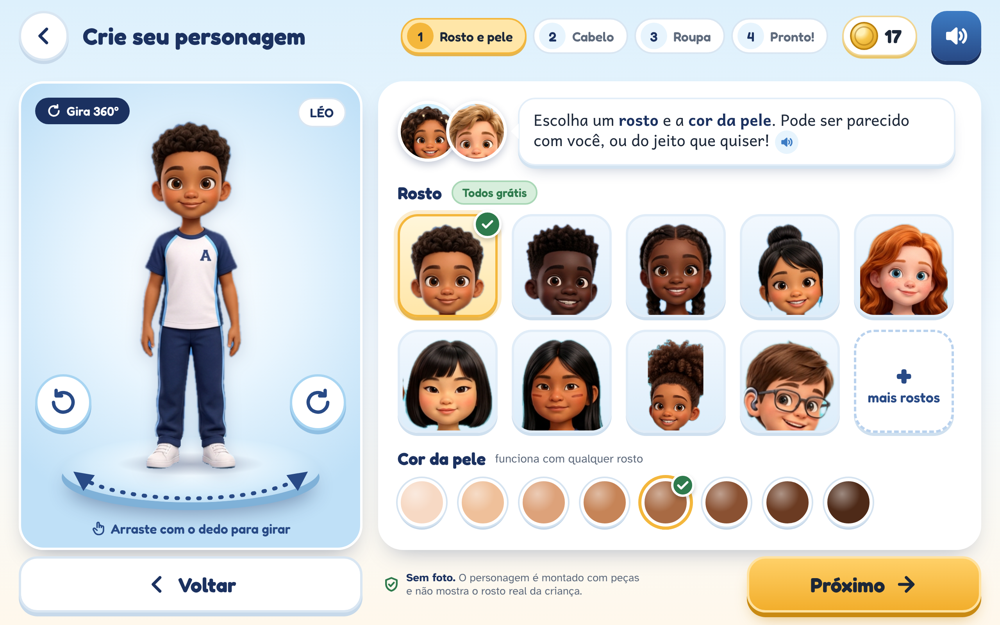

# Telas do Criador de Avatar e da Lojinha 3D (rodada 1)

**Data:** 13/11/2026 · Decisões **002**, **006**, **007**, **008** e **009**; rel. **38** (economia virtual); proposta [`lojinha-emblemas`](../../lojinha-emblemas/README.md).

As telas foram montadas em HTML/CSS com **recortes das pranchas 3D que já existem**. Os recortes saíram de `avatar-3d/*.png` e de `personagens-3d/02-expressoes.png`, `dupla-opcao-1.png` e `06-leitura-juntos-praca.png`. **Nenhuma imagem nova foi gerada por IA.** Captura: Playwright/Chromium, 1280×800, `deviceScaleFactor 2` (PNG de 2560×1600).



## 1. As telas

| Arquivo | O que mostra | Pontos de desenho |
|---|---|---|
| `01-criar-avatar-pele-rosto.png` | **Passo 1:** 9 rostos-base com diversidade de tons, traços e cabelos, mais 8 tons de pele | O avatar grande fica à esquerda num disco giratório, com setas ↺ ↻, o selo "Gira 360°" e a dica "arraste com o dedo". Sofia e Tales guiam com um balão que tem botão de áudio. Os botões têm 72 px. O rodapé diz "**Sem foto**". |
| `02-criar-avatar-cabelo.png` | **Passo 2:** 18 penteados (crespo, black power, puffs, cacheado, tranças, nagô, box braids, coque, rabo, ondulado, chanel, liso, raspado, arrepiado) | Filtros por tipo e o selo "**Todos grátis, sempre**". O cabelo nunca vem com enfeite. |
| `03-criar-avatar-roupa.png` | **Passo 3:** UNIFORME e BLUSÃO **grátis**. COLETE, CAPA, PIJAMA, XADREZ e TIME ficam com cadeado e preço fixo em moedinhas | Cada nome vem em sílabas decodificáveis. A área **Acessibilidade: sempre grátis** traz óculos, aparelho auditivo, cadeira de rodas e muleta. O rodapé avisa: "roupa não dá vantagem". |
| `04-lojinha-utensilios.png` | **Lojinha da Vila**: prateleiras de madeira com 10 utensílios, cada um com o seu **para que serve** | Exemplos: LUPA serve para explorar o Cerrado, REGADOR para regar a horta da vila e LANTERNA para ler a placa da gruta. Há abas por propósito, provador com o avatar segurando a LUPA, **cofrinho com meta** (17 de 24, falta 7, bônus fixo de +1 a cada 10, desfazer em 24 h) e as regras visíveis no rodapé. O botão principal é "**Guardar para a LUPA**". |
| `05-meu-avatar-na-vila.png` | O avatar pronto (LÉO, de colete) na praça do ipê, ao lado de Sofia e Tales, com a **MOCHILA** e a **LUPA** equipadas | Cartão de equipamentos, falas com áudio e botões "Trocar visual", "Lojinha" e "Ir para a aventura". |
| `06-fluxo-avatar.png` | O fluxo em 4 passos, o ciclo da lojinha e as regras | O ciclo é aprender → moedinhas → cofrinho → escolher o porquê → usar no mundo. As regras estão em três quadros: Grátis, Para conquistar e Nunca. Fecha com o esquema de produção glTF. |

**Paleta (Decisão 009):** azul-marinho, azul-claro, branco, madeira, verde-mata, amarelo-ipê e terracota, com no máximo 2 ou 3 cores por elemento. **Ficaram de fora** a camiseta listrada colorida (`roupas-a`, coluna 5), a pipa e o xilofone. Os kits de ciências, que têm tubos coloridos, também não aparecem nas telas. Quando saírem as versões `-v2`, basta recortá-las com o mesmo script.

## 2. Regras que as telas mostram

1. **Sem foto da criança.** O avatar é montado com peças e não identifica a criança real (Decisão 008; LGPD art. 14; ECA Digital).
2. **São grátis para sempre:** rosto, cor da pele, todos os cabelos, uniforme e blusão da escola, e **acessibilidade** (óculos de grau, aparelho auditivo, cadeira de rodas, muleta). Trocar o visual também é grátis.
3. **Itens a conquistar:** roupas de aventura, de bioma e de festa, e utensílios. O preço é **fixo e igual para todos** e o nome é decodificável. Cada item tem um **propósito** visível (rel. 38; proposta lojinha-emblemas).
4. **Nunca entram:** joias, brincos, colares, pulseiras, maquiagem ou enfeites (Decisão 006); sorte, caixa-surpresa ou raridade aleatória; dinheiro real; "só hoje" ou contagem regressiva; ranking; perder item por faltar dias; item que dê **vantagem** em lição, jogo ou nota.
5. **Cofrinho com meta:** o bônus de paciência é fixo (+1 a cada 10), a criança pode tirar as moedas quando quiser e qualquer compra se desfaz em 24 h.
6. **Salvaguarda pedagógica (Decisão 007, item 7):** o 3D completo fica no mundo, no criador e na lojinha. Nas telas de lição, o fundo continua limpo.

## 3. Peças recortadas (`avatar-3d/pecas/`, 199 PNG)

| Prefixo | Origem | Tratamento |
|---|---|---|
| `crianca-*.png` (17) | `diversidade-a/b.png` | Fundo removido. O fundo azul em degradê é modelado por um polinômio e preenchido a partir das bordas. Restos de vizinhos e do chão foram limpos. |
| `roupa-NN-*.png` (8) e `roupa-aNN-*.png` (7) | `roupas-b.png` e `roupas-a.png` | Fundo removido. A camiseta listrada não foi recortada. |
| `cabelo-*.png` e `cabelo-*-recorte.png` (34 + 34) | `cabelos-a/b.png` | Há duas versões: o tile arredondado original e a cabeça **sem fundo**, que é a usada nas telas sobre um cartão neutro. |
| `utensilio-[ab]-*.png` e `utensilio-[ab]-tile-*.png` | `utensilios-a/b.png` | Objeto sem fundo e tile arredondado. Repetidos, pipa e xilofone foram omitidos. |
| `rosto-*.png` (10) | Topo das peças de corpo inteiro | São os cartões do passo 1. |
| `sofia-busto-*.png` e `tales-busto-*.png` (12) | `personagens-3d/02-expressoes.png` | 6 expressões de cada um, para os guias. |
| `dupla-sofia-tales-corpo.png` | `personagens-3d/dupla-opcao-1.png` | Corpo inteiro sem fundo. |

**Limites dos recortes:** são PNG de baixa resolução (cerca de 574 px de altura no corpo inteiro). Há pequenas franjas azuladas nas bordas, e algumas cabeças ficaram cortadas onde as crianças se encostam na prancha (por exemplo, o puff do `rosto-08`). Os recortes servem para protótipo e direção de arte, não para produção. Na tela 3, o óculos e o aparelho auditivo aparecem como zoom do mesmo menino, e a muleta é um ícone vetorial simples, porque ainda não existe arte 3D dela. Na tela 5, a mochila aparece atrás do ombro como indicação: na produção ela vai no encaixe **costas**.

## 4. Como isso vira produção (peças glTF modulares)

- **Corpo-base:** um personagem infantil com **esqueleto comum** (humanoide, poucas articulações, LOD para tablet modesto). A **cor de pele** e a **cor do cabelo** são parâmetros de material, não modelos separados. Os formatos de rosto e de olhos são *blend shapes* (morph targets) do mesmo corpo.
- **Encaixes (slots):** `cabeca/rosto`, `cabelo`, `tronco`, `pernas`, `pes`, `mao_dir` (lupa, lanterna, regador), `costas` (mochila), `cabeca_topo` (chapéu) e `acessibilidade` (óculos, aparelho auditivo, cadeira de rodas com animações próprias, muleta). Cada peça é um **`.glb`** com *skinning* no mesmo esqueleto ou presa a um osso, e com uma regra de exclusão (exemplo: chapéu esconde parte do volume do cabelo).
- **Catálogo:** um JSON por item com `id`, `slot`, `nome_decodificavel` (sílabas), `preco` (fixo), `proposito`, `colecao`/`emblema`, `gratis` (identidade/acessibilidade), `paleta` (no máximo 3 cores) e `revisao_arte` (checagem da Decisão 009 e "sem adorno").
- **App:** um visualizador 3D leve (three.js/Babylon na web, ou o motor do mundo aberto) com giro por arrasto e botões ↺ ↻ como alternativa acessível. O provador da lojinha usa o mesmo visualizador. O áudio de cada balão é gravado pela voz da Sofia e do Tales.
- **Pipeline de arte:** as pranchas desta pasta são a **direção de arte**. A equipe 3D modela cada peça uma vez. As imagens de IA não vão para o produto final.
- **Privacidade:** o avatar é salvo só como uma lista de IDs de peças e parâmetros. Nenhuma imagem da criança é guardada.

## 5. Como regenerar

```bash
cd docs/propostas/06-fonema-unificada/avatar-3d/telas/fontes
python3 recortar.py    # pranchas → ../../pecas/*.png (PIL + numpy)
python3 gerar.py       # monta os 6 HTML (01–06)
node shot.js           # captura ../0N-*.png (ou: node shot.js 03 05)
```

## 6. Para o dono decidir

- **Pintura facial indígena** (`rosto-07`, vinda de `diversidade-a/b`): a tela 1 a mostra como opção cultural. Manter, de preferência com validação de consultoria indígena, ou retirar?
- **Nomes e preços** de exemplo (COLETE 30, LUPA 24 etc.): calibrar com a curva do rel. 38 (cerca de 35 moedas por semana).
- **Muleta e outros itens sem arte 3D:** pedir na próxima rodada de pranchas, junto com as versões `-v2` sem arco-íris (pipa, xilofone e camiseta).
