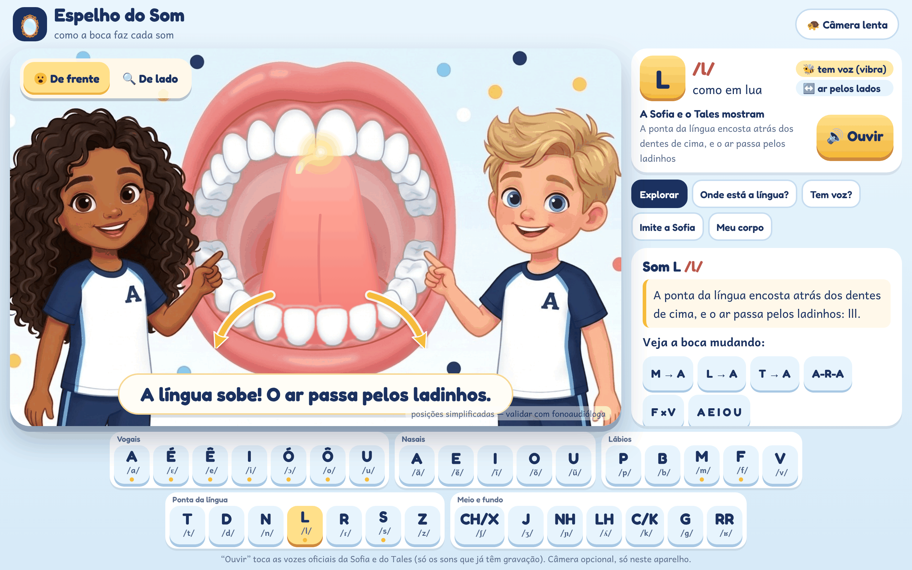
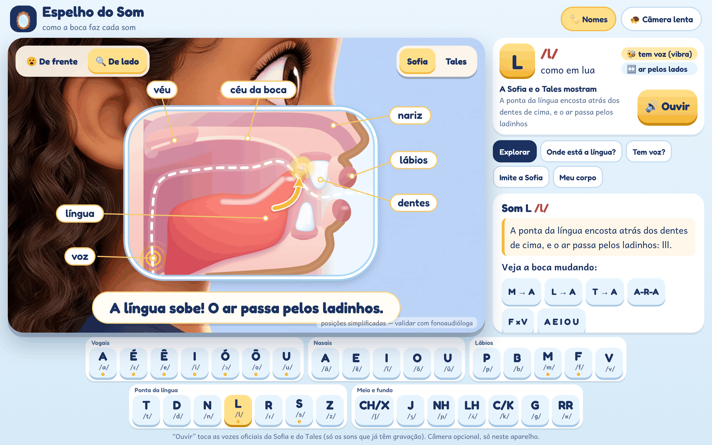
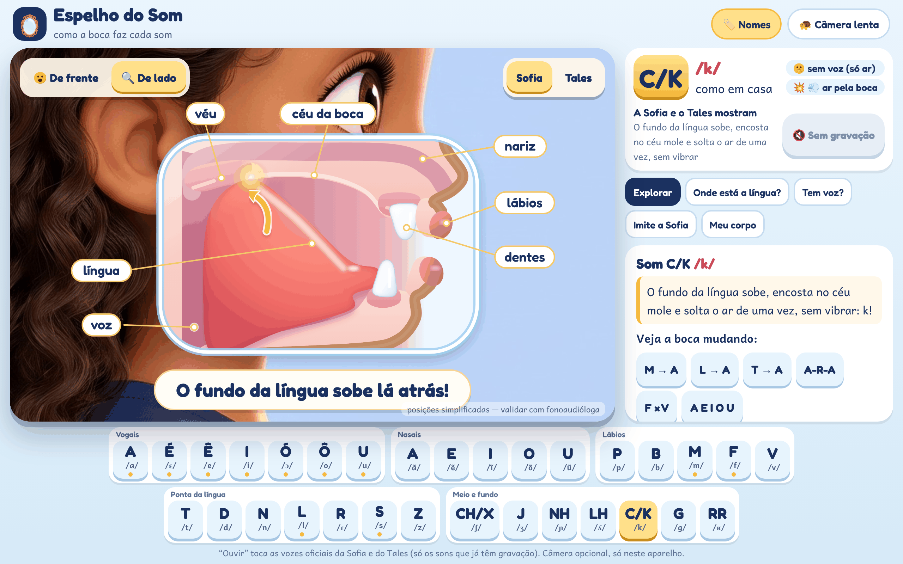

# Espelho do Som: como a boca faz cada som

A parte mais importante da plataforma: a criança **vê** como os lábios e a língua fazem cada som. Estilo aprovado pelo dono (D020):

- **De frente — "Boca gigante":** boca grande de cartoon, com a Sofia e o Tales ao lado apontando.
- **De lado — "3D fofinho":** a Sofia (ou o Tales) de perfil, em 3D de filme de animação, com uma **janelinha** translúcida na bochecha mostrando a boca por dentro.

> Posições simplificadas — **validar com fonoaudióloga** antes de ir para o produto.







## Como abrir

- **Demo completa:** `demo.html` (abre direto do disco). Para o botão "Ouvir" achar o manifesto dos áudios, sirva a **raiz do repositório**: `python3 -m http.server 8931` e abra `http://localhost:8931/docs/propostas/06-fonema-unificada/espelho-do-som-3d/demo.html`.
- **Componente para o app:** `embed.html` (ver abaixo).
- **Capturas:** `node ferramentas/capturar.js` (Playwright; 1280×800 e 390×844, `deviceScaleFactor 2`). `node ferramentas/folha.js lado a,l,k saida.png` monta uma folha de contato para revisão.
- **Imagens:** `python3 recortar.py` recria `recortes/` a partir de `estilos-opcoes/` e `imagens/`.

Sem dependências externas: SVG + JavaScript puro, fontes em `fontes/`, todos os caminhos relativos.

## As duas vistas (mexem juntas)

| Vista | Como é feita | Arquivos |
|---|---|---|
| **De frente** | A forma dos lábios vem de **6 ilustrações por visema**, todas com o mesmo enquadramento da dupla (conferido: deslocamento 0 px): **A** aberta (A, É, nasais do A, T D N L R, K G, NH LH, RR), **U** (U, Ũ), **O** (Ô, Ó, Õ, CH, J), **M** (M, P, B), **F** (F, V) e **I** (I, Ê, S, Z). Troca com crossfade de ~180 ms e um "squash & stretch" pequeno só na região da boca (a dupla não se mexe). **Nenhum lábio é desenhado por código.** Só na boca aberta aparece a **língua animada** (coral, gordinha, com gradiente, brilho e sulco), desenhada entre o fundo e a camada dos dentes (`recortes/frente-camada.png`): ela passa por trás dos dentes. Ponta sobe no T/D/N/L, bate no R, fundo sobe no K/G, meio sobe no NH/LH. Setas amarelas, brilho no ponto de contato, risquinhos de ar (F, V, S, Z, CH, J), "ar pelo nariz" e frase curta | `espelho-frente.js`, `recortes/frente-*` |
| **De lado** | Perfil 3D da Sofia ou do Tales (`recortes/lado-<quem>.jpg`, gerado com a referência `personagens-3d/dupla-opcao-1.png`). A **janelinha** e tudo dentro dela são desenhados por código, nas posições de `fonemas.js`: dentes de perfil (brancos, arredondados, com brilho), gengiva, céu da boca, **véu que sobe e desce**, língua com volume (gradiente coral, brilho, sombra interna), lábios em corte (fecham no M/P/B, fazem bico no U/CH, o de baixo encosta nos dentes no F/V), ar pela boca e/ou pelo nariz, ondinhas douradas de voz. **Brilho no ponto de contato** e **seta amarela na parte que se mexe**. Etiquetas opcionais (botão Nomes) | `espelho-lado.js` |

Diferenças que a criança precisa ver (de lado): **L** = só a **ponta** sobe e toca atrás dos dentes de cima, dorso baixo · **K/G** = ponta **baixa**, atrás dos dentes de baixo, e o **dorso** sobe até o véu · **T/D/N** = ponta no mesmo lugar do L, mas a língua fica mais plana e alta · **S/Z** = ponta perto, sem tocar, ar fininho · **CH/J** = língua mais recuada e alta, lábios em bico · **R** fraco = a ponta bate rapidinho · **RR** = raspa no fundo da garganta · **M** = lábios fechados, véu abaixado, ar pelo nariz.

Animações: plosivas (P B T D K G) fecham e soltam; o R bate; o RR treme no fundo; câmera lenta; sequências M→A, L→A, T→A, A-R-A, F×V, A E I O U. Respeita `prefers-reduced-motion`.

O raio-X escuro e o 3D em Three.js **saíram da experiência**. "Conheça seu corpo" agora usa a janelinha de lado com as etiquetas.

## Áudio ("Ouvir")

**Sem `speechSynthesis`.** `espelho-audio.js` toca só os mp3 das vozes oficiais já gerados pelo app (`app/web/public/audio/falas/` + `manifesto.json`, chave `quem|texto`). Hoje há fala gravada para: **A, É, Ê, I, Ó, Ô, U, M, F, L, S** (teclas com pontinho dourado). Para os outros sons o botão fica desligado e **nada toca**. Quando o app gerar falas no formato `"M, de macaco."`, elas entram sozinhas pelo manifesto. A pasta é configurável: `audioBase` (parâmetro de URL ou opção de `montar`). As instruções dos exercícios ficam escritas (sem voz sintetizada).

## Componente embutível (`embed.html` + `embed.js`)

```html
<iframe src="…/espelho-do-som-3d/embed.html?f=m&vista=frente&quem=sofia&compacto=1&audioBase=/audio/falas/" title="Espelho do Som"></iframe>
```

| Parâmetro | Valores |
|---|---|
| `f` | fonema: `a E(é) e(ê) i O(ó) o(ô) u`, `a~ e~ i~ o~ u~`, `p b m f v t d n l r s z`, `x`(ch) `j nh lh k g rr`. Apelidos: `ch`, `c`, `q`, `é`, `ê`, `ó`, `ô`, `ã`, `õ`; maiúsculas viram minúsculas (`M` → `m`; atenção: `E` e `O` exatos são É e Ó) |
| `vista` | `frente` (padrão) ou `lado` |
| `quem` | `sofia` (padrão) ou `tales` (vista de lado e voz preferida) |
| `compacto` | `1` = só o palco com os botões De frente/De lado (o app põe os próprios controles) |
| `audioBase` | pasta com `manifesto.json` e os mp3 (no app: `/audio/falas/`) |
| `lento`, `rotulos` | `1`/`0` |

Mensagens (`postMessage`): o iframe **aceita** `{tipo:'espelho:fonema', f}`, `{tipo:'espelho:vista', vista}`, `{tipo:'espelho:quem', quem}`, `{tipo:'espelho:lento', lento}`, `{tipo:'espelho:rotulos', rotulos}`, `{tipo:'espelho:ouvir'}`; e **envia** `{tipo:'espelho:pronto', fonemas}`, `{tipo:'espelho:mudou', f, vista, quem}`, `{tipo:'espelho:audio', f, tocou}`.

Sem iframe: carregue `espelho.css`, `fonemas.js`, `espelho-frente.js`, `espelho-lado.js`, `espelho-audio.js`, `embed.js` e chame `EspelhoDoSom.montar(div, { fonema, vista, quem, compacto, audioBase })`, que devolve `{ fonema(), vista(), quem(), lento(), rotulos(), ouvir(), temAudio(), estado(), destruir() }`.

Para o app copiar: `embed.html`, `embed.js`, `espelho.css`, `espelho-frente.js`, `espelho-lado.js`, `espelho-audio.js`, `fonemas.js`, `fontes/` e, de `recortes/`, `frente-*` e `lado-*` (≈ 1,9 MB).

## Exercícios (na demo)

1. **Onde está a língua?** A criança toca na janelinha o lugar onde a língua (ou o lábio) encosta. No 1º erro, dica; no 2º, o lugar certo brilha.
2. **Tem voz ou não tem?** "Ponha a mão na garganta": f×v, s×z, p×b, t×d, k×g, ch×j. Depois, a janelinha mostra as ondinhas (ou não).
3. **Imite a Sofia (ou o Tales):** boca de frente ao lado de um espelho com a **câmera opcional** (`getUserMedia`, só neste aparelho; nada é gravado nem enviado).
4. **Conheça seu corpo:** tocar em lábios, dentes, língua, atrás dos dentes, céu da boca, véu, nariz, garganta e voz.

## Tabela fonema → posição (`fonemas.js`)

Referências: Thaïs Cristófaro Silva, *Fonética e Fonologia do Português* (Contexto); Mattoso Câmara Jr., *Estrutura da Língua Portuguesa*; Barbosa & Albano (2004), "Brazilian Portuguese", *Journal of the IPA* 34(2). **Selo: validar com fonoaudióloga.**

| Som | Lábios | Língua | Onde encosta | Véu | Voz | Ar |
|---|---|---|---|---|---|---|
| A /a/ (abelha) | bem abertos | baixa e no meio, ponta atrás dos dentes de baixo | nenhum (o ar passa livre) | levantado | sim | boca |
| É /ɛ/ (é, pé) | abertos, esticados | frente, meio-baixa | nenhum | levantado | sim | boca |
| Ê /e/ (elefante) | meio abertos, sorriso pequeno | frente, meio-alta | nenhum | levantado | sim | boca |
| I /i/ (ilha) | esticados (sorriso largo) | frente e alta, pertinho do céu da boca | lados da língua nos dentes de cima | levantado | sim | boca |
| Ó /ɔ/ (óculos) | redondos e abertos | atrás, meio-baixa | nenhum | levantado | sim | boca |
| Ô /o/ (ovo) | redondinhos | atrás, meio-alta | nenhum | levantado | sim | boca |
| U /u/ (uva) | biquinho bem projetado | atrás e alta, perto do véu | nenhum | levantado | sim | boca |
| A /ã/ (âncora) | bem abertos | baixa e no meio, ponta atrás dos dentes de baixo | nenhum; o véu desce e o som sai também pelo nariz | abaixado | sim | boca + nariz |
| E /ẽ/ (enfeite) | meio abertos, sorriso pequeno | frente, meio-alta | nenhum; o véu desce e o som sai também pelo nariz | abaixado | sim | boca + nariz |
| I /ĩ/ (índio) | esticados (sorriso largo) | frente e alta, pertinho do céu da boca | nenhum; o véu desce e o som sai também pelo nariz | abaixado | sim | boca + nariz |
| O /õ/ (onça) | redondinhos | atrás, meio-alta | nenhum; o véu desce e o som sai também pelo nariz | abaixado | sim | boca + nariz |
| U /ũ/ (um) | biquinho bem projetado | atrás e alta, perto do véu | nenhum; o véu desce e o som sai também pelo nariz | abaixado | sim | boca + nariz |
| P /p/ (pato) | fechados, depois abrem com um soprinho | descansando | lábio com lábio | levantado | não | boca (explosão) |
| B /b/ (bola) | fechados, depois abrem | descansando | lábio com lábio | levantado | sim | boca (explosão) |
| M /m/ (macaco) | fechados | descansando | lábio com lábio | abaixado | sim | nariz |
| F /f/ (foca) | lábio de baixo encosta nos dentes de cima | descansando | lábio de baixo + dentes de cima | levantado | não | boca |
| V /v/ (vaca) | lábio de baixo encosta nos dentes de cima | descansando | lábio de baixo + dentes de cima | levantado | sim | boca |
| T /t/ (tatu) | entreabertos | ponta sobe | ponta da língua atrás dos dentes de cima (alvéolo) | levantado | não | boca (explosão) |
| D /d/ (dado) | entreabertos | ponta sobe | ponta da língua atrás dos dentes de cima (alvéolo) | levantado | sim | boca (explosão) |
| N /n/ (navio) | entreabertos | ponta sobe | ponta da língua no alvéolo | abaixado | sim | nariz |
| L /l/ (lua) | entreabertos | ponta encosta, lados descem | ponta da língua no alvéolo; o ar passa pelos lados | levantado | sim | pelos lados da língua |
| R /ɾ/ (arara (r fraco)) | entreabertos | a ponta bate uma vez, rapidinho | toque rápido da ponta no alvéolo | levantado | sim | boca (batida) |
| S /s/ (sapo) | sorriso, dentes juntinhos | ponta perto do alvéolo, sem encostar | quase: fica um caminho fininho para o ar | levantado | não | boca |
| Z /z/ (zebra) | sorriso, dentes juntinhos | ponta perto do alvéolo, sem encostar | quase: caminho fininho para o ar | levantado | sim | boca |
| CH/X /ʃ/ (chuva) | biquinho | ponta mais para trás, lâmina perto do céu da boca | quase, atrás do alvéolo | levantado | não | boca |
| J /ʒ/ (jacaré) | biquinho | ponta mais para trás, lâmina perto do céu da boca | quase, atrás do alvéolo | levantado | sim | boca |
| NH /ɲ/ (ninho) | entreabertos | o meio sobe; a ponta fica embaixo | meio da língua no céu da boca duro | abaixado | sim | nariz |
| LH /ʎ/ (palhaço) | entreabertos | o meio sobe; os lados descem | meio da língua no céu da boca; o ar passa pelos lados | levantado | sim | pelos lados da língua |
| C/K /k/ (casa) | entreabertos | o fundo (dorso) sobe | dorso da língua no véu (céu mole) | levantado | não | boca (explosão) |
| G /g/ (gato) | entreabertos | o fundo (dorso) sobe | dorso da língua no véu (céu mole) | levantado | sim | boca (explosão) |
| RR /ʁ/ (rato, carro) | entreabertos | a raiz vai para trás, perto da úvula | quase: o ar raspa no fundo da garganta | levantado | não | boca |

Notas: o "rr" (/ʁ/) varia muito entre sotaques (pode soar como [h] ou [χ]); ficou sem vibração das pregas, com ar raspando no fundo. O "l" no fim de sílaba (sal → [w]) e o "r" de fim de sílaba ainda não estão na tabela.

## Capturas

| Arquivo | O quê |
|---|---|
| `capturas/01..04e-frente-*` | Boca gigante: A, L, M, U, K, F, O, I |
| `capturas/05..09c-lado-*` | Sofia de lado: L, K, M, S, A, T, CH |
| `capturas/09d, 09e-lado-tales-*` | Tales de lado: L e K |
| `capturas/14..17-ex-*` | Exercícios |
| `capturas/18..21-embed-*` | Componente embutido (normal e compacto) |
| `capturas/celular/*` | As mesmas cenas em 390×844 |
| `capturas/transicao-*.png` | Tiras (0, 33, 66, 100%): frente M→A e T→A; lado L→K e T→A; quadros soltos em `capturas/transicoes/` |

## Arquivos antigos que podem ser apagados

Não são mais usados (ficaram do protótipo anterior, com raio-X escuro e 3D): `espelho-svg.js`, `espelho3d.js`, `espelho.js`, `_t3.html`, `vendor/`, `recortes/raiox-*`, `recortes/lado3d-*`, `imagens/v2-raio-x-*`, `imagens/raio-x-*`, `imagens/referencia-estilo-*`, `estilos-opcoes/base-lado-3d-vazia.png`, `capturas/10..13-3d-*`.

## O que ainda é provisório

- Posições e proporções simplificadas: falta a revisão de uma fonoaudióloga. O "rr" varia muito entre sotaques; o "l" e o "r" de fim de sílaba não estão na tabela.
- Ilustrações de IA (bocas de frente e perfis): arte final por ilustradora.
- Só 11 sons têm fala gravada; faltam os áudios dos outros (e sons isolados gravados por fonoaudióloga).
