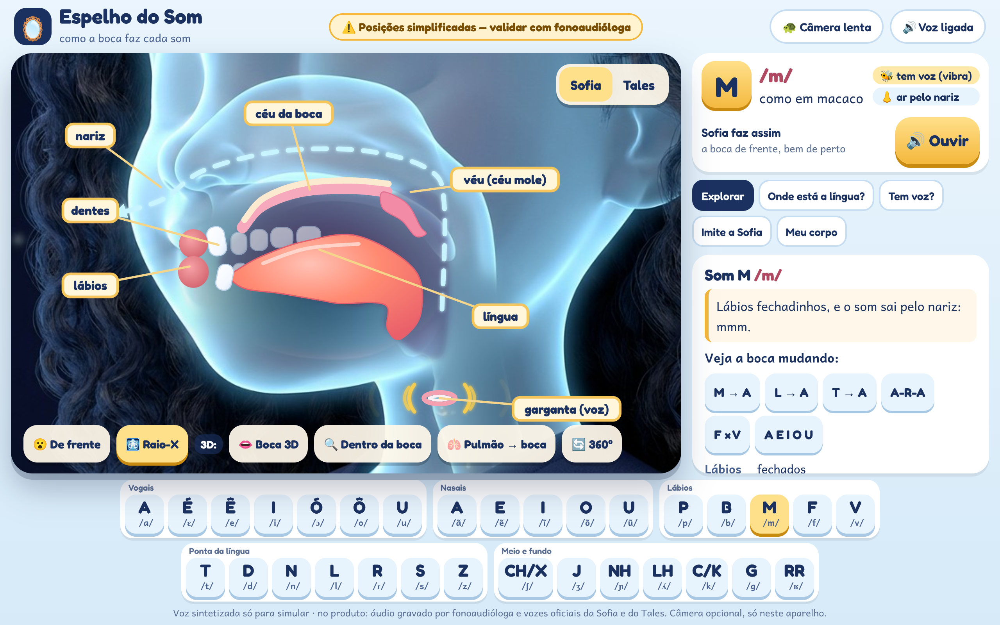

# Espelho do Som 3D: a boca da Sofia e do Tales, de frente, em raio-X e por dentro

O dono pediu que o Espelho do Som use **a boca dos próprios personagens**, com **zoom grande**, e uma **vista de lado tipo raio-X** mostrando a língua. Assim a criança entende como o som é feito e conhece as partes do corpo. Tudo bonito, lúdico e com exercícios. É uma das partes mais importantes da plataforma.

> ⚠️ **Posições simplificadas — validar com fonoaudióloga** antes de ir para o produto.

## Como abrir

- **Completo (com 3D):** sirva a pasta `06-fonema-unificada/` com qualquer servidor estático (módulos ES não funcionam em `file://`):
  `python3 -m http.server 8931` e abra `http://localhost:8931/espelho-do-som-3d/demo.html`.
- **Direto do disco:** `demo.html` também abre em `file://`; aí aparecem a frente ilustrada e o raio-X (sem os modos 3D).
- **Capturas:** `node ferramentas/capturar.js` (Playwright, Chromium com WebGL em software, 1280×800, `deviceScaleFactor 2`).
- **Imagens:** `python3 recortar.py` recria os recortes (`recortes/`).

## As três vistas (mexem juntas)

| Vista | O que é | Arquivos |
|---|---|---|
| **De frente** (padrão) | Rosto ilustrado da Sofia ou do Tales com **lupa de zoom na boca**. Só existem algumas bocas prontas (Sofia: M, A, O, S, F, L, CH, E; Tales: M, O, U, I, E, A); para os outros sons aparece a mais parecida, com o aviso "parecido" | `recortes/rosto-*.jpg`, `recortes/boca-*.jpg` |
| **Raio-X** (híbrido) | A cabeça de "vidro" da Sofia ou do Tales (imagens v2) com a boca e a garganta **apagadas** por `recortar.py`; por cima, alinhado ao perfil, um **boneco 2D animado e fiel**: língua coral lisa e gordinha, dentes brancos arredondados em 2 fileiras, lábios macios, céu da boca e véu que sobe e desce, setinhas de ar (boca/nariz) e ondinhas douradas de voz | `espelho-svg.js`, `recortes/raiox-*-limpo.jpg` |
| **3D** (opção) | Boca 3D fofa em Three.js (dentinhos de brinquedo, língua em malha que muda de forma, lábios em anel): **boca 3D** de frente, **dentro da boca** (voo da câmera para dentro), **do pulmão à boca** e **girar 360°** (OrbitControls) | `espelho3d.js`, `vendor/` (Three.js r187) |

Animações por som: a língua sobe e toca o lugar certo; o **"r" fraco bate** rapidinho no alvéolo; **p/b/t/d/k/g** fecham e soltam o ar de uma vez; no **m/n/nh** o véu desce e o ar sai pelo nariz; o **rr** raspa no fundo; nas **vogais nasais** o ar sai pela boca e pelo nariz; a voz liga e desliga (ex.: **f × v**, **s × z**, **p × b**). Há **câmera lenta** e sequências (M→A, L→A, T→A, A-R-A, F×V, A E I O U).

## Exercícios

1. **Onde está a língua?** A criança toca no raio-X o lugar onde a língua (ou o lábio) encosta. No 1º erro, dica; no 2º, o lugar certo brilha.
2. **Tem voz ou não tem?** "Ponha a mão na garganta": f×v, s×z, p×b, t×d, k×g, ch×j. Depois, o raio-X mostra as ondinhas (ou não).
3. **Imite a Sofia (ou o Tales):** boca de frente ao lado de um espelho com a **câmera opcional** (`getUserMedia`, só neste aparelho; nada é gravado nem enviado). Sem câmera, segue normalmente.
4. **Conheça seu corpo:** tocar em lábios, dentes, língua, céu da boca, nariz, véu, pregas vocais e pulmões para ouvir o nome e para que serve.

**O que é simulado:** a voz usa `speechSynthesis` pt-BR. No produto, cada som será **áudio gravado** (fonoaudióloga e vozes oficiais da Sofia e do Tales), sincronizado com a boca. As bocas de frente e as cabeças de vidro são imagens de IA provisórias (arte final por ilustradora, universo/06).

## Tabela fonema → posição (`fonemas.js`)

Referências: Thaïs Cristófaro Silva, *Fonética e Fonologia do Português* (Contexto); Mattoso Câmara Jr., *Estrutura da Língua Portuguesa*; Barbosa & Albano (2004), "Brazilian Portuguese", *Journal of the IPA* 34(2). **Selo: validar com fonoaudióloga.**

| Som | Lábios | Língua | Onde encosta | Véu | Voz | Ar |
|---|---|---|---|---|---|---|
| A /a/ (abelha) | bem abertos | baixa e no meio, ponta atrás dos dentes de baixo | nenhum (o ar passa livre) | levantado | sim | boca |
| É /ɛ/ (é, pé) | abertos, esticados | frente, meio-baixa | nenhum | levantado | sim | boca |
| Ê /e/ (elefante) | meio abertos, sorriso pequeno | frente, meio-alta | nenhum | levantado | sim | boca |
| I /i/ (ilha) | esticados (sorriso largo) | frente e alta, pertinho do céu da boca | lados da língua nos dentes de cima | levantado | sim | boca |
| Ó /ɔ/ (óculos) | redondos e abertos | atrás, meio-baixa | nenhum | levantado | sim | boca |
| Ô /o/ (ovo) | redondinhos | atrás, meio-alta | nenhum | levantado | sim | boca |
| U /u/ (uva) | biquinho bem projetado | atrás e alta, perto do véu | nenhum | levantado | sim | boca |
| A /ã/ (âncora) | bem abertos | baixa e no meio, ponta atrás dos dentes de baixo | nenhum; o véu desce e o som sai também pelo nariz | abaixado | sim | boca + nariz |
| E /ẽ/ (enfeite) | meio abertos, sorriso pequeno | frente, meio-alta | nenhum; o véu desce e o som sai também pelo nariz | abaixado | sim | boca + nariz |
| I /ĩ/ (índio) | esticados (sorriso largo) | frente e alta, pertinho do céu da boca | nenhum; o véu desce e o som sai também pelo nariz | abaixado | sim | boca + nariz |
| O /õ/ (onça) | redondinhos | atrás, meio-alta | nenhum; o véu desce e o som sai também pelo nariz | abaixado | sim | boca + nariz |
| U /ũ/ (um) | biquinho bem projetado | atrás e alta, perto do véu | nenhum; o véu desce e o som sai também pelo nariz | abaixado | sim | boca + nariz |
| P /p/ (pato) | fechados, depois abrem com um soprinho | descansando | lábio com lábio | levantado | não | boca (explosão) |
| B /b/ (bola) | fechados, depois abrem | descansando | lábio com lábio | levantado | sim | boca (explosão) |
| M /m/ (macaco) | fechados | descansando | lábio com lábio | abaixado | sim | nariz |
| F /f/ (foca) | lábio de baixo encosta nos dentes de cima | descansando | lábio de baixo + dentes de cima | levantado | não | boca |
| V /v/ (vaca) | lábio de baixo encosta nos dentes de cima | descansando | lábio de baixo + dentes de cima | levantado | sim | boca |
| T /t/ (tatu) | entreabertos | ponta sobe | ponta da língua atrás dos dentes de cima (alvéolo) | levantado | não | boca (explosão) |
| D /d/ (dado) | entreabertos | ponta sobe | ponta da língua atrás dos dentes de cima (alvéolo) | levantado | sim | boca (explosão) |
| N /n/ (navio) | entreabertos | ponta sobe | ponta da língua no alvéolo | abaixado | sim | nariz |
| L /l/ (lua) | entreabertos | ponta encosta, lados descem | ponta da língua no alvéolo; o ar passa pelos lados | levantado | sim | pelos lados da língua |
| R /ɾ/ (arara (r fraco)) | entreabertos | a ponta bate uma vez, rapidinho | toque rápido da ponta no alvéolo | levantado | sim | boca (batida) |
| S /s/ (sapo) | sorriso, dentes juntinhos | ponta perto do alvéolo, sem encostar | quase: fica um caminho fininho para o ar | levantado | não | boca |
| Z /z/ (zebra) | sorriso, dentes juntinhos | ponta perto do alvéolo, sem encostar | quase: caminho fininho para o ar | levantado | sim | boca |
| CH/X /ʃ/ (chuva) | biquinho | ponta mais para trás, lâmina perto do céu da boca | quase, atrás do alvéolo | levantado | não | boca |
| J /ʒ/ (jacaré) | biquinho | ponta mais para trás, lâmina perto do céu da boca | quase, atrás do alvéolo | levantado | sim | boca |
| NH /ɲ/ (ninho) | entreabertos | o meio sobe; a ponta fica embaixo | meio da língua no céu da boca duro | abaixado | sim | nariz |
| LH /ʎ/ (palhaço) | entreabertos | o meio sobe; os lados descem | meio da língua no céu da boca; o ar passa pelos lados | levantado | sim | pelos lados da língua |
| C/K /k/ (casa) | entreabertos | o fundo (dorso) sobe | dorso da língua no véu (céu mole) | levantado | não | boca (explosão) |
| G /g/ (gato) | entreabertos | o fundo (dorso) sobe | dorso da língua no véu (céu mole) | levantado | sim | boca (explosão) |
| RR /ʁ/ (rato, carro) | entreabertos | a raiz vai para trás, perto da úvula | quase: o ar raspa no fundo da garganta | levantado | não | boca |

Notas: o "rr" (/ʁ/) varia muito entre sotaques (pode soar como [h] ou [χ]); ficou sem vibração das pregas, com ar raspando no fundo. O "l" no fim de sílaba (sal → [w]) e o "r" de fim de sílaba ainda não estão na tabela.

## Capturas

| Arquivo | O quê |
|---|---|
| `capturas/01..04-frente-*` | Frente ilustrada com lupa na boca (Sofia A, Tales U, Sofia F, Sofia L) |
| `capturas/05..09-raiox-*` | Raio-X híbrido: M (nariz e voz), L (ponta no alvéolo), K (dorso no véu, Tales), S (ar fininho, Tales), A |
| `capturas/10..13-3d-*` | 3D: boca de frente, dentro da boca (T e K), do pulmão à boca |
| `capturas/14..17-ex-*` | Exercícios |
| `capturas/transicoes/` e `capturas/transicao-*.png` | Quadros de M→A, L→A e T→A (0, 33, 66 e 100%) |

## Imagens de origem (`imagens/`)

| Arquivo | Uso |
|---|---|
| `v2-raio-x-sofia.png`, `v2-raio-x-tales-L.png` | Fundo do raio-X (exterior); o interior da boca é apagado e redesenhado |
| `sofia-bocas-M-A-O-S.png`, `v2-sofia-bocas-F-L-CH-E.png`, `v2-tales-bocas-M-U-I-K.png` | Rostos de frente |
| `raio-x-boca-partes.png`, `raio-x-sons-M-L-R-S.png` | Só referência de estilo (posições erradas; não usadas) |
