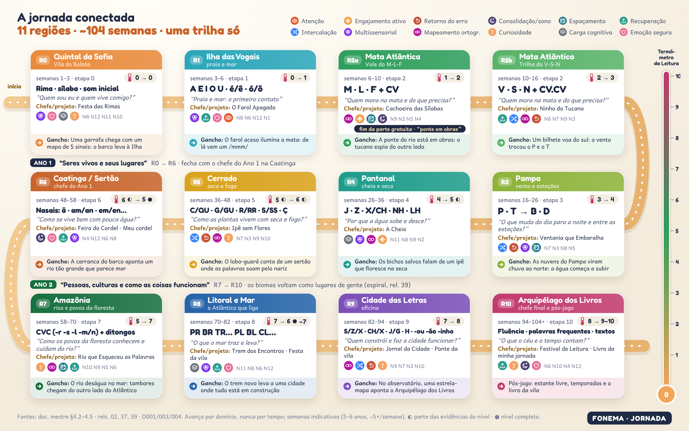
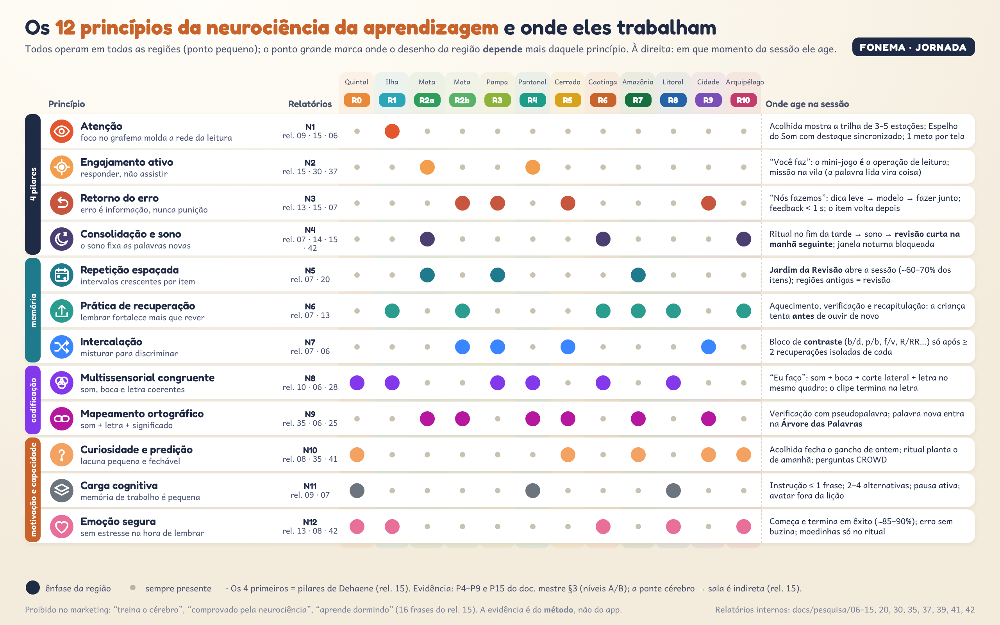
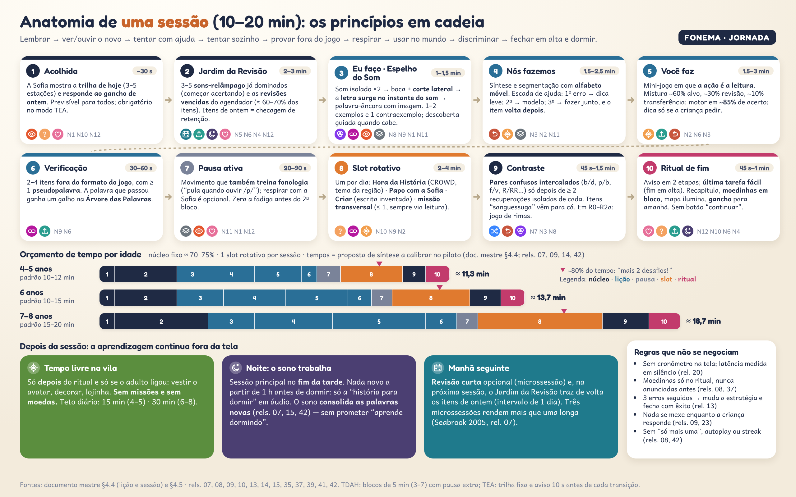
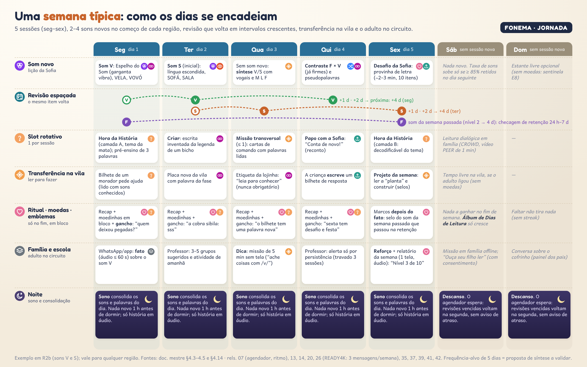
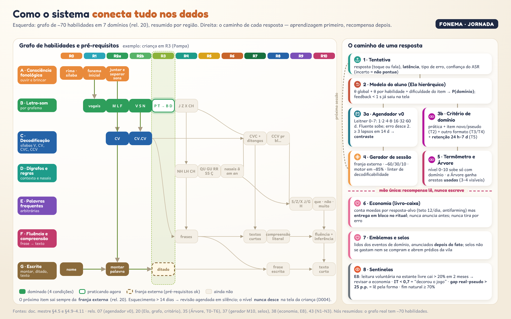

# Jornada Conectada: o mapa de 2 anos com a neurociência da aprendizagem embutida

> **Pedido do dono (Decisão 006, item 5):** "uma jornada onde uma etapa se conecte com a outra e tenha a neurociência da aprendizagem toda junta".
> **Esta pasta responde em três níveis:** a **jornada** (11 regiões, ~104 semanas), a **semana** e a **sessão**. Os três seguem a mesma regra: cada passo **herda** do anterior (revisão espaçada, palavras-âncora, prédios da vila) e **prepara** o seguinte (gancho de curiosidade, pré-requisito do grafo).
>
> **Regras deste documento**
> 1. As bases são o [documento mestre](../../../sintese/00-documento-mestre.md) (§3, §4.2–4.14), os resumos dos blocos [A](../../../sintese/bloco-A-01-15.md), [B](../../../sintese/bloco-B-16-25.md), [C](../../../sintese/bloco-C-26-31.md) e [D](../../../sintese/bloco-D-32-43.md) e as [decisões 001–006](../../../decisoes/). As referências citadas são **só os relatórios internos** (`rel. NN` = `docs/pesquisa/NN-*.md`). Nenhuma fonte externa nova foi acrescentada.
> 2. O que esta frente **propõe** (ganchos narrativos, elenco por região, tempos por fase, profissões) aparece marcado **[proposta da jornada]**. Reconciliações já feitas pela síntese aparecem como **[proposta de síntese]**, como no documento mestre.
> 3. Semanas, minutos e limiares são **hipóteses a calibrar no piloto**. O avanço real é **por domínio, nunca por tempo** (D001, D004).



## Arquivos

| Arquivo | O que mostra |
|---|---|
| [`mapa-jornada-2-anos.png`](mapa-jornada-2-anos.png) | As 11 regiões (12 áreas, R2 em duas partes) como trilha única: semanas, etapa, sons, nível do termômetro de entrada → saída, tema, chefe/projeto, princípios em destaque e o **gancho** para a próxima |
| [`neurociencia-na-jornada.png`](neurociencia-na-jornada.png) | Matriz dos 12 princípios × 12 áreas: onde cada um tem ênfase e em que momento da sessão ele age |
| [`anatomia-da-sessao.png`](anatomia-da-sessao.png) | As 10 fases da sessão com os princípios encadeados, orçamento de tempo por idade (4–5, 6, 7–8 anos) e o "depois" (vila, sono, manhã seguinte) |
| [`semana-tipica.png`](semana-tipica.png) | Seg–Dom em 7 faixas: som novo, revisão espaçada (itens voltando em +1 d, +2 d, +4 d), slot rotativo, transferência na vila, ritual, família/escola e noite |
| [`grafo-habilidades.png`](grafo-habilidades.png) | Grafo resumido dos 7 domínios por região (com "franja externa") e o caminho de uma resposta pelos dados, com a barreira de mão única entre aprendizagem e recompensa |
| `fontes/` | HTML + SVG próprios (`dados.js`, `comum.js`, `comum.css`, uma página por infográfico) e `capturar.js` (Playwright, viewport 1280×800, `deviceScaleFactor: 2` → 2560×1600). Regerar: `node fontes/capturar.js` |

---

## 1. A ideia em uma página: o que liga uma etapa à outra

A jornada tem **cinco fios** que atravessam todas as regiões. Cada fio corresponde a um conjunto de princípios da neurociência e da psicologia cognitiva.

| Fio | Como liga a região N à N+1 | Princípios (seção 2) | Base |
|---|---|---|---|
| **1. Código** (o que se aprende) | Uma região por etapa da ordem de ensino do PB (0 a 10). O grafo de habilidades só libera a próxima quando os pré-requisitos estão **dominados** (4 condições) | N9, N8, N11 | doc. mestre §4.3 e §4.5; rels. 02, 06, 20, 35 |
| **2. Memória** (o que não se perde) | Os sons da região anterior **continuam voltando**: Jardim da Revisão, moradores antigos pedindo ajuda, contraste com o par confuso. Voltar ao mapa conta como revisão espaçada | N5, N6, N7, N4 | rels. 07, 37 §3.2 |
| **3. Mundo** (o que se entende) | Espiral temática: Ano 1 "Seres vivos e seus lugares" (R0–R6); Ano 2 "Pessoas, culturas e como as coisas funcionam" (R7–R10), revisitando os biomas como lugares de gente. Palavras-âncora entram na Árvore e reaparecem | N9, N10 | rel. 39 (MORE, transferência mantida 14 meses); rel. 41 |
| **4. Vontade de voltar** (por que a criança quer seguir) | O **gancho** do fim de cada região (e do fim de cada sessão) abre uma lacuna pequena e fechável. A próxima região é **visível e sem cadeado**: dá para espiar | N10, N12, N2 | rel. 08 (curiosidade, Loewenstein; Gruber), rel. 37 (regiões visíveis), rel. 42 |
| **5. Adulto e vila** (onde a leitura vira ação) | A vila acumula prédios lidos de todas as regiões. A família recebe a missão da semana do som atual. O professor recebe grupos e o próximo passo | N2, N12 | rels. 26, 30, 37, 38, 40 |

A "Nuvem Bagunceira apagou as letras do mundo; cada palavra lida devolve uma coisa ao mundo" (rel. 37 §3.5, a partir do rel. 31) é a **moldura narrativa** que costura os ganchos. A recompensa principal continua sendo a própria leitura: a palavra lida vira coisa (rel. 08, P1).

---

## 2. Os 12 princípios de neurociência da aprendizagem



Os quatro primeiros são os **pilares de Dehaene** (atenção, engajamento ativo, retorno do erro, consolidação), usados como especificação de produto no rel. 15. Os demais detalham memória (rel. 07), codificação (rels. 10, 35), motivação (rels. 08, 13) e capacidade (rel. 09). **A neurociência sustenta o método, não o app**: é proibido dizer "treina o cérebro", "comprovado pela neurociência" ou "aprende dormindo" (rel. 15, 16 frases proibidas; D002).

| # | Princípio | O que a pesquisa diz (resumo dos relatórios) | Como opera no FONEMA | Onde age | Nível (doc. mestre §3) | Relatórios |
|---|---|---|---|---|---|---|
| **N1** | **Atenção** | Atenção ao grafema leva ao padrão de leitura do leitor experiente (Yoncheva et al. 2010); sala decorada → mais tempo fora da tarefa (Fisher et al. 2014); atenção sustentada é imatura até 8 anos | Um foco por tela; destaque do grafema **no instante** em que a Sofia diz o som; trilha da sessão visível; nada se mexe enquanto a criança responde | Acolhida, Espelho do Som, toda tela | P8 (A/B) | 06, 09, 15 |
| **N2** | **Engajamento ativo** | Toda tela pede resposta gerada; integração intrínseca: quando a mecânica **é** a habilidade, mais aprendizagem e 7× mais jogo voluntário (Habgood & Ainsworth 2011) | "Você faz" = a operação de leitura; missões da vila em que ler faz algo acontecer; nenhum vídeo passivo > 60 s | Você faz, missões, projeto da semana | P10 (A/B) | 15, 30, 37 |
| **N3** | **Retorno do erro** | Feedback d ≈ 0,41, mas > 1/3 das intervenções pioram quando focam o "eu" (Kluger & DeNisi 1996); erro com feedback corretivo ajuda (Metcalfe 2017); prompt antes do modelo | Feedback < 1 s, específico ao grafema; escada de ajuda (dica → modelo → fazer junto → fechar com êxito); sem buzina, X vermelho ou perda de moedas; ASR incerto = "não ouvi bem" | Nós fazemos, contraste, toda resposta | P9 (A/B) | 07, 13, 15 |
| **N4** | **Consolidação e sono** | O sono consolida palavras novas (Henderson et al. 2012); "salto" de retenção em 24 h; dispositivo à noite OR 2,17 para sono insuficiente; contribuição brasileira do grupo de Ribeiro (rel. 15) | Sessão principal no fim da tarde; **janela noturna bloqueada** 1 h antes de dormir; "história para dormir" só em áudio; revisão na manhã seguinte; domínio exige **retenção 24 h–7 d** | Ritual → noite → Jardim do dia seguinte; desafios-chefe | P5, P15 (A/B) | 07, 14, 15, 42 |
| **N5** | **Repetição espaçada** | Prática distribuída > concentrada (Cepeda et al. 2006, 839 comparações); 3 microssessões > 1 longa em fônica aos 5–7 anos (Seabrook et al. 2005) | Agendador v0 (Leitner + estabilidade): intervalos 1·2·4·8·16·32·60 dias; regiões antigas viram terreno de revisão; nunca "você tem 120 revisões atrasadas" | Jardim da Revisão; mapa; semana | P5 (A) | 07, 20, 37 |
| **N6** | **Prática de recuperação** | Recuperar > rever (Rowland 2014, g ≈ 0,50); em crianças depende de **sucesso + feedback** (Fazio & Marsh 2019) | A criança tenta antes de ouvir de novo; formato produtivo (falar) com caminho por toque; 3 recuperações corretas para aquisição; recapitulação no ritual; reconto | Aquecimento, verificação, ritual, Papo com a Sofia | P5 (A) | 07, 13 |
| **N7** | **Intercalação** | Intercalar ajuda a discriminar itens parecidos **já aprendidos** (Brunmair & Richter 2019); pares espelhados separados no tempo (rel. 06) | P antes de B, T antes de D, **com intervalo**; mistura só após ≥ 2 recuperações isoladas de cada; itens "sanguessuga" vão para a trilha de contraste | Bloco de contraste; R2b, R3, R5, R9 | P5 (A) | 06, 07 |
| **N8** | **Codificação multissensorial congruente** | Consciência fonêmica ensinada **com letras**; no Brasil, mapeamento fonema-letra **com articulação** superou o silábico (Sargiani, Ehri & Maluf 2018); multissensorial só funciona se **congruente** (Shams & Seitz 2008) | Espelho do Som: som ×2 → boca + corte lateral → **letra surge no instante do som** → palavra-âncora; o clipe termina na letra; sem música sob tarefa fonológica | Eu faço; correção ("ver a boca de novo") | P2, P4 (A/B) | 06, 10, 28 |
| **N9** | **Mapeamento ortográfico** | A palavra fica guardada quando cada letra se liga ao som e ao significado (Ehri 2014); decodificar é o motor do autoensino (Share); morfologia ajuda, mais quem tem dificuldade | Pseudopalavras em 10–20% dos itens; som + letra + significado + ligação a ≥ 1 nó da **Árvore das Palavras**; nada de cartão-relâmpago de palavra inteira; morfologia desde CV/CVC | Verificação; Árvore; R7–R10 | P3 (B/C) | 06, 25, 35 |
| **N10** | **Curiosidade e predição** | Dopamina sinaliza **erro de predição**, não prazer (Schultz 1997); curiosidade melhora a memória (Gruber et al. 2014); curiosidade = lacuna pequena e fechável (Loewenstein 1994); leitura dialógica e inferência | Gancho no fim de cada sessão e de cada região; "o que você acha que acontece depois?"; **surpresa no conteúdo, previsibilidade nas regras** (nunca sorteio) | Acolhida, ritual, Hora da História, ganchos de região | — (B/C no rel. 08) | 08, 35, 41 |
| **N11** | **Carga cognitiva** | Memória de trabalho infantil é pequena e treiná-la não transfere (Melby-Lervåg & Hulme 2013); detalhes sedutores g ≈ −0,33 (Sundararajan & Adesope 2020); princípios de Mayer | Instrução ≤ 1 frase de ~10 palavras; 2–4 alternativas; pistas visuais retiráveis (dígrafo marcado, sílaba colorida); pausa ativa; avatar fora da lição | Toda tela; R0–R1, R4, R8 | P8 (A/B) | 07, 09 |
| **N12** | **Emoção segura** | Estresse na hora de lembrar prejudica (Vogel & Schwabe 2016); elogio ao processo protege (Mueller & Dweck 1998); recompensa tangível esperada reduz motivação intrínseca (Deci et al. 1999); autoconceito de leitor se forma nas primeiras semanas | Começar e terminar em êxito (~85–90%); "Desafio da Sofia" sem nota nem cronômetro; nível **nunca desce** na tela; moedinhas **só em bloco no ritual**; Sofia e Bolota nunca tristes | Ritual, provinhas, todo feedback | P9, P10, P15 (A/B) | 08, 13, 42 |

---

## 3. A jornada região a região

### 3.1 Visão geral

Mapa único do documento mestre §4.2 (proposta de síntese do Bloco D). Ano 1 = R0–R6; Ano 2 = R7–R10. O **nível** é o da Escala FONEMA 0–10 (D004). Os níveis 5 e 6 atravessam várias regiões: ◐ = parte das evidências do nível já cumprida; ● = nível completo (doc. mestre §4.5, "nível ≠ etapa ≠ região").

| Região | Semanas | Etapa · sons | Nível entra → sai | Tema / pergunta-guia | Chefe (rel. 37) · projeto (rel. 39) | A vila ganha (rel. 37, remapeado) | Princípios em destaque |
|---|---|---|---|---|---|---|---|
| **R0** Quintal da Sofia / Vila do Bolota | 1–3 | 0 · rima, sílaba, som inicial, síntese oral | 0 → 0 | "Quem sou eu e quem vive comigo?" | Festa das Rimas · Álbum da minha família | Casa do avatar, quintal, Bolota | N8 N12 N11 N10 |
| **R1** Ilha das Vogais | 3–6 | 1 · A E I O U, é/ê, ó/ô | 0 → 1 | Praia e mar: o primeiro contato | O Farol Apagado (acender lendo vogais) | Barco e cais | N8 N6 N12 N1 |
| **R2a** Mata Atlântica · Vale do M-L-F | 6–10 | 2 · M, L, F + CV | 1 → 2 | "Quem mora na mata e do que precisa?" | Cachoeira das Sílabas · Guia da mata para o Bolota | Horta e Árvore das Palavras | N9 N2 N5 N4 |
| *Fim da parte gratuita* | ~8–10 (D001: 4–8) | — | — | Relatório antes/depois para o adulto | — | "Ponte em obras", sem cadeado nem oferta à criança | — |
| **R2b** Mata Atlântica · Trilha do V-S-N | 10–16 | 2 · V, S, N + CV.CV | 2 → 3 | idem | Ninho do Tucano | Correio da vila (bilhetes) | N6 N7 N9 N3 |
| **R3** Pampa | 16–26 | 3 · P, T → B, D (intervalo e contraste) | 3 → 4 | "O que muda do dia para a noite e entre as estações?" | Ventania que Embaralha [proposta da jornada] · Diário do tempo | Biblioteca (pede os selos de P T B D) | N7 N3 N8 N5 |
| **R4** Pantanal | 26–36 | 4 · J, Z, X/CH, NH, LH + frases | 4 → 5◐ | "Por que a água sobe e desce?" | A Cheia · Mapa da cheia | Viveiro de bichos | N11 N8 N9 N2 |
| **R5** Cerrado | 36–48 | 5 · C/QU, G/GU, R/RR, S/SS, Ç | 5◐ → 6◐ | "Como as plantas vivem com seca e fogo?" | Ipê sem Flores · Horta da vila | Horta comunitária, mercado e coreto | N7 N3 N9 N10 |
| **R6** Caatinga / Sertão (**chefe do Ano 1**) | 48–58 | 6 · nasalidade (ã, am/an, em/en…) | 6◐ → 5● | "Como se vive bem com pouca água?" | Feira do Cordel · **Meu cordel** | Praça do cordel e cisterna | N4 N12 N6 N8 |
| **R7** Amazônia (abre o Ano 2) | 58–70 | 7 · CVC + ditongos | 5 → 7 | "Como os povos da floresta conhecem e cuidam do rio?" | Rio que Esqueceu as Palavras · Livro do rio | Barco-escola e observatório de bichos | N10 N9 N5 N6 |
| **R8** Litoral e Mar | 70–82 | 8 · CCV (PR, BR, TR… PL, BL, CL…) | 7 → 6●–7 | "O que o mar traz e leva?" (África–Brasil, ERER) | Trem dos Encontros [proposta da jornada] · Festa da vila | Estação de trem (projeto coletivo), teatro | N11 N8 N6 N12 |
| **R9** Cidade das Letras / oficina | 82–94 | 9 · S/Z/X, CH/X, J/G, H; -ou, -ão, -inho | 7 → 8 | "Quem constrói e faz a cidade funcionar?" | Jornal da Cidade · Ponte da vila (STEAM) | Jornal da vila, observatório | N9 N7 N3 N10 |
| **R10** Arquipélago dos Livros (**chefe final** e pós-jogo) | 94–104+ | 10 · fluência, palavras frequentes, textos | 8 → 9–10 | "O que o céu e o tempo contam?" | Festival de Leitura · **Livro da minha jornada** | Editora da vila (os livros da criança na biblioteca) | N6 N10 N4 N12 |

**Notas de reconciliação.** (1) Os chefes do rel. 37 foram desenhados para outro mapa de biomas; aqui eles seguem a **etapa**, e dois foram renomeados para caber no bioma ("Ventania que Embaralha" passou do Pampa-etapa 6 para o Pampa-etapa 3, agora com pares mínimos; "Trem da Serra" virou "Trem dos Encontros", porque a Serra deixou de ser região). (2) O projeto do rel. 39 **é** o desafio-chefe (doc. mestre §4.11). (3) Reprovar no chefe **nunca bloqueia**: abre uma trilha curta de reforço (doc. mestre §4.5).

### 3.2 Fichas das regiões

Cada ficha junta: sons, nível, tema, metas das 5 transversais (rel. 39, matriz §4, realocada ao mapa único; complementos do rel. 37), ambientes e elenco, vídeos da Academia (tipos a–f de [`../videos/README.md`](../videos/README.md)), lojinha (catálogo e coleções de [`../lojinha-emblemas/README.md`](../lojinha-emblemas/README.md)), gancho e princípios.

**Elenco fixo em todas as regiões:** Sofia (mentora 2D, uniforme escolar sem adornos, D006) e Bolota (tatu-bola aprendiz, efeito protégé). Moradores da vila: os da bíblia visual ([`../personagens/README.md`](../personagens/README.md)) e os "moradores com gosto" da lojinha. Animais de estimação da vila (cachorro e gato, D006) entram em R0. **As profissões por região são [proposta da jornada]**, alinhadas aos temas do rel. 39.

> **Legenda das transversais:** **PC** pensamento computacional · **Lóg** raciocínio lógico · **Emo** inteligência emocional · **Tec** tecnologia e cidadania digital · **Fin** educação financeira. Cota: ≤ 1 missão transversal por sessão, sempre exigindo ler ou ouvir e decodificar; as transversais **nunca bloqueiam** a trilha (D003; rels. 37, 43).

#### R0 · Quintal da Sofia / Vila do Bolota — semanas 1–3 · nível 0 → 0
| Campo | Conteúdo |
|---|---|
| Sons | Etapa 0: rima, sílaba (batida), fonema inicial, síntese oral; já **com letras e sons** nas apresentações (P2) |
| Tema | "Quem sou eu e quem vive comigo?" Corpo, família, rotina, bichos do quintal (rel. 39) |
| Transversais | **PC** sequência da rotina (acordar → escovar → comer) · **Lóg** classificar objetos por forma e cor · **Emo** nomear 4 emoções básicas no rosto do Bolota · **Tec** "como o app me ouve" (orelhinha acesa) e "a tela descansa e eu também" · **Fin** o cofrinho aparece; moedinhas vêm de aprender (rels. 37, 39) |
| Ambientes e elenco | Quintal, casa da Sofia (`ambiente-casa-sofia.png`), praça da vila; Sofia, Bolota, moradores da vila; cachorro e gato da vila (D006); avatar com representatividade grátis |
| Academia | (d) onboarding: "como o app me ouve", "o espelho do som", "a vila", "e se eu errar?"; (c) trailer da região; (e) família: "como funciona", "termômetro", "rotina de 10 min" |
| Lojinha | Identidade grátis (óculos, aparelho auditivo, cadeira de rodas, tons de pele e cabelos); itens com figura + áudio; coleção **Quintal da Sofia** visível ("em breve", sem preço) |
| Chefe / projeto | Festa das Rimas (oral) · "Álbum da minha família" (nomes e rimas) |
| Gancho → R1 | [proposta da jornada] Uma garrafa chega à beira do quintal com um mapa e **5 sinais** desenhados (as vogais). O barco do Bolota leva à Ilha |
| Neurociência | **N8** sílabas com batida e rimas cantadas; **N12** diagnóstico de boas-vindas não reprovativo, sem pressão por decodificar (Sementinha); **N11** sessão 10–12 min aos 4–5, 2–3 alternativas; **N10** primeiro gancho |

#### R1 · Ilha das Vogais — semanas 3–6 · nível 0 → 1
| Campo | Conteúdo |
|---|---|
| Sons | A E I O U, com é/ê e ó/ô; som ≠ nome da letra (botões separados) |
| Tema | Praia e mar como primeiro contato; o litoral volta em R8 (espiral) |
| Transversais | **Lóg** classificar palavras ouvidas pelo som inicial · **Fin** primeira moedinha e o cofrinho com meta · **Emo** "Errei, e agora?" com a Sofia (rels. 33, 37) |
| Ambientes e elenco | Praia, farol, cais; peixe-boi e jangada (catálogo); pescador(a) da ilha [proposta da jornada] |
| Academia | (a) 7 vídeos de vogais orais (no MVP); (c) trailer; (e) missão semanal por vogal; (f) "como modelar a vogal sem distorcer" |
| Lojinha | Coleção **Litoral / Ilha das Vogais** visível (MAIÔ entra em R2a; recompensa narrativa: o farol acende); cofrinho apresentado |
| Chefe / projeto | O Farol Apagado: acender o farol lendo vogais (rel. 37) |
| Gancho → R2a | [proposta da jornada] Com o farol aceso, a luz alcança a **mata** do continente, e de lá vem um som comprido: /mmm/ |
| Neurociência | **N8** Espelho do Som das vogais (boca aberta/arredondada, é × ê); **N6** ouvir som → tocar letra (formato GraphoGame); **N12** autoconceito de leitor nas primeiras semanas (rel. 13): muitos êxitos; **N1** um foco por tela |

#### R2a · Mata Atlântica, Vale do M-L-F — semanas 6–10 · nível 1 → 2 · fim da parte gratuita
| Campo | Conteúdo |
|---|---|
| Sons | M, L, F (contínuas: dá para prolongar /mmm/, o que facilita a síntese) + CV; primeiras palavras: MALA, MEL, LUA, FALA |
| Tema | "Quem mora na mata e do que precisa?" Mico-leão-dourado, árvores, chuva (rel. 39) |
| Transversais | **PC** sequência de 3 passos com cartas de comando lidas (rel. 37) e "comandos para o mico chegar à fruta" (rel. 39) · **Lóg** seriação pequeno → grande · **Emo** medo do escuro da mata; respirar com a Sofia · **Tec** "como o app ouve minha voz?" · **Fin** guardar ou gastar: 1 figurinha agora ou 2 amanhã (rel. 39) |
| Ambientes e elenco | Vale, cachoeira, trilha; mico-leão, tucano, beija-flor; guarda-parque [proposta da jornada] |
| Academia | (a) /m/ (amostra pronta: `../videos/amostra-sofia-som-m.mp4`), /l/, /f/; (c) trailer + histórias T1–T2; (e) **"assinatura"** e relatório antes/depois **só para o adulto** |
| Lojinha | Primeiras etiquetas decodificáveis: MALA, MAIÔ, FIGURINHA LUA; emblemas "Mestre do M/L/F" (bronze → ouro) |
| Chefe / projeto | Cachoeira das Sílabas · "Guia da mata para o Bolota" (figurinhas que falam, 1 palavra lida cada) |
| Gancho → R2b | [proposta da jornada] A ponte do rio está **em obras** (fim do gratuito, sem cadeado); do outro lado, o tucano espia e chama |
| Neurociência | **N9** primeira palavra decodificada = o "fazer algo" do rel. 08; **N2** síntese com alfabeto móvel; **N5** o agendador ganha histórico; **N4** maior ganho cerebral nos primeiros meses (rel. 06: priorizar consistência no início) |

#### R2b · Mata Atlântica, Trilha do V-S-N — semanas 10–16 · nível 2 → 3
| Campo | Conteúdo |
|---|---|
| Sons | V, S (inicial), N + CV.CV; primeiro contraste F × V (surdo/sonoro, depois de os dois firmarem) |
| Tema | Mesmo tema da mata, agora com textos decodificáveis temáticos (camada B) |
| Transversais | **Emo** ler o bilhete triste de um morador e ajudar (rel. 37) · **PC** cartas de comando com palavras V/S/N · **Fin** primeira meta do cofrinho concluída |
| Ambientes e elenco | Trilha, ninho do tucano, correio da vila |
| Academia | (a) /v/, /s/, /n/ + **par mínimo f/v**; (e) missões semanais; (f) "como modelar o /s/ sem vogal" |
| Lojinha | SAIA, LUVA, FIVELA, SOFÁ, VELA; coleção **Mata Atlântica** (recompensa: ingresso grátis da Trilha do Tucano) |
| Chefe / projeto | Ninho do Tucano (provinha de fase R2b: passa para o nível 3) |
| Gancho → R3 | [proposta da jornada] Um bilhete voa do sul: "o vento trocou o **P** e o **T** de lugar!" |
| Neurociência | **N6** recuperação com feedback; **N7** primeira intercalação F × V; **N9** pseudopalavras ("nomes de criaturas"); **N3** feedback específico ao traço (mão na garganta: vibra!) |

#### R3 · Pampa — semanas 16–26 · nível 3 → 4
| Campo | Conteúdo |
|---|---|
| Sons | P, T primeiro; B, D **com intervalo**; depois contraste explícito P/B, T/D (par espelhado b/d nunca na mesma semana) |
| Tema | "O que muda do dia para a noite e entre as estações?" Vento, campo, frio, joão-de-barro; palavras-âncora PATO, BOTA, DIA, TATU |
| Transversais | **PC** padrões que se repetem (dia/noite, laço) e achar o "bug" na sequência · **Lóg** causa e efeito (vento → cata-vento gira) e seriação · **Emo** frustração quando a construção cai · **Tec** "como o celular sabe que vai chover?" · **Fin** troca entre personagens (escambo) (rels. 37, 39) |
| Ambientes e elenco | Campo aberto, moinho, céu de dia e de noite; Mestre Gaúcho (morador da lojinha); meteorologista [proposta da jornada] |
| Academia | (a) /p/, /t/, /b/, /d/ + **pares p/b e t/d**; (f) "pares surdo/sonoro"; (c) histórias do vento |
| Lojinha | BONÉ, BOTA, TAPETE, PUFE, BANCO DE PRAÇA, SAPO, TATU, BOLA, PIPA, APITO, LUPA, FIGURINHA IPÊ; **Biblioteca** pede os **selos** P T B D (não se compram) |
| Chefe / projeto | Ventania que Embaralha: restaurar palavras lendo pares mínimos [proposta da jornada] · "Diário do tempo" (5 dias de sol, chuva e vento com rótulo lido) |
| Gancho → R4 | [proposta da jornada] As nuvens do Pampa viajam para o norte e viram chuva: no Pantanal, **a água começa a subir** |
| Neurociência | **N7** separar no tempo e só então contrastar (rels. 06, 07); **N3** feedback por traço (vozeamento); **N8** corte lateral obrigatório nos surdo/sonoros; **N5** os sons de R2 viram revisão de longo intervalo |

#### R4 · Pantanal — semanas 26–36 · nível 4 → 5◐
| Campo | Conteúdo |
|---|---|
| Sons | J, Z, X/CH, NH, LH + frases decodificáveis |
| Tema | "Por que a água sobe e desce?" Cheia e seca, tuiuiú, jacaré, ninhos; palavras NINHO, BICHO, OLHO, PEIXE |
| Transversais | **PC** decompor o ciclo da cheia em 4 passos · **Lóg** classificar por onde vivem (água, terra, ar) · **Emo** empatia com o filhote perdido; pedir ajuda · **Tec** armadilha fotográfica · **Fin** necessidade × desejo: o que levar na canoa (rels. 37, 39) |
| Ambientes e elenco | Planície alagada, canoa, viveiro; capivara, tuiuiú, onça, jacaré; veterinária de resgate [proposta da jornada] |
| Academia | (a) /ʒ/, /z/, /ʃ/ + **pares s/z e ʃ/ʒ**; (b) regrinhas **NH** e **LH**; (c) histórias da cheia |
| Lojinha | MOCHILA, PIJAMA, FONTE, PONTE, GALINHEIRO, CAIS, JABUTI, BOTO, CHOCALHO, VARAL DE LIVROS; coleção **Pantanal** (recompensa: os bichos resgatados visitam a vila) |
| Chefe / projeto | A Cheia: ler instruções para salvar os bichos · "Mapa da cheia" |
| Gancho → R5 | [proposta da jornada] Os bichos salvos contam de um lugar seco onde um **ipê floresce justamente na seca** |
| Neurociência | **N11** dígrafo = 2 letras, 1 som: pista visual retirável (dígrafo marcado); **N8** corte lateral para /ʃ/ × /s/; **N9** frases com compreensão; **N2** missão de resgate em que ler é agir |

#### R5 · Cerrado — semanas 36–48 · nível 5◐ → 6◐
| Campo | Conteúdo |
|---|---|
| Sons | Contextuais: C/QU, G/GU, R/RR, S/SS, Ç (o diferencial diagnóstico do PB; mais itens aqui, rel. 20) |
| Tema | "Como as plantas vivem com seca e fogo?" Raízes profundas, ipê, pequi, buriti; quilombolas e povos do Cerrado; palavras RAIZ, ROÇA, QUEIJO, GUARÁ |
| Transversais | **PC** algoritmo de plantio com depuração ("o que faltou?") · **Lóg** dedução ("se não tem água, então…") e pistas lidas · **Emo** paciência: a planta demora · **Tec** "a máquina não sabe tudo: o app pode errar" · **Fin** comparar preços (duas lojinhas); plantar para vender na feira (rels. 37, 39) |
| Ambientes e elenco | Chapada, vereda, cupinzeiros (`ambiente-bioma-cerrado.png`); lobo-guará, jabuti, seriema, tamanduá; Dona Ema (gosta de flores de ipê); agricultora [proposta da jornada] |
| Academia | (b) regrinhas **R/RR, R entre vogais, C/QU, G/GU, S/SS, S com som de Z, Ç**; (a) **pares k/g e ɾ/ʁ** |
| Lojinha | TIARA DE IPÊ, LOBO-GUARÁ ★ (pede o /g/ dominado), CAPA DE LEITOR ★ (meta do cofrinho), CORETO ★, HORTA, POÇO, VIOLA, AGOGÔ, FIGURINHA PEQUI; coleção **Cerrado** (recompensa: o ipê floresce e o Lobo-guará conta "A NOITE DO LOBO") |
| Chefe / projeto | Ipê sem Flores (ler regras contextuais para "acordar" o ipê) [proposta da jornada, a partir do rel. 37] · "Horta da vila" |
| Gancho → R6 | [proposta da jornada] O lobo-guará fala de um **sertão** onde as palavras soam pelo nariz: mandacaru, chão, canção |
| Neurociência | **N7** R × RR, S × SS intercalados; **N3** padrão de erro alimenta o próximo item; "sanguessugas" → contraste; **N9** descoberta guiada: ver casos → achar o padrão → a Sofia nomeia a regra (rel. 35); **N10** "por que o S faz som de Z aqui?" |

#### R6 · Caatinga / Sertão — chefe do Ano 1 — semanas 48–58 · nível 6◐ → 5●
| Campo | Conteúdo |
|---|---|
| Sons | Nasalidade: ã, am/an, em/en, im/in, om/on, um/un; M antes de P/B |
| Tema | "Como se vive bem com pouca água?" Mandacaru, cisterna, asa-branca, cordel, xilogravura, sanfona e forró; palavras SERTÃO, CHÃO, PÃO, CANÇÃO |
| Transversais | **PC** padrão de rima como regra · **Lóg** completar sequências de sílabas nasais · **Emo** orgulho e apresentação ("ler para alguém") · **Tec** gravar e ouvir a própria voz, cuidando do que se compartilha · **Fin** economizar água = economizar recursos; **meta de poupança do Ano 1** (rel. 39) |
| Ambientes e elenco | Sertão, açude, feira; asa-branca; tatu-bola (o Bolota "visita a família", validar com consultoria de biologia) [proposta da jornada]; cordelista, xilogravurista e sanfoneiro [proposta da jornada] |
| Academia | (a) nasais + **par oral/nasal**; (b) **M antes de P/B** e **-ÃO × -AM**; (c) Noite de cordel |
| Lojinha | CHAPÉU DE COURO ★ (pede o /ch/), GIBÃO, SANFONA ★, PANDEIRO, TAMBOR, REDE, PAMONHA, FIGURINHA MAMÃO; coleção **Sertão** (recompensa: noite de cordel no coreto) |
| Chefe / projeto | **Feira do Cordel** (ler e recontar) · **"Meu cordel"**: completar versos rimados e ilustrar em xilogravura (EF12LP19, a conferir) |
| Gancho → R7 | [proposta da jornada] A proa do barco do São Francisco aponta para o norte: "lá existe um rio **tão grande que parece mar**" |
| Neurociência | **N4** fecha o Ano 1: provinha de fase + **retenção** de sons de meses atrás + benchmark trimestral; **N12** provinha sem ansiedade, público real (família); **N6** reconto; **N8** ícone "nariz" para nasalidade |

#### R7 · Amazônia — abre o Ano 2 — semanas 58–70 · nível 5 → 7
| Campo | Conteúdo |
|---|---|
| Sons | CVC (R, S, L e nasal no fim da sílaba) + ditongos; L × U no fim (mal/mau) |
| Tema | "Como os povos da floresta conhecem e cuidam do rio?" Ciclo da água, peixes, canoa, roça; literatura de autoria indígena (licença a conferir); revisita "seres vivos" com a lente da interdependência (espiral) |
| Transversais | **PC** o mapa do rio como modelo · **Lóg** cadeias (quem come quem) · **Emo** respeito a outros modos de vida · **Tec** satélite que vê a floresta; pausas e cuidado com a tela · **Fin** bens comuns: o rio é de todos (rels. 37, 39) |
| Ambientes e elenco | Rio, igarapé, aldeia, barco-escola; boto, arara, peixes; Tio Bento, barqueiro (lojinha); pescador ribeirinho e professora indígena [proposta da jornada; consultoria indígena obrigatória] |
| Academia | (b) **L × U no fim**, **E/I e O/U átonos finais**; (c) trailer do Ano 2 e histórias do rio |
| Lojinha | BARCO, FORNO, MOINHO, BANCA DE LIVROS, ESTANTE, MICO-LEÃO, TUIUIÚ, BERIMBAU, CAVAQUINHO, INGRESSO BARCO NO RIO; coleção **Amazônia** (recompensa: rio de palavras no barco-escola) |
| Chefe / projeto | Rio que Esqueceu as Palavras · "Livro do rio" (página bilíngue com palavra de língua indígena validada por consultor) |
| Gancho → R8 | [proposta da jornada] O rio deságua no mar, e do outro lado do Atlântico chegam **tambores** e histórias |
| Neurociência | **N10** abertura do Ano 2 com mistério; **N9** CVC e morfologia; **N5** sons do Ano 1 em manutenção (intervalos de 32–60 dias, embutidos em palavras e frases); **N6** recuperação em textos |

#### R8 · Litoral e Mar — semanas 70–82 · nível 7 → 6●–7
| Campo | Conteúdo |
|---|---|
| Sons | CCV: PR, BR, TR, DR, CR, GR, FR, VR; PL, BL, CL, GL, FL (na fala, encontros só são exigíveis entre 6;0 e 7;0: leitura ≠ fala, rel. 29) |
| Tema | "O que o mar traz e leva?" Praia, mangue, jangada, pesca; África e Brasil ligados pelo Atlântico (capoeira, samba de roda, culinária); escravidão só com linguagem para a idade e revisão de especialista em ERER (rel. 39) |
| Transversais | **PC** ritmo como sequência e repetição (programar a batida) · **Lóg** simetria e padrões em tecidos; condição "se… então" · **Emo** identidade e autoestima ("minha cor, meu cabelo, minha história"); persistência · **Tec** como o som viaja (vibração) · **Fin** feira de peixe: preço e troco simples (rels. 37, 39) |
| Ambientes e elenco | Praia, mangue, roda de capoeira, estação de trem; pescadora e mestre de capoeira [proposta da jornada] |
| Academia | (c) histórias do mar; (e) missões CCV; (f) "como apoiar encontros consonantais sem corrigir a fala" |
| Lojinha | ESTAÇÃO DE TREM (projeto coletivo, 120), TEATRO ★ (meta grande), FLAUTA, VITRINE, JANELA FLORIDA, FILTRO DE BARRO, ESTRELA DE NATAL; coleção **Instrumentos do Brasil** ganha força (banda da vila) |
| Chefe / projeto | Trem dos Encontros: fluência em frases com CCV [proposta da jornada, a partir do "Trem da Serra" do rel. 37] · "Festa da vila": roda de música com instrumentos cujos nomes a criança lê |
| Gancho → R9 | [proposta da jornada] O trem novo para numa **cidade onde tudo está em construção** e falta quem leia as instruções |
| Neurociência | **N11** CCV é mais difícil: pistas de sílaba retiráveis; **N8** articulação dos encontros; **N6** fluência por leitura repetida; **N12** identidade e pertencimento; tolerância de fala por idade |

#### R9 · Cidade das Letras / oficina — semanas 82–94 · nível 7 → 8
| Campo | Conteúdo |
|---|---|
| Sons | Concorrências arbitrárias S/Z/X, CH/X, J/G, H; morfologia -ou, -am/-ão, -inho/-zinho ("a gente fala assim, escreve assado") |
| Tema | "Quem constrói e faz a cidade funcionar?" Profissões, ferramentas, máquinas simples, ponte, lixo e reciclagem; palavras HOSPITAL, ENGENHEIRA, CAIXA, GIRAFA (rel. 39) |
| Transversais | **PC** depurar a construção que cai · **Lóg** comparar medidas · **Emo** persistir depois do erro · **Tec** como funciona por dentro (tela, alto-falante, internet); senha e privacidade · **Fin** mercadinho: preço, orçamento, troco (moedas 1, 5 e 10 só como representação) (rels. 37, 39) |
| Ambientes e elenco | Oficina, praça, jornal, hospital; padeiro, bibliotecária, inventora de robôs com o robô Tec (bíblia visual); engenheira, pedreiro, carteira [proposta da jornada] |
| Academia | (b) **X (2 vídeos), CH × X, J × G, H inicial, -OU, -INHO**; (f) "concorrências: ensinar sem decoreba" |
| Lojinha | JORNAL DA VILA, OBSERVATÓRIO ★ (meta grande), ABAJUR, RELÓGIO DE PAREDE (nunca marca tempo de jogo); emblema **Criador** prata/ouro |
| Chefe / projeto | Jornal da Cidade: ler e escrever notícia curta · "Ponte da vila" (STEAM: ler instruções, construir, testar, consertar) |
| Gancho → R10 | [proposta da jornada] No observatório, uma **estrela-mapa** aponta o Arquipélago dos Livros: "o que o céu e o tempo contam?" |
| Neurociência | **N9** mapeamento + morfologia (rel. 35); **N7** S/Z/X intercalados; **N3** erros esperados e explicados ("por que se escreve com X?"); **N10** descoberta guiada da origem das palavras |

#### R10 · Arquipélago dos Livros — chefe final e pós-jogo — semanas 94–104+ · nível 8 → 9–10
| Campo | Conteúdo |
|---|---|
| Sons | Fluência, palavras de alta frequência ("que", "não", "muito", "também", "homem", por mapeamento, não por memória visual), textos curtos; ortografia morfológica em revisão |
| Tema | "O que o céu e o tempo contam?" Sol e sombra, calendário, lua, astronomia indígena (validar), objetos de antigamente da família |
| Transversais | **PC** linha do tempo · **Lóg** antes/depois · **Emo** olhar para trás e ver o quanto cresceu (autoeficácia) · **Tec** relógio digital × relógio do céu · **Fin** meta de longo prazo planejada e celebrada (rel. 39) |
| Ambientes e elenco | Ilhas-biblioteca, editora da vila, observatório; Dona Coruja (bibliotecária da lojinha); astrônoma e escritora [proposta da jornada] |
| Academia | (c) histórias longas com perguntas inferenciais; (e) "ritual de passagem" com a família; (f) avaliação e reconto |
| Lojinha | Emblemas de ouro; "Criador" ouro = publicar no livro da vila; itens de domínio (capa dourada do Leitor) |
| Chefe / projeto | Festival de Leitura (reconto para a família) · **"Livro da minha jornada"**: frases sobre cada região, lidas para a família (público real) |
| Depois | **Pós-jogo** sem fim que "tranca": estante livre, temporadas que voltam todo ano, modo infinito de revisão com fim de capítulo, Sofia em fading (autonomia), ritual de passagem com a família (doc. mestre §4.6) |
| Neurociência | **N6** reconto e recuperação de 2 anos de conteúdo; **N10** inferência ("o que acontece depois?"); **N4** manutenção (nível 7 do agendador); **N12** autoeficácia e celebração do processo, sem nota |

### 3.3 A espiral do conhecimento de mundo

| Ano 1 · "Seres vivos e seus lugares" | Volta no Ano 2 · "Pessoas, culturas e como as coisas funcionam" |
|---|---|
| R1 Ilha (praia e mar) | R8 Litoral e Mar (o Atlântico que liga África e Brasil) |
| R2 Mata Atlântica (quem mora e do que precisa) | R7 Amazônia (interdependência; povos que cuidam do rio) |
| R3 Pampa (dia, noite, estações) | R10 Céu e tempo (calendário, sombra, astronomia) |
| R5 Cerrado (plantas, horta) | R9 Cidade (quem planta, quem constrói, quem vende) |
| R6 Caatinga (água pouca, cisterna, cordel) | R9/R10 (como as coisas funcionam; o livro da jornada) |

O fechamento do Ano 1 compara os 6 lugares numa **tabela-taxonomia** na Árvore das Palavras (rel. 39 §4.1). Por região: 6–8 itens de conhecimento com imagem e áudio (sem exigir leitura) + compreensão oral de texto novo do mesmo tema e de tema vizinho (rel. 39 §4.4).

---

## 4. Anatomia de uma sessão (10–20 min)



A sessão é uma **corrente**: cada fase prepara a seguinte. A ordem vem do documento mestre §4.4 (lição "eu faço → nós fazemos → você faz" + composição da sessão). Os minutos por fase são **[proposta da jornada]** dentro das faixas do mestre.

| # | Fase | 4–5 anos | 6 anos | 7–8 anos | O que acontece | Princípios encadeados |
|---|---|---|---|---|---|---|
| 1 | **Acolhida** | 0:30 | 0:30 | 0:30 | Sofia mostra a trilha de 3–5 estações (≤ 6 s) e responde ao gancho de ontem | N1 atenção dirigida · N10 fecha a lacuna aberta ontem · N12 previsibilidade |
| 2 | **Sons-relâmpago + Jardim da Revisão** | 2:00 | 2:00 | 3:00 | 3–5 itens dominados (começar acertando) e as revisões vencidas do agendador (≈ 60–70% dos itens da sessão); itens de ontem = checagem de retenção | N5 espaçamento · N6 recuperação · N4 o sono de ontem é testado · N12 começo em êxito |
| 3 | **Eu faço · Espelho do Som** | 1:00 | 1:30 | 1:30 | Som ×2 → boca + corte lateral → letra surge no instante do som → palavra-âncora; 1–2 exemplos e 1 contraexemplo; descoberta guiada quando cabe | N8 congruência · N9 som + letra + significado · N1 sinalização · N11 um conceito |
| 4 | **Nós fazemos** | 1:30 | 2:00 | 2:30 | Síntese e segmentação com alfabeto móvel; dica leve → modelo → fazer junto; o item volta depois | N3 retorno do erro · N2 resposta gerada · N11 andaime |
| 5 | **Você faz** | 1:30 | 2:00 | 3:00 | Mini-jogo com integração intrínseca; ~60% alvo, ~30% revisão, ~10% transferência; motor em ~85%; dica só se pedir | N2 engajamento · N6 recuperação · N3 feedback < 1 s |
| 6 | **Verificação** | 0:30 | 0:45 | 1:00 | 2–4 itens fora do formato do jogo, ≥ 1 pseudopalavra; a palavra que passa ganha galho na Árvore | N9 decodificar, não adivinhar · N6 |
| 7 | **Pausa ativa** | 0:45 | 0:40 | 0:40 | Movimento que treina fonologia ("pula quando ouvir /p/"); respirar com a Sofia, opcional | N11 alívio de carga · N1 reinício da atenção · N12 |
| 8 | **Slot rotativo** | 2:00 | 2:30 | 4:00 | Um por dia: Hora da História (CROWD) · Papo com a Sofia · Criar · missão transversal (≤ 1) | N10 curiosidade e conhecimento · N9 linguagem e escrita · N2 |
| 9 | **Contraste** | 0:45 | 1:00 | 1:30 | Pares confusos intercalados após ≥ 2 recuperações isoladas de cada; "sanguessugas"; em R0–R2a, jogo de rimas | N7 intercalação · N3 · N8 corte lateral |
| 10 | **Ritual de fim** | 0:45 | 0:45 | 1:00 | Aviso em 2 etapas ("mais 2 desafios" a ~80% do tempo; "último desafio!"); última tarefa ~85–90% (fim em alta); recapitula; **moedinhas em bloco**; mapa ilumina; gancho para amanhã; ponte com o mundo real; sem botão "continuar" | N12 emoção segura · N10 gancho · N6 recapitulação · N4 sessão termina antes do sono |
| | **Total** | **≈ 11,3** | **≈ 13,7** | **≈ 18,7** | Núcleo fixo ≈ 70–75%; teto diário 15 min (4–5) e 2 sessões / 30 min (6–8) | rels. 08, 09, 14, 42 |

**Depois da sessão.** (a) **Tempo livre na vila**, só depois do ritual e só se o adulto ligou, sem missões nem moedas (rel. 37). (b) **Noite**: nenhuma sessão nova a partir de 1 h antes do horário de dormir; só "história para dormir" em áudio; o sono consolida as palavras novas (rels. 07, 15, 42), **sem prometer "aprende dormindo"**. (c) **Manhã seguinte**: revisão curta opcional; o Jardim da sessão seguinte traz os itens de ontem (intervalo de 1 dia).

**Ajustes por perfil** (doc. mestre §4.13): modo Foco curto (TDAH) com blocos de 5 min (3–7), feedback < 300 ms e pausa extra; modo Previsível (TEA) com trilha fixa, aviso 10 s antes de cada transição e surpresas desligadas; modo Reforço de leitura com 1 letra nova por sessão e 4–5 recuperações para aquisição. **Sinais de sobrecarga** (3 erros seguidos, salto no tempo de resposta, toques aleatórios, inatividade > 20–30 s): a Sofia reduz alternativas, muda a modalidade ou propõe pausa, e a sessão **fecha com êxito** (rels. 09, 13).

---

## 5. Anatomia de uma semana



Frequência-alvo de **5 dias por semana** [proposta de síntese, doc. mestre §4.4]. Ritmo de sons novos: começa com **2–4 grafemas por semana** (1–2 por sessão) e sobe até 4–5 pela regra de taxa (≥ 85% retidos no dia seguinte → +1; < 70% → −1) (rel. 07). O exemplo do infográfico é R2b (V e S).

| Dia | Som novo | Revisão espaçada | Slot rotativo | Transferência na vila | Família e escola |
|---|---|---|---|---|---|
| **Seg** | Som X (Espelho do Som) | Itens da semana anterior + revisões vencidas | Hora da História (camada A do tema; pré-ensino de 3 palavras) | Bilhete de um morador pede ajuda | Mensagem **"fato"** (áudio ≤ 60 s) sobre o som X |
| **Ter** | Som Y | X volta (+1 d) | Criar (escrita inventada) | Placa nova da vila | Professor: 3–5 grupos sugeridos e atividade de amanhã |
| **Qua** | Síntese X/Y com sons antigos | Y volta (+1 d) | Missão transversal (≤ 1) | Etiqueta da lojinha ("leia para conhecer", nunca obrigatório) | Mensagem **"dica"**: missão de 5 min sem tela |
| **Qui** | Contraste X × par antigo; pseudopalavras | X volta (+2 d) | Papo com a Sofia (reconto) | A criança escreve um bilhete de resposta | Professor: alerta só por persistência |
| **Sex** | **Desafio da Sofia** (provinha de letra, ~2–3 min, 10 itens, ≥ 8/10 com ≥ 1 pseudopalavra) | Y volta (+2 d); som da semana passada: **checagem de retenção 24 h–7 d** | Hora da História (camada B, decodificável) | **Projeto da semana**: ler a "planta" e construir (selos) | Mensagem **"reforço"** + relatório semanal (1 tela, áudio): "Nível N de 10" |
| **Sáb/Dom** | Nada novo | O agendador espera; revisões vencidas voltam na segunda, **sem aviso de atraso** | Leitura dialógica em família (CROWD; vídeo PEER de 1 min) | Tempo livre na vila, se o adulto ligou | Missão em família offline; "Ouça seu filho ler" (consentimento específico ⚖️); conversa sobre o cofrinho |

**O que encadeia a semana.**
- **Segunda planta, sexta colhe.** O som apresentado na segunda só vira **marco de domínio** depois de passar na retenção (24 h a 7 dias): o selo costuma chegar na sexta seguinte, **comunicado depois do fato** (rels. 08, 20, 35).
- **Toda noite conta.** O sono entre as sessões é parte do desenho (N4). Por isso a sessão fica no fim da tarde e a revisão abre o dia seguinte.
- **3 mensagens à família por semana** (fato, dica, reforço), no modelo READY4K (rel. 26), com áudio e imagem para quem não lê bem. O adulto no circuito é parte da intervenção: GraphoGame sozinho g = −0,02 × 0,48 com muita interação adulta (doc. mestre P11).
- **Nada se perde no fim de semana.** Não há streak: o **Álbum de Dias de Leitura** só cresce (rel. 37).

### 5.1 A região como "semana longa"

O mesmo encadeamento se repete na escala da região (4–12 semanas): **semanas de aquisição** (sons novos) → **semanas de mistura** (contraste e textos do tema, camada B) → **semana do projeto-chefe** (camada C, provinha de fase disfarçada + transferência fora do jogo) → **gancho** para a próxima região. O chefe só abre a próxima região quando a provinha de fase tem ≥ 85% na leitura e ≥ 75% na escrita e as condições 2–4 do domínio estão cumpridas (doc. mestre §4.5). Reprovar abre reforço curto e nunca tira nada.

---

## 6. Como o sistema conecta tudo nos dados



### 6.1 Grafo de habilidades (o "esqueleto" da jornada)

~70 habilidades em **7 domínios** (rel. 20 §3.2): A consciência fonológica · B letra-som · C decodificação silábica · D dígrafos e regras contextuais · E palavras frequentes/arbitrárias · F fluência e compreensão · G escrita. Cada região é um **recorte** do grafo; cada nó tem pré-requisitos.

| Conceito | Regra | Fonte |
|---|---|---|
| **Franja externa** | O próximo item sai das habilidades cujos pré-requisitos já estão dominados; P(acerto) alvo ≈ 0,75–0,85 na prática e ≈ 0,5 no diagnóstico | rel. 20; doc. mestre §4.5 |
| **Estados do nó** | não iniciado → adquirindo → consolidando → dominado → automatizado; marcadores ⚑ sanguessuga e ⧗ lento (painel do professor) | rels. 20, 31 |
| **Dominado = 4 condições** | (1) prática: P(domínio) ≥ 0,95 com ≥ 8 tentativas em ≥ 2 sessões, 4 de 5 últimas certas com ≥ 2 pseudopalavras; (2) generalização T2; (3) transferência T3/T4 fora do formato do jogo; (4) retenção T5 entre 24 h e 7 d | doc. mestre §4.5; rel. 35 |
| **Bloqueio de novos** | acerto < 75%, > 40 revisões vencidas ou ≥ 2 itens travados → nada novo até estabilizar | rel. 07 |
| **Esquecimento** | > 14 dias sem prática → decaimento e revisão agendada **em silêncio**; o nível nunca desce na tela | rels. 07, 20; D004 |

**Pendência importante.** O documento mestre lista o grafo na ordem "vogais → contínuas → oclusivas → CV → dígrafos → CCV/CVC → regras contextuais" (Bloco B), e a ordem de ensino põe contextuais (etapa 5) antes de nasais (6), CVC (7) e CCV (8). O grafo resumido aqui segue a **ordem de ensino**; a lista definitiva de nós e arestas precisa ser fechada com a equipe pedagógica.

### 6.2 O caminho de uma resposta

```
TENTATIVA ─► MODELO DO ALUNO (Elo) ─┬─► AGENDADOR v0 (Leitner 0–7) ─► GERADOR DA PRÓXIMA SESSÃO ─┐
 (toque/fala,  θ global + θ habilidade │    1·2·4·8·16·32·60 d; ≥3 lapsos   franja externa · 60/30/10 │
  latência,    + dificuldade do item   │    em 14 d → trilha de contraste    · ~85% · linter          │
  erro, ASR)   → P(domínio)            └─► CRITÉRIO DE DOMÍNIO (4 condições) ─► TERMÔMETRO 0–10       │
     ▲                                          │                            ─► ÁRVORE DAS PALAVRAS   │
     └──────────────────────────────────────────┼──────────────────────────────────────────────────────┘
 ═══════════════ MÃO ÚNICA: a camada de recompensa só LÊ eventos de aprendizagem ═══════════════
                                                ▼
                     ECONOMIA (livro-caixa) ─► entrega em bloco no RITUAL
                     EMBLEMAS e SELOS      ─► anunciados depois do fato
                     PAINÉIS (família, professor, rede) ─► agregados por papel (RLS)
```

**Eventos mínimos** [proposta da jornada, para a frente de arquitetura]:

| Evento | Quem escreve | Quem lê | Campos essenciais (sem dado pessoal desnecessário) |
|---|---|---|---|
| `tentativa_registrada` | sessão | modelo do aluno, economia (contabilidade) | item, habilidade(s), tipo de resposta (fluente / correta lenta / com pista / erro / não pontuada), latência, formato (jogo / fora do jogo), confiança do ASR |
| `item_reagendado` | agendador | gerador | item, nível 0–7, estabilidade, próxima data, lapsos em 14 d |
| `habilidade_estado` | modelo do aluno | gerador, painel do professor | habilidade, θ, P(domínio), estado |
| `dominio_confirmado` | critério de domínio | termômetro, emblemas, selos, Árvore, economia (marco = 5 moedas) | habilidade, condições 1–4 com datas |
| `nivel_termometro` | termômetro | criança (visual), família, professor, rede (agregado) | nível 0–10, evidências faltantes, faixa de previsão |
| `arvore_aresta` | verificação/missão | Árvore | nó origem, nó destino, tipo (`deriva_de`, `explica_grafia`, `usada_em_contexto`), estado (apresentada / testada / **usada**) |
| `moedas_sessao` | economia | ritual, cofrinho, painel da família | total da sessão (teto 12/dia), fontes, marcos |
| `emblema_nivel` | emblemas | mural, painel da família | família, nível (bronze/prata/ouro), regra cumprida |

### 6.3 Árvore das Palavras

Grafo pessoal (rel. 35) com nós FONEMA, GRAFEMA, SÍLABA, MORFEMA, PALAVRA, FAMÍLIA, TEMA, HISTÓRIA, REGRA e EVENTO. **Só cresce por evidência de conexão usada** (não por exposição). A criança vê **no máximo 3–4 conexões por vez**. É ela que costura as regiões: VELA (R2b) liga-se a VELEIRO (R8) por família; a taxonomia dos biomas fecha o Ano 1; o "Livro da minha jornada" em R10 é desenhado a partir dos ramos que a criança realmente usou. Riscos a vigiar: vaidade visual, sobrecarga e morfologia falsa (MAR/MARTELO) (rel. 35).

### 6.4 Economia e emblemas sem atropelar a aprendizagem

O rel. 08 classificava a camada econômica como "não usar"; a **Decisão 002 prevalece** e as salvaguardas viram obrigatórias (doc. mestre §4.9). Na jornada, isso vira **regras de precedência**:

| Regra | Como a jornada aplica | Base |
|---|---|---|
| **1. Aprendizagem escreve, recompensa lê** | A economia, os emblemas e a lojinha só consomem eventos; nunca alteram o modelo do aluno, o agendador ou o termômetro | [proposta da jornada] sobre rels. 37, 38 |
| **2. Nada anunciado antes** | Sem "leia 10 e ganhe X"; sem efeito de moeda a cada acerto; moedas **em bloco no ritual**; marcos **depois do fato** com elogio ao processo | rels. 08, 37; doc. mestre §4.9 |
| **3. Domínio pesa mais que volume** | Marco de domínio 5, região 10, atividade 1; repetir o já dominado rende 0 depois de 2 vezes/dia; teto de 12/dia | rel. 38 |
| **4. Selos ≠ moedas** | Selos de domínio não se gastam nem se compram; prédios grandes da vila pedem selos, não moedas | rel. 37 |
| **5. Ler nunca é condição para comprar** | Etiqueta decodificável com ajuda graduada; a lojinha fica fora da tela inicial e abre só no fim da sessão | rel. 38; lojinha-emblemas §1.1 |
| **6. Nada se perde** | Sem perda por erro ou ausência; sem streak; nada expira; temporadas voltam todo ano | D002; rels. 37, 38 |
| **7. Sem sorte** | Zero aleatoriedade; "raro" só por conquista (★ domínio, ★ meta, ★ projeto) | D002; ECA Digital ⚖️; lojinha-emblemas §3 |
| **8. Livros por domínio, nunca por moeda** | A estante livre não rende moeda e é a **sentinela E8** | rel. 38 |
| **9. Desligável** | Modo "só estrelas de domínio" pela família ou escola; modo quadro de fichas para TEA/TDAH | rel. 38 |
| **10. Medir se a recompensa está atropelando** | **E8**: queda > 20% em 2 meses na leitura voluntária da estante livre → revisar; piloto com 3 braços (sem vila/lojinha; com vila; com vila + lojinha); **IT < 0,7** = "decorou o jogo"; **gap real–pseudo > 25 p.p.** = lê pela forma; **fim natural ≥ 70%** | rels. 35, 37, 38 |

### 6.5 Como a economia acompanha a jornada

| Fase | Regiões | Faixa de preços (rel. 38) | O que a criança aprende de finanças | Emblemas que mais aparecem |
|---|---|---|---|---|
| S1 | R0–R4 | P 2–5 · M 6–12 · G 15–25 · espera ≤ 1 semana | ganhar com esforço; uma meta por vez no cofrinho | Domínio de sons, Leitor de bioma, Persistência |
| S2 | R5–R6 | P 3–8 · M 10–20 · G 30–50 · ≤ 1,5 semana | comparar preços; necessidade × desejo; **meta de poupança do Ano 1** | Colecionador, Ajudante da Vila, Poupador |
| S3 | R7–R8 | P 5–10 · M 15–30 · G 50–90 · ≤ 2,5 semanas | bens comuns; projeto coletivo (estação de trem) | Generoso, Curioso |
| S4 | R9–R10 | P 5–15 · M 20–40 · G 80–150 · ≤ 4 semanas | orçamento, troco (moedas 1/5/10 só como representação); meta de longo prazo | Criador, Leitor (ouro) |

Os meses das faixas S1–S4 no rel. 38 foram desenhados para outro esboço de mapa; o encaixe por região acima é **[proposta da jornada]** e precisa ser recalibrado para 5 sessões por semana (doc. mestre §4.9).

---

## 7. Métricas de que a jornada está conectada

| Pergunta | Métrica | Alvo / alerta | Base |
|---|---|---|---|
| A criança lembra do que aprendeu em regiões antigas? | Retenção a 7 e a 30 dias por habilidade | revisão em 85–90% de retenção | rels. 07, 20 |
| Ela lê de verdade ou decorou o jogo? | Índice de transferência (IT) e gap real × pseudopalavra | IT < 0,7 e gap > 25 p.p. = alerta (limiares propostos) | rel. 35 |
| O conhecimento de mundo ficou? | 6–8 itens de conhecimento por região + compreensão oral de texto novo | — (medir no piloto) | rel. 39 |
| A recompensa está atropelando? | Leitura voluntária na estante livre (E8) | queda > 20% em 2 meses = revisar | rel. 38 |
| A sessão termina bem? | % de sessões encerradas pelo ritual; "foi fácil parar" (pais) | ≥ 70% fim natural; ≥ 80% "fácil parar" | rels. 38, 42 |
| A família está no circuito? | missões da semana feitas; escutas de "ouça seu filho ler" | — (A/B SMS × WhatsApp) | rel. 26 |
| O ritmo está certo? | taxa de aquisição (retidos no dia seguinte) | ≥ 85% → +1 som; < 70% → −1 | rel. 07 |

---

## 8. Pendências e o que validar

1. **Ganchos, profissões e elenco por região** são [proposta da jornada]: validar com roteiro, consultoria de conteúdo (ERER, cultura indígena, biologia) e testes com crianças.
2. **Elenco com nomes divergentes entre pastas:** o padeiro é "Seu Zé" na lojinha e "Seu Kenji" na bíblia de personagens; a bibliotecária é "Dona Coruja" na lojinha e "Jaci" na bíblia. Fixar um nome único (a pasta `personagens-v2/` está em produção).
3. **Regra de agregação dos níveis 5–7**, que cruzam regiões (◐/●): definir com a equipe pedagógica como o termômetro mostra "nível 5 em construção" sem confundir o adulto (Bloco D, ajuste 2).
4. **Grafo de habilidades definitivo** (~70 nós e arestas) e a ordem contextuais × nasais × CVC × CCV (seção 6.1).
5. **Tempos por fase** da sessão: calibrar com telemetria (latência, sinais de sobrecarga, % fim natural).
6. **Chefes remapeados** ("Ventania que Embaralha" em R3; "Trem dos Encontros" em R8; "Ipê sem Flores" agora com contextuais): revisar com a frente de jogo.
7. **Faixas de preço por região**: recalibrar a renda R = 35 (4 sessões/semana) para 5 sessões/semana.
8. **Códigos BNCC** citados no rel. 39 estão em boa parte como (NV): conferir no documento oficial antes de qualquer material.
9. **Nome lúdico da Academia** (D006) a definir; aqui os vídeos aparecem pelos tipos a–f da biblioteca de vídeos.

---

## 9. Referências internas usadas

- **Síntese:** [documento mestre](../../../sintese/00-documento-mestre.md) §3 (P1–P15), §4.2 (mapa), §4.3 (ordem dos sons), §4.4 (lição e sessão), §4.5 (domínio e Escala 0–10), §4.9 (economia), §4.10 (vila), §4.11 (competências), §4.13 (inclusão), §4.14 (família e escola); [Bloco A](../../../sintese/bloco-A-01-15.md) (rels. 06–15); [Bloco B](../../../sintese/bloco-B-16-25.md) (rel. 20); [Bloco C](../../../sintese/bloco-C-26-31.md) (rels. 26, 30, 31); [Bloco D](../../../sintese/bloco-D-32-43.md) (rels. 32–43 e a reconciliação do mapa).
- **Relatórios de pesquisa** (`docs/pesquisa/`): 02 (ordem dos sons do PB), 06 (cérebro leitor), 07 (memória e retenção; agendador v0), 08 (dopamina, recompensa, curiosidade), 09 (atenção e carga cognitiva), 10 (fala e multissensorial), 11 (dislexia), 12 (TEA e TDAH), 13 (emoção, erro e feedback), 14 (neurodesenvolvimento, música, sono), 15 (neuroeducação, pilares, neuromitos), 20 (avaliação adaptativa, grafo, Elo), 25 (decodificáveis), 26 (família e escola), 28 (arte e áudio), 29 (fonoaudiologia), 30 (ciências da aprendizagem em jogos), 33 (socioemocional), 35 (aprendizagem profunda, Árvore, T0–T6), 37 (mundo aberto, chefes, vila, selos), 38 (economia), 39 (currículo integrado e espiral), 41 (linguagem oral), 42 (jogo, telas e sono), 43 (avaliação das transversais).
- **Decisões:** [001](../../../decisoes/001-jornada-e-modelo-de-precos.md), [002](../../../decisoes/002-economia-virtual-avatar-educacao-financeira.md), [003](../../../decisoes/003-formacao-integral-e-aprendizagem-profunda.md), [004](../../../decisoes/004-termometro-alfabetizacao-e-proxima-fase.md), [005](../../../decisoes/005-proposta-unificada.md), [006](../../../decisoes/006-academia-uniforme-elenco-voz.md).
- **Proposta unificada (pastas irmãs):** [lojinha e emblemas](../lojinha-emblemas/README.md), [vídeos](../videos/README.md), [personagens](../personagens/README.md), [mundo 3D](../mundo-3d/README.md), [painéis](../paineis/README.md), [WhatsApp](../whatsapp/README.md).
