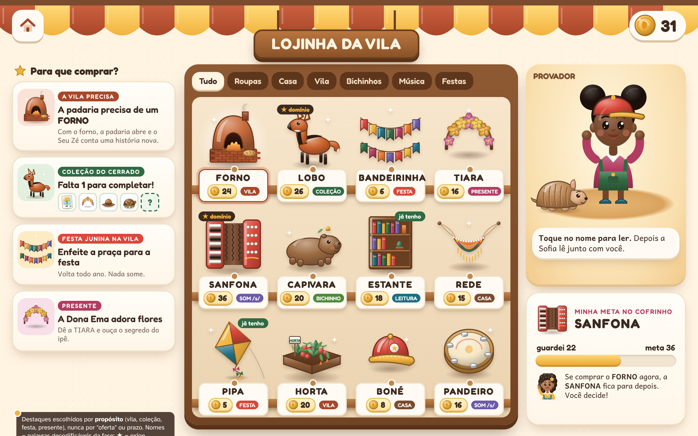

# Lojinha, Coleções e Emblemas: comprar com propósito

> Proposta 06 (FONEMA Unificada), frente **Lojinha · Coleções · Emblemas**. Data: 13/11/2026.
> Responde ao pedido do dono: os itens "ainda estão muito crus, não chamam atenção" e "tem que ter um propósito, um emblema, um porquê de comprar".
> Base: Decisões **002** e **005**, rel. **38** (economia virtual), rel. **08** (dopamina e motivação) e rel. **37** (mundo aberto e avatar). Nada aqui é parecer jurídico.



## 0. Resumo em 8 pontos

1. **Todo item tem um porquê visível.** Antes do preço, a criança vê *para que serve*: completar uma **coleção**, atender uma **necessidade da vila**, preparar uma **festa**, dar um **presente** a um morador, cumprir uma **missão**, **decorar** a casa ou **cuidar** de um bichinho. A vitrine da lojinha é organizada por esses porquês, não por "ofertas".
2. **Comprar muda o mundo.** O FORNO abre a padaria, o Seu Zé faz pão e uma **história nova** é liberada. A recompensa principal continua sendo **conteúdo de leitura** (rel. 08, P1; rel. 38, [17]): o item é a porta, a leitura é o prêmio.
3. **Itens ilustrados com qualidade de jogo premium** (volume, brilho, sombra, paleta quente das propostas 1 e 3). Veja o [`catalogo-itens.png`](catalogo-itens.png): 48 itens desenhados.
4. **Emblemas em 9 famílias**, com níveis **bronze, prata e ouro** ganhos por **esforço e domínio**, com a regra escrita no próprio emblema. Nunca por tempo de tela, sequência de dias ou moedas gastas. Ficam num **mural** e na **vitrine** da casa.
5. **"Raro" sem sorte.** Não existe épico nem lendário. Existe o **item ★ de conquista**, que pede mais **domínio** (um som dominado), mais **paciência** (só via meta do cofrinho) ou **cooperação** (projeto coletivo). A regra aparece no item, sempre igual para todos.
6. **Catálogo de 143 itens** (seção 4), com nome decodificável, fase em que entra, preço fixo, propósito e coleção/emblema ligado.
7. **Preços seguem a curva do rel. 38** (R ≈ 35 moedas/semana; faixas S1–S4) e se integram ao **cofrinho com meta**, ao **bônus de paciência fixo** (+1 a cada 10) e à **lista de desejos**.
8. **Salvaguardas mantidas:** sem dinheiro real, sem loot box, sem escassez, sem vantagem pedagógica, moedas nunca se perdem, compra desfazível em 24 h, oferta paga só para o adulto (ECA Digital), identidade grátis e nenhuma comparação entre crianças.

### Arquivos desta pasta

| Arquivo | O que mostra |
|---|---|
| [`tela-lojinha.png`](tela-lojinha.png) | Vitrine com prateleiras, destaques **por propósito** ("a padaria precisa de FORNO", "falta 1 para a coleção do Cerrado"), provador com o avatar e o Bolota, meta do cofrinho |
| [`tela-item-detalhe.png`](tela-item-detalhe.png) | FORNO: "Leia para conhecer" (FOR·NO), **para que serve** (padaria antes → depois), emblema Ajudante da Vila, coleção Praça da Vila, preço em pilhas de 5, saldo e cofrinho, desfazer em 24 h |
| [`tela-colecoes.png`](tela-colecoes.png) | Álbum: Coleção do Cerrado 4/5, item que falta e como consegui-lo, **recompensa narrativa** (o ipê floresce e o Lobo-guará conta "A NOITE DO LOBO"), lista de coleções |
| [`tela-emblemas.png`](tela-emblemas.png) | Mural com as 9 famílias, bronze/prata/ouro, bloqueados com "?" e a regra de cada nível; detalhe do "Mestre do M" |
| [`tela-cofrinho-meta.png`](tela-cofrinho-meta.png) | Porquinho com janela de vidro, meta escolhida entre 3, "FALTA 14", bônus de paciência explicado, regra "guardar 1 de cada 3", tirar é livre |
| [`tela-casa-decorada.png`](tela-casa-decorada.png) | Casa decorada com itens comprados, janela para a vila que cresceu, **vitrine** de emblemas/figurinhas/livros, modo "Arrumar" e "Mostrar para a família" |
| [`catalogo-itens.png`](catalogo-itens.png) | Folha com 48 itens ilustrados (roupas, cabelos e acessórios com representatividade, casa, vila, fauna brasileira, instrumentos, figurinhas, festas) |
| `fontes/` | HTML + SVG de cada tela: `base.js` (48 itens), `chars.js` (Sofia, avatar Lia, Bolota, emblemas, padaria), `common.css`, `shot.js` (Playwright) |

---

## 1. Os "porquês" de comprar

### 1.1 O laço completo

```
 APRENDER (lição, missão, revisão, história)
      │  moedas pelo esforço e pelo domínio (rel. 38 §4.2; teto de 12/dia)
      ▼
 ESCOLHER UM PORQUÊ ──► coleção · vila · festa · presente · missão · casa · bichinho
      │                         (ou GUARDAR no cofrinho para uma meta)
      ▼
 LER A ETIQUETA (palavra decodificável) ──► comprar em 2 toques (desfazível em 24 h)
      ▼
 O MUNDO RESPONDE ──► prédio novo, morador agradece, história nova, coleção avança, emblema sobe
      ▼
 NOVA LEITURA (história liberada, bilhete do morador, placa nova na vila) ──► volta ao topo
```

A lojinha abre **no fim da sessão** e no "tempo livre da vila" (rel. 38 §4.1, componente 5), nunca no meio da lição.

### 1.2 Os sete porquês

| Porquê | Como funciona | Exemplo na tela | O que a criança ganha além do item | Regra de cuidado |
|---|---|---|---|---|
| **1. Completar coleções por bioma** | Cada região tem um álbum de 5 a 8 itens (roupa, bichinho, figurinha, enfeite). Todos visíveis desde o início, com preço. Alguns vêm por domínio (sem custo) | "Falta 1 para completar a coleção do Cerrado" | **Recompensa narrativa** ao completar: cena nova na vila + história decodificável nova + emblema Colecionador | Fim conhecido; sem pacote surpresa; nada expira; a coleção não "puxa" a criança com contagem regressiva |
| **2. Necessidades da vila** | Os prédios precisam de peças (a padaria precisa de FORNO; a horta precisa de ÁGUA). Necessidade aparece **antes** do enfeite (necessidade × desejo, Decisão 002) | "A padaria precisa de um FORNO" | A vila cresce: prédio abre, morador muda de fala, história nova, novas missões com o som da vez | Nada murcha, quebra ou "morre" se a criança escolher outra coisa (rel. 37 M3). A Sofia mostra a escolha **sem julgar** |
| **3. Eventos e temporadas** | Festa Junina, Carnaval, Folclore (agosto), Dia das Crianças, fim de ano: a vila faz uma festa com enfeites, roupas e brincadeiras | "Enfeite a praça para a festa" | Festa com história própria, música do coreto, dança do avatar | **Voltam todo ano.** O que foi comprado fica para sempre. Proibido "só hoje", contagem regressiva e item que some (rel. 38 S4) |
| **4. Presentes para moradores** | Cada morador tem um gosto conhecido (Dona Ema adora flores). A criança dá um presente comprado **ou** escreve um bilhete (grátis) | "A Dona Ema adora flores: dê a TIARA e ouça o segredo do ipê" | Reação animada + **história desbloqueada** do morador + emblema Generoso | O morador agradece sempre igual, com ou sem presente caro; **conta o gesto, não o valor**; nunca fica triste por não ganhar |
| **5. Missões que pedem um item** | Algumas missões opcionais de "mundo" (não da trilha principal) pedem um objeto: "leve a LANTERNA para ler na gruta" | Cartão de missão na vila | Mini-aventura extra, palavras novas da fase | **Sempre há caminho sem comprar** (pegar emprestado na biblioteca da vila ou fazer a versão a pé). A trilha principal nunca exige item |
| **6. Decorar casa, quarto e vitrine** | Modo "Arrumar": arrastar móveis, quadros, tapetes; a vitrine expõe emblemas, figurinhas e livros lidos | Casa da Lia | Identidade, autoria, criatividade (sandbox sem meta, rel. 37 §3.5) | "Mostrar" envia foto só para o **painel da família**. Sem visitar casas de outras crianças, sem curtidas |
| **7. Cuidar de bichinhos** | Bichinhos da fauna brasileira (capivara, jabuti, lobo-guará…) moram na casa/vila; itens de cuidado são agrados opcionais | Capivara no tapete | Animações de carinho, curiosidades lidas sobre o bicho (conhecimento de mundo) | O bichinho **nunca** adoece, fica triste ou vai embora por falta de compra ou de uso (rel. 38 §4.3; pressão parassocial) |

### 1.3 Moradores e seus gostos (presentes)

| Morador | Onde | Gosta de | O que conta quando recebe |
|---|---|---|---|
| **Seu Zé**, padeiro | Padaria (vila) | PAMONHA, CHAPÉU DE PALHA, MILHO | A receita do pão do Bolota (texto de instruções) |
| **Dona Ema** | Cerrado | TIARA DE IPÊ, FLOR DE IPÊ | O segredo do ipê que floresce na seca |
| **Dona Coruja**, bibliotecária | Biblioteca | LIVRO DE PRESENTE, MARCADOR | Abre uma seção nova da estante livre |
| **Vó Lia** | Casa vizinha | BOLO DE MILHO, VASO | Uma cantiga de roda para ler junto |
| **Tio Boto** | Rio (Amazônia) | CHOCALHO, COLAR DE SEMENTE | A lenda do rio que esqueceu as palavras |
| **Mestre Gaúcho** | Pampa | CUIA, PONCHO | Como o vento move o moinho |

O bilhete escrito pela criança (frase decodificável montada com palavras da fase) vale como presente e conta para o emblema Generoso. **Generosidade não depende de moeda.**

### 1.4 Destaques da semana (como a vitrine escolhe)

A coluna "Para que comprar?" mostra até 4 cartões, escolhidos por regra fixa e transparente:
1. **1 necessidade da vila** ligada à região atual;
2. **1 coleção quase completa** (falta 1 ou 2);
3. **1 festa** do calendário, se houver (anunciada com 2 semanas de antecedência, sem prazo de compra);
4. **1 presente** para um morador com quem a criança conversou na sessão.

Nunca: "mais vendido", "oferta", "preço baixou", "últimas unidades", comparação com outras crianças.

---

## 2. Emblemas e insígnias

### 2.1 Princípios
- Emblema é **sinal simbólico e informativo de competência** (rel. 08 §3.4): diz *o que* a criança aprendeu ou fez. Não se compra, não se troca e não dá moedas.
- **Três níveis:** bronze (começou), prata (consolidou), ouro (domina e mantém). Cada nível tem **regra escrita** na tela, lida pela Sofia.
- **Por esforço e domínio**, medido pelo modelo do aluno (rel. 20) e pelo que a criança faz no mundo. **Nunca** por tempo de tela, número de sessões, sequência de dias ou moedas gastas.
- Nada se perde: faltar dias não rebaixa nenhum emblema. O ouro do domínio de som pede **retenção** (lembrar na revisão espaçada), não frequência.
- **Sem ranking** e sem comparação entre crianças. O mural é da criança; a família vê no painel.
- Anúncio **depois do fato** (rel. 08 §3.3): a Sofia celebra o processo ("você leu o M em três histórias!"). Os critérios ficam visíveis no mural para quem quiser olhar, mas a sessão não diz "faça X para ganhar Y".

### 2.2 As nove famílias

| Família | Emblemas | Bronze | Prata | Ouro | Ligação com a lojinha |
|---|---|---|---|---|---|
| **Domínio de sons** | "Mestre do M", "Mestre do LH"… um por som/padrão | Achar o som em 10 palavras ouvidas | Ler 20 palavras com o som sem ajuda, em 2 dias diferentes | Ler uma história com o som sem ajuda **e** lembrar na revisão após 2 semanas | Libera itens ★ de domínio (ex.: LOBO-GUARÁ pede o /g/); instrumentos tocam o som dominado |
| **Leitor de bioma** | "Leitor do Cerrado", "Leitor do Pantanal"… | Ler 3 histórias da região | Vencer o desafio da região (provinha disfarçada, rel. 37) | Recontar 2 histórias da região para alguém da família (adulto confirma) | Libera o guarda-roupa da região |
| **Colecionador** | Um só, com níveis | 1 coleção de bioma completa | 3 coleções | 5 coleções | Coleções podem ser completadas comprando **ou** por domínio |
| **Ajudante da Vila** | Um só | Ajudar 1 construção | 3 construções | 6 construções + 1 projeto coletivo | Ajudar = comprar a peça, **doar qualquer valor** ao projeto ou cumprir a missão de construção (lendo a planta) |
| **Poupador / Planejador** | Um só (educação financeira) | Concluir 1 meta do cofrinho | Concluir 3 metas | Concluir uma meta **grande** (G) planejada na lista de desejos | Integra o cofrinho; itens ★ meta |
| **Generoso** | Um só | Dar 1 presente ou bilhete | Presentear 5 moradores diferentes | Participar de 3 projetos coletivos da vila ou da turma | Conta **atos**, não valor; bilhete escrito vale |
| **Curioso** | Um só | Ver 3 vídeos explicativos e responder à pergunta da Sofia | Explorar 5 cantos novos do mundo e ler as placas | Ler 10 histórias da **estante livre** (que não dão moeda) | Ingressos de mini-aventuras extras |
| **Criador** | Um só | Escrever 1 história curta (montar frases) | 3 histórias | Publicar uma história no "livro da vila" (rel. 37, R10) | MESA, JORNAL DA VILA, TEATRO |
| **Persistência** | Um só | Tentar de novo 10 vezes depois de errar | Voltar a uma atividade difícil e acertar | Dominar um som que estava "travado" (sinalizado pelo modelo do aluno) | Nenhuma: emblema puro de processo (rel. 08 §3.2) |

O "Curioso" ouro usa a **estante livre**, que é também a sentinela de superjustificação do rel. 38 (E8). O emblema reconhece a leitura sem moeda, sem transformá-la em leitura paga.

### 2.3 Mural e vitrine
- **Mural** ([`tela-emblemas.png`](tela-emblemas.png)): feltro verde com as 9 famílias. Cada família mostra os três níveis. Conquistado aparece em cor plena com ✓. Em andamento aparece esmaecido com barra de progresso **real**. Bloqueado aparece com "?" e a regra escrita.
- **Vitrine** ([`tela-casa-decorada.png`](tela-casa-decorada.png)): a criança escolhe até 3 emblemas, figurinhas e o contador de livros lidos para expor na casa.
- **Itens de domínio** (não se compram, rel. 37 §3.6): chapéu de "Mestre do S", lenço do Cerrado, capa dourada do Leitor. Vestem o avatar como prova de competência.

---

## 3. Raridade sem sorte: o item ★ de conquista

O rel. 38 (§4.4) proíbe **raridade** no sentido de jogo (épico, lendário, chance, edição limitada). O dono pediu itens com mais desejo e "raros". A conciliação: **não existe raridade de sorteio nem de prazo.** Existe a **conquista**, com regra explícita.

| Tipo ★ | Regra | Exemplo | Por que é ético |
|---|---|---|---|
| **★ domínio** | O item só aparece com preço depois que o som/padrão indicado está **dominado** (marco do rel. 20). Antes, aparece como "em breve", sem preço e sem cadeado | LOBO-GUARÁ pede o /g/; CHAPÉU DE COURO pede o /ch/ | Amarra o desejo ao aprendizado; a regra é a mesma para todas as crianças |
| **★ meta** | O item só pode ser comprado **com moedas do cofrinho**, depois de concluir uma meta com ele (paciência) | CAPA DE LEITOR, CORETO, TEATRO, OBSERVATÓRIO | Ensina a poupar; o bônus de paciência ajuda a chegar; nada se perde se a criança desistir |
| **★ projeto** | Construções grandes que a vila (ou a turma, na escola) faz junto; cada um doa o quanto quiser | ESTAÇÃO DE TREM, PONTE, POÇO | Cooperação sem ranking; todos que ajudaram recebem o mesmo agradecimento |

Regras fixas: (1) o ★ e a regra aparecem **no próprio item** e são lidos pela Sofia; (2) **mesma moldura** para todos os itens, sem brilho especial que sugira valor; (3) nenhum item é limitado em quantidade, tempo ou sorte; (4) nenhum ★ dá vantagem de aprendizagem; (5) a criança que não consegue ler a etiqueta recebe ajuda e compra normalmente.

---

## 4. Catálogo (143 itens)

**Como ler a tabela.** *Entra na loja* indica a região do mapa (rel. 37 §3.2) a partir da qual (a) **todas as letras do nome já foram ensinadas** e (b) a criança já chegou ao bioma do item (guarda-roupa por região, rel. 37 §3.6), valendo a mais tardia (R0–R1: itens com figura + áudio; R2a: M L F; R2b: V S N; R3: P T B D; R4: J Z X CH NH LH; R5: contextuais C/QU G/GU R/RR S/SS Ç; R6: nasalidade; R7: CVC e ditongos; R8: CCV; R9: concorrências arbitrárias e H). Antes disso, o item aparece como "em breve", **sem preço**. *Todos os nomes passam pelo filtro de decodificabilidade do rel. 25 antes de entrar no catálogo; a coluna é indicativa.* Preços em moedas, fixos e imutáveis depois de publicados. ✔ = desenhado na folha `catalogo-itens.png`.

| # | Item (etiqueta) | Categoria | Tema / bioma | Entra na loja | Preço | Propósito (o porquê) | Liga a coleção / emblema | Ilustrado |
|---:|---|---|---|:---:|---:|---|---|:---:|
| 1 | **SAIA** | Roupa | Quintal | R2b | 6 | Vestir o avatar; combina com FIVELA | Col. Roupas do Dia | ✔ |
| 2 | **BONÉ** | Roupa | Quintal | R3 | 8 | Vestir o avatar; dia de sol na vila | Col. Roupas do Dia | ✔ |
| 3 | **BOTA** | Roupa | Cerrado | R3 | 10 | Trilha do Cerrado (enfeite, sem efeito) | Col. Cerrado | ✔ |
| 4 | **LUVA** | Roupa | Pampa | R2b | 6 | Vestir no frio do Pampa | Col. Pampa | — |
| 5 | **MALA** | Acessório | Quintal | R2a | 5 | Levar na viagem de barco para a Ilha | Col. Roupas do Dia | — |
| 6 | **MOCHILA** | Acessório | Biblioteca | R4 | 14 | Carregar os livros lidos (vitrine) | Emblema Curioso | ✔ |
| 7 | **CAPA DE LEITOR** | Roupa | Biblioteca | R5 | 40 | Fantasia de leitor para o Festival | ★ meta do cofrinho · Emblema Poupador | ✔ |
| 8 | **VESTIDO DE CHITA** | Roupa | Festa Junina | R5 | 28 | Dançar a quadrilha da vila | Col. Festa Junina | ✔ |
| 9 | **CAMISA XADREZ** | Roupa | Festa Junina | R5 | 12 | Dançar a quadrilha da vila | Col. Festa Junina | — |
| 10 | **CHAPÉU DE PALHA** | Roupa | Festa Junina | R6 | 10 | Quadrilha; presente p/ Seu Zé | Col. Festa Junina | — |
| 11 | **CHAPÉU DE COURO** | Roupa | Sertão | R6 | 34 | Roupa do vaqueiro do Sertão | Col. Sertão ★ (domínio /ch/) | ✔ |
| 12 | **GIBÃO** | Roupa | Sertão | R6 | 30 | Roupa do vaqueiro do Sertão | Col. Sertão | — |
| 13 | **PONCHO** | Roupa | Pampa | R6 | 22 | Esquentar no vento do Pampa | Col. Pampa | — |
| 14 | **BOMBACHA** | Roupa | Pampa | R7 | 18 | Roupa do Pampa | Col. Pampa | — |
| 15 | **SANDÁLIA** | Roupa | Litoral | R6 | 8 | Passear na praia da Ilha | Col. Litoral | — |
| 16 | **MAIÔ** | Roupa | Litoral | R2a | 6 | Brincar na praia da Ilha | Col. Litoral | — |
| 17 | **SUNGA** | Roupa | Litoral | R6 | 6 | Brincar na praia da Ilha | Col. Litoral | — |
| 18 | **CAPA DE CHUVA** | Roupa | Amazônia | R5 | 14 | Passear na chuva da floresta | Col. Amazônia | — |
| 19 | **FANTASIA DE ONÇA** | Roupa | Carnaval | R6 | 26 | Desfile de carnaval da vila | Col. Carnaval | — |
| 20 | **FANTASIA DE FREVO** | Roupa | Carnaval | R7 | 24 | Desfile; combina com SOMBRINHA | Col. Carnaval | — |
| 21 | **PIJAMA** | Roupa | Casa | R4 | 8 | Ritual de fim de sessão (dormir com o Bolota) | Col. Casa Aconchego | — |
| 22 | **CAPACETE** | Acessório | Cidade | R7 | 12 | Andar de bicicleta na Cidade das Letras | Col. Cidade | — |
| 23 | **FIVELA** | Cabelo | Quintal | R2b | 4 | Enfeitar o cabelo | Col. Cabelos do Brasil | ✔ |
| 24 | **LENÇO** | Cabelo | Quintal | R5 | 9 | Amarração de cabelo | Col. Cabelos do Brasil | ✔ |
| 25 | **MIÇANGA** | Cabelo | Quintal | R5 | 6 | Contas para tranças | Col. Cabelos do Brasil | ✔ |
| 26 | **TIARA DE IPÊ** | Cabelo | Cerrado | R5 | 16 | Presente p/ Dona Ema (ouve o segredo do ipê) | Col. Cerrado · Emblema Generoso | ✔ |
| 27 | **FAIXA** | Cabelo | Quintal | R4 | 4 | Faixa para black power / cachos | Col. Cabelos do Brasil | — |
| 28 | **PENTE GARFO** | Cabelo | Quintal | R5 | 5 | Cuidar do cabelo crespo (decorativo) | Col. Cabelos do Brasil | — |
| 29 | **TURBANTE** | Cabelo | Festa da vila | R7 | 14 | Amarração para dias de festa | Col. Cabelos do Brasil | — |
| 30 | **COLAR DE SEMENTE** | Acessório | Amazônia | R6 | 10 | Artesanato da floresta | Col. Amazônia | — |
| 31 | **ÓCULOS (armação)** | Identidade | — | sempre | grátis | Grátis; armações coloridas custam 3 | — | ✔ |
| 32 | **APARELHO AUDITIVO** | Identidade | — | sempre | grátis | Grátis; capinha estampada custa 4 | — | ✔ |
| 33 | **CADEIRA DE RODAS** | Identidade | — | sempre | grátis | Grátis; raios coloridos custam 5 | — | ✔ |
| 34 | **PRÓTESE / MULETA** | Identidade | — | sempre | grátis | Grátis; adesivos custam 3 | — | — |
| 35 | **TONS DE PELE e CABELOS (cacheado, crespo, liso, tranças, black)** | Identidade | — | sempre | grátis | Grátis e permanentes | — | — |
| 36 | **ADESIVO DE RODA** | Enfeite de identidade | Quintal | R3 | 3 | Enfeitar a cadeira de rodas | Col. Cabelos do Brasil (estilo) | — |
| 37 | **SOFÁ** | Casa | Casa | R2b | 22 | Sala da casa; o Bolota cochila | Col. Casa Aconchego | ✔ |
| 38 | **VELA** | Casa | Casa | R2b | 4 | Luz para ler à noite (enfeite) | Col. Casa Aconchego | — |
| 39 | **TAPETE** | Casa | Casa | R3 | 12 | Quarto; lugar do bichinho | Col. Casa Aconchego | ✔ |
| 40 | **VASO** | Casa | Mata Atlântica | R5 | 7 | Planta na janela | Col. Mata Atlântica | ✔ |
| 41 | **QUADRO** | Casa | Casa | R5 | 10 | Pendura um desenho da vila | Col. Casa Aconchego | ✔ |
| 42 | **REDE** | Casa | Sertão | R5 | 15 | Varanda; ler deitado na rede | Col. Sertão | ✔ |
| 43 | **ESTANTE** | Leitura | Biblioteca | R7 | 18 | Guarda os livros que a criança leu | Emblema Leitor · vitrine | ✔ |
| 44 | **MESA** | Casa | Casa | R5 | 10 | Lugar para escrever histórias | Emblema Criador | — |
| 45 | **CAMA** | Casa | Casa | R5 | 20 | Quarto do avatar | Col. Casa Aconchego | — |
| 46 | **COLCHA DE RETALHO** | Casa | Casa | R6 | 14 | Cama colorida | Col. Casa Aconchego | — |
| 47 | **ABAJUR** | Casa | Casa | R9 | 12 | Luz para ler na cama | Col. Casa Aconchego | — |
| 48 | **CORTINA** | Casa | Casa | R7 | 9 | Janela do quarto | Col. Casa Aconchego | — |
| 49 | **BANQUINHO** | Casa | Casa | R6 | 6 | Sentar para ler com o Bolota | Col. Casa Aconchego | — |
| 50 | **PUFE** | Casa | Casa | R3 | 8 | Canto de leitura | Col. Casa Aconchego | — |
| 51 | **RELÓGIO DE PAREDE** | Casa | Casa | R9 | 12 | Enfeite (nunca marca tempo de jogo) | — | — |
| 52 | **MURAL** | Casa | Casa | R7 | 10 | Expor emblemas na parede | Mural de emblemas | — |
| 53 | **PRATELEIRA DE VIDRO (VITRINE)** | Casa | Casa | R8 | 30 | Vitrine para mostrar conquistas à família | Emblema Colecionador | — |
| 54 | **JANELA FLORIDA** | Casa | Mata Atlântica | R8 | 16 | Floreira na janela | Col. Mata Atlântica | — |
| 55 | **LAMPARINA** | Casa | Sertão | R7 | 8 | Luz de casa do Sertão | Col. Sertão | — |
| 56 | **FILTRO DE BARRO** | Casa | Sertão | R8 | 12 | Água fresca (necessidade × desejo) | Col. Sertão | — |
| 57 | **HORTA** | Vila | Vila | R5 | 20 | A vila precisa de comida | Projeto coletivo · Emblema Ajudante | ✔ |
| 58 | **FONTE** | Vila | Vila | R4 | 30 | Água na praça | Col. Praça da Vila · Ajudante | ✔ |
| 59 | **FORNO** | Vila | Vila | R7 | 24 | A padaria precisa de forno; Seu Zé abre a padaria | Col. Praça da Vila · Ajudante | ✔ |
| 60 | **CORETO** | Vila | Vila | R5 | 45 | Música na praça; festas | Col. Praça da Vila ★ (meta) | ✔ |
| 61 | **PONTE** | Vila | Vila | R4 | 38 | Liga a vila à região nova | Projeto coletivo · Ajudante | ✔ |
| 62 | **MOINHO** | Vila | Pampa | R7 | 42 | Farinha para a padaria | Col. Praça da Vila · Ajudante | ✔ |
| 63 | **BANCA DE LIVROS** | Leitura | Vila | R7 | 26 | Biblioteca de rua: novos livros chegam | Emblema Leitor · Ajudante | ✔ |
| 64 | **BANCO DE PRAÇA** | Vila | Vila | R3 | 12 | Moradores sentam para ouvir histórias | Col. Praça da Vila | — |
| 65 | **POSTE** | Vila | Vila | R7 | 10 | Ilumina a rua à noite | Col. Praça da Vila | — |
| 66 | **CAIXA DE CORREIO** | Vila | Vila | R5 | 9 | Receber bilhetes dos moradores (leitura) | Emblema Curioso | — |
| 67 | **POÇO** | Vila | Sertão | R5 | 28 | Água para a horta (necessidade) | Projeto coletivo | — |
| 68 | **CISTERNA** | Vila | Sertão | R7 | 34 | Guardar água da chuva | Projeto coletivo | — |
| 69 | **GALINHEIRO** | Vila | Vila | R4 | 20 | Ovos para a padaria | Ajudante da Vila | — |
| 70 | **VIVEIRO** | Vila | Pantanal | R5 | 36 | Casa para bichos resgatados na Cheia | Ajudante da Vila | — |
| 71 | **BARCO** | Vila | Amazônia | R7 | 40 | Barco-escola visita a vila | Col. Amazônia · Ajudante | — |
| 72 | **CAIS** | Vila | Ilha das Vogais | R4 | 26 | Ponto do barco (liga a Ilha) | Ajudante da Vila | — |
| 73 | **FAROL** | Vila | Ilha das Vogais | R6 | 40 | Acende a Ilha à noite | Col. Litoral ★ | — |
| 74 | **PRAÇA DO CORDEL** | Vila | Sertão | R7 | 48 | Varal de cordel para ler | Emblema Leitor | — |
| 75 | **TEATRO** | Vila | Cidade | R8 | 90 | Peças lidas pela criança | ★ meta grande · Emblema Criador | — |
| 76 | **JORNAL DA VILA** | Vila | Cidade | R9 | 60 | Publica notícias que a criança escreve | Emblema Criador | — |
| 77 | **OBSERVATÓRIO** | Vila | Amazônia | R9 | 80 | Ver bichos e estrelas; histórias novas | ★ meta grande · Curioso | — |
| 78 | **ESTAÇÃO DE TREM** | Vila | Serra | R8 | 120 | Liga todas as regiões (projeto coletivo) | Projeto coletivo · Ajudante ouro | — |
| 79 | **SAPO** | Bichinho | Quintal | R3 | 5 | Mora na lagoa do quintal | Col. Quintal | ✔ |
| 80 | **TATU** | Bichinho | Quintal | R3 | 8 | Amigo do Bolota (enfeite) | Col. Quintal | — |
| 81 | **JABUTI** | Bichinho | Cerrado | R4 | 14 | Bichinho para cuidar (opcional) | Col. Cerrado | ✔ |
| 82 | **ARARA** | Bichinho | Amazônia | R5 | 18 | Canta na varanda | Col. Amazônia | ✔ |
| 83 | **TUCANO** | Bichinho | Mata Atlântica | R5 | 18 | Visita a janela | Col. Mata Atlântica | ✔ |
| 84 | **CAPIVARA** | Bichinho | Pantanal | R5 | 20 | Brinca no tapete | Col. Pantanal | ✔ |
| 85 | **MICO-LEÃO** | Bichinho | Mata Atlântica | R7 | 22 | Mora na árvore da vila | Col. Mata Atlântica | ✔ |
| 86 | **LOBO-GUARÁ** | Bichinho | Cerrado | R5 | 26 | Conta a história do Cerrado | Col. Cerrado ★ (domínio /g/) | ✔ |
| 87 | **BOTO** | Bichinho | Amazônia | R4 | 24 | Nada no rio da vila | Col. Amazônia | — |
| 88 | **TAMANDUÁ** | Bichinho | Cerrado | R7 | 22 | Visita o cupinzeiro | Col. Cerrado (2ª página) | — |
| 89 | **TUIUIÚ** | Bichinho | Pantanal | R7 | 24 | Ave símbolo do Pantanal | Col. Pantanal | — |
| 90 | **ONÇA** | Bichinho | Pantanal | R6 | 30 | Pelúcia de onça para a cama | Col. Pantanal ★ (meta) | — |
| 91 | **PEIXE-BOI** | Bichinho | Litoral | R5 | 24 | Lagoa da Ilha | Col. Litoral | — |
| 92 | **BEIJA-FLOR** | Bichinho | Mata Atlântica | R7 | 12 | Visita a floreira | Col. Mata Atlântica | — |
| 93 | **SERIEMA** | Bichinho | Cerrado | R6 | 18 | Canta de manhã na vila | Col. Cerrado (2ª página) | — |
| 94 | **CASINHA DO BICHO** | Cuidado | Vila | R5 | 12 | Abrigo do bichinho (nunca obrigatório) | Col. Quintal | — |
| 95 | **POTE DE COMIDA** | Cuidado | Vila | R3 | 3 | Agrado ao bichinho; ele não passa fome sem isso | — | — |
| 96 | **BOLA** | Cuidado | Quintal | R3 | 3 | Brincar com o bichinho | Col. Quintal | — |
| 97 | **ESCOVA** | Cuidado | Quintal | R7 | 4 | Escovar o bichinho | — | — |
| 98 | **PANDEIRO** | Instrumento | Cidade/samba | R6 | 16 | Toca o som /p/ quando tocado | Col. Instrumentos do Brasil | ✔ |
| 99 | **TAMBOR** | Instrumento | Sertão/maracatu | R6 | 14 | Toca o som /t/ | Col. Instrumentos do Brasil | ✔ |
| 100 | **VIOLA** | Instrumento | Sertão | R5 | 30 | Toca o som /v/ | Col. Instrumentos do Brasil | ✔ |
| 101 | **SANFONA** | Instrumento | Sertão | R6 | 36 | Toca o som /s/; música do forró | Col. Instrumentos ★ (meta) | ✔ |
| 102 | **CHOCALHO** | Instrumento | Amazônia | R4 | 8 | Toca o som /ch/ | Col. Instrumentos do Brasil | ✔ |
| 103 | **BERIMBAU** | Instrumento | Capoeira | R7 | 28 | Toca o som /b/ | Col. Instrumentos do Brasil | — |
| 104 | **AGOGÔ** | Instrumento | Samba | R5 | 10 | Toca o som /g/ | Col. Instrumentos do Brasil | — |
| 105 | **FLAUTA** | Instrumento | Vila | R8 | 18 | Toca o som /f/ | Col. Instrumentos do Brasil | — |
| 106 | **APITO** | Instrumento | Carnaval | R3 | 4 | Puxar o desfile | Col. Carnaval | — |
| 107 | **CAVAQUINHO** | Instrumento | Samba | R7 | 32 | Toca o som /k/ | Col. Instrumentos do Brasil | — |
| 108 | **FIGURINHA IPÊ** | Figurinha | Cerrado | R3 | 3 | Fala a palavra; ou vem ao dominar o /p/ | Col. Cerrado | ✔ |
| 109 | **FIGURINHA ONÇA** | Figurinha | Pantanal | R6 | 3 | Fala a palavra | Col. Pantanal | ✔ |
| 110 | **FIGURINHA CAJU** | Figurinha | Sertão | R4 | 3 | Fala a palavra | Col. Sertão | ✔ |
| 111 | **FIGURINHA LUA** | Figurinha | Quintal | R2a | 2 | Fala a palavra | Col. Quintal | — |
| 112 | **FIGURINHA MAMÃO** | Figurinha | Quintal | R6 | 3 | Fala a palavra | Col. Quintal | — |
| 113 | **FIGURINHA BOTO** | Figurinha | Amazônia | R3 | 3 | Fala a palavra | Col. Amazônia | — |
| 114 | **FIGURINHA PEQUI** | Figurinha | Cerrado | R5 | 3 | Fala a palavra | Col. Cerrado (2ª página) | — |
| 115 | **FIGURINHA JANGADA** | Figurinha | Litoral | R6 | 3 | Fala a palavra | Col. Litoral | — |
| 116 | **FIGURINHA CUIA** | Figurinha | Pampa | R5 | 3 | Fala a palavra | Col. Pampa | — |
| 117 | **FIGURINHA SACI** | Figurinha | Folclore | R5 | 3 | Fala a palavra (agosto) | Col. Folclore | — |
| 118 | **BANDEIRINHA** | Festa | Festa Junina | R4 | 6 | Enfeitar a praça; volta todo ano | Col. Festa Junina | ✔ |
| 119 | **FOGUEIRA (de papel)** | Festa | Festa Junina | R5 | 12 | Cenário da quadrilha | Col. Festa Junina | ✔ |
| 120 | **MILHO** | Festa | Festa Junina | R7 | 4 | Barraca de comidas da festa | Col. Festa Junina | — |
| 121 | **PAMONHA** | Festa | Festa Junina | R6 | 5 | Presente p/ Seu Zé | Col. Festa Junina · Generoso | — |
| 122 | **SOMBRINHA DE FREVO** | Festa | Carnaval | R6 | 15 | Dançar frevo no desfile | Col. Carnaval | ✔ |
| 123 | **MÁSCARA** | Festa | Carnaval | R5 | 10 | Desfile da vila | Col. Carnaval | ✔ |
| 124 | **SERPENTINA** | Festa | Carnaval | R7 | 4 | Enfeitar a rua do desfile | Col. Carnaval | — |
| 125 | **ESTANDARTE** | Festa | Carnaval | R7 | 26 | Bloco da vila (projeto da turma) | Col. Carnaval · Ajudante | — |
| 126 | **PIPA** | Festa | Dia das Crianças | R3 | 5 | Soltar no morro da vila | Col. Dia das Crianças | ✔ |
| 127 | **PIÃO** | Festa | Dia das Crianças | R6 | 4 | Brincadeira antiga | Col. Dia das Crianças | ✔ |
| 128 | **BOLINHA DE GUDE** | Festa | Dia das Crianças | R7 | 4 | Brincadeira antiga | Col. Dia das Crianças | — |
| 129 | **PERNA DE PAU** | Festa | Dia das Crianças | R7 | 12 | Brincadeira antiga | Col. Dia das Crianças | — |
| 130 | **CARRANCA** | Festa | Folclore | R7 | 18 | Barco do São Francisco | Col. Folclore | — |
| 131 | **GORRO DO SACI** | Festa | Folclore | R7 | 8 | Fantasia do folclore | Col. Folclore | — |
| 132 | **ESTRELA DE NATAL** | Festa | Fim de ano | R8 | 10 | Enfeite de fim de ano | Col. Fim de Ano | — |
| 133 | **MARCADOR DE LIVRO** | Leitura | Biblioteca | R5 | 3 | Marca a página do livro em leitura | Emblema Leitor | — |
| 134 | **LUPA** | Leitura | Biblioteca | R3 | 6 | Enfeite de detetive de palavras | Emblema Curioso | — |
| 135 | **LANTERNA** | Leitura | Biblioteca | R6 | 8 | Ler na barraca (cenário) | Emblema Curioso | — |
| 136 | **BARRACA DE LEITURA** | Leitura | Casa | R7 | 20 | Cantinho de leitura | Col. Casa Aconchego | — |
| 137 | **INGRESSO: TRILHA DO TUCANO** | Ingresso | Mata Atlântica | R5 | 15 | Mini-aventura EXTRA (história bônus, nunca trilha principal) | Emblema Curioso | — |
| 138 | **INGRESSO: BARCO NO RIO** | Ingresso | Amazônia | R7 | 20 | Mini-aventura extra; reutilizável | Emblema Curioso | — |
| 139 | **INGRESSO: CIRCO DA VILA** | Ingresso | Vila | R6 | 18 | Mini-aventura extra | Emblema Curioso | — |
| 140 | **BOLO DE MILHO (presente)** | Presente | Vila | R7 | 6 | Presente p/ Vó Lia; ela conta uma receita | Emblema Generoso | — |
| 141 | **LIVRO DE PRESENTE** | Presente | Biblioteca | R5 | 8 | Presente p/ Dona Coruja; abre a seção nova | Emblema Generoso · Leitor | — |
| 142 | **FLOR DE IPÊ (presente)** | Presente | Cerrado | R8 | 3 | Presente p/ Dona Ema | Emblema Generoso | — |
| 143 | **SEMENTE (doação)** | Presente | Vila | R5 | 2 | Doação ao projeto coletivo da horta | Emblema Generoso · Ajudante | — |

**Contagem por categoria:** Vila 21 · Roupa 19 · Casa 19 · Bichinho 15 · Festa 15 · Instrumento 10 · Figurinha 10 · Cabelo 7 · Leitura 6 · Identidade (grátis) 5 + 1 enfeite · Acessório 4 · Cuidado do bichinho 4 · Presente 4 · Ingresso de mini-aventura 3. Cada nova região acrescenta 20–30 itens e 1 projeto coletivo (rel. 38 §4.4).

### 4.1 Coleções e recompensas narrativas

| Coleção | Itens (exemplos) | Ao completar, o mundo responde | Emblema |
|---|---|---|---|
| **Quintal da Sofia** (R0–R2) | SAPO, TATU, BOLA, PIPA, FIGURINHA LUA, PUFE | O Bolota ganha uma casinha e conta como chegou ao quintal | Colecionador |
| **Roupas do Dia** | SAIA, BONÉ, MALA, MAIÔ | Desfile no quintal com a Sofia (animação curta) | Colecionador |
| **Cabelos do Brasil** | FIVELA, LENÇO, MIÇANGA, FAIXA, TURBANTE | Salão da vila abre; história "Cada cabelo, um jeito" | Colecionador |
| **Litoral / Ilha das Vogais** | MAIÔ, SUNGA, SANDÁLIA, PEIXE-BOI, FIGURINHA JANGADA | O farol acende e a Ilha ganha uma história de pescador | Colecionador |
| **Mata Atlântica** | VASO, TUCANO, MICO-LEÃO, BEIJA-FLOR, JANELA FLORIDA | Ingresso grátis para a Trilha do Tucano (mini-aventura) | Colecionador |
| **Cerrado** | FIGURINHA IPÊ, TIARA DE IPÊ, JABUTI, BOTA, LOBO-GUARÁ ★ | O ipê da vila floresce; o Lobo-guará conta "A NOITE DO LOBO" | Colecionador |
| **Pantanal** | CAPIVARA, TUIUIÚ, ONÇA ★, FIGURINHA ONÇA, VIVEIRO | Os bichos resgatados na Cheia visitam a vila | Colecionador |
| **Sertão** | CHAPÉU DE COURO ★, GIBÃO, REDE, LAMPARINA, FIGURINHA CAJU | Noite de cordel no coreto (texto rimado decodificável) | Colecionador |
| **Pampa** | PONCHO, BOMBACHA, LUVA, FIGURINHA CUIA, MOINHO | O moinho gira e a padaria ganha farinha | Colecionador |
| **Amazônia** | ARARA, BOTO, CHOCALHO, COLAR DE SEMENTE, BARCO | O barco-escola leva a criança por um rio de palavras | Colecionador |
| **Praça da Vila** | FONTE, HORTA, CORETO ★, PONTE, FORNO, MOINHO, BANCA DE LIVROS | O coreto toca a música da festa e todos os moradores aparecem | Ajudante da Vila |
| **Casa Aconchego** | SOFÁ, TAPETE, CAMA, COLCHA, CORTINA, BARRACA DE LEITURA | Ritual de "boa noite" especial com o Bolota | Colecionador |
| **Instrumentos do Brasil** | PANDEIRO, TAMBOR, VIOLA, SANFONA ★, CHOCALHO, BERIMBAU, AGOGÔ, FLAUTA | Banda da vila: cada instrumento toca o som da sua letra, e juntos tocam a música das letras | Colecionador + Domínio de sons |
| **Festa Junina** | BANDEIRINHA, FOGUEIRA, VESTIDO DE CHITA, CAMISA XADREZ, CHAPÉU DE PALHA, PAMONHA | Quadrilha com o avatar (todo ano) | Colecionador |
| **Carnaval** | MÁSCARA, SOMBRINHA DE FREVO, FANTASIA DE ONÇA, SERPENTINA, APITO, ESTANDARTE | Desfile do bloco da vila | Colecionador |
| **Dia das Crianças** | PIPA, PIÃO, BOLINHA DE GUDE, PERNA DE PAU | Tarde de brincadeiras antigas com regras para ler | Colecionador |
| **Folclore** (agosto) | FIGURINHA SACI, GORRO DO SACI, CARRANCA | Roda de lendas na fogueira | Curioso |

Itens de coleção podem vir **pela lojinha** ou **por domínio** (ex.: a FIGURINHA IPÊ vem ao dominar o /p/). Quem ganhou por domínio não paga de novo. O álbum mostra quais vieram de cada jeito.

---

## 5. Curva de preços, sumidouros e cofrinho (integração com o rel. 38)

### 5.1 Âncoras (inalteradas)
- **Uma moeda só**, ganha só aprendendo (rel. 38 §4.2). Renda de referência **R ≈ 35/semana**; teto de 12/dia; marco de domínio = 5; região concluída = 10.
- **Preço publicado é imutável.** O ajuste é feito só nos itens novos.

### 5.2 Faixas por fase

| Período (rel. 38 §4.6) | Regiões típicas (rel. 37) | Pequeno (P) | Médio (M) | Grande/meta (G) | Itens ★ meta | Exemplos do catálogo |
|---|---|---|---|---|---|---|
| S1 (meses 1–6) | R0–R2b | 2–5 | 6–12 | 15–25 | nenhum | FIVELA 4, SAIA 6, MALA 5, SOFÁ 22 |
| S2 (meses 7–12) | R3–R4 | 3–8 | 10–20 | 30–50 | 1 por região | PIPA 5, BONÉ 8, TAPETE 12, FONTE 30, PONTE 38 |
| S3 (meses 13–18) | R5–R7 | 5–10 | 15–30 | 36–90 | 1–2 por região | MÁSCARA 10, CAPIVARA 20, FORNO 24, SANFONA 36 ★, CORETO 45 ★ |
| S4 (meses 19–24) | R8–R10 | 5–15 | 20–40 | 80–150 | 2 por região | FLAUTA 18, VITRINE 30, TEATRO 90 ★, ESTAÇÃO DE TREM 120 (projeto) |

A criança **nunca vê preço acima da sua numeracia**: itens fora da faixa aparecem como "em breve". Nas fases iniciais, o preço vem em **pilhas de 5 moedas** (subitização), como na `tela-item-detalhe.png`.

### 5.3 Para onde vão as moedas (sumidouros por propósito)

| Porquê | Peso-alvo no gasto | Itens típicos |
|---|---|---|
| Casa, avatar e decoração | 40–50% | Roupas, cabelos, móveis |
| Necessidades da vila e projetos coletivos | 15–20% | FORNO, HORTA, POÇO, ESTAÇÃO |
| Coleções e figurinhas | 10–15% | Figurinhas (2–3), bichinhos |
| Festas | 5–10% | Enfeites e fantasias |
| Presentes | 5–10% | Pequenos (2–8) para caber em qualquer saldo |
| Ingressos de mini-aventuras extras | 5–10% | Só conteúdo **bônus**, reutilizável |

Simulação de uma semana em S3 (R = 35): a criança ganha 35; guarda 12 pela regra "1 de cada 3"; compra a FIGURINHA CAJU (3) e a BANDEIRINHA (6); dá um LIVRO DE PRESENTE (8) à Dona Coruja; fica com 6 livres. Razão gasto/ganho = 17/35 ≈ 0,5 na semana; com a meta concluída na semana seguinte (SANFONA 36 + bônus 3), a média de 4 semanas fica perto de 0,8, dentro do alvo de 0,6–0,9 (E3).

### 5.4 Cofrinho com meta
- **Saldo livre e cofrinho são separados** e aparecem juntos no topo ("livres 31 · no cofrinho 22").
- **Uma meta por vez em S1–S2 e até três em S3–S4**, cada uma com a foto do item ([`tela-cofrinho-meta.png`](tela-cofrinho-meta.png)). A tela mostra "faltam ≈ N sessões de leitura", em vez de dias, para não virar contagem regressiva.
- **Bônus de paciência fixo:** +1 moeda a cada 10 guardadas, pago ao completar a meta (rel. 38 §4.7). A regra está desenhada na tela e nunca muda (confiabilidade, [43]).
- **Itens ★ meta** só se compram com o cofrinho. É o "raro" que ensina a esperar.
- **Regra automática** opcional, escolhida com o adulto: "guardar 1 de cada 3 moedas". Pode ser desligada.
- **Tirar é livre** e não tem penalidade. Só o bônus espera a meta.
- **Custo de oportunidade** dito uma vez, sem culpa: "Se comprar o FORNO agora, a SANFONA fica para depois. Você decide!"
- **Lista de desejos** com prioridade (coração), lida em voz alta pela criança (fluência).
- **Emblema Poupador/Planejador** reconhece metas concluídas, nunca o volume de moedas acumulado.

---

## 6. Salvaguardas e métricas

### 6.1 Checklist (soma-se ao S1–S13 do rel. 38 §4.9)

| # | Salvaguarda | Como aparece nas telas |
|---|---|---|
| L1 | Nenhum dinheiro real; moedas não se compram, não se convertem e não vêm de anúncio | Nenhum botão de compra real em telas da criança |
| L2 | **Oferta paga só para o adulto**, atrás da porteira parental (ECA Digital; Decisão 002). A criança nunca vê plano, preço em reais ou "peça para seus pais" | A ponte "em obras" do fim do recorte gratuito não tem cadeado nem mensagem de compra (rel. 37) |
| L3 | Sem sorte: preço e aparência sempre visíveis; nada de baú, roleta, pacote surpresa de figurinhas | Figurinhas compradas uma a uma, com a figura à vista |
| L4 | Sem escassez: itens de festa voltam todo ano; nada some; sem contagem regressiva | "Volta todo ano. Nada some." no cartão da festa |
| L5 | Sem vantagem pedagógica: nenhum item facilita, acelera, pula conteúdo ou dá dica; ingressos só abrem conteúdo **extra** | "Para que serve?" nunca promete ajuda na lição |
| L6 | Moedas nunca se perdem; itens não quebram nem expiram; bichinho e vila não sofrem por ausência | Sem "fome", "sujeira" ou "saudade" |
| L7 | Emblemas nunca por tempo de tela, sequência de dias ou gasto | Regras escritas no mural |
| L8 | Compra em 2 toques, com preço lido e **desfazer em 24 h** | "Mudou de ideia? Dá para desfazer em 24 h" |
| L9 | Ler a etiqueta **nunca** é condição para comprar | Ajuda graduada da Sofia (sílaba → som → palavra) |
| L10 | Sem comparação social: sem visitar casas de outras crianças, curtidas, ranking ou troca entre crianças | "Mostrar" vai só para o painel da família |
| L11 | Identidade grátis e permanente (pele, cabelos, óculos, aparelho auditivo, cadeira de rodas, prótese); só enfeites custam | Selo "GRÁTIS" no catálogo |
| L12 | Moradores e Sofia agradecem igual, com ou sem presente; nunca pedem compra | Bilhete escrito vale como presente |
| L13 | A economia pode ser desligada ou simplificada por pais e escola (modo "só estrelas de domínio"); coleções e emblemas continuam, com itens vindos por domínio | Configuração no painel |
| L14 | Destaques da vitrine por regra fixa e transparente (seção 1.4), nunca personalizados para maximizar gasto | — |

### 6.2 Métricas (painel interno agregado, sem identificação; somam-se às E1–E12 do rel. 38 §4.10)

| Código | Métrica | Alvo / alerta |
|---|---|---|
| L-M1 | **Distribuição do gasto por porquê** (casa, vila, coleção, festa, presente, ingresso) | Nenhum porquê acima de 60%; alerta se "vila + presente + coleção" < 25% (lojinha virou só vestuário) |
| L-M2 | % de compras feitas a partir de um cartão de propósito vs. navegação livre | Acompanhar; alerta se > 80% (cartões estão "empurrando") |
| L-M3 | Coleções concluídas por criança/trimestre e tempo até concluir | ≥ 1 por região; tempo dentro da faixa da fase |
| L-M4 | % de presentes que são **bilhetes escritos** (sem moeda) | ≥ 20% (generosidade não depende de saldo) |
| L-M5 | Distribuição de emblemas por família e nível | Persistência e Domínio presentes em ≥ 70% das crianças ativas; alerta se Poupador concentrado em crianças de renda alta de moedas (equidade, E2) |
| L-M6 | Uso da vitrine e do "Mostrar para a família"; conversas abertas no painel | Monitorar (meta a definir com E11) |
| L-M7 | Itens ★ meta: % concluídos vs. abandonados | Conclusão ≥ 60% (E5) |
| L-M8 | **Sentinela de superjustificação** (E8): leitura na estante livre antes/depois da nova lojinha | Estável ou subindo; queda > 20% em 2 meses → revisar |
| L-M9 | Comparação no piloto: lojinha com propósito vs. lojinha simples vs. "só estrelas" em domínio fônico e leitura livre (E9) | Sem diferença negativa em aprendizagem |
| L-M10 | Taxa de desfazer compra (E6) | Alerta > 10% |

---

## 7. Como regenerar as imagens

```bash
cd docs/propostas/06-fonema-unificada/lojinha-emblemas/fontes
node shot.js catalogo-itens.html 1280 1640 ../catalogo-itens.png \
  tela-lojinha.html 1280 800 ../tela-lojinha.png \
  tela-item-detalhe.html 1280 800 ../tela-item-detalhe.png \
  tela-colecoes.html 1280 800 ../tela-colecoes.png \
  tela-emblemas.html 1280 800 ../tela-emblemas.png \
  tela-cofrinho-meta.html 1280 800 ../tela-cofrinho-meta.png \
  tela-casa-decorada.html 1280 800 ../tela-casa-decorada.png
```

Playwright/Chromium, viewport 1280×800, `deviceScaleFactor: 2` (telas em 2560×1600). Todos os itens são SVG gerados em `base.js` com gradientes de volume, brilho, contorno no tom da própria cor e sombra no chão, prontos para virar sprites do jogo. Fontes Andika (leitura), Fredoka (títulos) e Atkinson Hyperlegible (notas para adultos), as mesmas da proposta 1.

## 8. Pendências
1. Passar **todos os nomes** pelo filtro de decodificabilidade do rel. 25 e ajustar a coluna "Entra na loja".
2. Validar com crianças (piloto F1/F2, rel. 27) se os cartões de propósito aumentam a escolha de vila/presente/coleção sem aumentar o tempo de tela.
3. Revisão jurídica do ECA Digital (art. 20, loot boxes; publicidade infantil) para as telas e o painel do adulto.
4. Consultoria de representatividade para os itens de cabelo e cultura (turbante, lenço, miçanga), com famílias e educadores negros e indígenas.
5. Integrar o projeto coletivo da **turma** (modo escola) ao painel do professor, sem ranking entre turmas.
