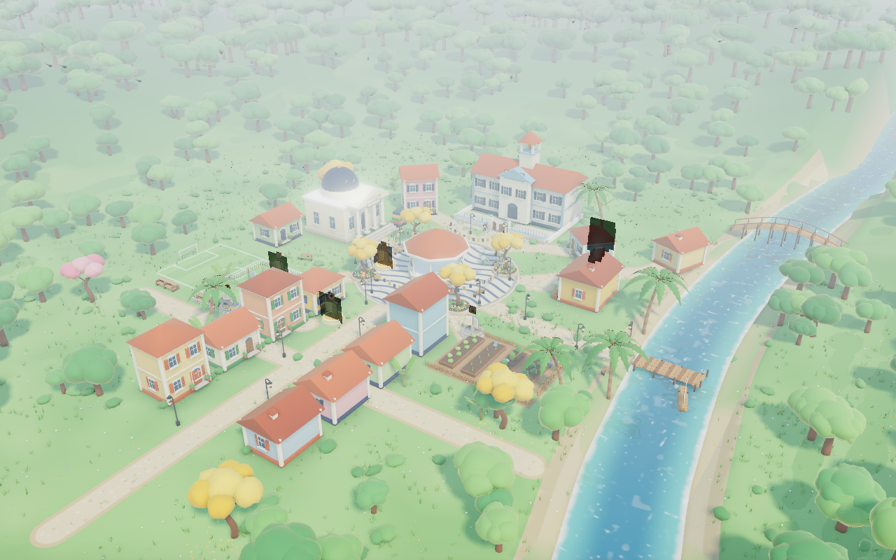

# FONEMA · Mundo 3D v2: a Vila das Letras explorável

> **O que é:** um cenário 3D de verdade, como uma maquete feita no Blender, mas montado por código: dá para girar 360°, chegar perto, afastar, voar para cima e para os lados, passear com a câmera de cinema e tocar nas coisas. O estilo é de filme de animação: formas arredondadas, cores quentes, luz suave, sombras macias, oclusão de ambiente, brilho leve e névoa.
> **Duas cenas:** a **Vila das Letras / Quintal (R0)**, bem detalhada, e o **Arquipélago** das regiões R0–R10, com voo de câmera de uma para a outra.
> **Para o app:** `criarMundo(container, {…})` (módulo ES) ou `<iframe>` com `postMessage`. O mundo dispara `fonema:missao` com o id da fase.
> **Não é** o jogo final: a geometria é procedural (primitivas arredondadas), não modelada por artista. Ver "Limites" e "Próximos passos".



## 1. Como abrir

Módulos ES não abrem em `file://`. Sirva a pasta com qualquer servidor estático:

```bash
cd docs/propostas/06-fonema-unificada/mundo-3d-v2
python3 -m http.server 8940
# abra http://localhost:8940/              (mundo com HUD)
# abra http://localhost:8940/exemplo-embed.html  (app de exemplo: iframe + postMessage)
```

Tudo é local, sem CDN e sem `npm`: `vendor/` (Three.js r187, licença MIT em `vendor/LICENSE-three.txt`), `fonts/` (Andika e Fredoka, OFL), `assets/` (recortes dos personagens) e `js/`.

### Parâmetros de URL (index.html)
| Parâmetro | Valores | Para quê |
|---|---|---|
| `cena` | `vila` (padrão) · `arquipelago` | cena inicial |
| `fase` / `feitas` / `regiao` | `R0-F03` · `R0-F01,R0-F02` · `R0` | progresso: portal atual brilha, feitos com estrela, os demais trancados |
| `q` | `auto` (padrão) · `alto` · `medio` · `baixo` | qualidade |
| `hora` | `0` (dia) … `1` (entardecer) | luz inicial |
| `vista` | `aerea`, `praca`, `escola`, `rio`, `campinho`, `entardecer`, `rua`, `horta`, `arquipelago`, `voo` | enquadramento inicial |
| `tilt` | `1` | efeito "miniatura" (tilt-shift) nas vistas altas |
| `hud` | `0` | sem botões (só o mundo) |
| `origem` | URL do app | restringe o `postMessage` para essa origem (padrão `*`) |
| `captura` | `1` | sem laço de animação (quadros determinísticos para capturas/vídeo) |

## 2. Controles (pensados para criança de 4–8 anos)

| Ação | Toque (tablet) | Mouse / teclado | Botão grande no HUD |
|---|---|---|---|
| Girar 360° | arrastar 1 dedo | arrastar | ↺ ↻ |
| Chegar perto / afastar | pinça | roda | 🔍 / 🔭 |
| Deslizar (pan) | 2 dedos | botão direito, setas, **W A S D** | ⬅️ ➡️ 🚶 |
| Voar para cima / descer | — | **Q / E** (ou PageUp/PageDown) | ⬆️ ⬇️ |
| Voltar para a praça | — | — | **🏠 Voltar para a praça** |
| Ir para um lugar | tocar no prédio ou no mini-mapa | clicar | **🧭 Ir para…** (11 lugares, ícone + nome) |
| Passeio guiado | — | — | **🎬 Passeio** (qualquer toque interrompe) |
| Missão | tocar no livro brilhante | clicar | cartão com **▶️ Vamos!** |
| Ilhas ⇄ Vila | tocar na ilha do Quintal | clicar | **🗺️ Ilhas** / **🏡 Vila** |
| Dia ⇄ entardecer | — | — | ☀️ / 🌇 (transição de 2,5 s) |
| Esconder HUD | — | **H** | — |

Regras de câmera: os movimentos são amortecidos (sem tranco), os voos duram 1–3 s em arco suave (≤ 45°/s, sem tremor nem flash, seguindo `jogo-completo/05-imersao-e-ritmo.md`), a câmera nunca entra no chão e não sai da área do mapa. Botões têm 76 px (62 px em telas pequenas), ícone primeiro e rótulo curto.

## 3. O que tem em cada cena

### Cena 1 · Vila das Letras / Quintal da Sofia (R0)
- **Praça do coreto:** coreto octogonal com colunas brancas, guarda-corpo marinho e cobertura em sino (torno), calçada em **pedra portuguesa** em ondas (creme + azul acinzentado), 4 canteiros redondos com flores, 4 **ipês-amarelos** com flores caídas, 8 postes coloniais com lanterna, bancos de ripa e os **varais de livros** (livrinhos marinho e amarelo, nada de bandeirinhas, D012).
- **Escola:** sobrado branco e azul-claro com torre do sino, frontão, venezianas marinho, placa **ESCOLA**, muro com gradil e o **portão de madeira** de duas folhas entreaberto. A Sofia espera no portão.
- **Biblioteca** (pórtico de colunas, cúpula marinho, placa **LIVRO**, pilha de livros gigantes), **padaria** (toldo creme/terracota, cestos de pão, placa **PÃO**, fumaça na chaminé) e **12 casas coloniais** térreas e sobrados, cada uma com **uma cor de parede + detalhe + telha** (paleta da marca, D009).
- **Casa da Sofia** com quintal: varal, cerquinha, **casinha do Paçoca** (o cachorro caramelo está lá).
- **Horta** com alface, cenoura, tomate e couve em canteiros de madeira, regador e placa **HORTA**. **Campinho** com gols, rede, bola e arquibancada (o Tales está lá). **Rio** com reflexo real, correnteza e espuma nas margens; **cais** e **barquinho** de madeira com vela branca e marinho; **ponte** em arco.
- **Mata atlântica** nas colinas (até 1.700 árvores instanciadas), coqueiros, bananeiras, arbustos, capim que balança com o vento, flores silvestres, pássaros e borboletas animados, nuvens fofas. **Entardecer** opcional: janelas e lanternas acendem, sol baixo atrás da escola.
- **Personagens:** a dupla Sofia e Tales e a Sofia sozinha são **recortes das artes 3D oficiais** (`personagens-3d/dupla-opcao-1.png` e `01-folha-modelo.png`, D007) em planos que sempre encaram a câmera, com **sombra real recortada**, sombra de contato e respiração leve. O **Bolota** (tatu-bola, paleta da folha-modelo) e o **Zum-Zum** (besouro barulhento, D019; verde-azulado + amarelo) são modelados em 3D. O Zum-Zum voa em volta do coreto, com asas zunindo.
- **6 portais de missão** (livro aberto que brilha, anel dourado, faíscas e o símbolo da fase), um para cada fase de R0 (`jogo-completo/02-regioes-R0-R2.md`): F01 porta da casa da Sofia, F02 varal do quintal, F03 praça, F04 horta, F05 casinha do Paçoca, F06 coreto. Estados: **atual** (brilha e pulsa), **feita** (verde-dourado), **trancada** (cinza com cadeado; respeita "uma fase por vez", D021).

### Cena 2 · Arquipélago (R0–R10)
11 ilhas-bioma em miniatura, arredondadas, num mar com faixa rasa turquesa e anéis de espuma: **Quintal** (mini-vila com coreto e ipês), **Ilha das Vogais** (farol branco e marinho com facho girando, coqueiros, 5 blocos A E I O U), **Mata Atlântica** (montanha, cachoeira animada e lago), **Pampa** (ovelhas, cerca, catavento), **Pantanal** (lagoas, palafita, tuiuiús), **Cerrado** (ipês amarelo e rosa, cupinzeiros), **Caatinga** (mandacarus, pedras, casinha de taipa), **Amazônia** (floresta densa e rio), **Litoral** (coqueiros, guarda-sóis, jangada), **Cidade das Letras** (prédios arredondados com letras) e **Arquipélago dos Livros** (pilhas de livros gigantes). A região atual tem **anel dourado e facho de luz**; as concluídas têm bandeira; as **bloqueadas ficam sob névoa suave com cadeado**. Rotas de boias (douradas até a atual). Tocar no Quintal faz o **voo até a vila** (mergulho → véu claro → chegada pelo alto → praça).

## 4. API

### Módulo ES (dentro do app)
```js
import { criarMundo, temWebGL } from './mundo-3d-v2/js/mundo.js'; // precisa do importmap "three" → vendor/three.module.js

const mundo = await criarMundo(document.querySelector('#palco'), {
  cena: 'vila',                 // ou 'arquipelago'
  regiaoAtual: 'R0',            // ilha que brilha no arquipélago
  faseAtual: 'R0-F03',          // portal que brilha na vila
  fasesFeitas: ['R0-F01', 'R0-F02'],
  qualidade: 'auto',            // 'alto' | 'medio' | 'baixo'
  hora: 0,                      // 0 dia … 1 entardecer
  aoEntrarMissao: ({ id, nome, regiao }) => app.abrirFase(id),
});
mundo.irPara('escola');         // praca, escola, biblioteca, padaria, casa, rua, horta, campinho, cais, ponte, mirante
mundo.passeio(true);            // câmera cinematográfica pelos pontos de interesse
mundo.voar(+1); mundo.deslizar(-1, 0); mundo.orbitar(0.7); mundo.zoom(0.6); mundo.focar(x, z);
mundo.trocarCena('arquipelago'); mundo.trocarCena('vila');   // da ilha para a vila = voo animado
mundo.abrirPortalPorId('R0-F03'); mundo.entrarMissao('R0-F03');
mundo.definirHora(1); mundo.cicloDoDia(true); mundo.tiltShift(true); mundo.definirQualidade('medio');
mundo.estado(); mundo.miniMapa(); mundo.stats(); mundo.destruir();
```
Se `temWebGL()` for falso, `criarMundo` lança um erro com `semWebGL: true`; o `index.html` mostra uma imagem do mundo e os botões das missões (o evento continua saindo).

### Eventos (no container **e** na `window`)
| Evento | `detail` | Quando |
|---|---|---|
| `fonema:pronto` | `{ cena, qualidade }` | o mundo terminou de montar |
| `fonema:lugar` | `{ id, nome, icone }` | a câmera chegou perto de um lugar (HUD mostra o nome) |
| `fonema:portal` | `{ id, nome, estado, regiao }` | a criança tocou num portal (abrir o cartão) |
| **`fonema:missao`** | `{ id: 'R0-F03', nome, regiao: 'R0', estado }` | a criança confirmou a missão → **o app abre a fase** |
| `fonema:bloqueada` | `{ id, … }` | tentou entrar numa fase trancada |
| `fonema:regiao` | `{ id, nome, estado }` | tocou numa ilha do arquipélago |
| `fonema:cena`, `fonema:passeio`, `fonema:qualidade` | — | mudanças de estado |

### `<iframe>` + `postMessage`
O `index.html` repassa todos os eventos acima para o `parent` como `{ tipo: 'fonema:missao', detalhe: {…} }` e aceita comandos `{ tipo: 'fonema:comando', acao, args }`, com `acao` ∈ `irPara`, `passeio`, `voar`, `trocarCena`, `definirHora`, `entrarMissao`, `abrirPortal`, `hud`. Exemplo completo em **`exemplo-embed.html`**. Em produção, passe `?origem=https://app.fonema…` para não usar `*`.

## 5. Qualidade automática e desempenho

| Nível | Quando (`auto`) | Pixel ratio | Sombra | Pós | Reflexo do rio | Árvores | Capim |
|---|---|---|---|---|---|---|---|
| **alto** | desktop, > 4 GB, > 4 núcleos | ≤ 2 | 2048, suave | GTAO + bloom + gradação (+ tilt-shift opcional), MSAA 4× | 1024 px | 1.700 | sim |
| **médio** | tablet/celular, ≤ 4 GB | ≤ 1,5 | 1024 | bloom + gradação, MSAA 2× | 512 px | 1.100 | sim |
| **baixo** | ≤ 2 GB ou ≤ 2 núcleos | 1 | sem (sombras de contato pintadas) | nenhum (antialias nativo) | sem (água estilizada) | 500 | não |

- Além da escolha inicial, um **medidor ao vivo** desce um degrau se o quadro passar de 45 ms por 3 s seguidos.
- **Instancing:** árvores (troncos + 3 formatos de copa + LOD de 1 bolha para as distantes), flores, arbustos, capim, pétalas e boias são `InstancedMesh` (uma draw call por tipo). Os prédios e o mobiliário viram **uma malha por material** (`Lote`, cor por vértice, normais suaves).
- **Medido** (`mundo.stats()`, um render sem pós, conta sombra e reflexo): vila no alto ≈ **3,1 M triângulos e 50–300 draw calls** conforme o ângulo (≈ 1,9 M de geometria na cena; o resto é passe de sombra e reflexo); arquipélago ≈ 0,78 M e ~140 draws.
- Sem WebGL: imagem estática + botões das missões.

> ⚠️ FPS em tablet real **não foi medido** aqui: as capturas usam WebGL por software (SwiftShader). Próximo passo: rodar `?q=medio` num tablet Android de 3–4 GB e ajustar o número de árvores/sombra do nível médio.

## 6. Capturas e vídeo

Geradas com Playwright + Chromium (SwiftShader), 1280×800 com `deviceScaleFactor: 2` (2560×1600):

| Arquivo | Ângulo |
|---|---|
| `capturas/01-vila-aerea.png` | vista aérea da vila inteira, rio, ponte e mata |
| `capturas/02-praca-nivel-dos-olhos.png` | praça ao nível dos olhos: dupla, Bolota, Zum-Zum, coreto e varais de livros |
| `capturas/03-escola-portao.png` | escola com o portão de madeira e a Sofia |
| `capturas/04-rio-e-cais.png` | rio com reflexo, cais, barquinho e ponte |
| `capturas/05-campinho.png` | campinho, quintal da Sofia, casinha do Paçoca e portais |
| `capturas/06-entardecer.png` | entardecer: janelas e lanternas acesas, sol atrás da escola |
| `capturas/07-arquipelago.png` | arquipélago R0–R10: atual brilhando, bloqueadas na névoa |
| `capturas/08-voo-arquipelago-vila.png` | meio do voo, chegando na ilha do Quintal |
| `capturas/09-rua-das-casas.png` | rua das casas coloniais coloridas |
| `capturas/10-horta.png` | horta e portal R0-F04 |
| `capturas/11-vila-com-hud.png` | HUD completo (lugar, botões, mini-mapa, navegação) |
| `capturas/12-tilt-shift.png` | vista aérea com efeito miniatura |
| **`capturas/passeio-guiado.mp4`** | 23 s, 1280×720: arquipélago → mergulho → vila → passeio guiado |

Para regenerar (cada uma sobe seu próprio servidor):
```bash
node ferramentas/capturar.js              # todas (ou: node ferramentas/capturar.js 02,06 --dpr=1)
node ferramentas/video.js 15 medio        # quadros determinísticos → ffmpeg (interpola para 30 fps)
python3 ferramentas/recortar.py           # refaz os recortes dos personagens
```

## 7. Arquivos

| Arquivo | Papel |
|---|---|
| `index.html` | HUD da criança, carregamento, mini-mapa, cartão de missão, ponte `postMessage`, fallback sem WebGL |
| `exemplo-embed.html` | app de exemplo que embute o mundo por iframe e troca mensagens |
| `js/mundo.js` | **API `criarMundo`**: renderizador, câmera e controles, voos, passeio, toque, qualidade, pós-processamento, eventos |
| `js/vila.js` | Cena 1: relevo, chão pintado (caminhos, pedra portuguesa, campinho), rio, prédios, natureza, personagens, portais e pontos de interesse |
| `js/arquipelago.js` | Cena 2: ilhas-bioma, mar, rotas, névoa/cadeado, anel e facho da região atual |
| `js/predios.js` | escola, biblioteca, padaria, casas coloniais, coreto, postes, bancos, cercas |
| `js/natureza.js` | árvores instanciadas com LOD, ipê, coqueiro, bananeira, pássaros e borboletas |
| `js/personagens.js` | sprites 3D recortados, Bolota, Zum-Zum, rótulos e portais de missão |
| `js/ceu.js` · `js/agua.js` | céu em degradê com sol, luz/IBL, nuvens, dia/entardecer · rio com reflexo e mar com espuma |
| `js/kit.js` | `Lote` (junta peças numa malha), caixas arredondadas, bolhas orgânicas, vento, luz de borda, placas |
| `ferramentas/` | `capturar.js`, `video.js`, `recortar.py` |

## 8. Decisões de arte

1. **"Maquete de animação":** nada de faceta low-poly. Caixas com cantos arredondados, bolhas com ruído suave para copas, arbustos e nuvens, cobertura do coreto feita no torno, normais suaves e **luz de borda quente** (rim) em tudo, como nos filmes.
2. **Luz:** sol quente com sombra suave e seguindo a câmera (sombra nítida perto), céu em degradê com halo do sol, **ambiente (IBL) gerado do próprio céu**, névoa atmosférica em degradê, **GTAO** (oclusão de ambiente) no alto, bloom só no que brilha (lanternas, portais, janelas no entardecer) e gradação levemente quente com vinheta.
3. **Paleta da marca, 2–3 cores por objeto (D009):** paredes em amarelo-ipê, azul-claro, terracota-claro, verde-claro, creme e rosa suave; detalhes marinho, branco ou verde-mata; telha e madeira naturais. Toldo e farol em **duas** cores; livros marinho/amarelo. Nada de sequência arco-íris.
4. **Valores (D012):** varais de **livros** (não bandeirinhas), feira de leitura implícita, horta comunitária, esporte e convivência. Nada de festa junina, magia ou mitos.
5. **Leitura no mundo:** placas decodificáveis em Andika 700 (ESCOLA, LIVRO, PÃO, HORTA) com ícone concreto ao lado.
6. **Personagens = artes oficiais:** recortes das imagens 3D aprovadas (D007), sem inventar outro visual. Bolota e Zum-Zum seguem as paletas das folhas-modelo e da D019 (vilão leve, fofo, sem medo).

## 9. Limites honestos
- A geometria é **procedural**: bonita de longe e de perto, mas não tem a riqueza de um modelo de artista (texturas pintadas, imperfeições, detalhes de telha).
- Sofia e Tales são **planos recortados** (billboards): giram para encarar a câmera e não têm animação de corpo. Do alto, a sombra deles muda com o ângulo da câmera. O Tales sozinho foi recortado da arte em dupla, e há um resto mínimo do cabelo da Sofia no ombro dele.
- O reflexo do rio custa um segundo render da cena (desligado no nível baixo).
- Sem áudio nesta versão (o `mundo-3d` v1 tem áudio espacial sintetizado, fácil de portar).
- FPS em aparelho real não medido (ver seção 5).

## 10. Próximos passos
1. **Modelos glTF feitos no Blender por artista** substituindo a geometria procedural, prédio a prédio, mantendo as mesmas posições e a mesma API: `vila.js` já separa cada prédio numa função (`escola()`, `biblioteca()`, `casa()`…), basta trocar o conteúdo por `GLTFLoader` + `KTX2Loader` + `MeshoptDecoder`, com AO e luz de entardecer "assados" no Blender. Pipeline: Blender → glTF → `gltf-transform` (alto/médio/baixo, Meshopt + KTX2) → CDN.
2. **Personagens rigados:** Sofia, Tales e Bolota em glTF com esqueleto (Mixamo/Blender) e clipes `idle`, `acenar`, `andar`, `comemorar`, `apontar`; o Bolota com "virar bola". Rosto com blendshapes de visema ligados ao Espelho do Som (D020).
3. **Ligar ao app (`app/web`):** a tela `Mundo` monta `criarMundo()` (ou o iframe), passa o progresso real (`faseAtual`, `fasesFeitas`, `regiaoAtual`) e abre a lição no `fonema:missao`.
4. **Áudio** (portar `audio.js` do v1: passarinhos, rio, sino da escola, zunido do Zum-Zum; voz da dupla sempre no centro).
5. **Medição em 3 tablets-alvo** e ajuste dos níveis; impostores para a mata distante.
6. **Mais vida:** moradores andando (Dona Cida, Davi), a Nina na biblioteca, eventos da semana (feira de leitura, mutirão) mudando a praça.
