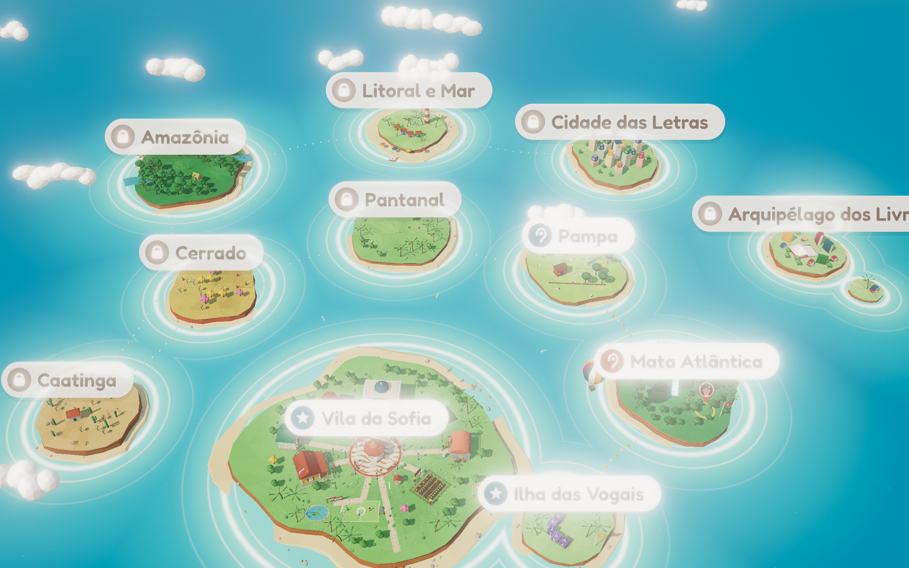

# FONEMA · Mundo 3D: arquipélago e vila navegáveis

> **O que é:** protótipo de **direção de arte** em Three.js (r187). Ele junta o mapa 3D da Proposta 2 (Arquipélago) com a "pintura" quente da Proposta 1 (Quintal Brasil) e deixa **entrar na vila** com zoom, vários ângulos, dia/entardecer/noite, partículas, vento e som espacial.
> **O que não é:** o jogo final. Não tem lições, salvamento nem backend. Ver "Limites honestos" no fim.



## 1. Como abrir

Importmap e módulos ES **não funcionam em `file://`**. Sirva a pasta com qualquer servidor estático:

```bash
cd docs/propostas/06-fonema-unificada/mundo-3d
python3 -m http.server 8931
# abra http://localhost:8931/
```

Tudo é local, sem CDN: `vendor/` (Three.js r187, OrbitControls e os passes de pós-processamento), `fonts/` (Andika e Fredoka, OFL) e `js/`. O mapa de importação é `"three" → ./vendor/three.module.js` e `"three/addons/" → ./vendor/`.

| Arquivo | Papel |
|---|---|
| `index.html` | Canvas, HUD da criança, painel de direção de arte (adulto), importmap |
| `js/main.js` | Renderizador, câmera/voos, dia-entardecer-noite, níveis de qualidade, pós-processamento, partículas, API de captura |
| `js/vila.js` | A vila (ilha inicial): 7 prédios, praça das emoções, coreto, horta, campinho, laguinho, cais, ponte etc. |
| `js/world.js` | Céu, mar estilizado (shader), as outras 10 ilhas-bioma, rotas, nuvens, barcos, balão, pássaros |
| `js/nature.js` | Terreno de ilha, árvores (ipê, mangueira, bananeira, coqueiro, araucária, mandacaru…), pessoas e bichos |
| `js/art.js` | "Pintura" em canvas: letreiros, rótulos, calçada portuguesa, placas de emoção, Sofia e Bolota (SVG → textura) |
| `js/audio.js` | Áudio espacial sintetizado (Web Audio `PannerNode`) |
| `js/util.js` | `Merger` (junta peças numa malha), geometrias base, aleatório determinístico |
| `ferramentas/capturar.js`, `ferramentas/video.js` | Geração das capturas e do vídeo (Playwright + ffmpeg) |

### Parâmetros de URL
`?view=arquipelago|voo|vila|vila34|praca|biblioteca|entardecer|noite|mata|pampa|…` · `&tod=0|1|2` (dia, entardecer, noite) · `&q=alto|medio|leve` · `&hud=0|1` · `&painel=0` (esconde o painel adulto) · `&capture=1&t=3` (quadro parado e determinístico).

## 2. Controles

| Ação | Mouse / teclado | Toque |
|---|---|---|
| Girar | arrastar | 1 dedo |
| Zoom | roda | pinça |
| Deslocar | botão direito / setas | 2 dedos |
| Voar até uma ilha | clicar na ilha (vibra 20 ms onde houver suporte) | tocar na ilha |
| Ângulos prontos | teclas **1–8** (arquipélago, voo, vila, 3/4, praça, biblioteca, entardecer, noite) | botões **Ilhas · Vila · Praça · Livros** |
| Ligar/desligar HUD | **H** ou botão "HUD" | botão "HUD" |
| Celebração (confete) | **C** ou "Celebrar" | "Celebrar" |

Os voos duram de 1,2 a 2,6 s, sobem em arco e terminam com amortecimento. O OrbitControls volta a funcionar ao fim do voo. O zoom vai de 7 a 560 unidades, e a câmera não desce abaixo do mar.

O **painel de direção de arte** (topo, para o adulto/equipe) troca a hora do dia (**Dia · Entardecer · Noite**, com transição suave), o nível de qualidade (**Alto · Médio · Leve**), liga o **Som 3D** (precisa de um toque, regra dos navegadores), dispara a **Celebração** e mostra FPS, draw calls e triângulos ao vivo.

## 3. O que cada ângulo mostra

| Arquivo | Ângulo | O que mostra |
|---|---|---|
| `01-arquipelago-aereo.png` | Aéreo alto | As 11 ilhas-bioma, a ponte Vila→Vogais, as boias douradas das rotas liberadas, as rotas pontilhadas das bloqueadas, os rótulos (estrela = feita, orelha = ouvir o nome, cadeado = bloqueada), o pino da Sofia na ilha atual (Mata Atlântica), o balão e as nuvens |
| `02-voo-para-ilha.png` | Meio do voo | A aproximação da Mata Atlântica, com montanha, cachoeira, lago, bromélias, anel "você está aqui", bandeira de progresso, balão e a rota de boias |
| `03-vila-panoramica.png` | Panorâmica | A vila inteira: biblioteca com cúpula, escola com sino, padaria, casa da Sofia, banco com porquinho, oficina de robôs, horta, poço, campinho, laguinho, cais e ponte |
| `04-vila-angulo-3-4.png` | 3/4 baixo | Leitura de volumes, telhados, caminhos de pedra, coqueiros, ipês, e o arquipélago ao fundo |
| `05-vila-zoom-praca.png` | Close na praça | Coreto, calçada em ondas, varais de livros da feira de leitura, placas da **Praça das Emoções** (alegria, calma, tristeza, medo, raiva), **Sofia e Bolota** como ilustrações 2D, com profundidade de campo |
| `06-vila-zoom-biblioteca.png` | Close na biblioteca | Letreiro **LIVRO** legível (Andika + ícone), pórtico com colunas e frontão, friso de lombadas coloridas, vasos floridos e a pilha de livros gigantes; o cantinho de leitura aparece no vídeo |
| `07-vila-entardecer.png` | Entardecer | Sol baixo e quente, sombras longas, janelas e postes acesos, vaga-lumes começando, céu rosa e laranja |
| `08-arquipelago-com-hud.png` | Aéreo + HUD | Casa, termômetro da leitura (sem números), moedinhas, botão grande de jogar, navegação por ícones e a fala da Sofia |
| `09-vila-noite.png` (extra) | Noite | Estrelas, postes com brilho (bloom), janelas, vaga-lumes, luz quente na praça |

**Vídeo** `voo-arquipelago-vila.mp4` (26 s, 1280×720, H.264, 30 fps): sobrevoo do arquipélago → aproximação → entrada na vila → giro pela praça (com celebração de confete) → zoom no letreiro LIVRO da biblioteca. Cada quadro é renderizado com o **tempo controlado por parâmetro** (`FONEMA.videoAt(t)`), então o vídeo é 100% reprodutível.

Para regenerar (com o servidor no ar): `node ferramentas/capturar.js` e `node ferramentas/video.js`.

## 4. Decisões de arte

1. **"Pintura" sobre o 3D.** O low-poly é facetado (sombreamento plano), mas cada face recebe uma variação de ±5% de tom e um gradiente que escurece a base. É o "pincel" do Quintal Brasil aplicado ao 3D, sem texturas pesadas.
2. **Paleta do guia de estilo da Proposta 1:** tinta `#3B2A20`, papel `#FFFBF4`, terracota `#A9472A`, sol `#F2B33D`, mar `#1F6E82`, ipê `#B23C62`, lilás `#6B5BA8` (vogais). Sem preto puro e sem vermelho de erro.
3. **Luz suave e quente.** Céu em gradiente com brilho do sol. Hemisférica azul-céu/areia mais um sol morno com sombras suaves (PCF). Tone mapping ACES. No pós: gradação quente, saturação +16%, vinheta marrom e um grão de papel estático (2,5%).
4. **Brasil reconhecível, sem clichê:** coreto com varais de livros da feira de leitura (Decisão 012), calçada portuguesa em ondas, ipês rosa e amarelo, mangueira, bananeira, rede na varanda, vira-lata caramelo, mandacaru, araucária, tuiuiú, capivara, palafita, farol, jangada.
5. **Sofia e Bolota em 2D ilustrado.** A pesquisa indica que agente 2D ensina melhor (Decisão 005). Por isso eles são **billboards** desenhados em SVG, com contorno branco de "adesivo" e sombra de contato, e recebem a cor da hora do dia. No produto, o SVG vira o canvas do **Rive** (lip-sync e emoções).
6. **Letreiros decodificáveis:** PÃO, LIVRO, BOLA, CASA, SAPO, ESCOLA, HORTA, ROBÔ, BANCO. Andika 700 (a e g de um andar), ícone concreto ao lado e placa clara. Ficam legíveis no close e um pouco iluminados à noite.
7. **HUD sem números para a criança:** o termômetro só enche. As moedinhas têm número porque contam coisas concretas. Os botões têm de 92 a 112 px, ícone primeiro e rótulo curto só de apoio.
8. **Progresso visível no mundo:** bandeira amarela nas ilhas feitas, bandeira ipê na ilha atual, boias douradas nas rotas liberadas e pontos brancos nas bloqueadas. A ponte de madeira liga a vila à Ilha das Vogais.

## 5. "4D/5D": tempo, movimento e sentidos (do radar de tecnologia)

| Recurso | Como foi feito | Alto | Médio | Leve |
|---|---|---|---|---|
| Ciclo **dia / entardecer / noite** | Um relógio só (`tod` 0→2) interpola céu, sol, hemisférica, névoa, mar, janelas, postes, estrelas, lua, vaga-lumes e a cor dos personagens | ✔ | ✔ | ✔ (sem sombra) |
| **Água estilizada** | Shader próprio: ondas por vértice, facetas por derivadas, faixa rasa turquesa e **espuma por distância à ilha**, anéis que se afastam, brilho especular e cintilas | ✔ | ✔ | ✔ |
| **Vento** | `onBeforeCompile` em copas, flores e varais de livros, com balanço proporcional à altura | ✔ | ✔ | ✔ (sem flores) |
| **Partículas** | Pontos com shader e tempo determinístico: pétalas de ipê (dia), vaga-lumes (noite), fumaça da padaria, brilho dos postes, **confete de celebração** | 220 pétalas, 90 vaga-lumes, 500 confetes | 110 / 50 / 220 | 40 / 20 / 90 |
| **Pós-processamento** | `RenderPass` → **GTAO** (AO em meia resolução) → **Bokeh** (DOF só nos closes, foco no alvo) → **Bloom** suave (limiar 1,0, só o que emite luz) → gradação/vinheta/grão → `OutputPass` (ACES + sRGB) | completo | só bloom (meia-res) + gradação | nenhum (vinheta em CSS) |
| Sombras | Sol com sombra PCF; o frustum acompanha a câmera | 2048 (4096 nas capturas) | 1024 | sem sombra dinâmica; sombras-bolha nos personagens |
| **Áudio espacial** | Web Audio `PannerNode`: mar (4 pontos da praia), passarinhos nas árvores, sino da escola, caixinha de música no coreto. Tudo sintetizado, sem arquivos. A orientação do ouvinte segue a câmera | HRTF, até 16 fontes | equalpower, 8 | equalpower, 4 (sem música) |
| **Háptico** | `navigator.vibrate`: 20 ms ao escolher ilha; padrão longo na celebração | ✔ | ✔ | ✔ |

A **voz da Sofia nunca é espacializada**: no produto, ela fica no centro e clara, por regra do radar. O nível inicial vem de `navigator.deviceMemory` e `hardwareConcurrency` (`autoQuality()`). No produto, entram o `detect-gpu` e o medidor de FPS ao vivo, que desce um degrau se o quadro passar de 40 ms por 3 s (radar, seção 6.2).

## 6. Orçamento de desempenho (medido no protótipo)

Medição com `FONEMA.stats()` (um render sem pós; os triângulos **incluem o passe de sombra** quando ele existe) a 1280×800:

| Nível · vista | Draw calls | Triângulos | Pontos | Texturas |
|---|---|---|---|---|
| Alto · arquipélago | 126 | 330 mil | 1,7 mil | 69 |
| Alto · vila | 60 | 324 mil | 1,7 mil | 40 |
| Médio · vila | 60 | 324 mil | 1,3 mil | 34 |
| Leve · vila (copas só da ilha atual) | **42** | **79 mil** | 1,1 mil | 19 |
| Leve · arquipélago | 89 | 137 mil | 1,1 mil | 48 |

**Geometria:** a vila tem cerca de 68 mil triângulos em 4 malhas: base, copas com vento, detalhes (flores, pedras, tufos) e janelas emissivas. As outras ilhas somam cerca de 94 mil, e o mar 39 mil. O truque é o **`Merger`**: centenas de peças viram **uma malha por camada**, com cor por vértice. Por isso a vila inteira custa poucas dezenas de draw calls, e o resto vem de letreiros, placas, sprites e partículas.

**Texturas** (todas geradas em canvas, sem download): 9 letreiros de 512×220, 17 blocos de letra de 256², 5 placas de emoção de 256², 11 rótulos de cerca de 700×128, a calçada de 1024², a Sofia (~600×1030), a Bolota e o pino. São **≈ 30 MB de GPU com mipmaps**. Somam-se o mapa de sombra (16 MB a 2048²) e os alvos de pós-processamento (proporcionais à tela; no Alto em DPR 2, de 100 a 150 MB). No Leve, sem sombra e sem pós, o total fica perto de **35 MB**, abaixo do teto de 48 MB do radar.

**Meta: 30 fps em Android de 2 GB (nível Leve).** O que o Leve faz: DPR 1, sem sombras dinâmicas, sem pós, sem camada de detalhe (flores, pedras, tufos), sem luzes pontuais, 7 nuvens, partículas reduzidas mar com malha de 64×64 e, quando a câmera está na vila, **só a ilha atual mantém as copas** (as outras ficam só com terreno e prédios). Na vila, o Leve cabe no orçamento do radar (≤ 80 mil triângulos: medimos 79 mil ✔; ≤ 60 draw calls: 42 ✔). **Na vista aérea do Leve ainda passamos** (137 mil triângulos e 89 draws). Para produção: LOD/impostores para ilhas distantes (copas `ico1` → `ico0` corta 4×), atlas para rótulos e letras (17 + 11 draws → 2) e instancing.

> ⚠️ Os números de FPS em aparelho **não foram medidos**: as capturas foram feitas com WebGL por software (SwiftShader), onde o FPS não representa celular. O próximo passo é rodar o painel (que mostra FPS e draws ao vivo) num Moto E/Galaxy A0x de 2 GB.

## 7. Do protótipo à produção (recomendação)

**Recomendação: react-three-fiber (Three.js) dentro do app Expo, via DOM component/WebView na fase 1, com migração para react-native-webgpu na fase 2.** Unity fica como plano B.

Por quê:
- **Continuidade:** este protótipo já é Three.js. Cenas, shaders (mar, vento, céu), `Merger`, voos e API de tempo passam quase direto para componentes r3f (`<Canvas>`, `drei/CameraControls`, `PerformanceMonitor`, `Detailed`/LOD). O radar de tecnologia aponta o mesmo caminho.
- **Mesma base para web, app e escola:** painel do professor, Next.js e app compartilham código. O nível 2,5D (Pixi/Canvas) cobre aparelhos sem WebGL.
- **Peso:** um runtime Unity WebGL/Android adiciona dezenas de MB e memória base alta, o que é ruim para 2 GB e para download em rede escolar. Three.js mais assets glTF comprimidos (Meshopt + KTX2) cabem em 3 MB por ilha no Leve.
- **Personagens 2D:** Rive e dotLottie integram melhor no ecossistema web/React Native.
- **Quando Unity faria sentido:** se o mundo virar um jogo 3D pesado (física extensa, muitas animações esqueléticas, editor de níveis para artistas não programadores). Hoje não é o caso, e o 3D é cenário, não lição.

Pipeline de assets: o prédio de Blender substitui as peças procedurais, com bake de AO e de luz dia/noite → glTF → glTF-Transform (alto, médio e leve) → CDN. As texturas de canvas viram **atlas KTX2**, e as cores por vértice continuam (são baratas).

Passos sugeridos:
1. Portar cena e shaders para r3f e medir em 3 aparelhos-alvo.
2. Trocar o procedural por glTF de artista, mantendo a paleta e o `Merger` como "instancing/batching".
3. Plugar o Rive na Sofia.
4. Ligar o progresso real: as ilhas liberam pelo currículo, e a vila cresce com a leitura, com itens da lojinha que têm propósito.

## 8. Limites honestos

- É **protótipo de direção de arte**. A geometria é procedural (primitivas), não modelada por artista. A Sofia e a Bolota são ilustrações estáticas, sem Rive nem lip-sync.
- Sem lição, sem salvamento, sem acessibilidade completa no canvas: falta leitor de tela para o mundo 3D, e a navegação por teclado é básica. A "fala da Sofia" no HUD é texto de exemplo.
- O áudio é **sintetizado** (placeholder de design sonoro). A voz humana gravada não está incluída.
- As sombras dos objetos com vento não balançam junto (o material de profundidade não recebe o vento). A diferença é imperceptível na distância de jogo.
- Os rótulos e letras usam uma textura por item (fácil de ler, caro em draws). Em produção, vão para atlas.
- A vista aérea no nível Leve ainda passa do orçamento (seção 6). A qualidade é escolhida por heurística simples, e o FPS em aparelho real **ainda não foi medido**.
- As capturas e o vídeo foram renderizados em Chromium headless com WebGL por software, então o resultado visual deve ser igual ao de uma GPU real. A ordem de sombras e transparências foi conferida quadro a quadro, mas pode haver pequenas diferenças de anti-aliasing.
