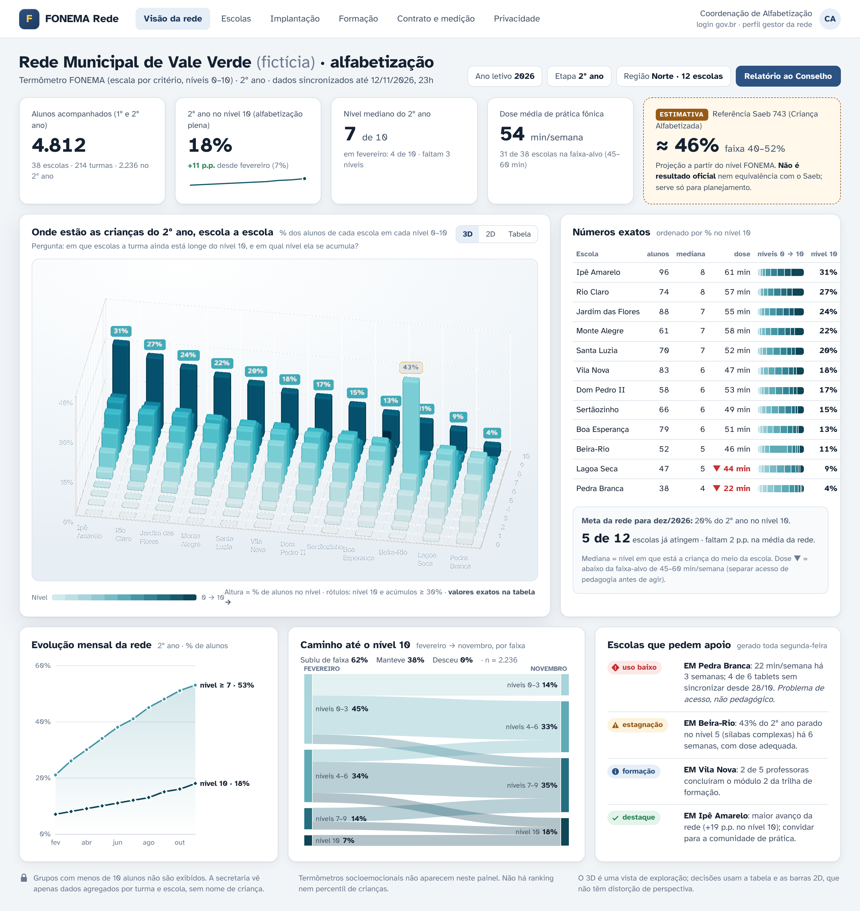

# Painéis premium do FONEMA (Proposta Unificada · frente "gráficos 3D")

Atende ao pedido do dono na Decisão 005: gráficos "mais bonitos, de fato 3D, mais elaborados e profissionais, sem perder o profissionalismo e a eficiência". A base é o painel institucional da Proposta 5 (`../../05-fonema-escola/`): fundo cinza-claro, cartões brancos, azul "lousa" e Atkinson Hyperlegible. Por cima dela entram uma **peça 3D principal** por painel e um **tema escuro**.

> Todos os dados são **fictícios** e coerentes entre os painéis. Exemplos: a EM Jardim das Flores tem 24% do 2º ano no nível 10 na secretaria e na escola; a turma 2º B tem as mesmas 24 crianças no painel da escola e no da professora; a Iris (2º B) está no nível 6 no painel da professora e no da família.

## Arquivos

| Painel | HTML interativo | Captura |
|---|---|---|
| Secretaria (rede) | `painel-secretaria.html` |  · [escuro](painel-secretaria-escuro.png) |
| Escola (direção) | `painel-escola.html` | [painel-escola.png](painel-escola.png) |
| Professora (turma) | `painel-professor.html` | [painel-professor.png](painel-professor.png) · [escuro](painel-professor-escuro.png) |
| Família (celular 390×844) | `painel-familia.html` | [painel-familia.png](painel-familia.png) |
| Criança (tablet, sem números) | `painel-crianca-progresso.html` | [painel-crianca-progresso.png](painel-crianca-progresso.png) |

Arquivos de apoio:
- `base.css`: tokens (claro/escuro), componentes e escala 0–10.
- `comum.js`: tema, tooltips, ícones de status e utilitários (`para100`, `mediana`).
- `dados-rede.js`: dados fictícios da rede.
- `vendor/`: ECharts 5, ECharts GL, three.js e as fontes Atkinson Hyperlegible e Andika (SIL OFL, licenças incluídas). Tudo é servido localmente, sem CDN.

**Como abrir:** rode `python3 -m http.server` dentro desta pasta e acesse `http://localhost:8000/painel-secretaria.html`. Para o tema escuro, acrescente `?tema=escuro`. Os gráficos 3D giram com o botão direito do mouse (o esquerdo só arrasta) e dão zoom com a roda. As capturas foram feitas no Playwright com Chromium headless (WebGL via SwiftShader), viewport de 1440×900 (família: 390×844; criança: 1280×800) e `deviceScaleFactor` 2.

## Regra de ouro: o 3D é a peça principal, o número exato fica ao lado
1. **Todo gráfico 3D tem um par 2D preciso visível na mesma tela**: a tabela "Números exatos" na secretaria, as barras 100% na escola e o mapa de calor 2D na professora. Decisões se tomam pelo 2D. O 3D serve para ter a visão do conjunto de uma vez e para apresentar ao Conselho.
2. **Projeção ortográfica** nas barras 3D (secretaria e escola). Ela elimina o encolhimento de perspectiva, e barras de mesma altura parecem iguais em qualquer ponto da cena. A perspectiva só aparece no terreno da professora, que é declaradamente uma vista exploratória (selo "EXPLORAÇÃO").
3. **Rótulos só onde importam**: o nível 10 (a meta) e acúmulos de 30% ou mais (sinal de estagnação, em caixa âmbar). Os demais valores aparecem no tooltip e na tabela.
4. **Ângulo de câmera fixo e escolhido**, com a meta no fundo e os níveis baixos à frente, para que barras altas não escondam rótulos. O usuário pode girar, mas o painel sempre abre na vista calibrada.
5. **Alternador "3D | 2D | Tabela"** em todo gráfico 3D. A tabela é a alternativa para leitores de tela.

## Catálogo de gráficos

| ID | Painel | Gráfico | Pergunta que responde | Dados | Cuidados de interpretação | 3D ou 2D |
|---|---|---|---|---|---|---|
| S1 | Secretaria | **Barras 3D escolas × níveis 0–10** (ECharts GL `bar3D`, sombra suave, chanfro, ortográfica) | Em que escolas a turma ainda está longe do 10 e onde ela se acumula? | % dos alunos de cada escola por nível; suprime n < 10 | Altura = % da escola, não nº de alunos (escolas de tamanhos diferentes). A cor repete o nível (redundância). Rótulos só no nível 10 e em acúmulos de 30% ou mais | **3D principal** + tabela S2 |
| S2 | Secretaria | Tabela "Números exatos" com mini-barra 100% | Quanto exatamente cada escola tem no nível 10? Qual a mediana e a dose? | n, mediana, dose (min/sem), distribuição, % nível 10 | Ordenada por % no nível 10 (escolas, nunca crianças). Dose abaixo de 45 tem ▼ e cor; separar acesso de pedagogia | 2D |
| S3 | Secretaria | KPIs + **referência Saeb 743 em caixa tracejada "ESTIMATIVA"** | Vamos chegar à meta? | % no nível 10, mediana, dose, projeção em faixa | A projeção **não é** resultado oficial nem equivalência com o Saeb/ICA (Decisão 004, rel. 20) | 2D |
| S4 | Secretaria | Evolução mensal (linha + área, rótulo direto no fim) | A rede está subindo mês a mês? | % no nível 10 e % no nível 7 ou mais, de fev a nov | Duas séries em tons do mesmo matiz e marcadores distintos (● e ◆), com rótulo direto | 2D |
| S5 | Secretaria | **Caminho até o nível 10** (Sankey fev → nov por faixas 0–3/4–6/7–9/10) + resumo "subiu / manteve / desceu" | As crianças estão mudando de faixa? | Migração entre faixas, em % dos alunos | Sankey é difícil para leigos: o resumo em texto vem acima e a tabela é a alternativa | 2D |
| S6 | Secretaria | Escolas que pedem apoio | Onde agir esta semana? | Regras (dose baixa, estagnação com dose adequada, formação, destaque) | Status sempre com **ícone + rótulo** (◆ uso baixo, ▲ estagnação, ● formação, ✓ destaque) | lista |
| E1 | Escola | Turmas por nível: barras 100% com rótulos | Que turmas estão longe do 10? | Distribuição 0–10 por turma, % no nível 10 | Rótulo só em segmentos de 9% ou mais; o % do nível 10 fica sempre à direita | 2D (preciso) |
| E2 | Escola | As mesmas turmas em relevo (bar3D ortográfico) | Qual o "degrau" entre 1º e 2º ano? | Igual a E1 | Vista de exploração para a reunião; os valores se leem em E1 | **3D** |
| E3 | Escola | **Antes e depois** (halteres fev ○ → nov ◆, com "+n") | Quanto cada turma avançou? | Nível mediano por turma em 2 momentos | Mediana é robusta, mas esconde a cauda; ver E1 | 2D |
| E4 | Escola | Dose de prática com faixa-alvo de 45–60 min | O programa está sendo aplicado? | min/semana (média de 4 semanas) | "Mais" não é melhor: a meta é uma faixa. Dose baixa em âmbar + ▼ | 2D |
| E5 | Escola | Fidelidade de implementação (matriz turma × 5 critérios) | O que falta para o programa rodar como previsto? | Dose, sessões até o fim, grupos aplicados, rotação, formação | Mede a aplicação do programa, **não avalia pessoas**; parcial vale meio ponto | 2D |
| P1 | Professora | **Quem precisa de mim hoje** (4 cartões com ação em 1 toque) | Por onde começo? | Sinais persistentes (2 semanas ou mais com dose adequada) | Não é diagnóstico; o motivo e a dose ficam sempre visíveis | cartões |
| P2 | Professora | Turma no termômetro (contagem por nível) | Como a turma se distribui? | Nº de alunos por nível | Contagem, não ranking; sem nomes | 2D |
| P3 | Professora | **Mapa de calor aluno × habilidade** (5 estados, ⚑ travado, hachura = voz incerta) | Quem está travado em quê? | Estado por habilidade (0 não iniciado … 4 automatizado) | Linhas **agrupadas pelo grupo sugerido, nunca por nota**; escala de um matiz + glifos; células com reconhecimento de voz incerto ficam fora do cálculo | 2D (preciso) |
| P4 | Professora | **Terreno da turma** (superfície 3D suavizada, wireframe, anotações "vale/planalto") | Onde está o "vale" da turma? | Mesma matriz de P3, suavizada entre vizinhos | A suavização cria relevo contínuo **que não existe nos dados**; serve só para ver o padrão. Valores, em P3 | **3D** (exploração) |
| P5 | Professora | Grupos sugeridos (G1–G4, cor + rótulo) | Quem precisa da mesma aula amanhã? | Próxima habilidade a ensinar | Sugestão: a professora arrasta para mudar; o motivo aparece em cada grupo | cartões |
| P6 | Professora | Plano de amanhã (linha do tempo por estações) | O que eu faço amanhã? | Grupos + recursos | Ligado aos grupos pela mesma cor e rótulo | lista |
| F1 | Família | **Termômetro de vidro** (SVG com volume: reflexos, menisco, bulbo) "Nível 6 de 10 · faltam 4" | Em que nível meu filho está e quanto falta? | Nível atual | Sem gauge ou velocímetro; previsão em **faixa** ("entre 4 e 7 meses"), sem promessa; áudio para pais com baixa escolaridade | "3D" ilustrado |
| F2 | Família | O caminho da criança (degraus fev → nov) | Está avançando? | Nível por mês | **Só ela com ela mesma**; nenhuma linha de turma | 2D |
| F3 | Família | Já sabe / está aprendendo (chips) · missão · vídeo · dias de leitura | O que fazer em casa? | Habilidades da semana | Dias de leitura **não são sequência**: não zeram e não punem | UI |
| C1 | Criança | **Jardim da leitura em 3D** (ilha flutuante, trilha de pedras quentes com flores, pedra atual com gota e anel de luz, árvore-meta, ponte para a próxima ilha) + termômetro sem números | Onde estou? O que vem agora? | Nível e habilidades dominadas | **Sem números, sem comparação e sem cadeado.** O que foi conquistado nunca murcha. A Sofia aparece em **2D** sobre o mundo 3D (Decisão 005) | **3D** estilizado |

### Quando usar 3D e quando usar 2D
- **Use 3D** quando a pergunta for de **padrão global em duas dimensões categóricas ao mesmo tempo** (escola × nível, aluno × habilidade) e o público precisar "ver o relevo" de uma vez: apresentação ao Conselho, reunião pedagógica, abertura do painel. Use também no mundo da criança, onde o 3D é cenário e não medida.
- **Use 2D** para **comparar valores, ler números, decidir e exportar**. Também para séries temporais, distribuições de uma variável, celular e acessibilidade.
- **Nunca use 3D** em pizza, linhas, KPI, nada que vá para a família como número, nem em telas de baixo desempenho (o modo leve troca o 3D pelo 2D).

## Acessibilidade e ética
- **Cor:** escala 0–10 de **um só matiz** (petróleo), clara → escura no tema claro e escura → clara no escuro (mais nível = mais contraste). Os grupos G1–G4 usam paleta categórica validada (azul, laranja, verde-água, violeta). Validação CVD feita com o script do guia de visualização: no claro, o pior par adjacente teve ΔE 9,2 e o normal 27,6; no escuro, 9,4 e 24,6. Um tom fica abaixo de 3:1 no claro, compensado pelo rótulo G1–G4 sempre visível. Status sempre com **ícone + texto** (✓ ▲ ◆ ●), nunca só cor.
- **Tipografia:** Atkinson Hyperlegible para adultos; Andika para a criança. Números tabulares.
- **Leitores de tela:** todo gráfico tem "Tabela" equivalente; os SVGs têm `aria-label`; no app, o termômetro da família é lido como "nível 6 de 10, faltam 4".
- **Ética:** sem ranking ou percentil de crianças, sem pódio, sem vermelho associado a nomes. **O socioemocional nunca chega à secretaria** (rodapé fixo). n < 10 é suprimido. A referência Saeb aparece sempre como **estimativa**.

## Stack recomendada para produção
| Camada | Recomendação | Observações |
|---|---|---|
| Web (portais de secretaria, escola e professora) | **Apache ECharts 5 + ECharts GL** (Apache-2.0) | Os mesmos tokens de `base.css` viram um tema ECharts (`echarts.registerTheme`). Use renderer **SVG** em linhas, barras e Sankey (texto nítido, exportação e PDF) e **canvas/WebGL** no mapa de calor grande e no 3D. Em React, use `echarts-for-react` ou um wrapper próprio com `useEffect` + `ResizeObserver` |
| PDF / relatório ao Conselho | ECharts SSR (`renderToSVGString`) no servidor | O 3D não vai para PDF: use a captura PNG de alta resolução (como aqui, via Playwright) ou o par 2D |
| App da professora (tablet) | **react-native-echarts** (wuba, Skia/SVG) para 2D; 3D em **WebView** com ECharts GL | O mesmo `option` da web, reaproveitado |
| App da família (celular) | **React Native Skia** (termômetro de vidro como shader/gradientes) + **Victory Native XL** ou `react-native-graph` para a linha | Confirmar a licença do Victory Native XL antes de adotar (rel. 31) |
| Mundo da criança | **three.js** (ou o motor 3D do mundo, ver `../mundo-3d/`) + **Rive** para a Sofia 2D | Estado vem do modelo do aluno; nada numérico na tela |
| Testes visuais | Playwright (capturas em CI, claro e escuro) + axe-core | Falhar o PR se o contraste cair ou se surgir texto sobreposto |

## Desempenho
- `echarts.min.js` tem 1,1 MB e `echarts-gl.min.js`, 0,64 MB. Em produção, use o **build modular** (`echarts/core` + só os gráficos usados) e **carregue o GL sob demanda** (`import()` só quando o cartão 3D entra na tela).
- **Modo leve automático:** sem WebGL2, com `navigator.deviceMemory` ≤ 2, com `prefers-reduced-motion` ou em celular, o painel abre direto no 2D. O 3D vira uma opção.
- No 3D: `temporalSuperSampling` só em repouso, SSAO desligado (custa caro e gerou artefatos em GPU por software), sombras `high` só no gráfico principal e no máximo 1 cena WebGL por tela. Mapa de calor com mais de 2 mil células em canvas.
- Dados chegam agregados do servidor (por escola/turma); nada de mandar dados por aluno à secretaria.

## Próximos passos
1. Implementar o alternador 3D/2D/Tabela de verdade (aqui ele é ilustrativo) e a tabela acessível.
2. Testar com 5 gestores, 5 professoras e 5 famílias: o 3D ajuda ou atrapalha a decisão? Medir o tempo para responder "qual escola mais precisa de apoio?" com 3D e com 2D.
3. Levar os tokens para `packages/design-tokens` e o tema ECharts para `packages/charts`.
