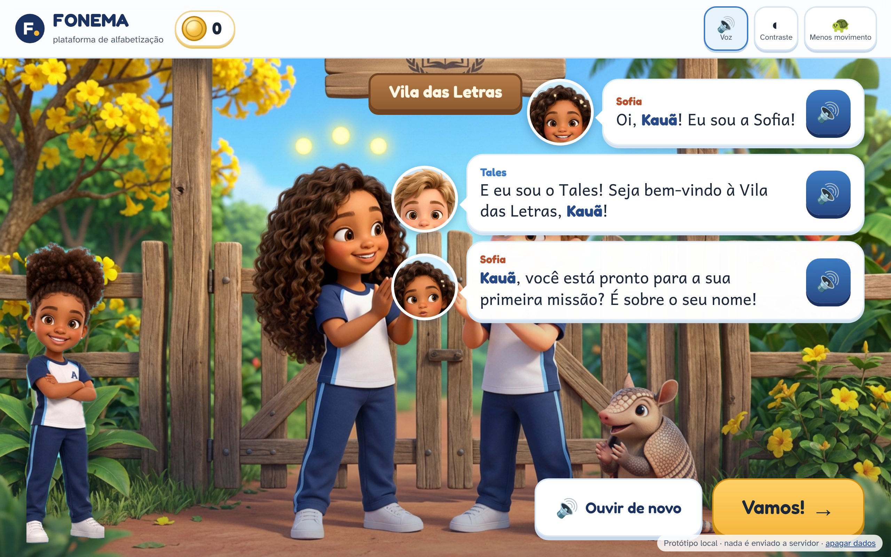

# Protótipo jogável: a primeira missão "Meu Nome"

**Data:** 13/11/2026 · **FONEMA, plataforma de alfabetização** (Decisão 014). Este protótipo segue as Decisões 007, 008, 009, 011, 012, **013** (cadastro e nome falado), 015 (Assiste e Faz) e 018 (selos e "Mostra pro professor"). A ordem das telas segue a anatomia da sessão (`jornada/README.md`, §4).

## Como abrir

1. Abra `index.html` direto no navegador (Chrome, Edge ou Safari recentes). Não precisa de servidor nem de instalação.
2. Abra pelo repositório: as imagens, as fontes e o áudio da dupla vêm de pastas vizinhas (`../avatar-3d/pecas/`, `../serie-sofia-e-tales/imagens/`, `../personagens-3d/`, `../lojinha-emblemas/fontes/`, `../voz/dupla/`).
3. Para ouvir as vozes, deixe o som ligado. O microfone é pedido só quando você toca em "Gravar" ou no 🎤.
4. **Teste automático:** a partir desta pasta, rode `node testes/fluxo.js` (Playwright + Chromium). Ele percorre dois fluxos inteiros e regera as capturas em `capturas/` (1280×800, `deviceScaleFactor 2`).
   - **Fluxo A:** Kauã, masculino, com microfone simulado.
   - **Fluxo B:** Helena, prefiro não informar, sem microfone.

## Fluxo

| # | Tela | O que acontece | Captura |
|---|---|---|---|
| 1 | **Cadastro (adulto)** | O adulto escreve o primeiro nome (o sistema descarta o sobrenome) e escolhe o gênero entre só 3 opções: masculino, feminino ou prefiro não informar. Uma prévia mostra como a Sofia vai falar ("pronto", "pronta" ou a forma neutra). Há 3 autorizações em linguagem simples: ser responsável, usar o primeiro nome na voz e, opcional, gravar a voz do adulto. O quadro "Não pedimos" lista foto, CPF, endereço e sobrenome | `01`, `b-01` |
| 2 | **Nome falado** | O adulto grava o nome (MediaRecorder, 3 s) e ouve de volta. Depois ouve **3 pronúncias** na voz da Sofia e na do Tales, que variam a sílaba tônica, a abertura das vogais e o ritmo (ex.: Kau-Ã, **Ka-u-Ã**, KAU-ã), e escolhe uma. Se nenhuma servir, ajusta a grafia fonética ("Ka-u-Ã", com a sílaba forte em MAIÚSCULAS) e gera de novo | `02` |
| 3 | **Entrega** | "Agora passe o aparelho para Kauã." Daqui em diante, todo texto tem áudio | `03` |
| 4 | **Avatar rápido** | São 2 escolhas: o jeito (9 crianças 3D das `pecas/`, com óculos, aparelho auditivo e cadeira de rodas) e a cor do cantinho (Mata, Ipê, Céu ou Barro). Não há foto, joia nem adorno | `04` |
| 5 | **Chegada à vila** | Arte 3D do portão com Sofia, Tales e o Bolota. Os balões têm voz: "Oi, Kauã!", "Seja bem-vindo / Seja bem-vinda / Que bom ter você", "pronto / pronta / vamos para a primeira missão?" | `05`, `b-05` |
| 6 | **Assiste** (Decisão 015) | Mini-vídeo de cerca de 1 min com a dupla em diálogo, legenda e letreiro com a letra. Os dois apresentam o primeiro som do nome, a palavra-âncora e a dica da boca. Fecha com "Agora é a sua vez, Kauã!". Um botão toca a amostra real das vozes oficiais (`voz/dupla/`, som A) | `06` |
| 7 | **Agora é a sua vez** | O nome aparece em letras grandes, com o primeiro som em destaque (o H mudo aparece apagado). O **Espelho do som** mostra o desenho da boca e a dica de articulação | `07`, `b-07` |
| 8 | **Figura** | Três figuras: qual começa com o mesmo som do nome? No 1º erro, a criança ouve "Quase, Kauã!" e recebe uma dica de articulação. No 2º erro, a figura certa brilha como modelo e a dupla faz junto. Não há X vermelho, buzina, perda de moedas nem cronômetro | `08`, `09`, `b-08` |
| 9 | **Letras** | A criança arrasta as letras do nome (ou toca nelas) na ordem, com o modelo visível em cima. Depois de 2 erros seguidos, a letra certa brilha | `10` |
| 10 | **Falar** | O microfone mostra um medidor de volume. O reconhecimento de fala é opcional e **só no aparelho**. Se o microfone não estiver disponível, a criança toca em "Eu falei!" | `11`, `b-11` |
| 11 | **Celebração** | A criança ganha o **Selo "Meu Nome", nível bronze**, no Álbum de Selos, e **+10 moedinhas**, sempre o mesmo valor e sem sorte. Abaixo do álbum, o **próximo objetivo** (Decisão 019): "Nível 1 · Primeiros Sons I · faltam 2 desafios para o nível 2" e "Rumo a Caça às Sílabas: faltam 26 desafios e a Festa das Rimas" ([jogo completo, 07](../jogo-completo/07-progressao-niveis-e-titulos.md)) | `12` |
| 12 | **Mostra pro professor** (Decisão 018) | A criança grava "meu nome começa com…" ou toca em "Mostrei ao vivo" | `13` |
| 13 | **Visão do professor** | O professor corrige em 1 toque: **✓ Aprendeu!**, **↺ Vamos treinar mais** ou **🎤 Me explicou certinho**. A criança ouve um parabéns com o nome e ganha um selo especial e +5 moedinhas. "Treinar mais" é acolhedor e não tira nada | `14`, `b-14` |
| 14 | **Despedida** | Na praça do ipê, o Tales deixa um gancho para amanhã ("o Bolota quer descobrir o som do nome dele"). A Sofia fala do sono que ajuda a lembrar. Não há botão "continuar jogando" | `15` |
| 15 | **O que a plataforma registra** | **Família:** mensagem de WhatsApp com o nome, concordância, atividade de 2 min para casa, áudio e resumo da semana. **Termômetro 0–10:** nível 0, a caminho do nível 1. **Professor:** status por habilidade (dominado, a revisar ou com ajuda) e a validação | `16`, `17`, `b-16` |

Os ajustes ficam no topo e valem em qualquer tela: **voz** ligada ou desligada, **alto contraste** (`b-17`) e **menos movimento**. Este último também respeita o `prefers-reduced-motion` do sistema. A versão de celular aparece em `b-08-celular-figuras.png`. Todos os botões têm 64 px ou mais.

## Concordância e nome (Decisão 013)

- Toda fala que se refere à criança usa `G(masculino, feminino, neutra)` em `app.js`.
  - Exemplos: "Seja bem-vindo" / "Seja bem-vinda" / "Que bom ter você"; "Hoje o Kauã… nome dele" / "Hoje a Ana… nome dela" / "Hoje Helena… o próprio nome".
- A criança é chamada **sempre pelo nome**, sem apelido: na chegada, no vídeo, nos acertos, nos erros acolhidos, no parabéns do professor, na despedida e na mensagem para a família.
- O texto na tela usa o nome escrito. A voz usa a **grafia fonética escolhida** pelo adulto (ex.: "Kauã").
- O teste automático confere que as falas neutras não contêm "pronto/pronta/bem-vindo/bem-vinda".

## Regras do primeiro som (`regras-som.js`)

Esta é uma tabela simples, das regras mais específicas para as mais gerais:

| Começo do nome | Som | Exemplo |
|---|---|---|
| H + vogal | o da vogal | Helena, Heitor, Humberto |
| Ch | /ʃ/ | Chico |
| Lh, Nh | /ʎ/, /ɲ/ | (raros) |
| Th | /t/ | Thiago, Theo |
| Ph | /f/ | Phelipe |
| Qu; Gu + e/i | /k/; /g/ | Quésia; Guilherme |
| C + e/i | /s/ | Cecília |
| C + outra letra | /k/ | Carlos, Clara |
| G + e/i | /ʒ/ | Gisele |
| G + outra letra | /g/ | Gabriel |
| X | /ʃ/ | Xavier |
| K | /k/ | Kauã |
| W | /u/ | Wesley |
| Y | /i/ | Yasmin |
| R | /ʁ/ (R forte) | Rafael |
| vogal + m/n + consoante | vogal nasal | Enzo, Antônio |
| demais letras | o som da própria letra | Sofia, Miguel, Davi |

- Cada som tem uma dica de articulação, um desenho da boca e palavras-figura.
- Os distratores evitam pares fáceis de confundir (s/z, p/b, f/v, t/d, k/g…) e palavras que começam com a mesma letra do nome, para a criança começar acertando no primeiro contato.
- Quando o som é ambíguo, a criança ouve uma nota curta. Ex.: "Antes de E ou I, o C tem som de S, como em sapo."

## O que é simulado e como será no produto final

| Aspecto | Neste protótipo | No produto |
|---|---|---|
| Vozes | `speechSynthesis` do navegador (pt-BR), com pitch e ritmo diferentes para Sofia e Tales | Vozes oficiais do ElevenLabs **"Sofia — FONEMA"** e **"Tales — FONEMA"** (Decisões 011 e 015). As falas são pré-gravadas com uma pausa no lugar do nome. O nome é gerado **uma vez** nas duas vozes e encaixado na hora |
| 3 pronúncias | A voz do navegador lê variações de grafia (sílaba tônica com acento, hiato ou ditongo, ritmo) | 3 versões geradas no ElevenLabs nas duas vozes. Vai **só o primeiro nome**, com consentimento específico (LGPD art. 14) e contrato de tratamento de dados (⚖️ verificar com advogado) |
| Gravação do adulto | Fica só na memória da aba e some ao fechar | Fica criptografada, serve só para comparar, nunca treina modelos e é apagada em 30 dias ou quando o adulto pedir |
| Sons isolados (/s/, /m/) | A voz fala só palavras inteiras ("Kauã… casa") | Gravados por **fonoaudióloga** (`voz/README.md`) |
| Mini-vídeo "Assiste" | Arte 3D com movimento lento, legenda e voz do navegador | Vídeo curto animado da dupla com as vozes oficiais. A amostra real está em `voz/dupla/` |
| Reconhecimento de fala | Usado só se o navegador reconhecer **no próprio aparelho** (`processLocally`). Nunca usa reconhecimento em nuvem. Se não houver, valem o medidor de volume e o botão "Eu falei!" | Modelo de reconhecimento infantil calibrado. Quando o resultado é incerto, a criança ouve "não ouvi bem", sem penalidade |
| Figuras | Emoji | Ilustrações 3D da casa |
| Avatar | 2 escolhas entre as crianças 3D prontas | Criador completo de peças (Decisão 008) |
| Professor | Simulado no mesmo aparelho | Fila no celular do professor (10 respostas em cerca de 2 min). Sem resposta em 72 h, a plataforma confirma pelo critério de domínio |
| Família | Mensagem de exemplo na tela | WhatsApp oficial da escola, com áudio da dupla |
| Termômetro | Mostra o nível 0, a caminho do 1 | O nível só sobe com domínio comprovado (provinha + retenção). Nunca desce na tela da criança (Decisão 004) |
| Dados | `localStorage`, sem sobrenome e sem áudio. "Apagar dados" limpa tudo. **Nada é enviado a servidor** | Infraestrutura segura (LGPD, ECA Digital) |

## Arquivos

| Arquivo | Conteúdo |
|---|---|
| `index.html` | Estrutura da página e topo com a trilha, as moedinhas e os ajustes |
| `estilo.css` | Paleta da marca (Decisão 009), botões grandes, alto contraste, menos movimento e layout responsivo |
| `regras-som.js` | Tabela do primeiro som, banco de sons e figuras, divisão em sílabas e as 3 pronúncias |
| `app.js` | Telas, voz, concordância, gravação, arrastar letras, microfone, selos e painéis |
| `testes/fluxo.js` | Teste de ponta a ponta com Playwright (2 fluxos, 28 verificações) e capturas |
| `capturas/` | 26 PNGs (2560×1600, e o de celular em 780×1688) |
