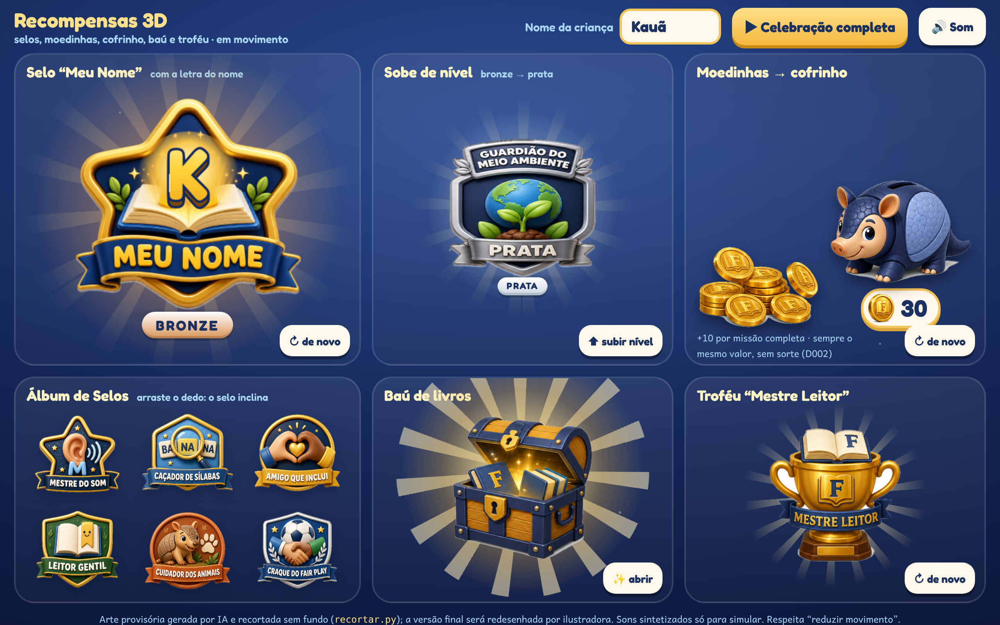

# Recompensas 3D: selos, moedinhas, cofrinho, troféu e baú

O dono achou o selo plano do protótipo "feio". Esta rodada define o **padrão visual premium em 3D** das recompensas: brilho, bordas grossas e arredondadas, e a paleta da marca, sem arco-íris (D009).

| Arquivo | Conteúdo |
|---|---|
| `imagens/selo-meu-nome.png` | Selo "Meu Nome": estrela dourada, livro aberto e letra saltando |
| `imagens/selo-guardiao-niveis.png` | "Guarda do Meio Ambiente" nos 4 níveis: bronze, prata, ouro e diamante (D018) |
| `imagens/selos-colecao-6.png` | Maestria do Som, Caça às Sílabas, Amizade que Inclui, Leitura Gentil, Cuidado com os Animais, Fair Play |
| `imagens/moedas-cofrinho-trofeu-bau.png` | Moedinha "F", pilha de moedas, cofrinho-tatu, troféu "Maestria da Leitura", baú de livros (sem joias) |

**No produto:**
- **Movimento:** os selos entram girando em 3D, com brilho passando, partículas e um som de conquista.
- **Moedinhas:** voam até o cofrinho-tatu.
- **Arte final:** cada selo vira arte final, recortada sem fundo, com uma versão por nível.
- **Selo "Meu Nome":** usa a **letra inicial do nome da criança** no lugar do "A".
- **Origem:** geradas no ElevenLabs (gpt-image-2). As versões finais precisam ser redesenhadas e cedidas por ilustradora (universo/06).

> **Atualizado pela D022:** os nomes são neutros, pela ação. As imagens desta rodada ainda trazem os rótulos antigos escritos ("Guardião", "Mestre", "Amigo", "Leitor", "Caçador", "Craque") e serão **regeradas com os nomes novos** na próxima rodada de artes.

## Demo animada (`demo.html`)

**Como abrir:** abra `demo.html` direto no navegador (funciona em `file://`, sem servidor). A celebração toca sozinha; cada cartão tem botão para repetir. Troque o nome da criança no topo: o selo muda de letra na hora.

| O quê | Como funciona |
|---|---|
| **Recortes** | `python3 recortar.py` tira o fundo branco das pranchas (flood fill a partir da borda com tolerância, borda suave de 3 px, cor des-misturada do branco) e separa cada item por componentes conexos → `recortes/*.png` (17 PNGs com transparência) |
| **Selo "Meu Nome"** | Entra **girando em 3D** (`rotateY` com 7 camadas atrás simulando a espessura), vem de longe e quica; **brilho** passa por cima só no desenho do selo (máscara com a própria arte); aura e raios na cor do nível; confete. A **letra inicial do nome** (Fredoka grossa, dourada, contorno marinho, com volume) fica sobre um clarão dourado que cobre o "A" original |
| **Nível** | Bronze → prata → ouro → diamante: o selo vira, pulsa com flash na cor do nível e troca a arte (Guardião do Meio Ambiente) |
| **Moedinhas** | Voam em arco, girando, da pilha até o **cofrinho-tatu**, que "engole" cada uma; o contador sobe (+10 fixo por missão, sem sorte — D002) |
| **Baú** | Treme, abre com luz (clarão e raios girando) e confete |
| **Troféu "Mestre Leitor"** | Sobe girando, com raios atrás |
| **Álbum** | Os 6 selos flutuam e inclinam em 3D sob o dedo/mouse |

- **Componente reutilizável:** `recompensas.js` + `recompensas.css` (`Recompensas.selo()`, `entrar()`, `subirNivel()`, `moedasVoam()`, `contar()`, `abrirBau()`, `trofeu()`, `confete()`). O protótipo jogável usa este mesmo componente.
- **Cores:** confete em ouro, creme, branco, azul-claro e marinho — sem arco-íris (D009).
- **Menos movimento:** respeita `prefers-reduced-motion` e a classe `body.calmo` (mostra o resultado final, sem giros nem confete).
- **Simulado:** sons de conquista sintetizados (WebAudio); no produto, efeitos gravados. Arte provisória de IA.
- **Capturas:** `node ferramentas/capturar.js` → `capturas/` (1280×800, `deviceScaleFactor 2`).
