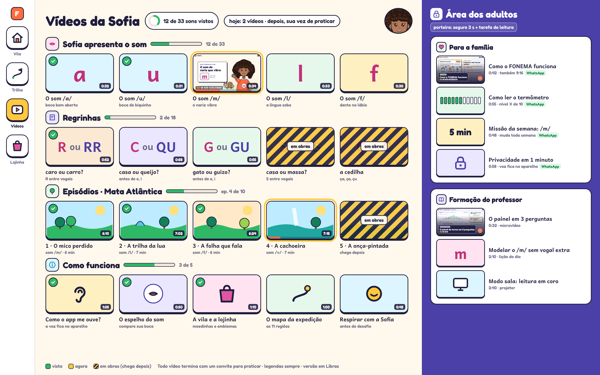

# Biblioteca de vídeos curtos — FONEMA (proposta unificada)

> **Origem:** Decisão 005, requisito 3 ("vídeos curtos para explicar sons, regras e o próprio app"), que evolui os episódios da Proposta 4 (Expedição Sofia).
> **Em uma frase:** uma videoteca de **6 tipos de vídeo curto**, todos com a Sofia, legenda sempre, versão em Libras e um **convite à prática no fim**. Os vídeos são feitos em uma esteira automatizada: Rive, TTS neural pré-gerado, fonemas gravados por fonoaudióloga e revisão pedagógica.



## Arquivos desta pasta

| Arquivo | O que é |
|---|---|
| `amostra-sofia-som-m.mp4` (34 s, 1280×720) | Tipo (a): Sofia apresenta o /m/. Boca fechada, nariz vibrando, corte lateral, M m traçados, MALA/MAPA/MOLA, "agora é sua vez" |
| `amostra-familia-como-funciona.mp4` (42 s, 1280×720) e `-9x16.mp4` (720×1280) | Tipo (e): o que é o FONEMA, termômetro "nível 6 de 10", missão da semana de 5 min, privacidade, WhatsApp |
| `amostra-professor-painel.mp4` (32 s, 1280×720) | Tipo (f): como ler o painel da turma em 3 perguntas |
| `*.vtt` | Legendas WebVTT de cada amostra (mesmo texto do roteiro) |
| `thumb-*.png` | Miniaturas (16:9 e uma 9:16) |
| `grade-videos.png` (2560×1600) | Tela "Vídeos da Sofia" no app (categorias, progresso, estados) + Área dos adultos |
| [`roteiros.md`](roteiros.md) | Roteiros com marcação de tempo: texto do TTS e pontos de fonema gravado |
| `fonte/` | Código das amostras: HTML/CSS/SVG + motor determinístico + Playwright + ffmpeg (ver §8) |

**Sobre as amostras:** todos os personagens e cenas são desenhados em SVG, sem imagens externas. Este ambiente não tem voz neural. Por isso cada amostra tem **legendas grandes sincronizadas** (o roteiro) e uma trilha simples gerada por código. A trilha é suave e baixa (pico −20 dBFS) e **fica muda nos momentos de fonema**. No vídeo do /m/, só há música na vinheta. Um selo de revisão no canto ("trilha muda · fonema /m/ gravado") marca onde entra o fonema gravado pela fonoaudióloga. Esse selo não vai para o produto.

---

## 1. Os 6 tipos de vídeo e as quantidades

| # | Tipo | Público | Duração | Quantidade (jornada completa) | No MVP | Formato |
|---|---|---|---|---|---|---|
| **a** | **Sofia apresenta o som** | criança (4–8) | **30–45 s** | **33 vídeos de fonema** (inventário da pesquisa 28 §3.1.5: 7 vogais orais, 5 nasais, 19 consoantes, 2 alofones regionais) **+ 8 de pares mínimos** (p/b, t/d, k/g, f/v, s/z, ʃ/ʒ, oral/nasal, ɾ/ʁ) = **41** | 16 (vogais + nasais iniciais, M L F V S N, P T) | 16:9 + quadrado 1:1 para o Espelho do Som |
| **b** | **Regrinhas** (ortografia contextual) | criança 6–8 | **45–60 s** | **≈ 20**: R/RR, R entre vogais, C/QU, G/GU, S/SS, S com som de Z, Ç, X (2 vídeos), CH × X, J × G, H inicial, NH, LH, M antes de P/B, -ÃO × -AM, -OU, -INHO, L × U no fim (mal/mau), E/I e O/U átonos finais | 2 (R/RR e C/QU, para as escolas-piloto) | 16:9 |
| **c** | **Episódios da jornada** (histórias por bioma) | criança | trailer 60–90 s · "Hora da História" 2–4 min com pausas | **11 trailers de região + ≈ 200 histórias** (Ato 1 de cada episódio, Proposta 4 §3) | 4 trailers + 36 histórias (T1–T3b) | 16:9; no app rodam ao vivo em Rive. O MP4 serve para o modo sala e para compartilhar |
| **d** | **Como funciona** (onboarding da criança) | criança | 45–75 s | **8**: como o app me ouve, o espelho do som, a vila e a lojinha, o mapa da expedição, respirar com a Sofia, o termômetro de estrelas, a porteira dos adultos, "e se eu errar?" | 5 | 16:9 |
| **e** | **Para a família** | responsáveis | **≤ 60 s** (pesquisa 26 §3.1.8) | **10 fixos** (como funciona, termômetro, missão, privacidade, "ouça seu filho ler", leitura dialógica, rotina de 10 min, tempo de tela, porteira, assinatura) **+ ≈ 40 missões semanais** geradas por modelo, uma por fonema/regra | 6 fixos + 16 missões | **16:9 e 9:16**; o 9:16 vai **pelo WhatsApp** (pesquisa 26 §3.2) |
| **f** | **Formação do professor** | professores, coordenação | **2–3 min** (pesquisa 26 §3.5) | **≈ 45**: 33 "como modelar o som X sem vogal extra" + 12 de uso (painel em 3 perguntas, modo sala, grupos e estações, eu faço/nós fazemos/você faz, ditado, leitura em coro, avaliação, LGPD na escola, WhatsApp da turma, coaching etc.) | 12 | 16:9; trechos de 30 s em 9:16 para o WhatsApp da rede |
| | **Total** | | | **≈ 375 vídeos** (≈ 175 "de catálogo" + ≈ 200 histórias de episódio) | **≈ 97** | |

Todas as versões têm **legenda**. Os tipos **a, d, e** e os vídeos de uso de **f** têm **versão com janela de Libras** (ver §2).

---

## 2. Regras de produção (baseadas na pesquisa)

| Regra | Como aplicar | Base |
|---|---|---|
| **Um conceito por vídeo, curto** | (a) 30–45 s · (b) 45–60 s · (d) ≤ 75 s · (e) ≤ 60 s · (f) 2–3 min. Nenhum vídeo infantil passa de 45 s sem um momento de ação ou pausa | Pesquisa 09 §3.2 ("até ~2–3 min para 4–5 anos"); design 04 ("≤ 45 s de animação sem ação") |
| **Som + boca + letra sincronizados** | A letra **aparece no mesmo quadro** do fonema; boca da Sofia com o visema correto (no /m/: lábios fechados em todo o som); desvio de áudio de −10 a +30 ms | Pesquisa 10 §3.1 (congruência); pesquisa 28 §2.2 |
| **Mostrar o invisível** | Corte lateral 2D (lábios, língua, véu palatino, ar, "garganta vibra") só nos traços que dependem dele; pares surdo/sonoro com pista da mão na garganta | Pesquisa 10 §3.1.3–4 |
| **O vídeo termina na letra e no convite** | Ordem fixa: ouvir → ver a boca → letra → palavras → **"agora é sua vez"**. A tela final abre a prática (espelho local, microfone ou toque). **Não existe autoplay** de outro vídeo | Pesquisa 10 §3.1.8; pesquisa 09 §3.2 (prática imediata); Proposta 4 (sem "próximo episódio") |
| **Pausa e interação** | No fim, 3 s de **silêncio total** com halo no microfone ("a Sofia espera você"). Nos episódios e nas regrinhas, 1–3 perguntas CROWD com pausa até a criança responder | Rel. 28 da Proposta 4 (contingência); pesquisa 09 |
| **Sem música durante instrução de som** | Música só na vinheta (≤ 3 s) e nas telas de adulto. Durante fonema, sílaba ou palavra-alvo, a trilha fica **muda** (rampas de 120 ms). Efeitos sonoros só como feedback curto | Pesquisa 09 §3.2 (coerência; música compete com a discriminação) |
| **Sem detalhes sedutores** | Fundo calmo; no máximo 1 elemento animado além do alvo; o personagem que não fala fica parado; nada de hotspot no vídeo. O Bolota só aparece na abertura e no convite | Pesquisa 09 §2.6 (Rey 2012; g ≈ −0,33) |
| **Sinalização** | O grafema-alvo aparece com **cor + negrito + sublinhado**, e anel ou pulso sincronizado com o som. Ícones de etapa no topo | Pesquisa 09 §3.1.3; design 04 ("cor nunca sozinha") |
| **Legendas sempre** | Legenda **ligada por padrão**, com o texto do roteiro (gerada automaticamente do mesmo arquivo do TTS), em Andika ≥ 30 px, uma linha, faixa escura embaixo, nunca sobre o alvo. No app, vai como trilha **WebVTT**. No WhatsApp, vai **gravada** no vídeo, porque lá não há CC. Para pré-leitores, a legenda é curta e não repete texto longo: a palavra-alvo na tela é conteúdo, não redundância | Design 04 §8; pesquisa 09 §2.5 (redundância) |
| **Versão com Libras** | Janela de intérprete (≥ 1/4 da altura, canto inferior direito, fundo liso) nos tipos a, d, e e no uso de f. Gravada por intérprete com **consultoria de pessoa surda**. Para o tipo (a), a versão em Libras mostra também a **datilologia** da letra | Pesquisa 26 (Conta pra Mim tem vídeos em Libras); design 04 §8 |
| **Voz** | TTS neural pré-gerado, caloroso e pausado ("Vamos ouvir juntos?"), com no máximo ~10 palavras por fala. **Fonemas isolados sempre gravados** por fonoaudióloga (CRFa), sem vogal de apoio ("/mmm/", nunca "mê") | Pesquisa 09 §3.1.9; pesquisa 28 §2.7 |
| **Áudio seguro** | Fala a −16 LUFS e −1 dBTP; trilha 12–15 dB abaixo; limitador para ouvidos infantis | Pesquisa 28 §1.5; design 04 §6 |
| **Família: áudio primeiro, dados leves** | Frases curtas, sem gráfico como formato principal, "você não precisa ser professor". Arquivo ≤ 3 MB por minuto e versão 480p | Pesquisa 26 §2.4 e §3.1 (Inaf 2024; plano de dados limitado) |
| **Professor: prática, não palestra** | Cada microvídeo fica ligado à lição do dia e termina com uma ação ("abrir roteiro") | Pesquisa 26 §3.5 |
| **Representatividade e acessibilidade** | Revisão por pessoas negras e pardas, educadores de várias regiões e pessoas com deficiência. `prefers-reduced-motion` troca animações por cortes. Nenhum flash acima de 3/s | Design 04 §5–6 |

---

## 3. Pipeline de produção

```
roteiro (YAML no repositório, junto do conteúdo)
  └─► linter: decodificabilidade, duração por tipo, ≤ 10 palavras/fala, grafema-alvo marcado, fim com convite
       └─► TTS neural pré-gerado (Azure pt-BR) ──► MP3 + JSON de visemas
       └─► fonemas da fonoaudióloga (banco de clipes gravados, 48 kHz) ──► inseridos nos pontos [FONEMA]
            └─► animação: Sofia/Bolota em Rive (state machine: visema, olhar, apontar)
                + cenas-modelo (Espelho do Som, corte lateral, pauta da letra, cartões de palavra, painel)
                 └─► render headless determinístico (quadro a quadro) ──► composição
                      └─► legendas WebVTT geradas do roteiro (+ versão gravada para o WhatsApp)
                      └─► mix: fala −16 LUFS, trilha muda nos fonemas, limitador
                           └─► revisão: pedagógica · fonoaudióloga (2 revisoras no tipo a) · acessibilidade · representatividade
                                └─► Libras: intérprete + consultor surdo ──► versão com janela
                                     └─► encode H.264 720p (~0,5–0,8 Mbps) + 480p leve, AAC 96 kbps, poster PNG
                                          └─► Cloudflare R2/CDN + pacote offline do app; WhatsApp Business (9:16)
```

- **Uma cena-modelo, muitos vídeos.** Cada tipo tem um modelo parametrizado. Por exemplo, o tipo (a) recebe o fonema, os traços articulatórios, os grafemas, 3 palavras e as ilustrações. Assim, trocar o /m/ pelo /f/ é trocar dados e o clipe gravado, e quase não exige animação nova.
- **As missões semanais da família (e)** são geradas automaticamente: modelo + fonema da semana + 3 objetos de casa. O texto é revisado pela equipe pedagógica em lote.
- **Determinismo:** o mesmo roteiro gera sempre o mesmo vídeo. Isso permite versionar, comparar quadros no CI e regerar tudo se a voz ou a marca mudarem. As amostras desta pasta já usam esse método (§8).

---

## 4. Formatos e especificação técnica

| Item | Especificação |
|---|---|
| Formatos | **16:9 1280×720** (app em paisagem, tablet, projetor/modo sala) · **9:16 720×1280** (WhatsApp, Status, celular em pé) · **1:1 720×720** (clipe da boca dentro do Espelho do Som, pesquisa 28 §3.1.2) |
| Vídeo | H.264 High, 30 fps, yuv420p, `+faststart`; versão leve 480p (~300–500 kbps) para dados móveis |
| Áudio | AAC 96–128 kbps embutido (mux; nunca tocado em paralelo), −16 LUFS |
| Legendas | WebVTT no app; gravadas na versão do WhatsApp |
| Peso-alvo | ≤ 3 MB por 30–45 s; ≤ 8 MB para qualquer vídeo do catálogo infantil (as amostras têm 1,6–2,5 MB) |
| Offline | Os vídeos da etapa atual e da próxima vão para o pacote baixado no Wi-Fi |

---

## 5. Onde os vídeos aparecem no app

| Lugar | Tipos | Como |
|---|---|---|
| **Trilha / lição** | a, b | Ao abrir um som novo, o vídeo (a) é o passo "ouvir → ver". Em todo erro repetido, o botão "ver a boca de novo" toca só o trecho do fonema |
| **Espelho do Som** | a (1:1) | Clipe da boca ao lado do espelho local (sem gravação) |
| **Episódios** | c | Ato 1 (história) e Ato 2 (som do episódio) usam as mesmas cenas, interativas em Rive |
| **Aba "Vídeos da Sofia"** (`grade-videos.png`) | a, b, c, d | Videoteca por categoria, com progresso ("12 de 33 sons"), estados visto/agora/"em obras", sem autoplay, sem ranking. O que ainda não está disponível aparece "em obras", sem cadeado. Todo vídeo termina abrindo a prática. O tempo de vídeo conta no teto diário |
| **Primeiro uso** | d | 3 vídeos curtos no onboarding (como o app me ouve, o espelho, a vila) |
| **Área da família** (atrás da porteira) | e | Cartão "missão da semana" com vídeo + áudio; "como ler o termômetro" ao lado do "Nível X de 10" |
| **WhatsApp** (consentimento, LGPD) | e (9:16), f (trechos) | Missão semanal em áudio + vídeo de ≤ 60 s, com link profundo para o app. Máximo de 3 mensagens por semana |
| **Painel do professor** | f | Microvídeo ligado à lição do dia ("como modelar o /r/"); ajuda contextual em cada gráfico; vídeos de uso no primeiro acesso |
| **Modo sala** | a, b, c | Projeção em 16:9 com legenda grande; a pausa final vira "leitura em coro" |

---

## 6. Custos estimados (ordem de grandeza, sem fonte de mercado; R$ de nov./2026)

Os valores são **incrementais** ao pacote de arte e áudio da pesquisa 28 §3.5 (rigs da Sofia, gravação dos fonemas e corte lateral-modelo já estão lá).

| Bloco | Unidade | Custo unitário | Quantidade | Total |
|---|---|---|---|---|
| Modelos de cena (Espelho, corte, pauta, cartões, painel, família) | modelo | R$ 8–15 mil | 8 | R$ 64–120 mil |
| (a) Sofia apresenta o som | vídeo | R$ 1,5–3 mil (dados + revisão de 2 fonos + ilustrações de 3 palavras) | 41 | R$ 62–123 mil |
| (b) Regrinhas | vídeo | R$ 2–3,5 mil | 20 | R$ 40–70 mil |
| (c) Trailers de região | vídeo | R$ 4–7 mil | 11 | R$ 44–77 mil |
| (c) Histórias dos episódios | — | já no custo por episódio da Proposta 4 (R$ 6–9 mil/ep.) | — | — |
| (d) Como funciona | vídeo | R$ 2–3,5 mil | 8 | R$ 16–28 mil |
| (e) Família: fixos | vídeo | R$ 2–3 mil (16:9 + 9:16) | 10 | R$ 20–30 mil |
| (e) Missões semanais (geradas) | vídeo | R$ 300–600 (revisão) | 40 | R$ 12–24 mil |
| (f) Formação do professor | vídeo | R$ 3–5 mil (formadora + roteiro pedagógico) | 45 | R$ 135–225 mil |
| **Libras** (intérprete + consultor surdo + edição) | minuto | R$ 400–800 | ≈ 140 min | R$ 56–112 mil |
| TTS neural (geração e regeração) | mês | US$ 50–150 | 24 | R$ 7–20 mil |
| **Total da biblioteca (24 meses)** | | | ≈ 175 vídeos de catálogo | **≈ R$ 460–830 mil** |
| **Fatia do MVP (M0–M6)** | | | ≈ 60 vídeos de catálogo + modelos | **≈ R$ 170–300 mil** |

Custo de distribuição: R2 sem tarifa de saída. Com 10 mil alunos e ~25 MB/mês de vídeo por aluno, o custo fica em centavos por aluno. O WhatsApp Business cobra por conversa iniciada (custo do canal, ver frente WhatsApp).

---

## 7. Cronograma

| Mês | Entrega | Validação |
|---|---|---|
| **M0** | Bíblia de vídeo, 3 pilotos (estas amostras) com voz real, cenas-modelo v1, linter de roteiro | 5–8 crianças e 10 famílias assistem. Medir compreensão e se a criança **faz o som** no convite |
| **M1–M2** | Gravação dos fonemas com fonoaudióloga; (a) vogais + M L F; (d) 3 de onboarding; (e) como funciona + termômetro + privacidade (16:9 e 9:16) | **A/B**: vídeo (som + boca + letra) × só letra + som, junto do teste do Espelho do Som |
| **M3–M4** | (a) V S N P T + nasais iniciais; (e) missões semanais geradas; (f) 6 de uso do painel; primeiras versões em Libras | Alfa com 30 famílias: taxa de abertura da missão no WhatsApp (áudio × vídeo × texto) |
| **M5–M6** | (b) R/RR e C/QU; (f) 6 de modelagem; trailers T1–T3; legendas e Libras completas no MVP | Beta com 3–5 turmas: uso do microvídeo no painel |
| **M7–M12** | Restante do tipo (a) (41 no total), (b) até 10, (f) até 25 | Telemetria: abandono por segundo, "ver a boca de novo" e erro após o vídeo |
| **M13–M24** | (b) completo (20), (f) completo (45), trailers T4–T11, missões até 40 | Sempre **2 regiões à frente** da criança mais rápida |

---

## 8. Como as amostras foram feitas (reprodutível)

As amostras usam o mesmo princípio do pipeline final: o estado da cena é uma **função pura do tempo**, `renderAt(t)`.

1. As cenas ficam em HTML/CSS/SVG (`fonte/som-m.html`, `familia.html`, `professor.html`). Os personagens são desenhados em `fonte/chars.js`: a Sofia tem cabelo cacheado volumoso, 4 bocas (visemas), braço articulado e mãos; o Bolota tem carapaça de 3 faixas. O corte lateral, as ilustrações e os ícones ficam em `fonte/parts.js`. As fontes são Andika e Fredoka (OFL).
2. `node render.js página.html saída.mp4 1280 720 34 trilha.wav [v=1]` abre o Chromium (Playwright), chama `renderAt(i/30)` para cada quadro, captura a tela e envia ao ffmpeg (libx264, CRF 24, `-tune animation`, AAC).
3. `python3 trilha.py trilha.wav 34 "3.4-34"` gera a trilha suave (pad + arpejo) e a deixa **muda** nas janelas indicadas.
4. `thumbs.js` gera as miniaturas, `vtt.js` extrai as legendas, e `grade.html` é a tela do catálogo (2560×1600).

Limites das amostras: não há voz (as legendas fazem o papel dela); o corte lateral e os visemas são **esboços para validação pela fonoaudióloga**; a janela de Libras aparece só como selo "LIBRAS", porque a versão com intérprete é gravada à parte.
